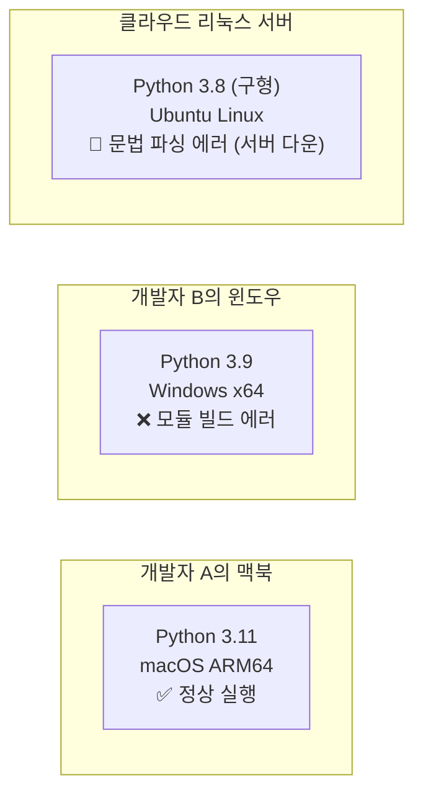
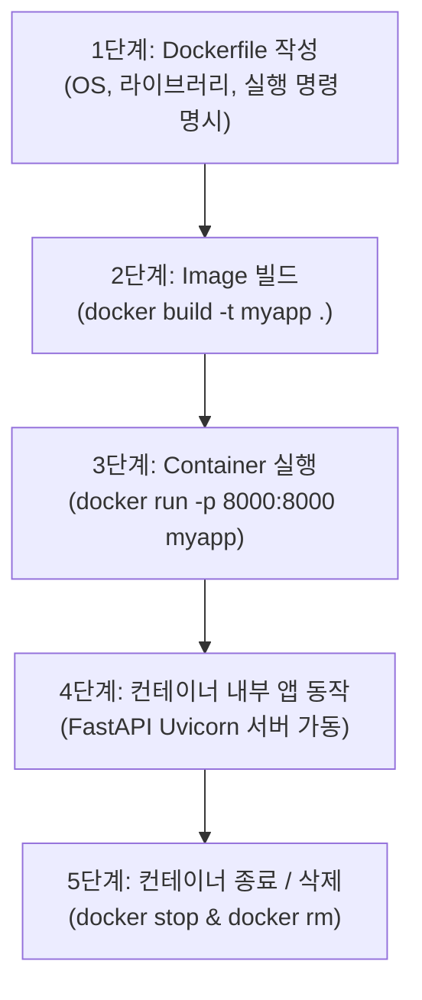
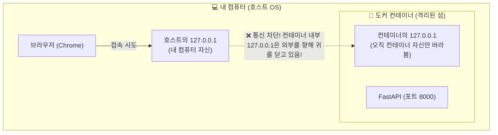
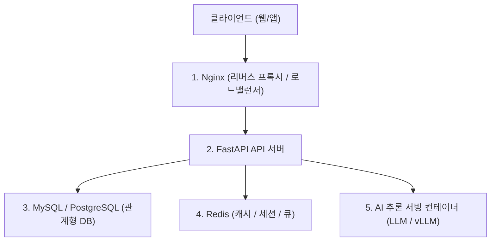

# 🐳 Docker & Docker Compose를 활용한 FastAPI 웹 서비스 배포 완벽 정리 노트

> 개발자들의 만년 난제 **"제 컴퓨터에서는 되는데요?"(환경 불일치 문제)**의 본질부터 **Docker의 핵심 2대 개념(Image vs Container)**, **Dockerfile 5대 필수 명령어**, **도커 내부 루프백(127.0.0.1)의 함정과 `0.0.0.0` 바인딩**, **포트 포워딩(Port Mapping, `-p 8000:8000`)**, 그리고 **FastAPI + MySQL 멀티 컨테이너 아키텍처를 원클릭으로 조율하는 Docker Compose 오케스트레이션**까지 총정리한 실무 데브옵스/배포 가이드

---

## 📑 목차
1. [Docker란 무엇인가? (컨테이너 가상화의 혁명)](#1-docker란-무엇인가-컨테이너-가상화의-혁명)
   - [1-1. 개발자들의 만년 난제: "제 컴퓨터에서는 잘 되는데요?"](#1-1-개발자들의-만년-난제-제-컴퓨터에서는-잘-되는데요)
   - [1-2. Docker의 핵심 철학: "실행 환경 자체를 코드로 박제한다"](#1-2-docker의-핵심-철학-실행-환경-자체를-코드로-박제한다)
   - [1-3. 개발 환경 준비: Docker Desktop 설치 및 구성](#1-3-개발-환경-준비-docker-desktop-설치-및-구성)
2. [Docker 핵심 2대 개념: Image vs Container](#2-docker-핵심-2대-개념-image-vs-container)
   - [2-1. Image (이미지): 불변(Immutable)의 실행 환경 설계도](#2-1-image-이미지-불변immutable의-실행-환경-설계도)
   - [2-2. Container (컨테이너): 이미지를 격리된 프로세스로 구동한 실체](#2-2-container-컨테이너-이미지를-격리된-프로세스로-구동한-실체)
   - [2-3. 이미지를 확보하는 2가지 경로 (Docker Hub vs Dockerfile 빌드)](#2-3-이미지를-확보하는-2가지-경로-docker-hub-vs-dockerfile-빌드)
   - [2-4. 공식 이미지 대화형 실행 실습 (`docker run -it python:3.10-slim bash`)](#2-4-공식-이미지-대화형-실행-실습-docker-run--it-python310-slim-bash)
3. [Dockerfile: 나만의 커스텀 이미지 빌드 명세서](#3-dockerfile-나만의-커스텀-이미지-빌드-명세서)
   - [3-1. Docker 배포의 5단계 표준 흐름](#3-1-docker-배포의-5단계-표준-흐름)
   - [3-2. Dockerfile 5대 핵심 지시어 (FROM, WORKDIR, COPY, RUN, CMD)](#3-2-dockerfile-5대-핵심-지시어-from-workdir-copy-run-cmd)
   - [3-3. FastAPI 프로덕션 배포용 Dockerfile 표준 템플릿](#3-3-fastapi-프로덕션-배포용-dockerfile-표준-템플릿)
4. [도커 네트워크의 결정적 비밀: 127.0.0.1의 함정과 0.0.0.0](#4-도커-네트워크의-결정적-비밀-127001의-함정과-0000)
   - [4-1. 🚨 왜 도커 안에서 `fastapi dev`나 `127.0.0.1`을 쓰면 접속이 먹통일까?](#4-1--왜-도커-안에서-fastapi-dev나-127001을-쓰면-접속이-먹통일까)
   - [4-2. 내 컴퓨터의 localhost vs 컨테이너의 localhost (독립된 '섬'의 개념)](#4-2-내-컴퓨터의-localhost-vs-컨테이너의-localhost-독립된-섬의-개념)
   - [4-3. 마법의 열쇠: `0.0.0.0` (외부 접속 전면 개방)](#4-3-마법의-열쇠-0000-외부-접속-전면-개방)
   - [4-4. 포트 포워딩 (Port Mapping, `-p 호스트:컨테이너`)](#4-4-포트-포워딩-port-mapping--p-호스트컨테이너)
5. [Docker 필수 운영 명령어 모음](#5-docker-필수-운영-명령어-모음)
   - [5-1. 이미지 빌드 (`docker build -t`)](#5-1-이미지-빌드-docker-build--t)
   - [5-2. 컨테이너 백그라운드 기동 (`docker run -d --rm`)](#5-2-컨테이너-백그라운드-기동-docker-run--d---rm)
   - [5-3. 컨테이너 모니터링 및 라이프사이클 관리 (`ps`, `images`, `stop`, `rm`)](#5-3-컨테이너-모니터링-및-라이프사이클-관리-ps-images-stop-rm)
6. [현실적인 웹 서비스의 한계와 Docker Compose의 등장](#6-현실적인-웹-서비스의-한계와-docker-compose의-등장)
   - [6-1. 상용 웹 서비스의 5대 구성 요소 (FastAPI + RDB + Redis + Nginx + AI 서빙)](#6-1-상용-웹-서비스의-5대-구성-요소-fastapi--rdb--redis--nginx--ai-서빙)
   - [6-2. 수동 다중 컨테이너 운영 시 발생하는 3대 재앙](#6-2-수동-다중-컨테이너-운영-시-발생하는-3대-재앙)
   - [6-3. Docker Compose란? (멀티 컨테이너 오케스트레이션 도구)](#6-3-docker-compose란-멀티-컨테이너-오케스트레이션-도구)
7. [실전 프로젝트: FastAPI + MySQL 멀티 컨테이너 시스템 구축](#7-실전-프로젝트-fastapi--mysql-멀티-컨테이너-시스템-구축)
   - [7-1. `docker-compose.yml` 완벽 작성법 (`services`, `depends_on`, `environment`)](#7-1-docker-composeyml-완벽-작성법-services-depends_on-environment)
   - [7-2. 컨테이너 간 내부 도메인 이름 해석 (Host가 `db`가 되는 마법)](#7-2-컨테이너-간-내부-도메인-이름-해석-host가-db가-되는-마법)
   - [7-3. `docker exec`로 MySQL 컨테이너 내부 진입 및 초기 DDL/DML 세팅](#7-3-docker-exec로-mysql-컨테이너-내부-진입-및-초기-ddldml-세팅)
   - [7-4. FastAPI 비동기/동기 SQLAlchemy 연결 설정 (`connection.py`)](#7-4-fastapi-비동기동기-sqlalchemy-연결-설정-connectionpy)
   - [7-5. 유저 조회 API 엔드포인트 구현 (`GET /users`)](#7-5-유저-조회-api-엔드포인트-구현-get-users)
   - [7-6. Docker Compose 실행, 로그 확인 및 완전 종료 (`up -d`, `logs -f`, `down`)](#7-6-docker-compose-실행-로그-확인-및-완전-종료-up--d-logs--f-down)
8. [💡 실전 핵심 요약 치트시트](#8--실전-핵심-요약-치트시트)

---

## 1. Docker란 무엇인가? (컨테이너 가상화의 혁명)

### 1-1. 개발자들의 만년 난제: "제 컴퓨터에서는 잘 되는데요?"

소프트웨어 개발과 배포 현장에서 가장 흔하게 터지는 재앙은 **"실행 환경의 불일치"**입니다:



- 같은 파이썬 코드라도 OS 종류(Windows, macOS, Linux), 파이썬 마이너 버전(3.8 vs 3.10 vs 3.13), 설치된 C 라이브러리 차이 때문에 로컬에서는 잘 돌던 서버가 운영 서버에만 올라가면 뻗어버리는 문제가 빈번했습니다.

---

### 1-2. Docker의 핵심 철학: "실행 환경 자체를 코드로 박제한다"

- **Docker(도커)**:  
  애플리케이션(코드)뿐만 아니라 이를 실행하는 데 필요한 **운영체제 커널 환경, 언어 런타임(Python), 라이브러리, 환경변수, 네트워크 설정까지 통째로 캡슐화(격리)하여 패키징하는 도구**입니다.
- **황금 원칙**:  
  **"실행 환경을 코드로 만든다(Infrastructure as Code)!"**  
  도커가 설치된 컴퓨터라면 내 노트북이든, 동료의 PC든, AWS/GCP 클라우드 서버든 **100% 토씨 하나 안 틀리고 똑같은 환경에서 실행**됩니다.

---

### 1-3. 개발 환경 준비: Docker Desktop 설치 및 구성
- **Docker Desktop**: 로컬 PC(Windows, macOS)에서 Docker 데몬 엔진과 컨테이너를 쉽게 조작할 수 있도록 지원하는 공식 GUI 통합 관리 도구입니다.
- **설치 주소**: `https://www.docker.com/products/docker-desktop/`
- 회원가입 과정은 생략(`Skip`) 가능하며, 설치 완료 시 터미널에서 `docker` 및 `docker compose` 명령어가 자동으로 활성화됩니다.
- 설치 확인 명령어:
  ```bash
  docker --version
  docker compose version
  ```

---

## 2. Docker 핵심 2대 개념: Image vs Container

도커를 이해하는 핵심 열쇠는 **붕어빵 틀(Image)**과 **구워진 붕어빵(Container)**의 관계입니다.

```mermaid
graph LR
    subgraph Blueprint["1. Docker Image (설계도 / 정적 파일)"]
        IMG["Python 코드<br/>+ 종속 라이브러리<br/>+ 경량 OS 파일시스템<br/>(읽기 전용 / 불변)"]
    end

    subgraph Execution["2. Docker Container (실행된 프로세스)"]
        C1["컨테이너 #1 (포트 8000)"]
        C2["컨테이너 #2 (포트 8001)"]
        C3["컨테이너 #3 (포트 8002)"]
    end

    IMG -->|docker run (인스턴스화)| C1
    IMG -->|docker run (다중 복제)| C2
    IMG -->|docker run (스케일 아웃)| C3
```

### 2-1. Image (이미지): 불변(Immutable)의 실행 환경 설계도
- 애플리케이션을 실행하기 위한 모든 파일(OS 기본 유틸리티, 파이썬 인터프리터, 소스 코드, 라이브러리)을 압축해 둔 **정적(Static) 상태의 스냅샷 파일**입니다.
- 한 번 생성된 이미지는 절대 변경되지 않는 **불변(Read-Only)** 상태를 유지합니다.

### 2-2. Container (컨테이너): 이미지를 실제로 실행한 실체
- 이미지를 기반으로 운영체제(OS) 메모리 위에 띄워 독립적으로 돌아가는 **격리된 프로세스(실행 인스턴스)**입니다.
- 하나의 이미지로 수십, 수백 개의 독립된 컨테이너를 1초 만에 복제 실행할 수 있습니다.

---

### 2-3. 이미지를 확보하는 2가지 경로 (Docker Hub vs Dockerfile 빌드)
1. **공식 원격 저장소 다운로드 (Docker Hub)**:  
   전 세계 개발사들이 공식 배포한 베이스 이미지(Python, MySQL, Redis, Nginx 등)를 `docker pull`로 즉시 내려받아 사용.
2. **직접 빌드 (Dockerfile 작성)**:  
   내 프로젝트 전용 소스코드와 `requirements.txt`를 담아 나만의 커스텀 이미지를 생성.

---

### 2-4. 공식 이미지 대화형 실행 실습 (`docker run -it python:3.10-slim bash`)

도커 허브의 공식 파이썬 이미지를 받아 내 컴퓨터 안에서 격리된 파이썬 리눅스 환경을 띄워보는 실습입니다:

```bash
docker run -it python:3.10-slim bash
```

#### 옵션 상세 분석:
- **`docker run`**: 이미지를 바탕으로 새 컨테이너를 생성하고 시작하는 명령어.
- **`-i` (interactive)**: 컨테이너의 표준 입력(STDIN)을 내 터미널 키보드와 연결.
- **`-t` (tty)**: 가상 터미널 환경을 할당하여 글자 깨짐 없이 리눅스 셸을 표시.
- **`python:3.10-slim`**: 이미지 이름. 용량을 수백 MB 이상 줄인 가벼운(slim) 공식 Python 3.10 리눅스 배포판.
- **`bash`**: 컨테이너가 켜지자마자 컨테이너 내부에서 실행할 셸 프로그램(Bourne-Again Shell).

#### 컨테이너 내부 테스트:
```bash
# 컨테이너 안에서 파이썬 버전 확인
root@a1b2c3d4e5f6:/# python --version
Python 3.10.16

# 한 줄 파이썬 코드 실행
root@a1b2c3d4e5f6:/# python -c "print('Hello, World from Docker!')"
Hello, World from Docker!

# 빠져나오기
root@a1b2c3d4e5f6:/# exit
```

---

## 3. Dockerfile: 나만의 커스텀 이미지 빌드 명세서

### 3-1. Docker 배포의 5단계 표준 흐름



---

### 3-2. Dockerfile 5대 핵심 지시어 (FROM, WORKDIR, COPY, RUN, CMD)

| 지시어 | 설명 및 역할 | 비유 |
| :--- | :--- | :--- |
| **`FROM`** | 이미지가 기반으로 삼을 베이스 운영체제/언어 환경 지정 | 공터에 기초 콘크리트 바닥 깔기 |
| **`WORKDIR`** | 컨테이너 내부에서 명령어가 실행될 기본 작업 디렉터리 설정 | 작업할 방(폴더)으로 이동 |
| **`COPY`** | 내 컴퓨터(호스트)의 파일/폴더를 컨테이너 내부로 복사 | 외부 가구를 방 안으로 들여놓기 |
| **`RUN`** | **이미지를 빌드하는 시점**에 실행할 리눅스 명령어 (패키지 설치 등) | 입주 전 인테리어 시공/도배 |
| **`CMD`** | **컨테이너가 기동되는 순간** 최종적으로 실행할 진입 명령어 | 입주 후 전등 스위치 켜기 |

---

### 3-3. FastAPI 프로덕션 배포용 Dockerfile 표준 템플릿

```dockerfile
# 1. 가볍고 안정적인 파이썬 3.13 슬림 리눅스 환경 선택
FROM python:3.13-slim

# 2. 컨테이너 내부 작업 폴더 설정 (/app 디렉터리 생성 및 이동)
WORKDIR /app

# 3. 호스트의 현재 폴더(.) 모든 소스코드를 컨테이너 /app(.)으로 복사
COPY . .

# 4. 이미지 빌드 시 의존성 패키지 일괄 설치
RUN pip install --no-cache-dir -r requirements.txt

# 5. 컨테이너가 켜질 때 Uvicorn 프로덕션 서버 구동
# ⚠️ 반드시 호스트를 0.0.0.0으로 열어야 외부 접속 가능!
CMD ["uvicorn", "main:app", "--host", "0.0.0.0", "--port", "8000", "--reload"]
```

---

## 4. 도커 네트워크의 결정적 비밀: 127.0.0.1의 함정과 0.0.0.0

### 4-1. 🚨 왜 도커 안에서 `fastapi dev`나 `127.0.0.1`을 쓰면 접속이 먹통일까?

로컬 터미널에서 실행하던 익숙한 습관대로 도커 안에서 `fastapi dev`를 실행하거나 `uvicorn main:app --host 127.0.0.1`로 띄우면, **내 컴퓨터 크롬 브라우저에서 `http://localhost:8000`으로 아무리 접속해도 100% 접속 불가(White Screen / Connection Refused) 에러**가 터집니다.

---

### 4-2. 내 컴퓨터의 localhost vs 컨테이너의 localhost (독립된 '섬'의 개념)

도커 컨테이너는 호스트 컴퓨터와 완전히 격리된 **독립된 작은 가상 컴퓨터(섬)**입니다.



- **호스트의 127.0.0.1**: 내 노트북 컴퓨터 자기 자신을 지칭.
- **컨테이너의 127.0.0.1**: 컨테이너 자기 자신 내부만을 지칭.
- 만약 FastAPI가 `127.0.0.1`로 바인딩되어 있다면, 서버는 **"컨테이너 내부에서 발생한 루프백 요청만 받겠다"**고 선언한 상태이므로, 호스트 컴퓨터가 밖에서 문을 두드려도 요청을 전부 거부해 버립니다!

---

### 4-3. 마법의 열쇠: `0.0.0.0` (외부 접속 전면 개방)

이 문제를 해결하기 위해 Uvicorn 실행 시 호스트 IP를 반드시 **`--host 0.0.0.0`**으로 지정해야 합니다:

> **`0.0.0.0`의 의미**:  
> **"컨테이너에 할당된 모든 네트워크 인터페이스(외부에서 들어오는 모든 IP의 요청)를 차별 없이 활짝 열어두고 허용하겠다!"**

---

### 4-4. 포트 포워딩 (Port Mapping, `-p 호스트:컨테이너`)

컨테이너 내부에서 8000번 포트로 문을 열어두었더라도, 호스트 컴퓨터와 컨테이너 사이의 통로를 연결해주지 않으면 통신할 수 없습니다.

```bash
docker run -p 8000:8000 myapp
```

```mermaid
graph LR
    USER["👤 브라우저 주소창<br/>http://localhost:8000"] -->|호스트의 8000번 포트로 노크| HPORT["🚪 호스트 포트 : 8000"]
    HPORT -->|도커 네트워크 터널링 (-p 8000:8000)| CPORT["🚪 컨테이너 내부 포트 : 8000"]
    CPORT --> FASTAPI["⚡ FastAPI (0.0.0.0:8000)"]
```

- `-p <내 컴퓨터(호스트) 포트>:<컨테이너 내부 포트>`
- 예: `-p 3000:8000`으로 실행하면 브라우저 주소창에 `localhost:3000`을 쳤을 때 컨테이너 내부 8000번의 FastAPI로 연결됩니다.

---

## 5. Docker 필수 운영 명령어 모음

현업에서 매일 손가락처럼 사용하는 5대 핵심 Docker CLI 명령어입니다:

### 5-1. 이미지 빌드 (`docker build -t`)
```bash
docker build -t myapp .
```
- `-t myapp`: 생성될 이미지에 `myapp`이라는 태그(이름)를 부여.
- `.` (마침표): 현재 디렉터리에 위치한 `Dockerfile`을 읽어서 빌드하라는 뜻 (경로 지정 필수!).

---

### 5-2. 컨테이너 백그라운드 기동 (`docker run -d --rm`)
```bash
docker run -p 8000:8000 -d --name my-api --rm myapp
```
- `-p 8000:8000`: 포트 포워딩 연결 (외부 8000 ➔ 내부 8000).
- **`-d` (detached mode)**: 터미널이 묶이지 않고 **백그라운드에서 백그라운드 데몬으로 조용히 실행**.
- `--name my-api`: 컨테이너에 알아보기 쉬운 고유 이름 부여.
- **`--rm`**: 컨테이너가 중지(`stop`)되는 순간 디스크 용량을 낭비하지 않도록 찌꺼기 컨테이너를 자동 삭제.

---

### 5-3. 컨테이너 모니터링 및 라이프사이클 관리 (`ps`, `images`, `stop`, `rm`)

```bash
# 1. 로컬에 저장된 모든 도커 이미지 목록 확인
docker images

# 2. 현재 실행 중인 컨테이너 목록과 상태(포트, 업타임) 확인
docker ps

# 3. 종료된 컨테이너까지 모두 확인
docker ps -a

# 4. 실행 중인 컨테이너 안전하게 중지
docker stop my-api   # 또는 컨테이너 ID

# 5. 중지된 컨테이너 디스크에서 완전히 삭제
docker rm my-api
```

---

## 6. 현실적인 웹 서비스의 한계와 Docker Compose의 등장

### 6-1. 상용 웹 서비스의 5대 구성 요소 (FastAPI + RDB + Redis + Nginx + AI 서빙)

단순한 토이 프로젝트가 아닌 실제 운영 레벨의 웹 서비스는 FastAPI 서버 하나로 끝나지 않습니다:



---

### 6-2. 수동 다중 컨테이너 운영 시 발생하는 3대 재앙
이 5개의 컴포넌트를 `docker run` 명령어로 일일이 수동 실행하면 다음과 같은 문제가 터집니다:
1. **복잡한 네트워크 브리지 수동 설정**: 컨테이너끼리 서로의 사설 IP를 몰라 통신이 단절됨.
2. **실행 순서 의존성(Dependency) 꼬임**: DB(MySQL)가 아직 부팅도 안 끝났는데 FastAPI가 먼저 켜져서 Connection Error로 크래시 발생.
3. **배포 및 관리 피로도**: 명령어 5개를 매번 긴 환경변수와 함께 오타 없이 쳐야 함.

---

### 6-3. Docker Compose란? (멀티 컨테이너 오케스트레이션 도구)

> **Docker Compose**:  
> **"여러 개의 도커 컨테이너를 하나의 단일 통합 서비스처럼 묶어서 정의하고 실행·관리하는 기술"**

- **단일 설정 파일 (`docker-compose.yml`)**: 모든 컨테이너의 이미지, 포트, 환경변수, 의존 관계를 YAML 코드로 선언.
- **일괄 관리**: `docker compose up -d` 한 줄로 10개의 컨테이너가 약속된 순서대로 일괄 기동되고, `docker compose down` 한 줄로 깨끗하게 일괄 종료!
- **가상 사설 네트워크 자동 구축**: 동일한 compose 그룹 안의 컨테이너들은 **서로의 서비스 이름(도메인)으로 직접 통신 가능**!

---

## 7. 실전 프로젝트: FastAPI + MySQL 멀티 컨테이너 시스템 구축

슬라이드 20~27페이지의 내용을 종합한 **FastAPI 백엔드 + MySQL 8.0 데이터베이스 멀티 컨테이너 연동 실전 배포 파이프라인**입니다.

### 7-1. `docker-compose.yml` 완벽 작성법 (`services`, `depends_on`, `environment`)

프로젝트 루트에 `docker-compose.yml` 파일을 작성합니다:

```yaml
services:
  # 1. FastAPI 애플리케이션 서비스
  api:
    build: .                 # 현재 폴더의 Dockerfile을 바탕으로 자동 이미지 빌드
    ports:
      - "8000:8000"          # 호스트 8000 -> 컨테이너 8000 연결
    depends_on:
      - db                   # 🌟 db 컨테이너가 먼저 실행된 후에 api가 뜨도록 의존성 보장!

  # 2. MySQL 데이터베이스 서비스
  db:
    image: mysql:8.0         # Docker Hub 공식 MySQL 8.0 이미지 사용
    environment:
      MYSQL_ROOT_PASSWORD: password   # root 계정 비밀번호 설정
      MYSQL_DATABASE: app_db          # 초기 자동 생성할 데이터베이스 이름
    ports:
      - "3306:3306"          # 외부 DB 툴(DBeaver 등) 접속을 위한 포트 개방
```

---

### 7-2. 컨테이너 간 내부 도메인 이름 해석 (Host가 `db`가 되는 마법)

FastAPI에서 MySQL 접속 URL을 지정할 때, IP 주소 대신 **Docker Compose 서비스 명칭인 `db`를 그대로 호스트 이름으로 사용**합니다!

```python
# DATABASE_URL = "mysql+pymysql://<user>:<password>@<host>:<port>/<dbname>"
DATABASE_URL = "mysql+pymysql://root:password@db:3306/app_db"
```

- 도커 컴포즈가 자체 내장 DNS 서버를 통해 `db`라는 문자열을 MySQL 컨테이너의 내부 가상 IP로 자동 변환(해석)해 주기 때문에 IP가 바뀌어도 코드를 수정할 필요가 없습니다.

---

### 7-3. `docker exec`로 MySQL 컨테이너 내부 진입 및 초기 DDL/DML 세팅

컴포즈 실행 후 MySQL 컨테이너 셸로 진입하여 테이블과 테스트 데이터를 생성합니다:

```bash
# 1. 실행 중인 MySQL 컨테이너의 bash 셸로 침투 (-it)
docker exec -it docker-db-1 bash
# (컨테이너 이름이 docker-db-1 또는 fastapi-study-db-1 형식으로 생성됨)

# 2. MySQL CLI 접속
mysql -u root -p
# password 입력: password

# 3. 데이터베이스 선택
USE app_db;

# 4. 테이블 생성 (DDL)
CREATE TABLE user (
    id INT PRIMARY KEY AUTO_INCREMENT,
    name VARCHAR(50) NOT NULL
);

# 5. 테스트 데이터 삽입 (DML)
INSERT INTO user (name) VALUES ('alex'), ('bob'), ('chris');

# 6. 확인 후 종료
SELECT * FROM user;
exit
exit
```

---

### 7-4. FastAPI 비동기/동기 SQLAlchemy 연결 설정 (`connection.py`)

#### `requirements.txt`:
```text
fastapi[standard]
sqlalchemy
pymysql
cryptography
```
*(cryptography: MySQL 8.0의 최신 인증 플러그인 `caching_sha2_password` 호환을 위한 필수 패키지)*

#### `connection.py`:
```python
from sqlalchemy import create_engine
from sqlalchemy.orm import sessionmaker

# 호스트 자리에 서비스 이름 'db' 명시!
DATABASE_URL = "mysql+pymysql://root:password@db:3306/app_db"

engine = create_engine(DATABASE_URL, echo=True)

SessionFactory = sessionmaker(
    bind=engine,
    autocommit=False,
    autoflush=False,
    expire_on_commit=False
)
```

---

### 7-5. 유저 조회 API 엔드포인트 구현 (`GET /users`)

```python
# main.py
from fastapi import FastAPI
from sqlalchemy import text
from connection import SessionFactory

app = FastAPI(title="도커 기반 유저 관리 API")

@app.get("/users", summary="MySQL 연동 유저 전체 목록 조회")
def get_users_handler():
    # Context Manager를 활용해 DB 세션 안전 관리
    with SessionFactory() as session:
        # 원시 SQL 텍스트 실행
        stmt = text("SELECT * FROM user;")
        rows = session.execute(stmt).fetchall()
        
        # Row 매핑 객체를 딕셔너리 리스트로 변환
        users = [row._asdict() for row in rows]
        return {"users": users}
```

---

### 7-6. Docker Compose 실행, 로그 확인 및 완전 종료 (`up -d`, `logs -f`, `down`)

```bash
# 1. 모든 서비스 백그라운드 빌드 및 기동
docker compose up -d

# 2. 실시간 통합 로그 모니터링 (Ctrl + C로 빠져나올 수 있음)
docker compose logs -f

# 3. 새로운 코드 변경 사항이 생겼을 때 이미지 재빌드 및 반영
# 💡 코드를 고친 뒤에는 반드시 이미지를 새로 구워야 컨테이너에 반영됨!
docker compose up -d --build

# 4. 서비스 완전 중지 및 컨테이너, 가상 네트워크 일괄 삭제
docker compose down
```

---

## 8. 💡 실전 핵심 요약 치트시트

```markdown
┌────────────────────────────────────────────────────────────────────────┐
│           Docker & Docker Compose & 배포 핵심 치트시트                 │
├──────────────────────────────┬─────────────────────────────────────────┤
│ 명령어 / 개념                │ 핵심 요약 및 사용 공식                  │
├──────────────────────────────┼─────────────────────────────────────────┤
│ Image                        │ 불변(Read-only)의 실행 환경 설계도 파일 │
├──────────────────────────────┼─────────────────────────────────────────┤
│ Container                    │ 이미지를 격리된 프로세스로 실제 실행한 것│
├──────────────────────────────┼─────────────────────────────────────────┤
│ Dockerfile 5대장             │ FROM ➔ WORKDIR ➔ COPY ➔ RUN ➔ CMD       │
├──────────────────────────────┼─────────────────────────────────────────┤
│ --host 0.0.0.0               │ 도커 컨테이너 외부 접속 전면 개방 필수   │
│                              │ (127.0.0.1로 바인딩하면 외부 접속 불가) │
├──────────────────────────────┼─────────────────────────────────────────┤
│ -p 8000:8000                 │ 포트 매핑 (-p <호스트포트>:<컨테이너포트>)│
├──────────────────────────────┼─────────────────────────────────────────┤
│ docker run -d --rm           │ 백그라운드 데몬 실행 & 종료 시 자동 삭제│
├──────────────────────────────┼─────────────────────────────────────────┤
│ docker ps                    │ 실행 중인 컨테이너 목록 및 포트 확인    │
├──────────────────────────────┼─────────────────────────────────────────┤
│ docker exec -it <id> bash    │ 실행 중인 컨테이너 셸 내부로 침투 접속   │
├──────────────────────────────┼─────────────────────────────────────────┤
│ docker-compose.yml           │ 멀티 컨테이너 아키텍처를 정의하는 명세서│
├──────────────────────────────┼─────────────────────────────────────────┤
│ depends_on: - db             │ 컨테이너 간 기동 순서 의존성 제어       │
├──────────────────────────────┼─────────────────────────────────────────┤
│ 호스트명 'db'                │ 동일 컴포즈 네트워크 내 서비스명으로 DNS │
├──────────────────────────────┼─────────────────────────────────────────┤
│ docker compose up -d         │ 멀티 컨테이너 일괄 빌드 및 백그라운드 기동│
├──────────────────────────────┼─────────────────────────────────────────┤
│ docker compose logs -f       │ 실시간 컨테이너 로그 스트리밍 추적      │
├──────────────────────────────┼─────────────────────────────────────────┤
│ docker compose down          │ 모든 컨테이너와 가상 네트워크 일괄 청소 │
└──────────────────────────────┴─────────────────────────────────────────┘
```
