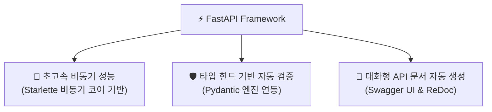
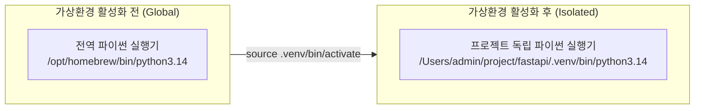
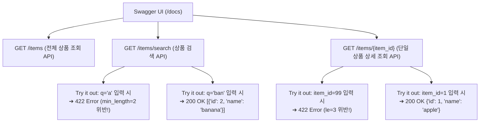

# ⚡ FastAPI 기초 & AI 모델 서빙 완벽 정리 노트

> Python 기반 고성능 웹 프레임워크 **FastAPI의 핵심 철학과 아키텍처**부터 **가상환경 격리(.venv)**, **네트워크 통신 원리(외부 통신 vs localhost 내부 루프백)**, **Python 객체의 JSON 자동 직렬화**, **데코레이터(`@app.get`)의 역할**, **대화형 API 문서(Swagger UI & ReDoc)**, **Path Parameter vs Query Parameter의 명확한 구분과 유효성 검증(Path, Query)**, 그리고 **라우팅 충돌 방지 원칙과 종합 이커머스 API 실전 구현**까지 총정리한 실무 가이드

---

## 📑 목차
1. [FastAPI란 무엇인가? (고성능 웹 API 프레임워크)](#1-fastapi란-무엇인가-고성능-웹-api-프레임워크)
   - [1-1. 'Fast'의 2가지 본질 (처리 속도 & 개발 속도)](#1-1-fast의-2가지-본질-처리-속도--개발-속도)
   - [1-2. FastAPI의 3대 핵심 특징](#1-2-fastapi의-3대-핵심-특징)
   - [1-3. Python 웹 프레임워크 3대장 비교 (FastAPI vs Django vs Flask)](#1-3-python-웹-프레임워크-3대장-비교-fastapi-vs-django-vs-flask)
2. [개발 환경 구축과 가상환경(.venv)의 본질](#2-개발-환경-구축과-가상환경venv의-본질)
   - [2-1. 왜 프로젝트마다 가상환경을 분리해야 하는가?](#2-1-왜-프로젝트마다-가상환경을-분리해야-하는가)
   - [2-2. OS별 가상환경 생성 및 활성화 명령어 (macOS vs Windows)](#2-2-os별-가상환경-생성-및-활성화-명령어-macos-vs-windows)
   - [2-3. 활성화 전후의 파이썬 인터프리터 경로 변화](#2-3-활성화-전후의-파이썬-인터프리터-경로-변화)
   - [2-4. FastAPI 표준 패키지 설치 (`pip install "fastapi[standard]"`)](#2-4-fastapi-표준-패키지-설치-pip-install-fastapistandard)
   - [2-5. 새 프로젝트 분석의 2대 진입점 (README.md & main.py)](#2-5-새-프로젝트-분석의-2대-진입점-readmemd--mainpy)
3. [FastAPI 서버 실행과 네트워크 통신 메커니즘](#3-fastapi-서버-실행과-네트워크-통신-메커니즘)
   - [3-1. 개발 서버 기동: `fastapi dev` 명령어](#3-1-개발-서버-기동-fastapi-dev-명령어)
   - [3-2. 외부 요청(naver.com/DNS) vs 내부 요청(localhost:8000/루프백) 완벽 비교](#3-2-외부-요청navercomdns-vs-내부-요청localhost8000루프백-완벽-비교)
   - [3-3. Python 데이터의 자동 JSON 직렬화 원리 (list/dict ➔ JSON)](#3-3-python-데이터의-자동-json-직렬화-원리-listdict--json)
4. [Python 데코레이터(Decorator)와 라우팅 시스템](#4-python-데코레이터decorator와-라우팅-시스템)
   - [4-1. 데코레이터(`@`)의 본질과 동작 원리](#4-1-데코레이터의-본질과-동작-원리)
   - [4-2. FastAPI에서 데코레이터의 역할 (`@app.get`)](#4-2-fastapi에서-데코레이터의-역할-appget)
   - [4-3. 대화형 자동 API 문서 (Swagger UI & ReDoc)](#4-3-대화형-자동-api-문서-swagger-ui--redoc)
5. [Path Parameter (경로 매개변수)](#5-path-parameter-경로-매개변수)
   - [5-1. Path Parameter의 정의와 리소스 식별(Identify)](#5-1-path-parameter의-정의와-리소스-식별identify)
   - [5-2. 타입 힌트 기반 자동 검증과 422 Unprocessable Entity](#5-2-타입-힌트-기반-자동-검증과-422-unprocessable-entity)
   - [5-3. 🚨 치명적 주의점: 라우팅 순서 충돌과 해결 공식](#5-3--치명적-주의점-라우팅-순서-충돌과-해결-공식)
   - [5-4. Path 고급 유효성 검사 옵션 (`Path()`)](#5-4-path-고급-유효성-검사-옵션-path)
   - [5-5. [실습 1] Path Parameter 만들기 (`max_length=6`)](#5-5-실습-1-path-parameter-만들기-max_length6)
6. [Query Parameter (쿼리 매개변수)](#6-query-parameter-쿼리-매개변수)
   - [6-1. Query Parameter의 정의와 주요 용도 (필터링·정렬·검색)](#6-1-query-parameter의-정의와-주요-용도-필터링정렬검색)
   - [6-2. 필수(Required) vs 선택(Optional/기본값) 파라미터 구분](#6-2-필수required-vs-선택optional기본값-파라미터-구분)
   - [6-3. Query 고급 옵션 (`Query()`, `min_length`, `ge`, `le`)](#6-3-query-고급-옵션-query-min_length-ge-le)
   - [6-4. [실습 2] 상품 검색 API 만들기](#6-4-실습-2-상품-검색-api-만들기)
7. [Path Parameter vs Query Parameter 비교 및 혼합 사용](#7-path-parameter-vs-query-parameter-비교-및-혼합-사용)
   - [7-1. 언제 Path를 쓰고, 언제 Query를 쓰는가? (의사결정 기준)](#7-1-언제-path를-쓰고-언제-query를-쓰는가-의사결정-기준)
   - [7-2. Path와 Query를 동시에 결합한 엔드포인트 설계](#7-2-path와-query를-동시에-결합한-엔드포인트-설계)
8. [종합 실전 예제: 이커머스 상품 관리 API & Swagger 검증](#8-종합-실전-예제-이커머스-상품-관리-api--swagger-검증)
   - [8-1. 전체 상품 조회, 검색, 단일 상품 상세 조회 풀 소스코드](#8-1-전체-상품-조회-검색-단일-상품-상세-조회-풀-소스코드)
   - [8-2. Swagger UI 대시보드 테스트 및 유효성 에러 분석](#8-2-swagger-ui-대시보드-테스트-및-유효성-에러-분석)
9. [💡 실전 핵심 요약 치트시트](#9--실전-핵심-요약-치트시트)

---

## 1. FastAPI란 무엇인가? (고성능 웹 API 프레임워크)

### 1-1. 'Fast'의 2가지 본질 (처리 속도 & 개발 속도)
**FastAPI**는 현대적인 Python 3.10+의 표준 기능(타입 힌트, 비동기)을 기반으로 구축된 최첨단 고성능 웹 API 프레임워크입니다.  
이름에 붙은 **'Fast'**에는 엔지니어링 관점에서 2가지 중요한 의미가 담겨 있습니다:

1. **실행 및 요청 처리 속도가 빠르다 (High Performance)**:  
   - 비동기 네트워킹 코어인 **Starlette**과 초고속 데이터 검증 라이브러리인 **Pydantic**을 기반으로 설계되었습니다.
   - 전통적인 Python 웹 프레임워크(Django, Flask)에 비해 압도적으로 빠르며, **Node.js(Express)나 Go 언어에 필적하는 벤치마크 처리량(RPS)**을 달성합니다.
2. **개발하는 속도가 빠르다 (Fast Development)**:  
   - 표준 Python 타입 힌트만 적어주면 데이터 유효성 검사, 직렬화, API 문서화가 자동으로 완료됩니다.
   - 개발자의 반복적인 보일러플레이트 코드를 줄여 **개발 생산성을 200~300% 향상**시킵니다.

---

### 1-2. FastAPI의 3대 핵심 특징



- **빠른 성능 (Starlette 기반)**:  
  `async` / `await` 비동기 프로그래밍을 완벽 지원하여 I/O 바운드 작업(DB 쿼리, 외부 API 호출, ML 추론 요청)을 효율적으로 병렬 처리합니다.
- **타입 힌트 기반 자동 검증 (Type Hinting & Validation)**:  
  함수 인자에 `user_id: int`처럼 파이썬 타입만 지정하면, 요청 데이터의 타입을 자동으로 체크하고 잘못된 입력값은 사전에 422 에러로 차단합니다.
- **자동 API 문서 (Swagger UI & ReDoc)**:  
  코드를 작성하고 서버를 띄우는 순간, 브라우저에서 직접 테스트할 수 있는 대화형 웹 문서가 1초 만에 자동 생성됩니다.

> [!NOTE]
> **언제 FastAPI를 사용하는가?**  
> - RESTful 백엔드 API 마이크로서비스 구축  
> - **AI / ML / 딥러닝 모델 서빙 (PyTorch, TensorFlow, Scikit-learn, OpenAI API 래핑)**: 데이터 과학자와 머신러닝 엔지니어들이 가장 사랑하는 서빙 프레임워크의 표준입니다.

---

### 1-3. Python 웹 프레임워크 3대장 비교 (FastAPI vs Django vs Flask)

| 비교 항목 | 🏛 Django | 🧪 Flask | ⚡ FastAPI |
| :--- | :--- | :--- | :--- |
| **철학 & 아키텍처** | 풀스택, Batteries-Included (ORM, 어드민, 인증 기본 내장) | 마이크로 프레임워크, 극단적 미니멀리즘과 높은 자유도 | 모던 API 전용 프레임워크, 비동기 네이티브, 타입 세이프 |
| **처리 성능** | 보통 (동기 중심, 전통적 WSGI) | 보통 (동기 중심, 전통적 WSGI) | **매우 빠름 (ASGI 기반, Starlette 코어)** |
| **타입 검증** | 수동 폼/시리얼라이저 작성 필요 | 서드파티 라이브러리(Marshmallow 등) 필요 | **Python 표준 타입 힌트로 자동 검증 (Pydantic)** |
| **API 문서화** | Swagger 연동 시 별도 플러그인 필요 | `flasgger` 등 외부 패키지 수동 세팅 | **코드 작성 즉시 Swagger/ReDoc 자동 생성** |
| **러닝 커브** | 높음 (규칙과 내부 구조가 방대함) | 낮음 (시작은 쉬우나 규모 확장 시 설계 어려움) | **낮음~보통 (직관적인 문법, 명확한 에러 메시지)** |
| **주요 사용처** | 대규모 모놀리식 웹 서비스, 관리자 페이지 | 간단한 프로토타입, 소규모 웹 사이트 | **고성능 REST API 서버, AI/ML 모델 서빙** |

---

## 2. 개발 환경 구축과 가상환경(.venv)의 본질

### 2-1. 왜 프로젝트마다 가상환경을 분리해야 하는가?
- 컴퓨터의 전역(Global) 파이썬 환경에 라이브러리를 마구잡이로 설치하면, 프로젝트 A(예: FastAPI 0.95, Pydantic v1)와 프로젝트 B(FastAPI 0.110, Pydantic v2) 간의 **패키지 버전 충돌(Dependency Hell)**이 발생합니다.
- **가상환경(Virtual Environment)**은 프로젝트 폴더 내부에 파이썬 실행 파일과 라이브러리를 격리 보관하는 독립된 방입니다.
- **폴더 이름 관례 (`.venv`)**:
  - 이름 앞에 붙은 점(`.`)은 운영체제에서 **숨김(Hidden) 파일/디렉터리**를 의미합니다.
  - 소스 코드가 아니라 환경 설정 격리용 디렉터리이므로 Git 관리 대상에서 제외(`.gitignore`)합니다.
  - 보통 프로젝트 폴더 하나당 **하나의 가상환경만 생성**하여 사용합니다.

---

### 2-2. OS별 가상환경 생성 및 활성화 명령어 (macOS vs Windows)

```bash
# 1. 프로젝트 폴더 생성 및 이동
mkdir fastapi-study && cd fastapi-study

# 2. Python 3.10+ 버전 확인
python3 --version

# 3. .venv 가상환경 생성
python3 -m venv .venv
```

#### 가상환경 활성화(Activate) 명령어 비교:

| 운영체제 (OS) | 가상환경 활성화 명령어 | 터미널 표시 변화 | 비활성화(종료) 명령어 |
| :--- | :--- | :--- | :--- |
| **macOS / Linux** | `source .venv/bin/activate` | 프롬프트 앞에 `(.venv)` 표시 | `deactivate` |
| **Windows (CMD)** | `.venv\Scripts\activate.bat` | 프롬프트 앞에 `(.venv)` 표시 | `deactivate` |
| **Windows (PowerShell)** | `.venv\Scripts\Activate.ps1` | 프롬프트 앞에 `(.venv)` 표시 | `deactivate` |

---

### 2-3. 활성화 전후의 파이썬 인터프리터 경로 변화

`which python3` (Windows의 경우 `where python`) 명령어로 파이썬 실행 위치를 추적해보면 가상환경의 작동 원리가 선명해집니다.



- **활성화 전**: OS 전체에서 공유하는 전역 파이썬 경로를 가리킴.
- **활성화 후**: 터미널의 환경변수(`PATH`)가 변경되어, 내가 생성한 `.venv` 폴더 안의 파이썬 인터프리터와 `pip` 저장소를 바라보게 됨.

---

### 2-4. FastAPI 표준 패키지 설치 (`pip install "fastapi[standard]"`)

가상환경이 켜진 상태(`(.venv)` 확인)에서 아래 명령어를 실행합니다:

```bash
pip install "fastapi[standard]"
```

> [!TIP]
> **왜 `"fastapi[standard]"` 인가요?**  
> 과거에는 `pip install fastapi uvicorn` 처럼 서버 엔진을 따로 설치했으나, 최신 FastAPI는 `[standard]` 옵션을 붙여 설치하면 프로덕션 ASGI 서버인 **Uvicorn**, 개발용 CLI 도구인 **FastAPI CLI**, Pydantic 이메일 검증기 등이 한 번에 완벽하게 세팅됩니다.

---

### 2-5. 새 프로젝트 분석의 2대 진입점 (README.md & main.py)

현업이나 오픈소스에서 새로운 파이썬 백엔드 프로젝트를 인수인계받거나 열어볼 때는 다음 2가지를 먼저 확인합니다:
1. **`README.md`**: 프로젝트의 전체 소개, 목적, 아키텍처 다이어그램, 환경 변수 세팅 및 실행 가이드 역할.
2. **`main.py` (또는 `app.py`)**: 전체 애플리케이션의 **코드 진입점(Entry Point)**. `app = FastAPI()` 인스턴스가 생성되고 라우터들이 등록되는 출발점.

---

## 3. FastAPI 서버 실행과 네트워크 통신 메커니즘

### 3-1. 개발 서버 기동: `fastapi dev` 명령어

`main.py` 파일이 있는 위치에서 터미널에 아래 명령어를 입력합니다:

```bash
fastapi dev
# 또는 명시적 파일 지정: fastapi dev main.py
```

- **`fastapi dev`의 핵심 기능**:
  - `http://127.0.0.1:8000` (8000번 포트)에서 개발 서버 자동 시작.
  - **핫 리로드 (Auto-reload)**: 코드를 수정하고 저장(`Ctrl + S`)하면 서버가 재시작 없이 실시간으로 변경 사항을 감지하여 반영.
  - 대화형 문서 링크 자동 안내 (`Documentation at http://127.0.0.1:8000/docs`).

---

### 3-2. 외부 요청(naver.com/DNS) vs 내부 요청(localhost:8000/루프백) 완벽 비교

우리가 브라우저 주소창에 주소를 칠 때, **외부 웹사이트 접속**과 **로컬 개발 서버 접속**은 네트워크 레벨에서 근본적으로 다르게 동작합니다.

```mermaid
graph TD
    subgraph Case1["1. 외부 서버에 요청하는 경우 (naver.com)"]
        U1["내 컴퓨터 브라우저 (Chrome)"] -->|1. naver.com 입력| OS1["운영체제 O/S 네트워크 스택"]
        OS1 -->|2. 외부 DNS 서버 질의| DNS["DNS 서버 (전화번호부)"]
        DNS -->|3. 실제 공인 IP 반환 (예: 223.130.195.95)| OS1
        OS1 -->|4. 광랜/인터넷망 경유| EXT["원격지 네이버 데이터센터 서버"]
    end

    subgraph Case2["2. 내 컴퓨터에 요청하는 경우 (localhost:8000)"]
        U2["내 컴퓨터 브라우저 (Chrome)"] -->|1. localhost:8000 입력| OS2["운영체제 O/S (루프백 감지)"]
        OS2 -->|2. 외부 인터넷으로 나가지 않음!| LOCAL["내 컴퓨터 내부 8000번 포트 (FastAPI 서버)"]
    end
```

| 구분 | 🌐 외부 서버 요청 (`https://naver.com`) | 💻 내부 로컬 요청 (`localhost:8000`) |
| :--- | :--- | :--- |
| **목적지** | 전 세계 어딘가에 위치한 원격 데이터센터 서버 | **현재 내가 작업하고 있는 바로 그 컴퓨터** |
| **DNS 질의** | 외부 DNS 서버를 거쳐 실제 공인 IP(예: `1.2.3.4`)를 알아옴 | DNS 질의 불필요 (`localhost`는 OS 내부에서 `127.0.0.1`로 즉시 해석) |
| **네트워크 경로** | 공유기 ➔ 통신사 망 ➔ 인터넷 백본망 ➔ 목적지 서버 | **루프백 인터페이스(Loopback Interface)**를 타고 컴퓨터 내부에서 유턴 |
| **인터넷 연결 필요 여부** | 인터넷이 끊기면 통신 불가 | **인터넷(Wi-Fi)이 완전히 끊겨도 로컬 테스트 100% 가능** |

---

### 3-3. Python 데이터의 자동 JSON 직렬화 원리 (list/dict ➔ JSON)

- **HTTP 프로토콜의 엄격한 제약**:
  - 클라이언트(웹 브라우저, 모바일 앱)와 서버가 주고받는 HTTP 응답 메시지의 본문(Body)에는 **JSON 문자열 형태의 텍스트만 실을 수 있습니다.**
- **FastAPI의 자동 변환(Serialization) 마법**:
  - 개발자가 파이썬 함수에서 복잡하게 `json.dumps()`를 호출할 필요가 없습니다.
  - 파이썬 딕셔너리나 리스트를 그대로 `return`하면, FastAPI가 내부적으로 HTTP 응답 헤더(`Content-Type: application/json`)와 함께 완벽한 JSON 규격으로 변환해 줍니다.

```python
from fastapi import FastAPI

app = FastAPI()

@app.get("/items")
def get_items():
    # 파이썬 List와 Dict 자료구조 반환
    return [
        {"id": 1, "name": "apple", "price": 1000},
        {"id": 2, "name": "banana", "price": 2000}
    ]
```

#### Python 자료형과 JSON 데이터 타입 매핑표:

| Python 자료형 | 변환 방향 | 표준 JSON 데이터 타입 |
| :--- | :---: | :--- |
| `dict` (딕셔너리) | ➔ | **JSON Object** (`{ "key": "value" }`) |
| `list` (리스트) | ➔ | **JSON Array** (`[ 1, 2, 3 ]`) |
| `tuple` (튜플) | ➔ | **JSON Array** (`[ "a", "b" ]`) |
| `str` (문자열) | ➔ | **JSON String** (`"text"`) |
| `int`, `float` (숫자) | ➔ | **JSON Number** (`123`, `3.14`) |
| `bool` (`True`, `False`) | ➔ | **JSON Boolean** (`true`, `false`) |
| `None` | ➔ | **JSON Null** (`null`) |

---

## 4. Python 데코레이터(Decorator)와 라우팅 시스템

### 4-1. 데코레이터(`@`)의 본질과 동작 원리
- **데코레이터(Decorator)**란:  
  어떤 함수를 수정하지 않고 감싸서(Wrapping), **해당 함수의 실행 전이나 후에 공통 로직(로깅, 인증, 시간 측정 등)을 덧붙여주는 파이썬 문법**입니다.
- **핵심 가치**: 중복 코드 제거, 선언적(Declarative) 기능 부여.

```python
# [데코레이터의 기본 원리 구조]
def my_decorator(func):
    def wrapper(*args, **kwargs):
        print("--- [전처리] 함수 실행 전 공통 작업 ---")
        result = func(*args, **kwargs)
        print("--- [후처리] 함수 실행 후 공통 작업 ---")
        return result
    return wrapper

# @ 기호로 함수 위에 장식
@my_decorator
def hello():
    print("안녕하세요! 메인 비즈니스 로직입니다.")

hello()
# 출력 결과:
# --- [전처리] 함수 실행 전 공통 작업 ---
# 안녕하세요! 메인 비즈니스 로직입니다.
# --- [후처리] 함수 실행 후 공통 작업 ---
```

---

### 4-2. FastAPI에서 데코레이터의 역할 (`@app.get`)

FastAPI에서는 데코레이터가 **일반 파이썬 함수를 웹 상에서 접근 가능한 'HTTP 엔드포인트(라우트)'로 승격시키는 결정적 역할**을 합니다.

```python
@app.get("/")
def root():
    return {"message": "Hello FastAPI"}
```

- **데코레이터가 수행하는 3가지 내부 작업**:
  1. **HTTP 메서드 지정**: `get`, `post`, `put`, `delete` 등 클라이언트가 어떤 방식으로 요청해야 하는지 정의.
  2. **URL 경로 매핑**: 클라이언트가 브라우저 주소창에 `/` 경로로 요청을 보낼 때 이 함수를 실행하도록 라우팅 테이블에 등록.
  3. **메타데이터 등록**: 함수의 매개변수, 반환 타입, 주석을 읽어와 **Swagger 문서(OpenAPI 스키마)에 자동 등록**.
- **동작 비유**: 프론트엔드의 `addEventListener("click", handler)`처럼, **"이 특정 URL로 GET 요청이 들어오면, 바로 밑에 있는 함수를 실행해 줘!"**라고 등록해 두는 것입니다.

---

### 4-3. 대화형 자동 API 문서 (Swagger UI & ReDoc)

서버가 켜진 상태에서 브라우저 주소창에 아래 주소를 입력하면 문서를 확인할 수 있습니다:

1. **Swagger UI (`http://localhost:8000/docs`)**:
   - 가장 널리 사용되는 대화형 테스트 대시보드.
   - 각 API를 펼쳐서 **`Try it out`** 버튼을 누르면, Postman 같은 외부 툴 없이도 브라우저에서 실시간으로 파라미터를 입력하고 요청을 전송해 결과를 확인할 수 있습니다.
2. **ReDoc (`http://localhost:8000/redoc`)**:
   - 깔끔하고 정돈된 3단 레이아웃의 공식 개발자 API 명세서 페이지.
   - 다른 팀이나 고객사에게 API 스펙을 공유할 때 매우 유용합니다.

---

## 5. Path Parameter (경로 매개변수)

### 5-1. Path Parameter의 정의와 리소스 식별(Identify)
- **Path Parameter (경로 매개변수)**: URL 경로 자체의 일부분으로 변수처럼 포함되어 전달되는 값입니다.
- **언제 사용하는가?**: 특정 **리소스(자원)를 고유하게 식별(Identify)**할 때 사용합니다.
  - 예: `/users/3` ➔ 3번 고유 ID를 가진 유저 정보
  - 예: `/items/apple` ➔ `apple`이라는 고유 식별명을 가진 아이템

```python
# 경로에 중괄호 {user_id} 를 넣고, 함수 인자로 동일한 이름을 전달받음
@app.get("/users/{user_id}")
def get_user(user_id: int):
    return {"user_id": user_id}
```

---

### 5-2. 타입 힌트 기반 자동 검증과 422 Unprocessable Entity

FastAPI는 파이썬의 타입 힌트(`user_id: int`)를 보고 자동으로 유효성 검사를 수행합니다.

- **정상 요청 (`GET /users/3`)**:
  - URL의 문자열 `"3"`을 파이썬 정수 `3`으로 자동 형변환하여 함수에 전달 ➔ **`200 OK` 성공!**
- **비정상 요청 (`GET /users/abc`)**:
  - `"abc"`는 정수(`int`)로 변환할 수 없음.
  - FastAPI가 함수 내부를 실행하기도 전에 가로채서 **`422 Unprocessable Entity` 에러 응답**을 자동으로 반환!

```json
/* 422 에러 응답 예시 (FastAPI 자동 생성) */
{
  "detail": [
    {
      "type": "int_parsing",
      "loc": ["path", "user_id"],
      "msg": "Input should be a valid integer, unable to parse string as an integer",
      "input": "abc"
    }
  ]
}
```

---

### 5-3. 🚨 치명적 주의점: 라우팅 순서 충돌과 해결 공식

같은 접두사(prefix)를 가진 엔드포인트를 만들 때, **코드 작성 순서**에 따라 심각한 라우팅 버그가 발생할 수 있습니다.

```python
# ❌ 잘못된 순서 (버그 발생!)
@app.get("/items/{item_id}")
def get_item(item_id: str):
    return {"item_id": item_id}

@app.get("/items/search")
def search_item():
    return {"message": "검색 결과"}
```

> **🚨 왜 문제가 발생할까?**  
> FastAPI는 라우트를 **위에서 아래로 선언된 순서대로** 매칭합니다.  
> 만약 `/items/{item_id}`가 위에 있다면, 사용자가 `/items/search`를 호출했을 때 FastAPI는 `"search"`라는 단어를 `{item_id}` 변수 값으로 인식하여 위쪽 함수를 실행해 버립니다!

#### 💡 해결 공식 (라우팅 우선순위 원칙):
> **"고정된 정적 경로(`/items/search`)를 항상 코드 위쪽에 먼저 선언하고,  
> 가변 변수가 들어간 경로(`/items/{item_id}`)를 아래쪽에 나중에 선언하라!"**

---

### 5-4. Path 고급 유효성 검사 옵션 (`Path()`)

FastAPI의 `Path` 모듈을 사용하면 숫자 범위, 문자열 길이, Swagger 문서 설명 등을 강력하게 강제할 수 있습니다.

```python
from fastapi import FastAPI, Path

app = FastAPI()

@app.get("/users/{user_id}")
def get_user(
    user_id: int = Path(
        ...,                    # ... (Ellipsis)는 '필수값'임을 의미
        ge=1,                   # ge: Greater than or equal to (1 이상이어야 함)
        description="조회할 유저의 고유 ID (1 이상의 양수)"
    )
):
    return {"user_id": user_id}
```

#### 주요 검증 키워드:
- `...` (Ellipsis): 기본값이 없는 필수 파라미터임을 명시
- `ge` (>=): 이상
- `gt` (>): 초과
- `le` (<=): 이하
- `lt` (<): 미만
- `min_length`, `max_length`: 문자열 최소/최대 길이 제한
- `description`: Swagger 문서에 친절한 한글 설명 표시

---

### 5-5. [실습 1] Path Parameter 만들기 (`max_length=6`)

- **요구사항**:
  - 엔드포인트: `GET /items/{item_name}`
  - `item_name`은 문자열(`str`) 타입이어야 하며, 최대 글자수(`max_length`)는 6글자 이하로 제한
- **응답 예시**: `/items/apple` 입력 시 `{"item_name": "apple"}` 반환

#### 완성 코드:
```python
from fastapi import FastAPI, Path

app = FastAPI()

@app.get("/items/{item_name}")
def get_item(
    item_name: str = Path(..., max_length=6, description="6자 이하의 아이템 이름")
):
    return {"item_name": item_name}
```

---

## 6. Query Parameter (쿼리 매개변수)

### 6-1. Query Parameter의 정의와 주요 용도 (필터링·정렬·검색)
- **Query Parameter (쿼리 매개변수)**: URL 경로 끝에 물음표(`?`)를 붙이고 `key=value` 형태로 전달하는 데이터입니다. 여러 개일 경우 `&`로 연결합니다.
  - 예: `/search?q=fastapi&limit=10`
- **주요 용도**:
  - 특정 리소스를 지칭하는 것이 아니라, 목록을 조회할 때 **필터링(Filtering), 검색(Search), 정렬(Sorting), 페이지네이션(Pagination)** 등의 부가 옵션을 줄 때 사용합니다.

---

### 6-2. 필수(Required) vs 선택(Optional/기본값) 파라미터 구분

URL 경로(`{}`)에 선언되지 않은 함수 매개변수는 FastAPI가 자동으로 **Query Parameter**로 취급합니다.

```python
@app.get("/search")
def search(q: str, limit: int = 10):
    return {"q": q, "limit": limit}
```

- **`q: str`**: 기본값이 지정되지 않았으므로 **필수(Required)** 쿼리 파라미터입니다. (`?q=단어`가 없으면 422 에러)
- **`limit: int = 10`**: 기본값 `10`이 할당되어 있으므로 **선택(Optional)** 쿼리 파라미터입니다. (생략 시 자동으로 10이 적용됨)

---

### 6-3. Query 고급 옵션 (`Query()`, `min_length`, `ge`, `le`)

`Path`와 마찬가지로 `from fastapi import Query`를 임포트하여 쿼리 스트링에 대한 상세한 유효성 검증을 걸 수 있습니다.

```python
from fastapi import FastAPI, Query

app = FastAPI()

@app.get("/search")
def search(
    q: str = Query(..., min_length=2, max_length=30, description="검색어 (2~30자)"),
    limit: int = Query(10, ge=1, le=100, description="한 페이지당 가져올 개수 (1~100)")
):
    return {"q": q, "limit": limit}
```

---

### 6-4. [실습 2] 상품 검색 API 만들기

- **요구사항**:
  - 엔드포인트: `GET /products/search`
  - 쿼리 파라미터 `q`(검색어, str, 필수), `limit`(개수, int, 기본값 10)
- **응답 예시**: `/products/search?q=apple&limit=5` 호출 시 `{"q": "apple", "limit": 5}` 반환

#### 완성 코드:
```python
from fastapi import FastAPI

app = FastAPI()

@app.get("/products/search")
def product_search(q: str, limit: int = 10):
    return {"q": q, "limit": limit}
```

---

## 7. Path Parameter vs Query Parameter 비교 및 혼합 사용

### 7-1. 언제 Path를 쓰고, 언제 Query를 쓰는가? (의사결정 기준)

| 구분 | 🎯 Path Parameter | 🔍 Query Parameter |
| :--- | :--- | :--- |
| **URL 형태** | `/users/10` | `/users?role=admin&sort=desc` |
| **핵심 목적** | **리소스의 '고유 식별(Identification)'** | **리소스 목록의 '조건 제어(Filtering, Pagination)'** |
| **필수 여부** | URL 경로의 일부이므로 **무조건 필수** | 대부분 **선택 옵션**(기본값 제공 가능) |
| **데이터 의미** | *"10번 유저를 가져와라"* | *"유저들 중 관리자 역할만 내림차순 정렬해서 가져와라"* |
| **RESTful 권장** | 자원의 계층 구조를 나타낼 때 | 자원을 정렬, 검색, 페이징할 때 |

---

### 7-2. Path와 Query를 동시에 결합한 엔드포인트 설계

실무에서는 리소스 식별과 조회 옵션을 동시에 전달하기 위해 두 방식을 함께 사용합니다.

```python
# 예: 3번 유저의 게시글 중 5개만 조회
# GET /users/3/posts?limit=5
@app.get("/users/{user_id}/posts")
def list_user_posts(user_id: int, limit: int = 10):
    # user_id는 URL 경로에 있으므로 -> Path Parameter
    # limit는 URL 경로에 없으므로 -> Query Parameter
    return {
        "user_id": user_id,
        "limit": limit,
        "message": f"{user_id}번 유저의 게시글을 최대 {limit}개 조회합니다."
    }
```

---

## 8. 종합 실전 예제: 이커머스 상품 관리 API & Swagger 검증

강의 슬라이드 29페이지에 등장한 실무형 이커머스 상품 조회 및 검색 API 전체 완성 코드입니다.

### 8-1. 전체 상품 조회, 검색, 단일 상품 상세 조회 풀 소스코드

```python
from fastapi import FastAPI, Path, Query

app = FastAPI(
    title="이커머스 상품 관리 API",
    description="FastAPI 기초 학습을 위한 상품 조회 및 검색 엔드포인트",
    version="1.0.0"
)

# 인메모리 가상 상품 데이터베이스
ITEMS = [
    {"id": 1, "name": "apple", "price": 1000},
    {"id": 2, "name": "banana", "price": 2000},
    {"id": 3, "name": "cherry", "price": 3000},
]

# 1. 전체 상품 조회 API
@app.get("/items", summary="전체 상품 조회 API")
def get_items_handler():
    """등록된 모든 상품의 리스트를 반환합니다."""
    return ITEMS


# 2. 상품 검색 API (고정 경로이므로 {item_id}보다 무조건 먼저 선언해야 함!)
@app.get("/items/search", summary="상품 검색 API")
def search_items_handler(
    q: str = Query(..., min_length=2, description="검색할 상품 키워드 (2자 이상)")
):
    """
    상품 이름에 검색 키워드(q)가 포함된 상품 목록을 필터링하여 반환합니다.
    예: /items/search?q=ap -> apple 상품 반환
    """
    searched = []
    for item in ITEMS:
        if q.lower() in item["name"].lower():
            searched.append(item)
    return searched


# 3. 단일 상품 상세 조회 API (변수 경로이므로 search보다 아래에 배치)
@app.get("/items/{item_id}", summary="단일 상품 상세 조회 API")
def get_item_detail_handler(
    item_id: int = Path(..., ge=1, le=3, description="조회할 상품의 ID (1~3 범위)")
):
    """
    고유 item_id를 받아 해당하는 단일 상품 정보를 반환합니다.
    인덱스는 0부터 시작하므로 item_id - 1로 접근합니다.
    """
    return ITEMS[item_id - 1]
```

---

### 8-2. Swagger UI 대시보드 테스트 및 유효성 에러 분석

서버 실행 후 `http://localhost:8000/docs`에 접속하면 아래와 같은 화면이 나타납니다:



- **OpenAPI 3.1 스키마 준수**:
  - `summary`로 지정한 한글 설명이 엔드포인트 오른쪽에 깔끔하게 노출됩니다.
  - 파라미터 타입, 제약조건(min_length, ge, le), 필수 여부가 표 형태로 일목요연하게 표시됩니다.
  - 잘못된 값을 넣고 `Execute`를 실행하면 FastAPI 엔진이 자동으로 검증 실패(422 HTTPValidationError)를 반환하는 것을 브라우저에서 즉시 체험할 수 있습니다.

---

## 9. 💡 실전 핵심 요약 치트시트

```markdown
┌────────────────────────────────────────────────────────────────────────┐
│                   FastAPI 기초 & 서빙 핵심 치트시트                    │
├──────────────────────────────┬─────────────────────────────────────────┤
│ 명령어 / 문법                │ 기능 및 핵심 사용 공식                  │
├──────────────────────────────┼─────────────────────────────────────────┤
│ python -m venv .venv         │ 프로젝트 전용 독립 가상환경 생성        │
├──────────────────────────────┼─────────────────────────────────────────┤
│ source .venv/bin/activate    │ 가상환경 활성화 (Windows: Scripts\activate)│
├──────────────────────────────┼─────────────────────────────────────────┤
│ pip install "fastapi[standard]"│ FastAPI + Uvicorn + CLI 통합 설치     │
├──────────────────────────────┼─────────────────────────────────────────┤
│ fastapi dev main.py          │ 핫 리로드 지원 로컬 개발 서버 구동      │
├──────────────────────────────┼─────────────────────────────────────────┤
│ localhost:8000               │ 외부로 나가지 않는 내 컴퓨터 내부 루프백│
├──────────────────────────────┼─────────────────────────────────────────┤
│ /docs                        │ Swagger UI 대화형 API 테스트 문서       │
├──────────────────────────────┼─────────────────────────────────────────┤
│ /redoc                       │ ReDoc 읽기 전용 공식 기술 문서         │
├──────────────────────────────┼─────────────────────────────────────────┤
│ @app.get("/경로")            │ 함수를 HTTP 엔드포인트로 등록하는 데코레이터│
├──────────────────────────────┼─────────────────────────────────────────┤
│ return {...} / [...]         │ 파이썬 딕셔너리/리스트를 자동 JSON 직렬화│
├──────────────────────────────┼─────────────────────────────────────────┤
│ {item_id}: int               │ Path Parameter (리소스 고유 식별용)     │
├──────────────────────────────┼─────────────────────────────────────────┤
│ 라우팅 선언 공식             │ 정적 경로(/search)를 항상 변수 경로      │
│                              │ (/{item_id})보다 먼저 위에 선언할 것!  │
├──────────────────────────────┼─────────────────────────────────────────┤
│ q: str                       │ Query Parameter (필수 검색어)           │
├──────────────────────────────┼─────────────────────────────────────────┤
│ limit: int = 10              │ Query Parameter (기본값 있는 선택 옵션) │
├──────────────────────────────┼─────────────────────────────────────────┤
│ Path(..., ge=1, le=100)      │ 경로 매개변수 범위 및 유효성 검사       │
├──────────────────────────────┼─────────────────────────────────────────┤
│ Query(..., min_length=2)     │ 쿼리 매개변수 글자수 및 조건 강제       │
├──────────────────────────────┼─────────────────────────────────────────┤
│ 422 Unprocessable Entity     │ 타입 검증 실패 시 자동 반환되는 HTTP 에러│
└──────────────────────────────┴─────────────────────────────────────────┘
```
