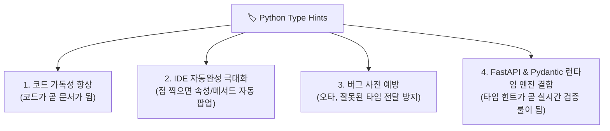
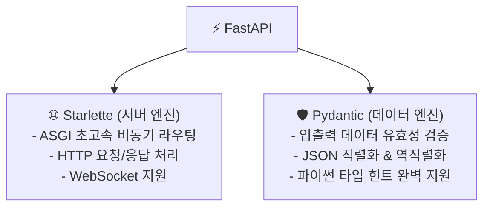
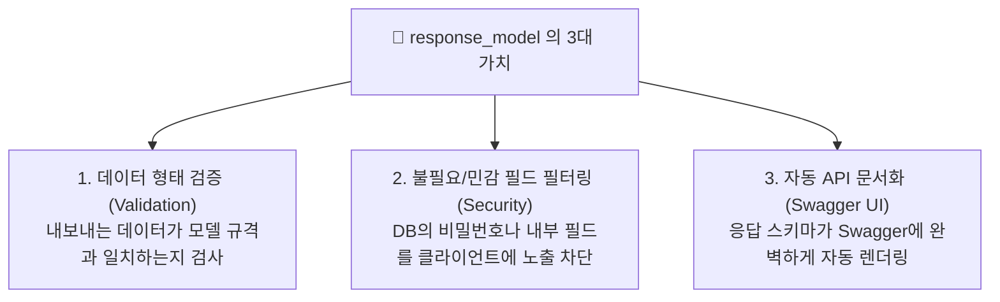

# ⚡ FastAPI & Pydantic 데이터 검증과 실전 CRUD 완벽 정리 노트

> Python 백엔드의 심장 **타입 힌트(Type Hints)**부터 **Request Body와 직렬화/역직렬화 메커니즘**, **Pydantic의 핵심 동작 원리(`BaseModel`, `Field`, `model_dump`)**, **Response Model의 3대 가치(검증, 민감정보 필터링, 문서화)**, **HTTP 상태 코드(201, 200, 204, 404, 422) 설계 표준**, 그리고 **`HTTPException` 에러 핸들링과 완벽한 CRUD(Create, Read, Update, Delete) 풀 구현**까지 총정리한 실전 가이드

---

## 📑 목차
1. [Type Hints (타입 힌트)의 본질과 모던 문법](#1-type-hints-타입-힌트의-본질과-모던-문법)
   - [1-1. Type Hints를 쓰는 4대 이유 (왜 FastAPI는 타입 힌트 위에 지어졌는가?)](#1-1-type-hints를-쓰는-4대-이유-왜-fastapi는-타입-힌트-위에-지어졌는가)
   - [1-2. 기본 자료형과 유니온 타입 (`|`)](#1-2-기본-자료형과-유니온-타입-)
   - [1-3. 함수의 인자 및 반환 타입 지정 (`->`)](#1-3-함수의-인자-및-반환-타입-지정--)
   - [1-4. 컬렉션 타입 (`list[T]`, `dict[K, V]`, 중첩 구조)](#1-4-컬렉션-타입-listt-dictk-v-중첩-구조)
   - [1-5. Optional 타입 (`T | None = None`)](#1-5-optional-타입-t--none--none)
2. [Request Body와 데이터 직렬화 / 역직렬화](#2-request-body와-데이터-직렬화--역직렬화)
   - [2-1. Path/Query vs Request Body의 결정적 차이](#2-1-pathquery-vs-request-body의-결정적-차이)
   - [2-2. 직렬화(Serialization) vs 역직렬화(Deserialization) 개념 정리](#2-2-직렬화serialization-vs-역직렬화deserialization-개념-정리)
3. [Pydantic: 데이터 검증과 파싱의 핵심 엔진](#3-pydantic-데이터-검증과-파싱의-핵심-엔진)
   - [3-1. FastAPI의 2대 지주 (Starlette vs Pydantic)](#3-1-fastapi의-2대-지주-starlette-vs-pydantic)
   - [3-2. `BaseModel` 정의와 자동 타입 변환 원리](#3-2-basemodel-정의와-자동-타입-변환-원리)
   - [3-3. Pydantic 핵심 메서드 4선 (`model_dump`, `model_dump_json`, `model_validate`)](#3-3-pydantic-핵심-메서드-4선-model_dump-model_dump_json-model_validate)
   - [3-4. `Field(...)`를 활용한 정밀한 유효성 검사 (`min_length`, `ge`, `le`)](#3-4-field를-활용한-정밀한-유효성-검사-min_length-ge-le)
4. [FastAPI에서 Request Body 다루기](#4-fastapi에서-request-body-다루기)
   - [4-1. Pydantic 모델을 타입 힌트로 전달하여 인스턴스 자동 주입받기](#4-1-pydantic-모델을-타입-힌트로-전달하여-인스턴스-자동-주입받기)
   - [4-2. 점(`.`) 표기법을 통한 안전하고 편리한 데이터 접근](#4-2-점-표기법을-통한-안전하고-편리한-데이터-접근)
   - [4-3. 기본값(Default)과 선택 필드(Optional Field) 설계](#4-3-기본값default과-선택-필드optional-field-설계)
   - [4-4. 계층형 JSON을 처리하는 중첩 모델 (Nested Model)](#4-4-계층형-json을-처리하는-중첩-모델-nested-model)
5. [Response Model (응답 모델)의 3대 핵심 가치](#5-response-model-응답-모델의-3대-핵심-가치)
   - [5-1. 왜 응답 모델을 별도로 지정해야 하는가?](#5-1-왜-응답-모델을-별도로-지정해야-하는가)
   - [5-2. 가치 1: 데이터 형태 검증 (Validation)](#5-2-가치-1-데이터-형태-검증-validation)
   - [5-3. 가치 2: 민감정보 마스킹 및 불필요한 필드 자동 제거 (Filtering)](#5-3-가치-2-민감정보-마스킹-및-불필요한-필드-자동-제거-filtering)
   - [5-4. 가치 3: 프론트엔드 협업을 위한 Swagger 문서 자동화](#5-4-가치-3-프론트엔드-협업을-위한-swagger-문서-자동화)
6. [HTTP 상태 코드 (Status Code) 설계 표준](#6-http-상태-코드-status-code-설계-표준)
   - [6-1. 상태 코드의 정의와 숫자의 의미](#6-1-상태-코드의-정의와-숫자의-의미)
   - [6-2. CRUD 기능별 표준 Method & Status Code 매핑표](#6-2-crud-기능별-표준-method--status-code-매핑표)
   - [6-3. `@app.post(..., status_code=201)` 적용법](#6-3-apppost-status_code201-적용법)
7. [에러 처리 (Error Handling) & HTTPException](#7-에러-처리-error-handling--httpexception)
   - [7-1. `HTTPException`의 역할과 문법](#7-1-httpexception의-역할과-문법)
   - [7-2. 404 Not Found 명시적 반환 패턴](#7-2-404-not-found-명시적-반환-패턴)
8. [실전 실습: 요청-응답 유효성 검증 (`POST /hello`)](#8-실전-실습-요청-응답-유효성-검증-post-hello)
   - [8-1. 요구사항 분석 (이름 검증 & 빈 문자열 분기)](#8-1-요구사항-분석-이름-검증--빈-문자열-분기)
   - [8-2. 실습 완성 코드 및 해설](#8-2-실습-완성-코드-및-해설)
9. [대망의 완성: 실무형 CRUD API 완벽 구현](#9-대망의-완성-실무형-crud-api-완벽-구현)
   - [9-1. DTO(Data Transfer Object) 모델 분리 설계](#9-1-dtodata-transfer-object-모델-분리-설계)
   - [9-2. [Create] 상품 등록 (`POST /items`, 201 Created)](#9-2-create-상품-등록-post-items-201-created)
   - [9-3. [Read All] 전체 상품 조회 (`GET /items`, 200 OK)](#9-3-read-all-전체-상품-조회-get-items-200-ok)
   - [9-4. [Read One] 단일 상품 상세 조회 (`GET /items/{item_id}`, 404 예외)](#9-4-read-one-단일-상품-상세-조회-get-itemsitem_id-404-예외)
   - [9-5. [Update] 상품 부분 수정 (`PATCH /items/{item_id}`, 독립 if문 주의점)](#9-5-update-상품-부분-수정-patch-itemsitem_id-독립-if문-주의점)
   - [9-6. [Delete] 상품 삭제 (`DELETE /items/{item_id}`, 204 No Content)](#9-6-delete-상품-삭제-delete-itemsitem_id-204-no-content)
10. [💡 실전 핵심 요약 치트시트](#10--실전-핵심-요약-치트시트)

---

## 1. Type Hints (타입 힌트)의 본질과 모던 문법

### 1-1. Type Hints를 쓰는 4대 이유 (왜 FastAPI는 타입 힌트 위에 지어졌는가?)

파이썬은 원래 동적 타입(Dynamic Typing) 언어입니다. 즉, 변수에 어떤 값을 넣어도 에러가 나지 않는 자유로움이 있지만, 프로젝트 규모가 커지면 **"이 함수에 문자열을 넣어야 하나? 숫자를 넣어야 하나?"** 헷갈리게 됩니다.

Python 3.5+부터 도입된 **Type Hints**는 변수, 함수의 매개변수, 반환값에 **"의도된 데이터 타입"을 명시하는 문법**입니다.



> [!NOTE]
> **순수 Python과 FastAPI의 결정적 차이**:  
> - 순수 파이썬 인터프리터는 타입 힌트를 작성해도 **실행 자체를 강제하지 않습니다** (힌트일 뿐 무시함).
> - 하지만 **FastAPI와 Pydantic은 이 타입 힌트를 런타임에 직접 읽어와서(Reflection)** 데이터 유효성 검사 규칙 및 직렬화 규칙으로 자동 승격시킵니다!

---

### 1-2. 기본 자료형과 유니온 타입 (`|`)

변수명 뒤에 콜론(`:`)을 붙이고 원하는 데이터 타입을 명시합니다.  
Python 3.10부터는 `Union[int, float]` 대신 파이프 기호(`|`)를 사용하여 여러 타입을 허용할 수 있습니다.

```python
# 1. 단일 기본 타입 힌트
name: str = "alex"          # 문자열
price: int = 100            # 정수
ratio: float = 0.3          # 실수(부동소수점)
is_active: bool = True      # 불리언 (참/거짓)

# 2. 유니온 타입 (|): 둘 이상의 타입을 허용하고 싶을 때
# 정수 또는 실수를 모두 허용
score: int | float = 90
score = 85.5  # ✅ 둘 다 정상
```

---

### 1-3. 함수의 인자 및 반환 타입 지정 (`->`)

함수 매개변수에는 콜론(`:`), 함수의 최종 반환값에는 화살표(`->`)를 사용하여 타입을 명시합니다.

```python
def add(n1: int, n2: int) -> int:
    """정수 2개를 입력받아 정수 합을 반환하는 함수"""
    return n1 + n2

result = add(10, 20)
# IDE는 result가 int임을 즉시 알고 int 전용 메서드를 자동완성해 줍니다!
```

---

### 1-4. 컬렉션 타입 (`list[T]`, `dict[K, V]`, 중첩 구조)

리스트나 딕셔너리 내부의 원소 타입까지 구체적으로 명시할 수 있습니다.

```python
# 1. 문자열만 담긴 리스트
names: list[str] = ["alex", "bob", "chris"]

# 2. 정수, 실수, None을 모두 담을 수 있는 유연한 리스트
numbers: list[int | float | None] = [100, 90.5, 80, None]

# 3. 키는 str, 값은 int 또는 None을 갖는 딕셔너리
scores: dict[str, int | None] = {
    "math": 90,
    "eng": 100,
    "history": None
}

# 4. 실무에서 가장 흔한 '딕셔너리들의 리스트' (중첩 구조)
users: list[dict[str, int | str]] = [
    {"id": 1, "name": "alex"},
    {"id": 2, "name": "bob"}
]
```

---

### 1-5. Optional 타입 (`T | None = None`)

어떤 데이터가 **"있을 수도 있고, 없을 수도 있는 경우(None 허용)"**에 사용합니다.

```python
# 값이 안 들어오면 기본값으로 None을 가짐
name: str | None = None

# 나중에 문자열이 채워질 수 있음
name = "alex"
```

---

## 2. Request Body와 데이터 직렬화 / 역직렬화

### 2-1. Path/Query vs Request Body의 결정적 차이

| 구분 | 🛣 Path Parameter | 🔍 Query Parameter | 📦 Request Body (요청 본문) |
| :--- | :--- | :--- | :--- |
| **전달 위치** | URL 경로 자체 (`/items/3`) | URL 뒤 쿼리스트링 (`?page=1`) | **HTTP 요청 본문(Body) 내부** |
| **데이터 형식** | 단순 문자열 / 숫자 | 단순 Key-Value 문자열 | **복잡한 JSON 객체, 중첩 리스트 등 대용량 데이터** |
| **주 사용 목적** | 리소스 식별(Identify) | 필터링, 정렬, 검색 옵션 | **데이터 신규 등록(POST), 수정(PUT/PATCH)** |
| **보안/노출** | URL 및 서버 접근 로그에 그대로 노출 | URL 및 로그에 노출 | **URL에 노출되지 않아 비교적 안전** |

---

### 2-2. 직렬화(Serialization) vs 역직렬화(Deserialization) 개념 정리

네트워크 통신에서 컴퓨터 메모리 속 객체와 네트워크 전송용 문자열은 서로 변환 과정을 거쳐야 합니다.

```mermaid
graph LR
    subgraph Client["💻 클라이언트 (Browser / App)"]
        CJ["JSON 텍스트 포맷<br/>{'name': 'apple', 'price': 1000}"]
    end

    subgraph Server["⚡ FastAPI 서버 (Python Runtime)"]
        PO["Python 객체 (Pydantic Instance)<br/>item.name == 'apple'"]
    end

    CJ -->|1. HTTP 요청 (Request)<br/>JSON ➔ Python : 역직렬화 (Deserialization)| PO
    PO -->|2. HTTP 응답 (Response)<br/>Python ➔ JSON : 직렬화 (Serialization)| CJ
```

- **역직렬화 (Deserialization)**:  
  클라이언트가 보낸 HTTP 요청 본문의 **JSON 문자열을 파이썬이 다룰 수 있는 객체/딕셔너리로 조립**하는 과정.
- **직렬화 (Serialization)**:  
  서버 내부의 **파이썬 데이터(Pydantic 모델, 딕셔너리, 리스트)를 전송 가능한 JSON 문자열로 변환**하여 HTTP 응답 본문에 싣는 과정.

---

## 3. Pydantic: 데이터 검증과 파싱의 핵심 엔진

### 3-1. FastAPI의 2대 지주 (Starlette vs Pydantic)

FastAPI는 바퀴를 다시 발명하지 않고, 세상에서 가장 뛰어난 두 오픈소스를 결합하여 탄생했습니다.



---

### 3-2. `BaseModel` 정의와 자동 타입 변환 원리

Pydantic의 모든 데이터 모델은 **`BaseModel`**을 상속받아 클래스로 정의합니다.

```python
from pydantic import BaseModel

class Item(BaseModel):
    name: str
    price: int
```

- **타입 강제 변환(Type Coercion)**:  
  만약 클라이언트가 `{"name": "apple", "price": "1000"}` 처럼 숫자를 문자열로 보냈더라도, Pydantic은 `int`로 변환 가능하면 자동으로 정수 `1000`으로 파싱해 줍니다.
- **타입 검증 실패**:  
  만약 `{"name": "apple", "price": "cheap"}` 처럼 정수로 바꿀 수 없는 값을 넣으면 Pydantic은 즉시 에러를 발생시킵니다.

---

### 3-3. Pydantic 핵심 메서드 4선 (`model_dump`, `model_dump_json`, `model_validate`)

Pydantic v2 기준, 실무에서 매일 사용하는 필수 메서드들입니다:

```python
from pydantic import BaseModel

class Item(BaseModel):
    name: str
    price: int

# 1. 인스턴스 생성
item = Item(name="apple", price=1000)
print(item)  # 출력: name='apple' price=1000

# 2. model_dump(): Pydantic 인스턴스를 순수 파이썬 dict로 변환
dict_data = item.model_dump()
print(dict_data)  # {'name': 'apple', 'price': 1000}

# 3. model_dump_json(): Pydantic 인스턴스를 JSON 문자열로 변환
json_str = item.model_dump_json()
print(json_str)   # '{"name":"apple","price":1000}'

# 4. model_validate(): 기존 dict 데이터를 검증하여 Pydantic 인스턴스로 복원
raw_dict = {"name": "banana", "price": 2000}
banana_item = Item.model_validate(raw_dict)
print(banana_item.name)  # "banana"
```

---

### 3-4. `Field(...)`를 활용한 정밀한 유효성 검사 (`min_length`, `ge`, `le`)

단순 타입 체크를 넘어, **글자수 최소/최대 제한, 숫자의 범위 제한**을 걸 수 있습니다.

```python
from pydantic import BaseModel, Field

class Item(BaseModel):
    # 이름은 필수(...)이며 최소 2글자 이상
    name: str = Field(..., min_length=2, description="상품 이름 (2자 이상)")
    
    # 가격은 필수(...)이며 0원 이상 (음수 가격 방지)
    price: int = Field(..., ge=0, description="상품 가격 (0원 이상)")

# ❌ 검증 실패 예시:
# Item(name="a", price=-10) 
# -> 1) name 길이가 2 미만이므로 에러!
# -> 2) price가 0보다 작으므로 에러!
```

---

## 4. FastAPI에서 Request Body 다루기

### 4-1. Pydantic 모델을 타입 힌트로 전달하여 인스턴스 자동 주입받기

FastAPI 엔드포인트 함수의 매개변수에 `BaseModel`을 상속받은 클래스를 타입으로 적어주면 끝납니다!

```python
from fastapi import FastAPI
from pydantic import BaseModel

app = FastAPI()

class CreateItemRequest(BaseModel):
    name: str
    price: int

@app.post("/items", summary="새로운 상품 등록 API")
def create_item(body: CreateItemRequest):
    # FastAPI가 내부적으로 CreateItemRequest(**request_json) 인스턴스를 만들어 주입함!
    return body
```

---

### 4-2. 점(`.`) 표기법을 통한 안전하고 편리한 데이터 접근

딕셔너리의 `body["name"]` 방식은 오타가 나도 실행 전까지 알기 어렵습니다.  
반면 Pydantic 모델은 **점(`.`) 표기법**을 지원하므로 오타가 나면 IDE가 즉시 경고를 띄워줍니다.

```python
@app.post("/items")
def create_item_handler(body: CreateItemRequest):
    # 안전하고 직관적인 점 표기법
    new_item = {
        "id": 1,
        "name": body.name,   # ✅ 자동완성 지원
        "price": body.price  # ✅ 자동완성 지원
    }
    return new_item
```

---

### 4-3. 기본값(Default)과 선택 필드(Optional Field) 설계

클라이언트가 특정 필드를 보내지 않아도 오류가 나지 않도록 기본값을 부여할 수 있습니다.

```python
class Item(BaseModel):
    name: str                             # 필수값 (기본값 없음)
    price: int                            # 필수값 (기본값 없음)
    description: str | None = None        # 선택값 (생략 시 None)
    is_active: bool = True                # 선택값 (생략 시 True)
```

---

### 4-4. 계층형 JSON을 처리하는 중첩 모델 (Nested Model)

실무에서 자주 쓰이는 복잡한 계층형 JSON 구조도 Pydantic 클래스 안에 다른 Pydantic 클래스를 넣으면 완벽하게 검증됩니다.

```python
class User(BaseModel):
    id: int
    name: str

class Order(BaseModel):
    user: User      # User 모델을 중첩 필드로 포함
    amount: int

@app.post("/orders")
def create_order(order: Order):
    # 클라이언트 전송 JSON 형태:
    # {
    #   "user": { "id": 1, "name": "alex" },
    #   "amount": 50000
    # }
    print(order.user.name)  # "alex"
    return order
```

---

## 5. Response Model (응답 모델)의 3대 핵심 가치

데코레이터에 **`response_model=Pydantic클래스`**를 지정하면 서버가 클라이언트에게 내보내는 응답 데이터를 엄격하게 통제할 수 있습니다.

```python
@app.post("/items", response_model=ItemResponse)
def create_item(item: ItemCreateRequest):
    ...
```



---

### 5-1. 왜 응답 모델을 별도로 지정해야 하는가?
- 데이터베이스(DB)에서 데이터를 꺼내오면 `password`, `created_at`, `internal_score` 등 클라이언트에게 절대 노출되면 안 되는 필드들이 함께 딸려옵니다.
- 만약 이를 그대로 `return`하면 **심각한 보안 사고(개인정보 노출)**로 이어집니다.

---

### 5-2. 가치 2: 민감정보 마스킹 및 불필요한 필드 자동 제거 (Filtering)

```python
# 클라이언트에게 응답할 모델 정의 (비밀번호 없음!)
class UserResponse(BaseModel):
    id: int
    username: str

@app.get("/users/{user_id}", response_model=UserResponse)
def get_user(user_id: int):
    # DB에서 조회한 원본 데이터 (민감한 password 포함)
    db_user = {
        "id": 1,
        "username": "alex",
        "password": "super-secret-password-1234",  # 🚨 위험 필드!
        "internal_memo": "블랙리스트 유저 아님"
    }
    
    # response_model=UserResponse 덕분에 FastAPI가 password를 자동으로 버려줌!
    return db_user
    # 클라이언트가 최종 수신하는 JSON:
    # { "id": 1, "username": "alex" }
```

> [!IMPORTANT]
> 💡 **핵심 요약**:  
> 함수 내부에서 아무리 많은 필드가 담긴 딕셔너리를 반환하더라도, **`response_model`에 선언되지 않은 필드는 FastAPI가 깨끗하게 걸러내고(제거하고) 안전한 데이터만 반환**합니다!

---

### 5-3. 가치 3: 프론트엔드 협업을 위한 Swagger 문서 자동화
- `response_model=list[ItemResponse]`를 걸어두면, Swagger UI 문서에 이 API가 어떤 구조의 JSON 리스트를 돌려주는지(키 이름, 데이터 타입)가 시각적으로 완벽하게 표시됩니다.
- 프론트엔드 개발자는 백엔드 코드를 보지 않고도 문서를 보고 바로 화면을 연동할 수 있습니다.

---

## 6. HTTP 상태 코드 (Status Code) 설계 표준

### 6-1. 상태 코드의 정의와 숫자의 의미
- HTTP 상태 코드는 클라이언트의 요청에 대해 **서버가 처리 결과를 3자리 숫자로 명확하게 알려주는 전 세계 공통 약속**입니다.
  - `2xx`: 성공 (Success)
  - `4xx`: 클라이언트 요청 오류 (Client Error - 잘못된 파라미터, 권한 없음 등)
  - `5xx`: 서버 내부 오류 (Server Error - 코드 버그, DB 다운 등)

---

### 6-2. CRUD 기능별 표준 Method & Status Code 매핑표

FastAPI 개발 시 무조건 준수해야 하는 REST API 상태 코드 표준 매핑입니다:

| CRUD 기능 | HTTP Method | 표준 상태 코드 | 상태 코드 이름 | 설명 |
| :--- | :---: | :---: | :--- | :--- |
| **생성 (Create)** | **POST** | **`201`** | **Created** | 새로운 리소스가 성공적으로 생성됨 |
| **전체 조회 (Read)** | **GET** | **`200`** | **OK** | 요청이 성공적으로 처리됨 |
| **단일 조회 (Read)** | **GET** | **`200`** | **OK** | 단일 데이터 조회 성공 |
| **수정 (Update)** | **PUT / PATCH**| **`200`** | **OK** | 리소스 수정 성공 |
| **삭제 (Delete)** | **DELETE** | **`204`** | **No Content** | 삭제 성공 (본문에 반환할 데이터가 없음) |
| **자원 없음** | 모든 Method | **`404`** | **Not Found** | 요청한 ID의 리소스가 존재하지 않음 |
| **데이터 검증 실패** | 모든 Method | **`422`** | **Unprocessable Entity**| Pydantic 타입/길이 검증 규칙 위반 |

---

### 6-3. `@app.post(..., status_code=201)` 적용법

FastAPI는 기본 성공 상태 코드가 `200`이므로, 신규 생성(POST)이나 삭제(DELETE)는 데코레이터에서 상태 코드를 명시해야 합니다.

```python
# 신규 상품 생성 시 201 Created 지정
@app.post("/items", response_model=ItemResponse, status_code=201)
def create_item(body: ItemCreateRequest):
    ...

# 상품 삭제 성공 시 204 No Content 지정
@app.delete("/items/{item_id}", status_code=204)
def delete_item(item_id: int):
    ...
```

---

## 7. 에러 처리 (Error Handling) & HTTPException

### 7-1. `HTTPException`의 역할과 문법
서버 로직 수행 중 비정상적인 상황(예: 찾는 상품이 없음)을 마주쳤을 때, 서버 프로세스를 다운시키지 않고 **클라이언트가 납득할 수 있는 정돈된 HTTP 에러 응답을 던지는 도구**입니다.

```python
from fastapi import FastAPI, HTTPException

app = FastAPI()

# 에러 발생 시 즉시 코드 실행 중단 및 404 응답 반환
raise HTTPException(
    status_code=404,
    detail="요청하신 상품을 찾을 수 없습니다."
)
```

클라이언트 수신 JSON:
```json
{
  "detail": "요청하신 상품을 찾을 수 없습니다."
}
```

---

## 8. 실전 실습: 요청-응답 유효성 검증 (`POST /hello`)

- **과제 요구사항**:
  1. 엔드포인트: `POST /hello`
  2. 요청 본문 형식: `{"name": "xxx"}` 검증
  3. 응답 형식: `{"message": "안녕하세요, xxx님!"}` 형식 검증
  4. **특수 조건**: `name`이 빈 문자열(`""`)이면 `{"message": "이름을 입력하세요"}` 반환

#### 완성 코드:
```python
from fastapi import FastAPI
from pydantic import BaseModel

app = FastAPI()

# 1. 요청 모델 정의
class HelloRequest(BaseModel):
    name: str

# 2. 응답 모델 정의
class HelloResponse(BaseModel):
    message: str

@app.post("/hello", response_model=HelloResponse)
def say_hello(body: HelloRequest):
    # 빈 문자열 검증 (공백 제거 후 체크)
    if not body.name.strip():
        return HelloResponse(message="이름을 입력하세요")
    
    return HelloResponse(message=f"안녕하세요, {body.name}님!")
```

---

## 9. 대망의 완성: 실무형 CRUD API 완벽 구현

슬라이드 24~32페이지의 모든 내용을 종합한 **인메모리 상품 관리 풀 CRUD API** 완성 소스코드입니다.

### 9-1. DTO(Data Transfer Object) 모델 분리 설계

```python
from fastapi import FastAPI, HTTPException, Path, Body
from pydantic import BaseModel

app = FastAPI(title="상품 관리 CRUD API", version="1.0.0")

# 1. 등록용 요청 모델 (id는 서버가 생성하므로 받지 않음)
class ItemCreateRequest(BaseModel):
    name: str
    price: int

# 2. 부분 수정용 요청 모델 (수정하고 싶은 필드만 보낼 수 있도록 None 허용)
class ItemUpdateRequest(BaseModel):
    name: str | None = None
    price: int | None = None

# 3. 클라이언트 반환용 응답 모델
class ItemResponse(BaseModel):
    id: int
    name: str
    price: int

# 인메모리 데이터 저장소
ITEMS = [
    {"id": 1, "name": "apple", "price": 1000},
    {"id": 2, "name": "banana", "price": 2000},
    {"id": 3, "name": "cherry", "price": 3000},
]
```

---

### 9-2. [Create] 상품 등록 (`POST /items`, 201 Created)

```python
@app.post("/items", response_model=ItemResponse, status_code=201, summary="상품 등록 API")
def create_item(body: ItemCreateRequest):
    new_item = {
        "id": len(ITEMS) + 1,
        "name": body.name,
        "price": body.price,
    }
    ITEMS.append(new_item)
    return new_item
```

---

### 9-3. [Read All] 전체 상품 조회 (`GET /items`, 200 OK)

```python
@app.get("/items", response_model=list[ItemResponse], summary="상품 전체 조회 API")
def list_items():
    return ITEMS
```

---

### 9-4. [Read One] 단일 상품 상세 조회 (`GET /items/{item_id}`, 404 예외)

```python
@app.get("/items/{item_id}", response_model=ItemResponse, summary="단일 상품 상세 조회 API")
def get_item(item_id: int = Path(..., ge=1, description="조회할 상품 ID")):
    for item in ITEMS:
        if item["id"] == item_id:
            return item
    
    # 끝까지 못 찾으면 404 에러 발생
    raise HTTPException(status_code=404, detail="상품을 찾을 수 없습니다.")
```

---

### 9-5. [Update] 상품 부분 수정 (`PATCH /items/{item_id}`, 독립 if문 주의점)

> [!WARNING]
> 🚨 **수정 로직 작성 시 치명적 주의점**:  
> `if body.name is not None:` 뒤에 `elif body.price is not None:` 을 쓰면 안 됩니다!  
> `elif`를 쓰면 클라이언트가 이름과 가격을 둘 다 수정하려고 보냈을 때 이름만 바뀌고 가격은 무시됩니다.  
> 반드시 **독립된 개별 `if`문**으로 각각 검사해야 합니다.

```python
@app.patch("/items/{item_id}", response_model=ItemResponse, summary="상품 부분 수정 API")
def patch_item(
    item_id: int = Path(..., ge=1),
    body: ItemUpdateRequest = Body(...)
):
    for stored_item in ITEMS:
        if stored_item["id"] == item_id:
            # 1. 이름이 전달되었으면 이름 갱신
            if body.name is not None:
                stored_item["name"] = body.name
            
            # 2. 가격이 전달되었으면 가격 갱신 (독립적인 if문!)
            if body.price is not None:
                stored_item["price"] = body.price
                
            return stored_item

    # 대상 상품이 없으면 404 에러
    raise HTTPException(status_code=404, detail="상품을 찾을 수 없습니다.")
```

---

### 9-6. [Delete] 상품 삭제 (`DELETE /items/{item_id}`, 204 No Content)

```python
@app.delete("/items/{item_id}", status_code=204, summary="상품 삭제 API")
def delete_item(item_id: int = Path(..., ge=1)):
    for item in ITEMS:
        if item["id"] == item_id:
            ITEMS.remove(item)
            # ⚠️ return을 명시하지 않으면 아래 404 코드로 흘러내려가므로 즉시 조기 반환!
            return

    raise HTTPException(status_code=404, detail="상품을 찾을 수 없습니다.")
```

---

## 10. 💡 실전 핵심 요약 치트시트

```markdown
┌────────────────────────────────────────────────────────────────────────┐
│               FastAPI & Pydantic & CRUD 핵심 치트시트                  │
├──────────────────────────────┬─────────────────────────────────────────┤
│ 문법 / 개념                  │ 핵심 요약 및 사용 공식                  │
├──────────────────────────────┼─────────────────────────────────────────┤
│ val: int | None = None       │ None을 허용하는 선택적 타입 힌트        │
├──────────────────────────────┼─────────────────────────────────────────┤
│ Request Body                 │ JSON으로 들어오는 대용량 요청 본문      │
├──────────────────────────────┼─────────────────────────────────────────┤
│ 직렬화 (Serialization)       │ Python 객체 ➔ JSON 문자열               │
├──────────────────────────────┼─────────────────────────────────────────┤
│ 역직렬화 (Deserialization)   │ JSON 문자열 ➔ Python 객체               │
├──────────────────────────────┼─────────────────────────────────────────┤
│ class Item(BaseModel):       │ Pydantic 기반 입출력 데이터 검증 모델   │
├──────────────────────────────┼─────────────────────────────────────────┤
│ model.model_dump()           │ Pydantic 모델을 순수 Python dict로 변환 │
├──────────────────────────────┼─────────────────────────────────────────┤
│ Field(..., min_length=2)     │ Pydantic 필드 상세 유효성 검사 규칙 설정│
├──────────────────────────────┼─────────────────────────────────────────┤
│ body: CreateItemRequest      │ Request Body를 Pydantic 객체로 자동 주입│
├──────────────────────────────┼─────────────────────────────────────────┤
│ response_model=ItemResponse  │ 응답 검증 + 민감 필드 자동 필터링(제거) │
├──────────────────────────────┼─────────────────────────────────────────┤
│ status_code=201              │ 리소스 신규 생성 성공 (POST 표준)       │
├──────────────────────────────┼─────────────────────────────────────────┤
│ status_code=204              │ 리소스 삭제 성공, 본문 없음 (DELETE 표준)│
├──────────────────────────────┼─────────────────────────────────────────┤
│ 422 Unprocessable Entity     │ Pydantic 타입 검증 실패 시 자동 반환    │
├──────────────────────────────┼─────────────────────────────────────────┤
│ raise HTTPException(404, ...)│ 리소스가 없을 때 던지는 명시적 에러 응답│
├──────────────────────────────┼─────────────────────────────────────────┤
│ PATCH 부분 수정 주의점       │ name과 price 검증 시 elif 금지!         │
│                              │ 각각 독립된 if문으로 처리할 것          │
└──────────────────────────────┴─────────────────────────────────────────┘
```
