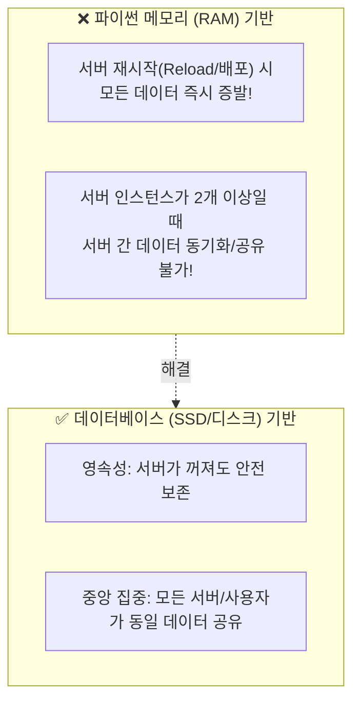
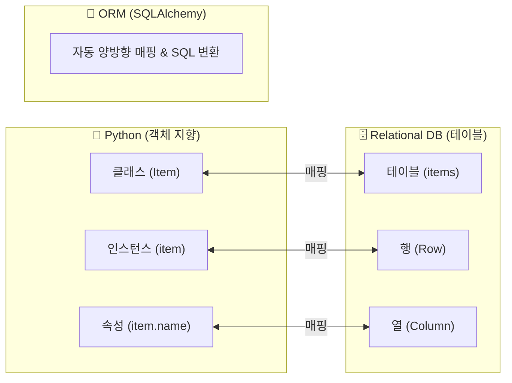
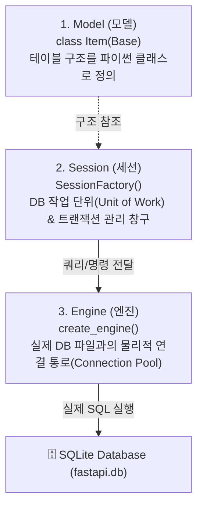
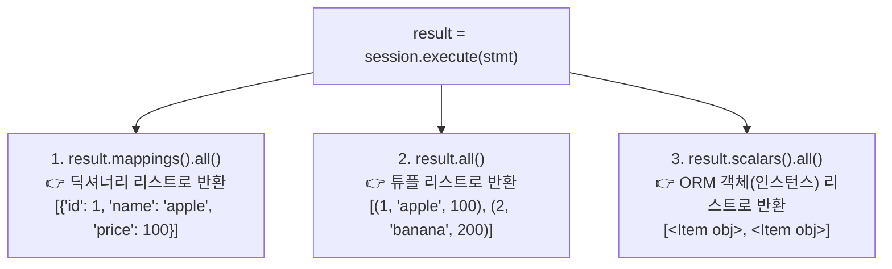

# 🗄️ FastAPI & SQLAlchemy ORM 데이터베이스 연동과 실전 영속 CRUD 완벽 정리 노트

> 메모리(list) 기반 CRUD의 한계와 **데이터베이스(RDB) 도입 이유**부터 **SQL 직접 작성의 한계와 ORM(Object-Relational Mapping)의 본질**, **SQLAlchemy 2.0 모던 아키텍처(Engine, Session, Model)**, **`Mapped` & `mapped_column` 모델링**, **세션의 생명주기와 영속성 컨텍스트(Staging ➔ Commit)**, **Result 커서의 원리와 3대 추출 메서드(`mappings`, `all`, `scalars`)**, 그리고 **Context Manager(`with`)를 적용한 견고한 실전 DB CRUD 구현**까지 총정리한 실무 가이드

---

## 📑 목차
1. [왜 데이터베이스(DB)가 필요한가? (메모리 CRUD의 한계)](#1-왜-데이터베이스db가-필요한가-메모리-crud의-한계)
   - [1-1. 메모리(list) 기반 CRUD의 2대 치명적 한계](#1-1-메모리list-기반-crud의-2대-치명적-한계)
   - [1-2. 데이터베이스의 3대 핵심 역할 (영속성, 동시성, 신뢰성)](#1-2-데이터베이스의-3대-핵심-역할-영속성-동시성-신뢰성)
2. [SQL 직접 작성(Raw SQL)의 한계와 ORM의 탄생](#2-sql-직접-작성raw-sql의-한계와-orm의-탄생)
   - [2-1. 클라이언트 - FastAPI - SQLite 전체 아키텍처](#2-1-클라이언트---fastapi---sqlite-전체-아키텍처)
   - [2-2. "SQL을 코드 안에 직접 적었을 때"의 2대 문제점](#2-2-sql을-코드-안에-직접-적었을-때의-2대-문제점)
   - [2-3. ORM(Object-Relational Mapping)이란?](#2-3-ormobject-relational-mapping이란)
   - [2-4. ORM 3대 매핑 공식 (테이블=클래스, 행=인스턴스, 열=속성)](#2-4-orm-3대-매핑-공식-테이블클래스-행인스턴스-열속성)
3. [SQLAlchemy: Python 표준 ORM 라이브러리](#3-sqlalchemy-python-표준-orm-라이브러리)
   - [3-1. SQLAlchemy를 사용하는 이유와 프레임워크별 ORM 비교](#3-1-sqlalchemy를-사용하는-이유와-프레임워크별-orm-비교)
   - [3-2. 패키지 설치 (`pip install SQLAlchemy`)](#3-2-패키지-설치-pip-install-sqlalchemy)
4. [SQLAlchemy 기초 3대 요소 (Engine, Session, Model)](#4-sqlalchemy-기초-3대-요소-engine-session-model)
   - [4-1. Engine (엔진): DB 물리적 연결의 관문](#4-1-engine-엔진-db-물리적-연결의-관문)
   - [4-2. Session (세션): 작업 단위와 트랜잭션 관리](#4-2-session-세션-작업-단위와-트랜잭션-관리)
   - [4-3. Model (모델): 파이썬 클래스로 표현한 테이블](#4-3-model-모델-파이썬-클래스로-표현한-테이블)
   - [4-4. 엔진을 통한 데이터베이스 요청/실행 전체 흐름](#4-4-엔진을-통한-데이터베이스-요청실행-전체-흐름)
5. [SQLAlchemy 2.0 모던 모델 정의와 테이블 자동 생성](#5-sqlalchemy-20-모던-모델-정의와-테이블-자동-생성)
   - [5-1. `DeclarativeBase`를 상속한 `Base` 선언](#5-1-declarativebase를-상속한-base-선언)
   - [5-2. `Mapped`와 `mapped_column`을 활용한 Item 모델 정의](#5-2-mapped와-mapped_column을-활용한-item-모델-정의)
   - [5-3. 왜 DB 컬럼의 타입을 고정해야 하는가? (일관성 & 저장 효율성)](#5-3-왜-db-컬럼의-타입을-고정해야-하는가-일관성--저장-효율성)
   - [5-4. `Base.metadata.create_all(bind=engine)` 테이블 자동 생성](#5-4-basemetadatacreate_allbindengine-테이블-자동-생성)
6. [세션의 라이프사이클과 데이터 저장 (Staging ➔ Commit)](#6-세션의-라이프사이클과-데이터-저장-staging--commit)
   - [6-1. 객체 생성 vs `session.add()` (Staging 상태의 의미)](#6-1-객체-생성-vs-sessionadd-staging-상태의-의미)
   - [6-2. `session.commit()`과 `session.close()`](#6-2-sessioncommit과-sessionclose)
   - [6-3. 다중 데이터 일괄 등록과 `RETURNING id`의 원리](#6-3-다중-데이터-일괄-등록과-returning-id의-원리)
7. [SQLAlchemy 데이터 조회(SELECT)와 Result 객체의 비밀](#7-sqlalchemy-데이터-조회select와-result-객체의-비밀)
   - [7-1. `select()` 쿼리문 빌드와 `session.execute()`](#7-1-select-쿼리문-빌드와-sessionexecute)
   - [7-2. 왜 `print(result)` 해도 데이터가 안 보일까? (Iterator/Result 커서)](#7-2-왜-printresult-해도-데이터가-안-보일까-iteratorresult-커서)
   - [7-3. 3대 데이터 추출 메서드 비교 (`mappings`, `all`, `scalars`)](#7-3-3대-데이터-추출-메서드-비교-mappings-all-scalars)
   - [7-4. 🚨 치명적 주의점: Result 커서의 일회성 소모(Consumption) 특성](#7-4--치명적-주의점-result-커서의-일회성-소모consumption-특성)
   - [7-5. 특정 데이터 단일 조회: `.where()`와 `session.scalar()`](#7-5-특정-데이터-단일-조회-where와-sessionscalar)
8. [FastAPI + SQLAlchemy 연동 실전 영속 CRUD 구현](#8-fastapi--sqlalchemy-연동-실전-영속-crud-구현)
   - [8-1. DB 연결 및 세션 팩토리 공통 모듈 (`connection.py`)](#8-1-db-연결-및-세션-팩토리-공통-모듈-connectionpy)
   - [8-2. [Create] 상품 생성 (`POST /items`, try-finally vs Context Manager)](#8-2-create-상품-생성-post-items-try-finally-vs-context-manager)
   - [8-3. [Read All] 전체 상품 조회 (`GET /items`, `scalars().all()`)](#8-3-read-all-전체-상품-조회-get-items-scalarsall)
   - [8-4. [Read One] 단일 상품 상세 조회 (`GET /items/{item_id}`, 404 예외)](#8-4-read-one-단일-상품-상세-조회-get-itemsitem_id-404-예외)
   - [8-5. [Update] 상품 부분 수정 (`PATCH /items/{item_id}`, DB 변경 반영)](#8-5-update-상품-부분-수정-patch-itemsitem_id-db-변경-반영)
   - [8-6. [Delete] 상품 삭제 (`DELETE /items/{item_id}`, `session.delete`)](#8-6-delete-상품-삭제-delete-itemsitem_id-sessiondelete)
9. [💡 실전 핵심 요약 치트시트](#9--실전-핵심-요약-치트시트)

---

## 1. 왜 데이터베이스(DB)가 필요한가? (메모리 CRUD의 한계)

### 1-1. 메모리(list) 기반 CRUD의 2대 치명적 한계

이전 장까지는 파이썬 코드 안의 리스트(`ITEMS = [...]`)에 데이터를 담아 CRUD를 구현했습니다.  
하지만 메모리 기반 데이터 관리는 실제 상용 서비스에서는 절대 사용할 수 없는 치명적인 결함이 있습니다:



1. **휘발성 (서버 재시작 시 데이터 소멸)**:  
   - RAM(메모리)에 상주하므로 코드를 수정해 서버가 리로드되거나, 배포, 서버 재부팅이 발생하는 순간 **기존에 저장된 모든 데이터가 영구적으로 날아갑니다.**
2. **동시 공유 불가 (다중 프로세스/서버 환경)**:  
   - 실제 서비스는 트래픽을 감당하기 위해 서버 프로세스를 여러 개(Uvicorn 워커 4개, 도커 컨테이너 여러 대) 띄웁니다.
   - 각 프로세스는 독립된 메모리를 가지므로, 1번 서버에서 등록한 상품을 2번 서버에서는 조회할 수 없습니다.

---

### 1-2. 데이터베이스의 3대 핵심 역할 (영속성, 동시성, 신뢰성)

- **1. 영속성 (Persistence)**:  
  서버가 다운되거나 재부팅되더라도 하드디스크/SSD의 물리적 파일이나 블록에 데이터가 영구적으로 안전하게 기록됩니다.
- **2. 동시성 (Concurrency)**:  
  수천, 수만 명의 사용자가 동시에 같은 상품을 조회하고 주문하더라도 락(Lock)과 격리 수준(Isolation)을 통해 데이터 충돌 없이 안전하게 조율합니다.
- **3. 신뢰성 (Reliability / ACID)**:  
  트랜잭션(Transaction)을 지원하여, 작업 도중 에러가 발생하면 이전 상태로 완벽히 되돌리는 롤백(Rollback)을 보장합니다.

---

## 2. SQL 직접 작성(Raw SQL)의 한계와 ORM의 탄생

### 2-1. 클라이언트 - FastAPI - SQLite 전체 아키텍처

```mermaid
sequenceDiagram
    autonumber
    actor Client as 클라이언트 (웹/앱)
    participant API as FastAPI 백엔드
    participant ORM as ORM (SQLAlchemy)
    participant DB as SQLite DB (test.db)

    Client->>API: HTTP POST /items {"name": "apple", "price": 1000}
    Note over API: Pydantic으로 Request Body 유효성 검증
    API->>ORM: item = Item(name=..., price=...)<br/>session.add(item); session.commit()
    ORM->>DB: INSERT INTO items (name, price) VALUES ('apple', 1000);
    DB-->>ORM: 1 Row Inserted (id=1 발급)
    ORM-->>API: Item ORM 객체 반환
    API-->>Client: HTTP 201 Created {"id": 1, "name": "apple", "price": 1000}
```

---

### 2-2. "SQL을 코드 안에 직접 적었을 때"의 2대 문제점

데이터베이스와 통신할 때 과거처럼 `SELECT * FROM items WHERE id = ?` 같은 원시 SQL(Raw SQL) 쿼리문을 파이썬 문자열로 직접 하드코딩하면 다음과 같은 심각한 문제가 발생합니다:

1. **스키마 변경 시 연관된 쿼리를 직접 관리 (유지보수 지옥)**:  
   - DB 테이블 구조(컬럼명 변경, 새 필드 추가 등)가 바뀌면, 파이썬 코드 전체에 흩어진 모든 SQL 문자열(`SELECT`, `INSERT`, `UPDATE`)을 개발자가 일일이 검색해서 수동으로 고쳐야 합니다.
   - 오타 하나로 런타임 SQL Syntax Error가 터지는 등 휴먼 에러가 빈번해집니다.
2. **SQL ➔ tuple ➔ 객체화 (데이터 변환의 극심한 번거로움)**:  
   - SQL을 실행하면 DB 드라이버는 데이터를 순수한 **튜플(`(1, 'apple', 1000)`)이나 로우(Row)** 형태로 반환합니다.
   - 개발자가 `item_id = row[0]`, `item_name = row[1]` 처럼 수동으로 인덱싱해서 파이썬 객체로 조립하는 노가다 코드를 수없이 작성해야 합니다.

---

### 2-3. ORM(Object-Relational Mapping)이란?

> **ORM (객체 관계 매핑)**:  
> 문자열 형태의 SQL 쿼리를 개발자가 직접 작성하는 대신, **객체 지향 프로그래밍(OOP) 언어의 문법(파이썬 클래스와 인스턴스)으로 데이터베이스를 다룰 수 있게 해주는 중개 기술**입니다.



---

### 2-4. ORM 3대 매핑 공식 (테이블=클래스, 행=인스턴스, 열=속성)

| RDB (관계형 데이터베이스) | ➔ 매핑 ➔ | Python (객체 지향 언어) | 실전 코드 예시 |
| :--- | :---: | :--- | :--- |
| **1개 테이블 (Table)** | ➔ | **1개 클래스 (Class)** | `class Item(Base):` ➔ `items` 테이블 |
| **1개 행 (Row / 레코드)** | ➔ | **1개 인스턴스 (Object)** | `item = Item(...)` ➔ 테이블의 한 줄 데이터 |
| **1개 열 (Column / 필드)** | ➔ | **1개 인스턴스 속성 (Attribute)**| `item.name`, `item.price` ➔ `name`, `price` 컬럼 |

---

## 3. SQLAlchemy: Python 표준 ORM 라이브러리

### 3-1. SQLAlchemy를 사용하는 이유와 프레임워크별 ORM 비교
- **SQLAlchemy**는 파이썬 생태계에서 가장 강력하고 성숙하며, 널리 사용되는 사실상의 표준(Defacto Standard) ORM입니다.
- FastAPI와 설계 철학이 완벽하게 들어맞으며, 대규모 트래픽 환경에서도 안정적인 커넥션 풀링과 트랜잭션 관리를 지원합니다.

#### Python 웹 프레임워크별 ORM 스타일 비교:
- **Django**: `Django ORM` 내장 (Active Record 패턴: 모델 객체 자체가 DB 저장 메서드를 가짐 `item.save()`)
- **FastAPI**: `SQLAlchemy`, `SQLModel`, `TortoiseORM` 자유 선택 (Data Mapper 패턴: 비즈니스 로직과 DB 영속성 레이어를 세션으로 명확히 분리)

---

### 3-2. 패키지 설치 (`pip install SQLAlchemy`)

가상환경(`.venv`)이 활성화된 상태에서 설치합니다:

```bash
pip install SQLAlchemy
```

---

## 4. SQLAlchemy 기초 3대 요소 (Engine, Session, Model)

SQLAlchemy를 지탱하는 3개의 핵심 기둥입니다:



### 4-1. Engine (엔진): DB 물리적 연결의 관문
- 파이썬 애플리케이션과 실제 SQLite 데이터베이스 파일(`test.db` 등) 사이의 **물리적인 연결 통로(Connection Pool)**를 쥐고 있는 핵심 객체입니다.
- 개발자가 작성한 ORM 코드를 실제 SQL 문장으로 번역하여 DB에 전달하고 실행합니다.
- `echo=True` 옵션을 주면 실행되는 원시 SQL 로그를 터미널에 실시간으로 출력해 주어 학습과 디버깅에 매우 유용합니다.

### 4-2. Session (세션): 작업 단위와 트랜잭션 관리
- 실제로 데이터를 추가(`add`), 조회(`select`), 수정, 삭제(`delete`)할 때 엔진 위에 띄우는 **작업 창구(단위)**입니다.
- 트랜잭션(Transaction)을 시작하고, 변경 사항을 모아두었다가 `commit()` 시점에 한 번에 DB에 반영합니다.

### 4-3. Model (모델): 파이썬 클래스로 표현한 테이블
- 데이터베이스의 테이블 스키마를 파이썬 클래스로 정의한 청사진입니다.

---

### 4-4. 엔진을 통한 데이터베이스 요청/실행 전체 흐름
1. **연결 생성 (Engine)**: `create_engine(DATABASE_URL)`이 DB와의 통신 회선을 개설합니다.
2. **세션 생성 (Session)**: `session = SessionFactory()`를 통해 실제 작업자가 창구(세션)를 엽니다.
3. **요청 전달 및 실행**: `session.add()` 또는 `session.execute(stmt)`를 호출하면 세션이 엔진에게 전달하고, 엔진이 실제 SQL을 실행한 뒤 결과를 파이썬 객체로 감싸서 돌려줍니다.

---

## 5. SQLAlchemy 2.0 모던 모델 정의와 테이블 자동 생성

### 5-1. `DeclarativeBase`를 상속한 `Base` 선언

SQLAlchemy 2.0부터는 `declarative_base()` 함수 대신 **`DeclarativeBase` 클래스를 상속받는 깔끔한 클래스 선언 방식**을 표준으로 권장합니다.

```python
from sqlalchemy.orm import DeclarativeBase

# 모든 ORM 모델들이 상속받을 최상위 부모 클래스
class Base(DeclarativeBase):
    pass
```

---

### 5-2. `Mapped`와 `mapped_column`을 활용한 Item 모델 정의

파이썬의 표준 타입 힌트 시스템과 결합된 모던 문법입니다:

```python
from sqlalchemy.orm import Mapped, mapped_column
from sqlalchemy import Integer, String

class Item(Base):
    # 실제 생성될 데이터베이스 테이블 이름 지정
    __tablename__ = "items"

    # id: 정수형, 기본키(PK), 1부터 자동 증가(Auto-increment)
    id: Mapped[int] = mapped_column(Integer, primary_key=True, autoincrement=True)
    
    # name: 문자열(최대 128자)
    name: Mapped[str] = mapped_column(String(128))
    
    # price: 정수형
    price: Mapped[int] = mapped_column(Integer)
```

---

### 5-3. 왜 DB 컬럼의 타입을 고정해야 하는가? (일관성 & 저장 효율성)
1. **일관성 (Data Consistency)**:  
   가격(`price`) 컬럼에 어떤 사람은 문자열 `"천원"`을 넣고 어떤 사람은 숫자 `1000`을 넣으면 계산과 정렬이 불가능해집니다. 타입을 고정하여 데이터의 무결성을 지킵니다.
2. **저장 효율성 (Storage Efficiency)**:  
   정수형(`Integer`)은 4바이트 고정 메모리를 사용하므로 디스크 공간을 절약하고 검색 색인(인덱스) 속도를 극대화합니다.

---

### 5-4. `Base.metadata.create_all(bind=engine)` 테이블 자동 생성

정의한 파이썬 모델 클래스를 바탕으로 SQLite DB 파일에 실제 물리적 테이블을 한 줄로 생성합니다:

```python
from sqlalchemy import create_engine

DATABASE_URL = "sqlite:///./test.db"
engine = create_engine(DATABASE_URL, echo=True)

# Base를 상속받은 모든 모델(Item 등)의 CREATE TABLE 문을 자동 실행!
Base.metadata.create_all(bind=engine)
```

터미널 출력 로그:
```sql
CREATE TABLE items (
    id INTEGER NOT NULL PRIMARY KEY AUTOINCREMENT,
    name VARCHAR(128) NOT NULL,
    price INTEGER NOT NULL
);
```

---

## 6. 세션의 라이프사이클과 데이터 저장 (Staging ➔ Commit)

### 6-1. 객체 생성 vs `session.add()` (Staging 상태의 의미)

```python
# 1단계: 순수 파이썬 객체 생성
item = Item(name="apple", price=100)
# ⚠️ 이 시점에는 파이썬 RAM 메모리에만 존재하며, SQLite DB 파일에는 전혀 기록되지 않음!

# 2단계: 세션에 등록 (Staging)
session.add(item)
# "이 객체를 나중에 DB에 저장할 거니까 영속성 관리 영역(Persistence)에 등록해 둬!"
# Git으로 치면 `git add`를 실행해 스테이징 영역에 올려둔 것과 동일합니다.
```

---

### 6-2. `session.commit()`과 `session.close()`

```python
# 3단계: 변경 사항을 DB에 영구 확정 (Commit)
session.commit()
# Git의 `git commit`처럼 실제 DB 파일에 INSERT SQL 쿼리가 날아가 영구 기록됩니다.

# 4단계: 세션 종료 (Close)
session.close()
# 점유했던 DB 커넥션 자원을 깔끔하게 반납합니다.
```

---

### 6-3. 다중 데이터 일괄 등록과 `RETURNING id`의 원리

여러 데이터를 한 번에 세션에 담고 커밋할 수 있습니다:

```python
item2 = Item(name="banana", price=200)
item3 = Item(name="cherry", price=300)

session.add(item2)
session.add(item3)
session.commit()

# DB 엔진 로그:
# INSERT INTO items (name, price) VALUES (?, ?) RETURNING id
```

> [!NOTE]
> 💡 **`RETURNING id`의 의미**:  
> 우리가 코드로 `item2`를 만들 때 `id` 값을 지정하지 않았지만, 데이터베이스가 기본키 자동 증가를 통해 `id=2`, `id=3`을 발급한 뒤 **즉시 파이썬 객체의 `id` 속성에 자동으로 채워줍니다!**  
> `print(item2.id)` ➔ `2` 출력!

---

## 7. SQLAlchemy 데이터 조회(SELECT)와 Result 객체의 비밀

### 7-1. `select()` 쿼리문 빌드와 `session.execute()`

SQLAlchemy 2.0에서는 함수형 쿼리 빌더인 `select()`를 사용합니다:

```python
from sqlalchemy import select

# 1. 쿼리문 객체 생성
stmt = select(Item)
print(stmt)  # 출력: SELECT items.id, items.name, items.price FROM items

# 2. 쿼리 실행
result = session.execute(stmt)
```

---

### 7-2. 왜 `print(result)` 해도 데이터가 안 보일까? (Iterator/Result 커서)

많은 입문자가 `print(result)`를 해보고 당황합니다:
```python
print(result)
# 출력: <sqlalchemy.engine.result.ChunkedIteratorResult object at 0x103b616a0>
```

- **이유**: `result`는 데이터 리스트 자체가 아니라, **데이터베이스에서 데이터를 한 줄씩 꺼내올 수 있는 '결과 핸들러(Iterator / Result 커서)'**이기 때문입니다.
- 사물함 안에 데이터가 들어있는데, 사물함의 겉모습(메모리 주소)만 출력한 것과 같습니다.
- 따라서 **데이터를 실제로 꺼내는 전용 메서드(`mappings()`, `all()`, `scalars()`)를 호출**해야 합니다.

---

### 7-3. 3대 데이터 추출 메서드 비교 (`mappings`, `all`, `scalars`)



| 메서드 | 반환 데이터 형태 | 주요 용도 |
| :--- | :--- | :--- |
| **`result.mappings().all()`** | `list[dict]` (딕셔너리 리스트) | 딕셔너리 형태로 JSON 직렬화하거나 키값으로 접근할 때 |
| **`result.all()`** | `list[tuple]` (튜플 리스트) | 원시 튜플 데이터 그대로 인덱싱할 때 |
| **`result.scalars().all()`**<br/>(또는 `session.scalars(stmt).all()`) | **`list[Item]` (ORM 객체 리스트)** | **실무 최다 사용!** `item.name`, `item.price` 처럼 ORM 객체로 다룰 때 |

---

### 7-4. 🚨 치명적 주의점: Result 커서의 일회성 소모(Consumption) 특성

> **⚠️ 한 번 비워버린 상자는 다시 쓸 수 없다!**  
> `result` 커서 객체는 `result.mappings().all()`을 호출하여 데이터를 모두 꺼내고 나면, **커서가 데이터의 맨 끝(End of File)에 도달**합니다.  
> 따라서 바로 아래 줄에서 `result.all()`을 또 호출하면 **이미 비어버렸으므로 빈 리스트(`[]`)가 반환**됩니다!

#### 해결책:
데이터를 다시 조회하고 싶다면, 반드시 **`result = session.execute(stmt)`로 쿼리를 재실행**하여 새 커서를 받아와야 합니다.

---

### 7-5. 특정 데이터 단일 조회: `.where()`와 `session.scalar()`

- 조건절 추가: `select(Item).where(Item.id == item_id)`
- 단일 객체 1개만 꺼낼 때는 `.all()`이 아니라 **`.scalar()`**를 호출합니다:

```python
stmt = select(Item).where(Item.id == 1)

# 단 1개의 Item 인스턴스를 반환 (없으면 None)
item = session.scalar(stmt)
if item:
    print(item.name, item.price)
```

---

## 8. FastAPI + SQLAlchemy 연동 실전 영속 CRUD 구현

### 8-1. DB 연결 및 세션 팩토리 공통 모듈 (`connection.py`)

```python
# connection.py
from sqlalchemy import create_engine
from sqlalchemy.orm import sessionmaker

DATABASE_URL = "sqlite:///./test.db"

# echo=True: 터미널에 실행되는 SQL 출력
engine = create_engine(
    DATABASE_URL,
    echo=True,
    connect_args={"check_same_thread": False}  # SQLite를 FastAPI에서 쓸 때 필수 옵션
)

# 세션 생성 공장(SessionFactory)
SessionFactory = sessionmaker(
    bind=engine,
    autocommit=False,
    autoflush=False,
    expire_on_commit=False
)
```

---

### 8-2. [Create] 상품 생성 (`POST /items`, try-finally vs Context Manager)

세션을 열고 닫는 방식에는 2가지 패턴이 있습니다.

#### 방법 A: try-finally 패턴 (슬라이드 14페이지)
```python
@app.post("/items", response_model=ItemResponse, status_code=201)
def create_item(body: ItemCreateRequest):
    session = SessionFactory()
    try:
        new_item = Item(name=body.name, price=body.price)
        session.add(new_item)
        session.commit()
        return new_item
    finally:
        session.close()  # 에러가 발생해도 세션은 반드시 닫힘
```

#### 방법 B: Context Manager (`with`) 패턴 (슬라이드 15페이지 - 추천!)
```python
@app.post("/items", response_model=ItemResponse, status_code=201)
def create_item(body: ItemCreateRequest):
    # with 블록을 빠져나갈 때 session.close()가 자동으로 호출됨!
    with SessionFactory() as session:
        new_item = Item(name=body.name, price=body.price)
        session.add(new_item)
        session.commit()
        return new_item
```

---

### 8-3. [Read All] 전체 상품 조회 (`GET /items`, `scalars().all()`)

```python
@app.get("/items", response_model=list[ItemResponse])
def list_items():
    session = SessionFactory()
    try:
        stmt = select(Item)
        items = session.scalars(stmt).all()
        return items
    finally:
        session.close()
```

---

### 8-4. [Read One] 단일 상품 상세 조회 (`GET /items/{item_id}`, 404 예외)

```python
@app.get("/items/{item_id}", response_model=ItemResponse)
def get_item(item_id: int):
    session = SessionFactory()
    try:
        stmt = select(Item).where(Item.id == item_id)
        item = session.scalar(stmt)
        
        # 상품이 존재하지 않으면 404 에러 반환
        if item is None:
            raise HTTPException(status_code=404, detail="Item not found")
            
        return item
    finally:
        session.close()
```

---

### 8-5. [Update] 상품 부분 수정 (`PATCH /items/{item_id}`, DB 변경 반영)

수정할 필드가 전달되었는지(`is not None`) 각각 독립적인 `if`문으로 검사한 뒤 `session.commit()`을 호출하면 DB에 즉시 UPDATE SQL이 실행됩니다.

```python
@app.patch("/items/{item_id}", response_model=ItemResponse)
def patch_item(item_id: int, body: ItemUpdateRequest):
    session = SessionFactory()
    try:
        stmt = select(Item).where(Item.id == item_id)
        item = session.scalar(stmt)
        
        if item is None:
            raise HTTPException(status_code=404, detail="Item not found")
        
        # 1. 이름이 들어왔으면 수정
        if body.name is not None:
            item.name = body.name
            
        # 2. 가격이 들어왔으면 수정 (elif가 아닌 독립된 if문!)
        if body.price is not None:
            item.price = body.price
            
        session.commit()  # 변경 사항 DB 반영
        return item
    finally:
        session.close()
```

---

### 8-6. [Delete] 상품 삭제 (`DELETE /items/{item_id}`, `session.delete`)

DB에서 조회한 ORM 객체를 `session.delete(item)`에 전달하고 커밋하면 DELETE SQL이 실행됩니다.  
삭제 성공 시 본문 없는 `204 No Content` 응답을 반환합니다.

```python
from fastapi import Response

@app.delete("/items/{item_id}", status_code=204)
def delete_item(item_id: int):
    session = SessionFactory()
    try:
        stmt = select(Item).where(Item.id == item_id)
        item = session.scalar(stmt)
        
        if item is None:
            raise HTTPException(status_code=404, detail="Item not found")
            
        session.delete(item)    # DB에서 삭제 예약
        session.commit()         # 삭제 확정
        return Response(status_code=204)
    finally:
        session.close()
```

---

## 9. 💡 실전 핵심 요약 치트시트

```markdown
┌────────────────────────────────────────────────────────────────────────┐
│            FastAPI & SQLAlchemy ORM 데이터베이스 핵심 치트시트         │
├──────────────────────────────┬─────────────────────────────────────────┤
│ 문법 / 개념                  │ 핵심 요약 및 사용 공식                  │
├──────────────────────────────┼─────────────────────────────────────────┤
│ RDB 도입 이유                │ 영속성(재시작 시 보존), 동시성, 신뢰성 │
├──────────────────────────────┼─────────────────────────────────────────┤
│ ORM 매핑 3대 공식            │ 테이블 = 클래스 / 행 = 객체 / 열 = 속성 │
├──────────────────────────────┼─────────────────────────────────────────┤
│ Engine                       │ create_engine() : DB 물리적 연결 통로   │
├──────────────────────────────┼─────────────────────────────────────────┤
│ Session                      │ SessionFactory() : DB 작업 창구/트랜잭션│
├──────────────────────────────┼─────────────────────────────────────────┤
│ class Base(DeclarativeBase): │ 모든 ORM 모델의 부모 클래스 선언        │
├──────────────────────────────┼─────────────────────────────────────────┤
│ Mapped[T] = mapped_column()  │ SQLAlchemy 2.0 표준 컬럼 타입 매핑 문법 │
├──────────────────────────────┼─────────────────────────────────────────┤
│ Base.metadata.create_all()   │ 파이썬 모델 기준으로 실제 DB 테이블 생성│
├──────────────────────────────┼─────────────────────────────────────────┤
│ session.add(item)            │ 영속성 관리 영역(Staging)에 등록        │
├──────────────────────────────┼─────────────────────────────────────────┤
│ session.commit()             │ 변경 사항을 실제 DB 파일에 최종 확정    │
├──────────────────────────────┼─────────────────────────────────────────┤
│ session.close()              │ DB 세션 및 연결 자원 반납               │
├──────────────────────────────┼─────────────────────────────────────────┤
│ with SessionFactory() as s:  │ Context Manager로 세션 자동 닫기 보장   │
├──────────────────────────────┼─────────────────────────────────────────┤
│ session.scalars(stmt).all()  │ 쿼리 결과를 ORM 객체 리스트로 추출      │
├──────────────────────────────┼─────────────────────────────────────────┤
│ result.mappings().all()      │ 쿼리 결과를 딕셔너리 리스트로 추출      │
├──────────────────────────────┼─────────────────────────────────────────┤
│ session.scalar(stmt)         │ .where() 조건에 맞는 단일 객체 1개 추출 │
├──────────────────────────────┼─────────────────────────────────────────┤
│ session.delete(item)         │ 조회된 ORM 객체를 DB에서 삭제           │
└──────────────────────────────┴─────────────────────────────────────────┘
```
