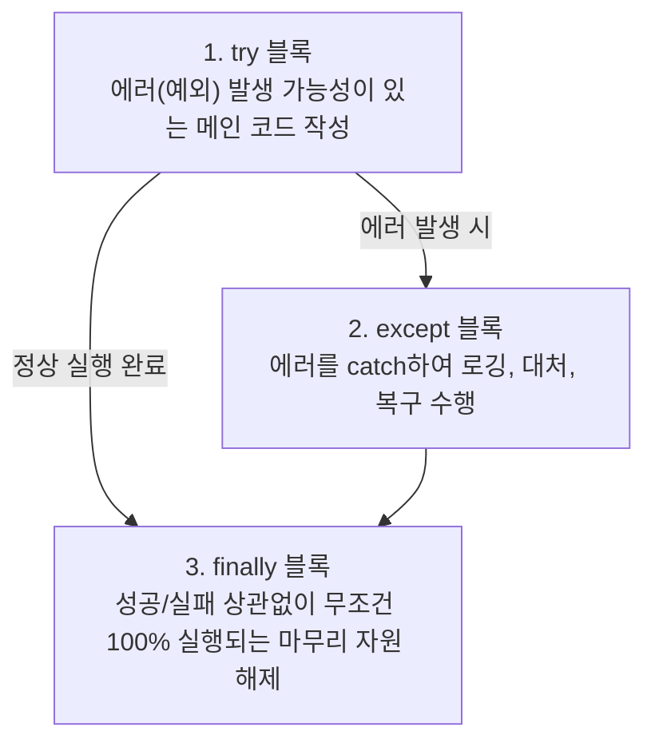
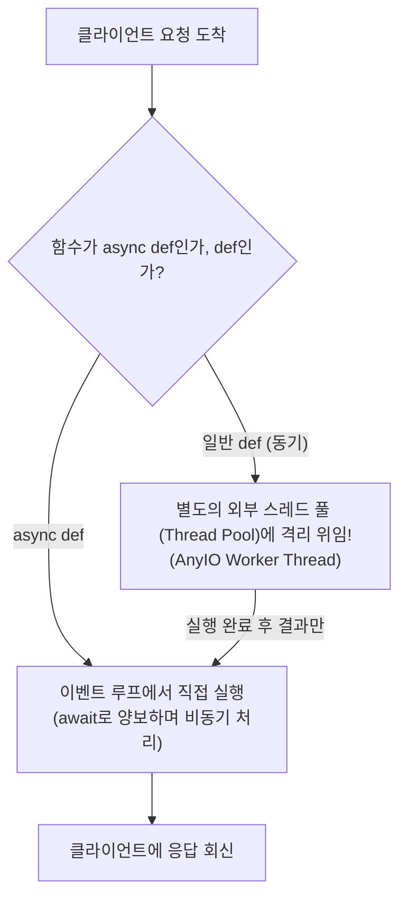

# ⚡ FastAPI & asyncio 비동기 프로그래밍, 의존성 주입(DI) & 스레드 풀 완벽 정리 노트

> FastAPI의 핵심 아키텍처인 **자원 관리(try-finally ➔ Context Manager ➔ Depends 의존성 주입)**부터 **클라이언트 요청-응답 4단계 라이프사이클**, **응답 속도를 극대화하는 Background Tasks**, **비동기(asyncio)의 본질과 컴퓨터 하드웨어(RAM vs Disk I/O) 속도 차이**, **코루틴(Coroutine)과 '세 쌍둥이 밥 먹이기' 이벤트 루프(Event Loop)의 원리**, **`await`를 쓰는 2대 필수 조건과 체이닝 실습**, 그리고 **FastAPI가 동기 함수(`def`)를 이벤트 루프 블로킹 없이 처리하는 비밀인 스레드 풀(Thread Pool)과 Lifespan 제어**까지 총정리한 실무 가이드

---

## 📑 목차
1. [자원 관리의 진화: try-finally에서 Context Manager까지](#1-자원-관리의-진화-try-finally에서-context-manager까지)
   - [1-1. try-except-finally 예외 처리 3대 블록의 역할](#1-1-try-except-finally-예외-처리-3대-블록의-역할)
   - [1-2. DB 세션에서 finally가 필수적인 이유 (return보다 늦게 닫히는 문제 해결)](#1-2-db-세션에서-finally가-필수적인-이유-return보다-늦게-닫히는-문제-해결)
   - [1-3. Context Manager (`with SessionFactory() as session:`)의 자동 뒷정리 마법](#1-3-context-manager-with-sessionfactory-as-session의-자동-뒷정리-마법)
2. [FastAPI 라우팅과 클라이언트 요청-응답 4단계 라이프사이클](#2-fastapi-라우팅과-클라이언트-요청-응답-4단계-라이프사이클)
   - [2-1. 라우팅(Routing)의 본질: 도로 표지판과 HTTP Method + URL 매핑](#2-1-라우팅routing의-본질-도로-표지판과-http-method--url-매핑)
   - [2-2. 🌐 요청부터 응답까지의 4단계 라이프사이클 전체 흐름도](#2-2--요청부터-응답까지의-4단계-라이프사이클-전체-흐름도)
3. [의존성 주입 (Dependency Injection, DI): with 구문마저 지우는 비결](#3-의존성-주입-dependency-injection-di-with-구문마저-지우는-비결)
   - [3-1. 의존성 주입(DI)이란 무엇인가? (자원 생성과 렌탈 개념)](#3-1-의존성-주입di이란-무엇인가-자원-생성과-렌탈-개념)
   - [3-2. `yield` 키워드를 활용한 세션 팩토리 제너레이터 (`get_session()`)](#3-2-yield-키워드를-활용한-세션-팩토리-제너레이터-get_session)
   - [3-3. `Depends(get_session)` 실전 적용과 엔드포인트 극단적 단순화](#3-3-dependsget_session-실전-적용과-엔드포인트-극단적-단순화)
4. [Background Tasks (백그라운드 태스크)](#4-background-tasks-백그라운드-태스크)
   - [4-1. 요청-응답 이후 실행의 의미와 체감 응답 속도 극대화](#4-1-요청-응답-이후-실행의-의미와-체감-응답-속도-극대화)
   - [4-2. 실전 코드: 회원가입 후 5초 이메일 발송 비동기 처리](#4-2-실전-코드-회원가입-후-5초-이메일-발송-비동기-처리)
   - [4-3. Background Tasks 사용 시 주의점 (무거운 작업과 Celery/Redis 비교)](#4-3-background-tasks-사용-시-주의점-무거운-작업과-celeryredis-비교)
5. [비동기 프로그래밍 (asyncio)의 본질과 컴퓨터 구조](#5-비동기-프로그래밍-asyncio의-본질과-컴퓨터-구조)
   - [5-1. 동기(Synchronous)의 한계와 I/O Bound 작업의 비효율](#5-1-동기synchronous의-한계와-io-bound-작업의-비효율)
   - [5-2. 컴퓨터 구조로 보는 속도 차이 (빛처럼 빠른 CPU/RAM vs 목 빠지는 Disk/Network I/O)](#5-2-컴퓨터-구조로-보는-속도-차이-빛처럼-빠른-cpuram-vs-목-빠지는-disknetwork-io)
   - [5-3. 비동기의 일상 비유: 라면 끓이기와 주문 접수](#5-3-비동기의-일상-비유-라면-끓이기와-주문-접수)
   - [5-4. 파이썬 표준 라이브러리 `asyncio`](#5-4-파이썬-표준-라이브러리-asyncio)
6. [코루틴(Coroutine)과 협력적 멀티태스킹](#6-코루틴coroutine과-협력적-멀티태스킹)
   - [6-1. 코루틴의 정의: "너 한 번, 나 한 번" 협력(co-routine)하는 함수](#6-1-코루틴의-정의-너-한-번-나-한-번-협력co-routine하는-함수)
   - [6-2. 코루틴 함수(`async def`) vs 코루틴 객체 (왜 바로 실행되지 않는가?)](#6-2-코루틴-함수async-def-vs-코루틴-객체-왜-바로-실행되지-않는가)
   - [6-3. `asyncio.run()`과 `asyncio.gather()`를 통한 동시 실행 패키징](#6-3-asynciorun과-asynciogather를-통한-동시-실행-패키징)
   - [6-4. 동기 vs 비동기 실행 시간 벤치마크 (4초 ➔ 2초 단축)](#6-4-동기-vs-비동기-실행-시간-벤치마크-4초--2초-단축)
7. [`await` 키워드와 양보(Yield Control)의 미학](#7-await-키워드와-양보yield-control의-미학)
   - [7-1. `await`: "여기서 잠깐 멈추고 제어권을 넘겨라!"](#7-1-await-여기서-잠깐-멈추고-제어권을-넘겨라)
   - [7-2. ⭐ await를 사용하는 2가지 절대 조건](#7-2--await를-사용하는-2가지-절대-조건)
   - [7-3. 어떤 작업이 Awaitable한가? (판단 3단계 공식)](#7-3-어떤-작업이-awaitable한가-판단-3단계-공식)
   - [7-4. [실습] 코루틴 체이닝 퍼즐 (출력 순서 제어 완성)](#7-4-실습-코루틴-체이닝-퍼즐-출력-순서-제어-완성)
8. [이벤트 루프(Event Loop)와 블로킹(Blocking) 금지의 법칙](#8-이벤트-루프event-loop와-블로킹blocking-금지의-법칙)
   - [8-1. 이벤트 루프란? ("세 쌍둥이 밥 먹이기" 완벽 비유)](#8-1-이벤트-루프란-세-쌍둥이-밥-먹이기-완벽-비유)
   - [8-2. 🚨 절대 규칙: 이벤트 루프를 블로킹하면 서버 전체가 얼어붙는다!](#8-2--절대-규칙-이벤트-루프를-블로킹하면-서버-전체가-얼어붙는다)
9. [FastAPI 내부 동작의 비밀: 동기 함수(`def`)와 스레드 풀(Thread Pool)](#9-fastapi-내부-동작의-비밀-동기-함수def와-스레드-풀thread-pool)
   - [9-1. "FastAPI는 비동기인데 왜 우린 지금까지 `def` 일반 함수를 썼을까?"](#9-1-fastapi는-비동기인데-왜-우린-지금까지-def-일반-함수를-썼을까)
   - [9-2. 스레드 풀(Thread Pool)의 대리 실행 메커니즘 (`run_endpoint_function`)](#9-2-스레드-풀thread-pool의-대리-실행-메커니즘-run_endpoint_function)
   - [9-3. 스레드 풀 크기 조절과 Lifespan 컨텍스트 매니저 (기본 40개 ➔ 200개 상향)](#9-3-스레드-풀-크기-조절과-lifespan-컨텍스트-매니저-기본-40개--200개-상향)
10. [💡 실전 핵심 요약 치트시트](#10--실전-핵심-요약-치트시트)

---

## 1. 자원 관리의 진화: try-finally에서 Context Manager까지

### 1-1. try-except-finally 예외 처리 3대 블록의 역할

파이썬의 예외 처리는 프로그램이 예기치 못한 에러로 강제 종료(크래시)되는 것을 막고, 사용한 시스템 자원을 안전하게 반납하기 위한 핵심 문법입니다.



- **`try`**: 에러가 발생할 가능성이 있는 코드를 실행. 에러가 나면 즉시 실행을 멈추고 `except`로 점프.
- **`except`**: 발생한 에러를 잡아내어 대처(로그 기록, 사용자 친화적 메시지 출력 등).
- **`finally`**: **예외 발생 여부와 상관없이 무조건 마지막에 실행되는 구역**. 파일 닫기(`f.close()`), 네트워크 연결 종료, 데이터베이스 세션 종료(`session.close()`) 등에 필수적입니다.
- **`except` 생략 가능**: 에러 처리는 상위로 넘기되 뒷정리만 확실히 하고 싶다면 `try - finally` 구조로만 작성할 수 있습니다.

---

### 1-2. DB 세션에서 finally가 필수적인 이유 (return보다 늦게 닫히는 문제 해결)

```python
def get_items_handler():
    session = SessionFactory()
    try:
        stmt = select(Item)
        items = session.scalars(stmt).all()
        return items  # ⚠️ 여기서 함수가 즉시 종료됨!
        # session.close() 를 여기에 적으면 절대 도달할 수 없음(Dead Code)!
    finally:
        session.close()  # ✅ return이 실행되기 직전에 무조건 실행되어 세션을 안전하게 닫음!
```

- 데이터베이스 세션을 열었으면 데이터를 다 쓰고 난 뒤 반드시 `session.close()`로 커넥션을 반납해야 커넥션 풀 누수(Memory Leak)가 발생하지 않습니다.
- 하지만 함수 중간에 `return items`를 만나면 함수가 그 즉시 끝나버립니다.
- **`finally` 블록을 사용하면 `return` 문을 만나더라도 파이썬 엔진이 그 직전에 `finally` 내부 코드를 먼저 실행하고 함수를 빠져나갑니다.**

---

### 1-3. Context Manager (`with SessionFactory() as session:`)의 자동 뒷정리 마법

매번 모든 API 엔드포인트마다 `session = SessionFactory()`, `try:`, `finally: session.close()`를 반복해서 적는 것은 코드가 지저분해지고 번거롭습니다.  
파이썬의 **컨텍스트 매니저 (Context Manager, `with` 문)**를 사용하면 이 모든 과정을 한 줄로 축약할 수 있습니다.

```python
def get_items_handler():
    # with 문 진입 시 자동으로 session이 열리고, 블록을 벗어날 때 자동으로 session.close() 호출!
    with SessionFactory() as session:
        stmt = select(Item)
        items = session.scalars(stmt).all()
        return items
```

#### ⚙ with 문 동작 메커니즘:
1. `with SessionFactory() as session:`에 진입하는 순간 세션 인스턴스가 생성됩니다 (`__enter__`).
2. 블록 내부 코드가 정상적으로 끝나든, 중간에 `return`을 만나든, 에러가 발생해 튕겨 나가든 상관없이, **들여쓰기가 끝나는 순간 컨텍스트 매니저가 내부적으로 `session.close()`를 100% 보장하며 안전하게 호출**합니다 (`__exit__`).

---

## 2. FastAPI 라우팅과 클라이언트 요청-응답 4단계 라이프사이클

### 2-1. 라우팅(Routing)의 본질: 도로 표지판과 HTTP Method + URL 매핑
- **라우팅(Routing)**이란:  
  클라이언트(웹 브라우저, 모바일 앱)가 보낸 요청의 **HTTP 메서드(GET, POST, PUT, DELETE)**와 **URL 경로(/items, /users)**를 조합하여, 서버 내부의 어떤 담당 함수(핸들러)를 실행시킬지 길을 안내하고 연결해 주는 과정입니다.
- **도로 표지판 비유**:
  - `GET /items` 표지판 ➔ `list_items()` 함수로 안내 (데이터 조회)
  - `POST /items` 표지판 ➔ `create_item()` 함수로 안내 (데이터 생성)
- **주소가 같아도 메서드가 다르면 완전히 다른 함수가 실행**됩니다!

---

### 2-2. 🌐 요청부터 응답까지의 4단계 라이프사이클 전체 흐름도

클라이언트가 버튼을 클릭한 순간부터 화면에 데이터가 렌더링될 때까지 FastAPI 내부에서 일어나는 일입니다:

```mermaid
sequenceDiagram
    autonumber
    actor Client as 💻 클라이언트 (Chrome)
    participant FastAPI as ⚡ FastAPI 라우팅 & 사전 검증
    participant Handler as ⚙ 비즈니스 핸들러 & DB
    participant Formatter as 📦 응답 직렬화기

    Client->>FastAPI: 1단계: HTTP 요청 (예: POST /items {"name": "apple", "price": 1000})
    Note over FastAPI: 2단계: 사전 검증<br/>a) 라우팅: URL+Method로 함수 탐색<br/>b) 데이터 유효성 검사: Pydantic 타입/길이 검증<br/>c) 검증 통과 시 핸들러 호출
    FastAPI->>Handler: 3단계: 함수 코드 실행 & DB 세션 관리
    Note over Handler: with SessionFactory() as session:<br/>session.add(new_item); session.commit()
    Handler-->>Formatter: 파이썬 Item ORM 객체 반환
    Note over Formatter: 4단계: 최종 응답 조립<br/>a) Python ➔ JSON 직렬화<br/>b) 상태 코드(201 Created) 부여
    Formatter-->>Client: HTTP 201 응답 전송 (JSON 본문)
```

1. **1단계: 클라이언트의 HTTP 요청 전송**: 웹/앱에서 주소를 호출 (`localhost:8000`은 외부망으로 나가지 않고 내 컴퓨터 내부에서 루프백 통신).
2. **2단계: FastAPI 사전 검증 및 라우팅**:
   - URL과 Method로 대상 함수 매핑
   - Path, Query, Request Body 데이터 형식 사전 검사 (실패 시 즉시 422 반환)
3. **3단계: 함수 실행 및 DB 세션 관리**: 비즈니스 로직 수행 및 안전한 세션 자원 해제.
4. **4단계: 최종 응답 처리**: 파이썬 데이터를 표준 JSON 텍스트로 자동 직렬화하고 HTTP 상태 코드와 함께 클라이언트로 회신.

---

## 3. 의존성 주입 (Dependency Injection, DI): with 구문마저 지우는 비결

### 3-1. 의존성 주입(DI)이란 무엇인가? (자원 생성과 렌탈 개념)

- **의존성 주입(Dependency Injection)**:  
  함수 내부에서 필요한 공통 자원(DB 세션, 인증 유저 정보, 외부 API 클라이언트 등)을 함수가 직접 만들지 않고, **FastAPI 프레임워크가 외부에서 대신 만들어 파라미터로 주입(Inject)해 주는 아키텍처**입니다.
- **렌탈(대여) 개념**:  
  자동차를 매번 내가 직접 사서 타고 폐차하는 것이 아니라, 렌터카 업체(FastAPI)에서 차를 빌려 타고 반납하면 뒷정리는 업체가 알아서 해주는 것과 같습니다.

---

### 3-2. `yield` 키워드를 활용한 세션 팩토리 제너레이터 (`get_session()`)

```python
# connection.py
from sqlalchemy.orm import Session
from connection import SessionFactory

def get_session():
    # 1. 요청이 들어오면 DB 세션을 열고
    session = SessionFactory()
    try:
        # 2. yield로 핸들러 함수에게 세션을 대여(전달)해 줌!
        # (함수가 종료될 때까지 get_session은 여기서 일시정지 상태 유지)
        yield session
    finally:
        # 3. 핸들러 함수가 return을 마치는 순간 일시정지가 풀리고 세션을 안전하게 닫음!
        session.close()
```

- **`yield`의 작동 원리**:
  - `return`은 값을 돌려주고 함수를 완전히 종료시킵니다.
  - 반면 `yield`는 **값을 반환한 뒤 그 자리에서 일시정지(Pause)**합니다.
  - FastAPI 핸들러 함수가 DB 작업을 모두 마치고 나면, 멈춰있던 `yield` 다음 줄(`finally: session.close()`)이 실행되면서 자원을 완벽하게 회수합니다.

---

### 3-3. `Depends(get_session)` 실전 적용과 엔드포인트 극단적 단순화

이제 엔드포인트 함수에서는 `with` 문조차 쓸 필요가 없습니다!

```python
from fastapi import FastAPI, Depends
from sqlalchemy.orm import Session
from sqlalchemy import select
from connection import get_session

app = FastAPI()

@app.get("/items", response_model=list[ItemResponse])
def list_items(session: Session = Depends(get_session)):
    # 🌟 with SessionFactory() as session: 을 작성할 필요가 전혀 없음!
    stmt = select(Item)
    items = session.scalars(stmt).all()
    return items
```

> [!TIP]
> 💡 **의존성 주입(DI)의 압도적인 장점**:
> 1. **비즈니스 로직에만 집중**: 세션을 열고 닫는 반복적인 보일러플레이트 코드가 완전히 사라집니다.
> 2. **테스트 용이성 (Mocking)**: 테스트 코드 작성 시 실제 DB 세션 대신 가짜(Mock) 세션으로 손쉽게 교체할 수 있습니다.

---

## 4. Background Tasks (백그라운드 태스크)

### 4-1. 요청-응답 이후 실행의 의미와 체감 응답 속도 극대화
- 클라이언트에게 **HTTP 응답 메시지를 먼저 초고속으로 반환한 뒤, 시간이 걸리는 부가 작업을 백그라운드에서 실행**하는 FastAPI 내장 기능입니다.
- 사용자는 화면에서 로딩 스피너를 오래 보지 않고 즉시 "완료되었습니다" 응답을 받으므로 **서비스의 체감 속도가 비약적으로 향상**됩니다.

---

### 4-2. 실전 코드: 회원가입 후 5초 이메일 발송 비동기 처리

```python
import time
from fastapi import FastAPI, BackgroundTasks

app = FastAPI()

# 5초가 걸리는 무거운 이메일 발송 함수
def send_email(email: str):
    time.sleep(5)  # 실제 이메일 SMTP 서버 통신 시뮬레이션
    print(f"📧 [발송 완료] {email} 님에게 환영 메일을 성공적으로 보냈습니다!")

@app.post("/sign-up")
def sign_up(email: str, background_tasks: BackgroundTasks):
    # 1. 백그라운드 태스크 큐에 작업 등록 (함수명, 인자)
    background_tasks.add_task(send_email, email)
    
    # 2. 이메일이 다 보내질 때까지 기다리지 않고 0.01초 만에 즉시 클라이언트에 응답!
    return {"message": "User SignUp Completed"}
```

---

### 4-3. Background Tasks 사용 시 주의점 (무거운 작업과 Celery/Redis 비교)

- **적합한 작업**: 이메일 발송, 푸시 알림 전송, 간단한 통계 로깅, 캐시 갱신 등 1~5초 내외의 가벼운 후처리.
- ❌ **부적합한 작업 (주의!)**:
  - 수 분 이상 걸리는 대용량 동영상 인코딩, 대규모 데이터셋 머신러닝 학습 등.
  - FastAPI의 Background Tasks는 동일한 서버 프로세스 안에서 실행되므로, 너무 무거운 CPU 작업을 넣으면 메인 웹 서버의 전체 성능이 떨어집니다.
  - **초대형 작업은 Celery + Redis / RabbitMQ 같은 분산 작업 큐 시스템을 사용하는 것이 정석**입니다.

---

## 5. 비동기 프로그래밍 (asyncio)의 본질과 컴퓨터 구조

### 5-1. 동기(Synchronous)의 한계와 I/O Bound 작업의 비효율

- **동기(Synchronous) 방식**:  
  호출자(Caller)가 피호출자(Callee)의 작업이 완전히 끝날 때까지 아무것도 하지 않고 가만히 멈춰서 기다리는 방식.

```python
import time

def hello():
    time.sleep(2)  # 2초 동안 CPU가 멍하니 대기 (Blocking)
    print("hello")

hello()
print("end")
# 총 2초 동안 프로그램 전체가 멈춤!
```

---

### 5-2. 컴퓨터 구조로 보는 속도 차이 (빛처럼 빠른 CPU/RAM vs 목 빠지는 Disk/Network I/O)

왜 웹 서버에서는 동기 방식이 치명적일까요? 컴퓨터 하드웨어의 영역 차이를 이해해야 합니다.

```mermaid
graph LR
    subgraph FastZone["⚡ 빛의 속도 (나노초 단위)"]
        CPU["CPU (연산 장치)<br/>1 + 1 = 2 계산"]
        RAM["RAM (주기억장치)<br/>FastAPI 파이썬 메모리"]
    end

    subgraph SlowZone["🐢 달팽이 속도 (밀리초~초 단위)"]
        DISK["SSD / HDD (보조기억장치)<br/>SQLite test.db 파일"]
        NET["외부 네트워크 / DB 서버<br/>API 통신 패킷"]
    end

    FastZone <-->|물리적 I/O 대기 발생 (Blocking!)| SlowZone
```

1. **CPU와 RAM의 연산**: 빛처럼 빠릅니다 (나노초 단위로 수억 번 계산).
2. **디스크(SSD/HDD)와 네트워크 I/O**: 물리적으로 모터가 돌거나 광케이블을 타야 하므로 상대적으로 **수백만 배 느립니다**.
3. **결론**:  
   FastAPI가 DB 조회를 요청할 때, CPU는 0.0001초 만에 요청 명령을 내렸지만 디스크에서 데이터가 RAM으로 올라올 때까지 **수 밀리초 동안 손을 놓고 멍하니 대기(Blocking)**하게 됩니다.  
   이 아까운 대기 시간 동안 다른 사용자의 요청을 처리하자는 것이 **비동기 프로그래밍(asyncio)**의 핵심입니다!

---

### 5-3. 비동기의 일상 비유: 라면 끓이기와 주문 접수

| 상황 | 🛑 동기 (Synchronous) | ⚡ 비동기 (Asynchronous) |
| :--- | :--- | :--- |
| **라면 끓이기** | 냄비에 물을 올리고, **물이 끓을 때까지 3분 동안 가스레인지 앞에 가만히 차렷 자세로 서 있기** | 물을 올려두고, **물이 끓는 동안(I/O 대기) 설거지를 하거나 테이블을 닦고 돌아오기** |
| **식당 운영** | 1번 손님의 스테이크 요리가 다 완성되어 서빙될 때까지 **2번 손님의 주문 접수를 일절 거부하고 문을 닫아두기** | 1번 손님 주문을 주방에 넘겨두고(조리 대기), **카운터에서 2번, 3번 손님의 주문을 쉬지 않고 연속해서 접수하기** |

---

### 5-4. 파이썬 표준 라이브러리 `asyncio`
- 파이썬에서 비동기 I/O 프로그래밍을 공식 지원하는 내장 라이브러리입니다 (`import asyncio`).
- 외부 라이브러리(numpy, pytorch 등)와 달리 별도 `pip install` 없이 즉시 사용 가능합니다.
- **CPU를 쓰지 않고 쉬는 I/O 대기 시간(네트워크 요청, DB 쿼리, sleep)에 다른 작업을 교대로 처리**하게 해줍니다.

---

## 6. 코루틴(Coroutine)과 협력적 멀티태스킹

### 6-1. 코루틴의 정의: "너 한 번, 나 한 번" 협력(co-routine)하는 함수

- **코루틴(Coroutine)**:  
  `co-`(함께, 협력하다) + `routine`(함수, 절차)의 합성어로, **실행 도중에 멈췄다가(양보) 나중에 그 자리에서 다시 이어서 실행할 수 있는 협력적인 함수**를 말합니다.
- 특정 함수가 CPU를 혼자 독점하지 않고, **"나 지금 DB 기다려야 하니까 다른 함수 먼저 일해!"** 하고 서로 양보하며 번갈아 실행됩니다.

---

### 6-2. 코루틴 함수(`async def`) vs 코루틴 객체 (왜 바로 실행되지 않는가?)

```python
# 1. async def로 정의된 함수 -> 코루틴 함수 (Coroutine Function)
async def hello():
    print("hello")

# 2. 코루틴 함수 호출
coro = hello()
print(coro)
# 출력: <coroutine object hello at 0x1056f3580>
```

> **Q. 왜 일반 함수처럼 `hello()`를 부르면 바로 실행되지 않고 객체만 튀어나올까요?**  
> **A. 코루틴은 단독으로 혼자 실행되려고 태어난 것이 아니기 때문입니다!**  
> 코루틴의 전제는 **"동시에 진행해야 할 여러 작업들이 있을 때, 대기 시간에 서로 양보하며 협력하는 것"**입니다.  
> 따라서 실행하기 전에 먼저 **작업 지시서(코루틴 객체)**를 만들어 두고, 이벤트 루프에 한꺼번에 올려서 실행해야 합니다.

---

### 6-3. `asyncio.run()`과 `asyncio.gather()`를 통한 동시 실행 패키징

```python
import asyncio

async def task_a():
    print("A 시작")
    await asyncio.sleep(2)  # 2초 동안 양보하며 대기
    print("A 끝")

async def task_b():
    print("B 시작")
    await asyncio.sleep(2)  # 2초 동안 양보하며 대기
    print("B 끝")

async def main():
    # 1. 코루틴 객체들을 생성하여 asyncio.gather로 한 바구니에 묶음
    coro_a = task_a()
    coro_b = task_b()
    await asyncio.gather(coro_a, coro_b)

# 2. 메인 진입점에서 이벤트 루프 가동
asyncio.run(main())
```

---

### 6-4. 동기 vs 비동기 실행 시간 벤치마크 (4초 ➔ 2초 단축)

```mermaid
gantt
    title 동기 vs 비동기 실행 타임라인 비교
    dateFormat X
    axisFormat %s초

    section 동기 (4초 소요)
    task_a 실행 (2초 대기) : 0, 2
    task_b 실행 (2초 대기) : 2, 4

    section 비동기 (2초 소요!)
    task_a 실행 및 양보 : 0, 2
    task_b 실행 및 양보 (동시 대기) : 0, 2
```



- **동기 방식 (`time.sleep`)**: A가 2초 멈추고 끝난 뒤 B가 2초 멈춤 ➔ **총 4초 소요!**
- **비동기 방식 (`asyncio.sleep`)**: A가 2초 대기에 들어가며 양보하자마자 B가 즉시 시작되어 함께 2초를 대기 ➔ **총 2초 만에 두 작업 동시 완료!**
- **작업이 5개, 10개로 늘어나도 I/O 대기 시간은 여전히 2초로 수렴**합니다.

---

## 7. `await` 키워드와 양보(Yield Control)의 미학

### 7-1. `await`: "여기서 잠깐 멈추고 제어권을 넘겨라!"
- 코루틴은 I/O를 기다릴 때 양보하지만, **컴퓨터는 언제 I/O 대기가 발생할지 스스로 예측할 수 없습니다.**
- 따라서 개발자가 코드에 **`await`**라는 키워드를 붙여서 **"여기가 바로 오래 걸리는 지점이니까, 결과가 올 때까지 다른 코루틴에게 CPU 제어권을 넘겨라!"** 하고 명시해 주어야 합니다.

---

### 7-2. ⭐ await를 사용하는 2가지 절대 조건

1. **반드시 `async def`로 선언된 비동기 함수(코루틴) 내부에서만 사용 가능!**  
   일반 동기 함수(`def`)나 파이썬 파일 최상단에서 단독으로 쓰면 문법 에러(`SyntaxError: 'await' outside function`)가 발생합니다.
2. **기다릴 수 있는 대상(`Awaitable` 객체) 앞에만 사용 가능!**  
   아무 함수에나 붙일 수 없으며, 반드시 비동기 작업을 지원하는 대상이어야 합니다.

```python
# ❌ 일반 동기 함수에 await를 붙인 잘못된 코드 (에러 발생!)
async def wrong():
    await time.sleep(3)  # TypeError: object NoneType can't be used in 'await' expression

# ✅ 비동기 전용 함수에 await를 붙인 올바른 코드
async def correct():
    await asyncio.sleep(3)  # 정상 동작
```

---

### 7-3. 어떤 작업이 Awaitable한가? (판단 3단계 공식)
1. `async def`로 정의된 함수인가? ➔ 호출 시 코루틴 객체를 반환하므로 100% `await` 가능.
2. 비동기 라이브러리(`aiohttp`, `asyncpg`, `aiofiles`, `asyncio` 등) 출신인가? ➔ 대부분 `await` 가능.
3. I/O 대기가 발생하는 작업인가? ➔ 비동기 버전 함수라면 `await`를 붙여야 함.

---

### 7-4. [실습] 코루틴 체이닝 퍼즐 (출력 순서 제어 완성)

슬라이드 31~34페이지의 실전 퍼즐 문제입니다.

- **목표 출력 순서**:
  1. `C 시작`
  2. `A 시작`
  3. `A 끝`
  4. `B 시작`
  5. `C 끝`
  6. `B 끝`

#### 풀이 분석 및 완성 코드:
각 코루틴의 `await asyncio.sleep()` 시간을 세밀하게 조율하여 타임라인을 맞춥니다.

```python
import asyncio

async def a():
    await asyncio.sleep(0.1)  # 0.1초 후 A 시작
    print("A 시작")
    await asyncio.sleep(0.0)  # 대기 없이 즉시 A 끝
    print("A 끝")

async def b():
    await asyncio.sleep(0.2)  # 0.2초 후 B 시작
    print("B 시작")
    await asyncio.sleep(0.2)  # 추가 0.2초(누적 0.4초) 후 B 끝
    print("B 끝")

async def c():
    await asyncio.sleep(0.0)  # 0.0초! 가장 먼저 C 시작
    print("C 시작")
    await asyncio.sleep(0.3)  # 추가 0.3초 후 C 끝
    print("C 끝")

async def main():
    await asyncio.gather(a(), b(), c())

asyncio.run(main())
```

---

## 8. 이벤트 루프(Event Loop)와 블로킹(Blocking) 금지의 법칙

### 8-1. 이벤트 루프란? ("세 쌍둥이 밥 먹이기" 완벽 비유)

**이벤트 루프(Event Loop)**는 수많은 코루틴들의 양보와 대기, 실행 재개를 쉴 새 없이 조율하는 **중간 총괄 관리자**입니다.

```mermaid
graph TD
    PARENT["👨‍👧‍👦 이벤트 루프 (부모)"]
    KID1["👶 코루틴 A (첫째)"]
    KID2["👶 코루틴 B (둘째)"]
    KID3["👶 코루틴 C (셋째)"]

    PARENT -->|1. 한 숟갈 먹임| KID1
    KID1 -->|2. 오물오물 씹는 중 (await)| PARENT
    PARENT -->|3. 씹는 동안 둘째 먹임| KID2
    KID2 -->|4. 오물오물 씹는 중 (await)| PARENT
    PARENT -->|5. 셋째 먹임| KID3
    PARENT -->|6. 첫째가 다 씹었으면 다음 숟갈!| KID1
```

- **비유 분석**:
  - **부모 = 이벤트 루프**: 단 한 명의 부모(싱글 스레드)가 숟가락을 들고 있습니다.
  - **아이들 = 코루틴**: 아이가 밥을 씹는 시간은 **I/O 대기 시간(`await`)**입니다.
  - 부모는 한 아이가 씹는 동안 멍하니 기다리지 않고 바로 옆 아이에게 숟가락을 가져갑니다.
  - 밖에서 보면 **세 아이가 동시에 밥을 먹는 것처럼(동시성 / Concurrency)** 보입니다!

---

### 8-2. 🚨 절대 규칙: 이벤트 루프를 블로킹하면 서버 전체가 얼어붙는다!

> **⚠️ 비동기 세상의 대역죄: Blocking the Event Loop!**  
> 만약 코루틴 내부에서 `await` 없이 `time.sleep(10)`이나 거대한 `while True` 연산을 돌려버리면, **이벤트 루프(부모)의 손발이 통째로 묶여버립니다.**  
> 그 순간 다른 모든 코루틴의 실행이 정지되어, **접속해 있는 모든 클라이언트의 웹 페이지가 동시에 멈추게 됩니다.**

---

## 9. FastAPI 내부 동작의 비밀: 동기 함수(`def`)와 스레드 풀(Thread Pool)

### 9-1. "FastAPI는 비동기인데 왜 우린 지금까지 `def` 일반 함수를 썼을까?"

> **미스터리**:  
> *"FastAPI는 비동기(Async) 기반 프레임워크라고 배웠는데, 왜 이전 실습에서는 `@app.get("/items")` 밑에 `async def`가 아니라 그냥 `def list_items():`를 썼을까요? 동기 함수를 쓰면 이벤트 루프가 블로킹되어 서버가 멈춰야 정상 아닌가요?"*

---

### 9-2. 스레드 풀(Thread Pool)의 대리 실행 메커니즘 (`run_endpoint_function`)

비밀은 FastAPI 내부 소스코드(`fastapi/routing.py`의 `run_endpoint_function`)에 숨어 있습니다.



- **FastAPI의 천재적인 배려**:
  - 개발자가 `def`로 동기 함수를 작성하면, FastAPI는 **"아! 이 함수는 동기 함수니까 이벤트 루프에서 직접 돌리면 서버가 멈추겠구나!"** 하고 판단합니다.
  - 그래서 이벤트 루프를 건드리지 않고, **외부의 별도 일꾼 모음인 스레드 풀(Thread Pool)의 작업자 스레드에게 작업을 대신 던져서 실행**시킵니다.
  - 덕분에 개발자가 실수로 동기 코드를 작성해도 이벤트 루프가 얼어붙지 않는 것입니다!

---

### 9-3. 스레드 풀 크기 조절과 Lifespan 컨텍스트 매니저 (기본 40개 ➔ 200개 상향)

- **스레드 풀의 한계**:  
  동기 엔드포인트는 **스레드 풀의 개수(기본값: 40개)**가 곧 **최대 동시 처리량**입니다.  
  동시 요청이 40개를 넘어가면 41번째 요청부터는 스레드가 날 때까지 대기 큐에서 지연(Lag)이 발생합니다.
- **해결책**:  
  최신 FastAPI 표준인 **Lifespan 컨텍스트 매니저**를 활용해 서버 기동 시 스레드 풀의 크기(`total_tokens`)를 상향 조정합니다.

```python
from contextlib import asynccontextmanager
import anyio
from fastapi import FastAPI

@asynccontextmanager
async def lifespan(app: FastAPI):
    # 1. [서버 시작 직후 실행] AI 모델 로드, 스레드 풀 조정 등
    limiter = anyio.to_thread.current_default_thread_limiter()
    limiter.total_tokens = 200  # 기본 40개 ➔ 200개로 대폭 상향!
    print("🚀 [서버 시작] 스레드 풀 200개 확장 완료")
    
    yield  # 서버가 돌아가는 동안 대기
    
    # 2. [서버 종료 직전 실행] DB 커넥션 풀 종료 등 마무리 코드
    print("🛑 [서버 종료] 자원 정리 완료")

app = FastAPI(
    title="e-Commerce 상품 관리 서버",
    lifespan=lifespan
)
```

---

## 10. 💡 실전 핵심 요약 치트시트

```markdown
┌────────────────────────────────────────────────────────────────────────┐
│         FastAPI 자원 관리 & 비동기(asyncio) & 스레드 풀 치트시트       │
├──────────────────────────────┬─────────────────────────────────────────┤
│ 문법 / 개념                  │ 핵심 요약 및 사용 공식                  │
├──────────────────────────────┼─────────────────────────────────────────┤
│ try - finally                │ return 직전에 session.close() 보장     │
├──────────────────────────────┼─────────────────────────────────────────┤
│ with SessionFactory() as s:  │ 들여쓰기 빠져나갈 때 자동 close()       │
├──────────────────────────────┼─────────────────────────────────────────┤
│ yield session                │ get_session() 제너레이터로 세션 렌탈    │
├──────────────────────────────┼─────────────────────────────────────────┤
│ Depends(get_session)         │ FastAPI 의존성 주입 (with 문도 생략)    │
├──────────────────────────────┼─────────────────────────────────────────┤
│ BackgroundTasks.add_task()   │ 응답 반환 후 백그라운드에서 후처리 실행 │
├──────────────────────────────┼─────────────────────────────────────────┤
│ async def                    │ 코루틴 함수 정의 (호출 시 코루틴 객체)  │
├──────────────────────────────┼─────────────────────────────────────────┤
│ await                        │ I/O 대기 시 CPU 제어권 양보 키워드      │
├──────────────────────────────┼─────────────────────────────────────────┤
│ await 사용 2대 조건          │ 1) async def 내부 2) Awaitable 객체     │
├──────────────────────────────┼─────────────────────────────────────────┤
│ asyncio.gather(c1, c2)       │ 여러 비동기 작업을 묶어 동시 실행       │
├──────────────────────────────┼─────────────────────────────────────────┤
│ 이벤트 루프 (Event Loop)     │ 코루틴들의 양보/대기/재개를 총괄 관리   │
├──────────────────────────────┼─────────────────────────────────────────┤
│ 블로킹 금지                  │ 이벤트 루프 멈추면 모든 비동기 작업 올스톱│
├──────────────────────────────┼─────────────────────────────────────────┤
│ def (동기 엔드포인트)        │ FastAPI가 스레드 풀(기본 40개)에서 실행 │
├──────────────────────────────┼─────────────────────────────────────────┤
│ lifespan (스레드 풀 확장)    │ anyio limiter.total_tokens = 200        │
└──────────────────────────────┴─────────────────────────────────────────┘
```
