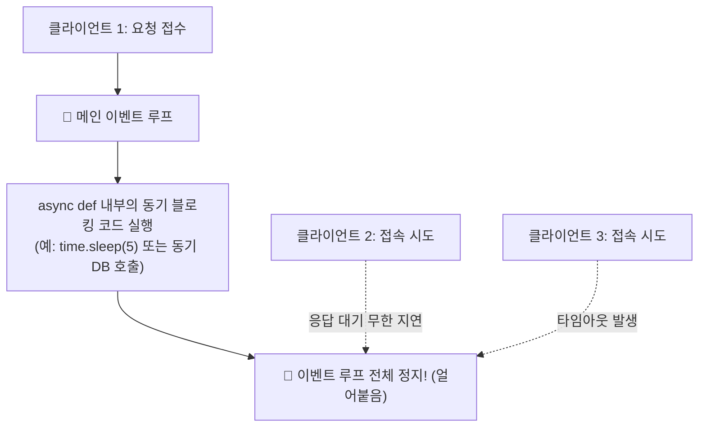
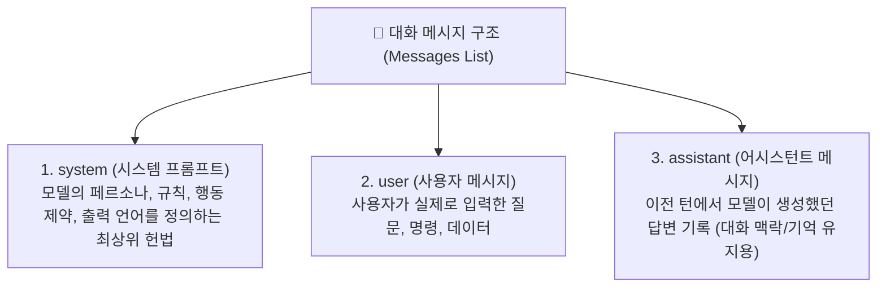
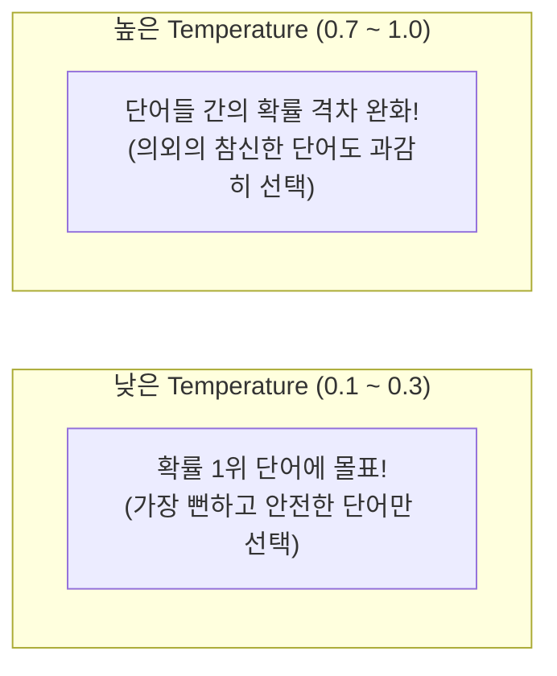

# 🤖 FastAPI 비동기 ORM & LLaMA 3.2 인공지능 모델 서빙 완벽 정리 노트

> **비동기 이벤트 루프 블로킹 방지 원칙**과 **동기 코드를 스레드로 격리하는 `run_in_threadpool()`**, **SQLAlchemy 2.0 비동기 ORM(`aiosqlite`, `AsyncSession`) 전환**, **LLM의 수학적 본질(다음 토큰 예측 확률 모델)과 3대 Role 프롬프트 구조**, **Hugging Face 인증 및 GGUF 4비트 양자화 모델 다운로드**, **C/C++ 기반 경량 추론 엔진 `llama.cpp` 연동**, **Lifespan을 활용한 모델 싱글톤 캐싱**, 그리고 **생성 품질을 결정하는 `temperature` 하이퍼파라미터**까지 총정리한 실전 AI 엔지니어링 가이드

---

## 📑 목차
1. [FastAPI 비동기 프로그래밍 심화: 이벤트 루프 블로킹 주의보](#1-fastapi-비동기-프로그래밍-심화-이벤트-루프-블로킹-주의보)
   - [1-1. 비동기(`async def`) 안에서 블로킹이 발생하면 벌어지는 대참사](#1-1-비동기async-def-안에서-블로킹이-발생하면-벌어지는-대참사)
   - [1-2. 코드 선택 가이드: 완전 동기식(`def`) vs 완전 비동기식(`async def`)](#1-2-코드-선택-가이드-완전-동기식def-vs-완전-비동기식async-def)
   - [1-3. 비동기 엔드포인트 안에서 동기 함수를 써야 할 때의 구원투수: `run_in_threadpool()`](#1-3-비동기-엔드포인트-안에서-동기-함수를-써야-할-때의-구원투수-run_in_threadpool)
2. [비동기 ORM 전환: SQLAlchemy 2.0 + aiosqlite](#2-비동기-orm-전환-sqlalchemy-20--aiosqlite)
   - [2-1. 왜 DB 드라이버까지 비동기로 바꿔야 하는가?](#2-1-왜-db-드라이버까지-비동기로-바꿔야-하는가)
   - [2-2. 패키지 설치 (`sqlalchemy[asyncio]`, `aiosqlite`, `greenlet`)](#2-2-패키지-설치-sqlalchemyasyncio-aiosqlite-greenlet)
   - [2-3. `create_async_engine`과 `AsyncSession` 비동기 세션 팩토리 구축](#2-3-create_async_engine과-asyncsession-비동기-세션-팩토리-구축)
   - [2-4. 비동기 세션 의존성 주입 (`get_async_session`)](#2-4-비동기-세션-의존성-주입-get_async_session)
   - [2-5. ⚡ 중요 규칙: I/O가 발생하는 시점에만 `await`를 붙여라!](#2-5--중요-규칙-io가-발생하는-시점에만-await를-붙여라)
3. [LLM(대형 언어 모델)의 본질과 프롬프트 엔지니어링](#3-llm대형-언어-모델의-본질과-프롬프트-엔지니어링)
   - [3-1. LLM의 진짜 정체: "다음 토큰(Token) 예측 확률 모델"](#3-1-llm의-진짜-정체-다음-토큰token-예측-확률-모델)
   - [3-2. Chat 모델의 3대 핵심 역할 (system, user, assistant)](#3-2-chat-모델의-3대-핵심-역할-system-user-assistant)
   - [3-3. 시스템 프롬프트(System Prompt) 설계 공식](#3-3-시스템-프롬프트system-prompt-설계-공식)
4. [실습 모델: Meta의 LLaMA 3.2 1B Instruct & 양자화(GGUF)](#4-실습-모델-meta의-llama-32-1b-instruct--양자화gguf)
   - [4-1. Llama 3.2 1B Instruct 선정 이유 (경량화 & CPU 추론 가능)](#4-1-llama-32-1b-instruct-선정-이유-경량화--cpu-추론-가능)
   - [4-2. 양자화(Quantization)란? (FP16 ➔ INT4로 메모리와 연산량 절감)](#4-2-양자화quantization란-fp16--int4로-메모리와-연산량-절감)
   - [4-3. Hugging Face 생태계와 CLI 로그인 (`hf auth login`)](#4-3-hugging-face-생태계와-cli-로그인-hf-auth-login)
   - [4-4. GGUF 양자화 모델 다운로드 CLI 명령어](#4-4-gguf-양자화-모델-다운로드-cli-명령어)
5. [llama.cpp: C/C++ 기반 초경량 LLM 추론 엔진](#5-llamacpp-cc-기반-초경량-llm-추론-엔진)
   - [5-1. llama.cpp와 `llama-cpp-python` 바인딩](#5-1-llamacpp와-llama-cpp-python-바인딩)
   - [5-2. OS별 C++ 빌드 툴체인 문제 해결 (macOS Xcode vs Windows BuildTools)](#5-2-os별-c-빌드-툴체인-문제-해결-macos-xcode-vs-windows-buildtools)
   - [5-3. Python에서 GGUF 모델 인스턴스화 (`Llama` 클래스 파라미터 해설)](#5-3-python에서-gguf-모델-인스턴스화-llama-클래스-파라미터-해설)
6. [FastAPI를 활용한 AI 챗봇 모델 서빙 API 구현](#6-fastapi를-활용한-ai-챗봇-모델-서빙-api-구현)
   - [6-1. 🚨 치명적 비효율: 요청마다 모델을 로드하면 안 되는 이유](#6-1--치명적-비효율-요청마다-모델을-로드하면-안-되는-이유)
   - [6-2. `lifespan` 컨텍스트 매니저를 통한 모델 사전 로딩 & `app.state.llm` 싱글톤 보관](#6-2-lifespan-컨텍스트-매니저를-통한-모델-사전-로딩--appstatellm-싱글톤-보관)
   - [6-3. `POST /chats` 생성 API 엔드포인트 구현과 응답 파싱](#6-3-post-chats-생성-api-엔드포인트-구현과-응답-파싱)
7. [생성 품질을 좌우하는 핵심 하이퍼파라미터: `temperature`](#7-생성-품질을-좌우하는-핵심-하이퍼파라미터-temperature)
   - [7-1. `temperature`의 수학적 의미 (확률 분포 조절)](#7-1-temperature의-수학적-의미-확률-분포-조절)
   - [7-2. 값의 크기별 체감 결과 비교표 (0.0 ~ 1.0+)](#7-2-값의-크기별-체감-결과-비교표-00--10)
8. [💡 실전 핵심 요약 치트시트](#8--실전-핵심-요약-치트시트)

---

## 1. FastAPI 비동기 프로그래밍 심화: 이벤트 루프 블로킹 주의보

### 1-1. 비동기(`async def`) 안에서 블로킹이 발생하면 벌어지는 대참사

FastAPI는 기본적으로 비동기 이벤트 루프(`asyncio`) 위에서 동작합니다.  
만약 비동기 함수(`async def`) 내부에서 `await` 없이 시간이 오래 걸리는 동기 I/O 코드(예: `time.sleep()`, 무거운 연산, 동기식 DB 쿼리)를 작성하면, **이벤트 루프 자체가 멈춰버리는(Blocking) 치명적인 장애**가 발생합니다.



> [!WARNING]
> 🚨 **비동기 프로그래밍 제1법칙**:  
> **"비동기 엔드포인트(`async def`) 안에서는 절대 대기를 유발하는 동기 블로킹 코드를 그대로 작성해서는 안 된다!"**  
> 대기가 발생하는 모든 I/O 작업은 반드시 `await`를 붙여 다른 코루틴에게 제어권을 양보해야 합니다.

---

### 1-2. 코드 선택 가이드: 완전 동기식(`def`) vs 완전 비동기식(`async def`)

FastAPI에서 엔드포인트를 만들 때 두 가지 선택지가 있습니다:

| 방식 | 선언 키워드 | 내부 동작 방식 | 권장 상황 |
| :--- | :--- | :--- | :--- |
| **완전 동기식** | `def` | FastAPI가 **스레드 풀(Thread Pool, 기본 40개)**의 작업자 스레드에 넘겨서 안전하게 대리 실행 | • 사용하는 라이브러리가 비동기(`async/await`)를 지원하지 않을 때<br/>• 동기 ORM(기존 SQLAlchemy, psycopg2 등)을 사용할 때 |
| **완전 비동기식** | `async def` | **메인 이벤트 루프**에서 직접 실행되며, `await` 지점마다 제어권을 양보 | • 비동기 전용 드라이버(`aiosqlite`, `asyncpg`, `httpx` 등)를 사용할 때<br/>• 초고속 I/O 동시 처리량이 필요할 때 |

---

### 1-3. 비동기 엔드포인트 안에서 동기 함수를 써야 할 때의 구원투수: `run_in_threadpool()`

> **Q. 비동기 함수(`async def`)를 메인으로 쓰고 있는데, 부득이하게 비동기 버전이 없는 구형 동기 라이브러리를 써야 합니다. 어떻게 해야 이벤트 루프가 멈추지 않을까요?**

FastAPI(Starlette)는 이 문제를 해결하기 위해 **`run_in_threadpool()`** 함수를 제공합니다.

```mermaid
sequenceDiagram
    autonumber
    actor Client as 클라이언트
    participant Loop as ⚡ 메인 비동기 이벤트 루프
    participant Worker as 🧵 별도 스레드 풀 (Worker Thread)

    Client->>Loop: 비동기 요청 (async def 엔드포인트)
    Loop->>Worker: await run_in_threadpool(sync_func)<br/>동기 코드를 스레드로 격리하여 던짐!
    Note over Loop: 🚀 메인 이벤트 루프는 멈추지 않고 다른 웹 요청들을 계속 처리!
    Note over Worker: 스레드 안에서 동기 함수 안전하게 실행 (time.sleep, 구형 모듈)
    Worker-->>Loop: 동기 작업 완료 ➔ 결괏값만 회신
    Loop-->>Client: 최종 HTTP 응답 전송
```

```python
from fastapi import FastAPI
from starlette.concurrency import run_in_threadpool
import time

app = FastAPI()

# 1. 비동기를 지원하지 않는 레거시 동기 함수
def legacy_sync_task(data: str):
    time.sleep(3)  # 3초 동안 CPU를 잡고 있는 동기 블로킹 작업
    return f"처리 완료: {data}"

# 2. 비동기 엔드포인트에서 안전하게 호출
@app.post("/process")
async def process_data(data: str):
    # run_in_threadpool로 스레드 풀에 격리하여 실행하고 결과만 await로 받음!
    result = await run_in_threadpool(legacy_sync_task, data)
    return {"result": result}
```

- **요약**: 비동기 세상(`async def`) 안에서 피할 수 없는 '동기식 일꾼(블로킹 코드)'을 써야 할 때, 그 일꾼을 잠시 **동기식 전용 방(스레드 풀)으로 밀어 넣어 처리하고 결과만 받아오는 안전장치**입니다.

---

## 2. 비동기 ORM 전환: SQLAlchemy 2.0 + aiosqlite

### 2-1. 왜 DB 드라이버까지 비동기로 바꿔야 하는가?
- 아무리 FastAPI 엔드포인트를 `async def`로 만들어도, 내부에서 기존의 동기식 SQLite/MySQL 드라이버를 호출하면 **DB 조회 중 이벤트 루프가 그대로 멈춰버립니다.**
- 따라서 데이터베이스 통신 단계까지 완벽하게 비동기로 동작하도록 **비동기 DB 드라이버(`aiosqlite`)와 SQLAlchemy의 비동기 확장 모듈(`AsyncSession`)**을 도입해야 합니다.

---

### 2-2. 패키지 설치 (`sqlalchemy[asyncio]`, `aiosqlite`, `greenlet`)

```bash
pip install "sqlalchemy[asyncio]" aiosqlite greenlet
```

- `sqlalchemy[asyncio]`: SQLAlchemy의 비동기 확장 코어
- `aiosqlite`: SQLite용 공식 비동기 드라이버 (백그라운드 스레드 기반 논블로킹 I/O)
- `greenlet`: SQLAlchemy 비동기 엔진이 파이썬 내부에서 코루틴 문맥을 스위칭하기 위한 필수 의존성

---

### 2-3. `create_async_engine`과 `AsyncSession` 비동기 세션 팩토리 구축

```python
# connection.py
from sqlalchemy.ext.asyncio import create_async_engine, AsyncSession
from sqlalchemy.orm import sessionmaker

# 1. sqlite+aiosqlite:// 드라이버 프로토콜 지정
DATABASE_URL = "sqlite+aiosqlite:///./test.db"

# 2. 비동기 전용 엔진 생성 (create_async_engine)
async_engine = create_async_engine(DATABASE_URL, echo=True)

# 3. AsyncSession 클래스를 바인딩한 비동기 세션 팩토리
AsyncSessionFactory = sessionmaker(
    bind=async_engine,
    class_=AsyncSession,  # 반드시 AsyncSession 지정!
    autocommit=False,
    autoflush=False,
    expire_on_commit=False,
)
```

---

### 2-4. 비동기 세션 의존성 주입 (`get_async_session`)

세션을 닫을 때도 네트워크/파일 I/O가 발생할 수 있으므로 `await session.close()`로 종료합니다.

```python
# connection.py
async def get_async_session():
    session: AsyncSession = AsyncSessionFactory()
    try:
        # yield로 비동기 세션 대여
        yield session
    finally:
        # 비동기로 세션 연결 종료
        await session.close()
```

---

### 2-5. ⚡ 중요 규칙: I/O가 발생하는 시점에만 `await`를 붙여라!

비동기 ORM을 작성할 때 입문자들이 가장 헷갈려하는 부분입니다.  
**"모든 SQLAlchemy 코드에 await를 붙이는 것이 아니라, 디스크/네트워크 I/O가 실제로 일어나는 순간에만 await를 붙입니다."**

```python
from fastapi import FastAPI, Depends
from sqlalchemy.ext.asyncio import AsyncSession
from sqlalchemy import select

app = FastAPI()

@app.get("/users")
async def get_users(session: AsyncSession = Depends(get_async_session)):
    # 1. [I/O 발생] DB에 쿼리를 전송하고 응답을 받아오는 순간 -> await 필수!
    result = await session.execute(select(User))
    
    # 2. [메모리 연산] 이미 RAM으로 가져온 데이터를 객체 리스트로 꺼내는 작업 -> await 불필요!
    users = result.scalars().all()
    
    # 3. [메모리 연산] 세션 영속성 관리 영역(Staging)에 객체 추가 -> await 불필요!
    new_user = User(name="Alex")
    session.add(new_user)
    
    # 4. [I/O 발생] 실제 DB 파일에 INSERT 문을 쓰고 확정하는 순간 -> await 필수!
    await session.commit()
    
    # 5. [I/O 발생] DB에서 레코드를 삭제하고 커밋하는 순간 -> await 필수!
    await session.delete(new_user)
    await session.commit()
    
    return users
```

---

## 3. LLM(대형 언어 모델)의 본질과 프롬프트 엔지니어링

### 3-1. LLM의 진짜 정체: "다음 토큰(Token) 예측 확률 모델"

대다수의 일반인들은 LLM(ChatGPT, LLaMA 등)이 사람처럼 자의식을 가지고 논리적으로 생각해서 글을 작성한다고 생각합니다.  
하지만 컴퓨터 공학과 통계학 관점에서 LLM의 본질은 다음과 같습니다:

> **LLM의 수학적 정의**:  
> **"지금까지 입력된 텍스트 시퀀스 다음에 올 가장 확률이 높은 단어 조각(Token)을 수학적/확률적으로 연속해서 계산해 내뱉는 거대한 수치 연산 장치"**


- 글을 통째로 한 번에 완성하는 것이 아니라, **단어(토큰)를 1개씩 차례대로 생성**하며 자기 자신의 출력을 다시 입력으로 삼아 다음 단어를 예측(Auto-regressive)합니다.

---

### 3-2. Chat 모델의 3대 핵심 역할 (system, user, assistant)

현대의 대화형 LLM은 문맥을 체계적으로 구조화하기 위해 **Role(역할) 기반 메시지 규격**을 사용합니다.



---

### 3-3. 시스템 프롬프트(System Prompt) 설계 공식

모델이 엉뚱한 언어로 답변하거나 불필요한 장황한 설명을 늘어놓지 않도록 최상위 규칙을 엄격하게 제한합니다:

```python
SYSTEM_PROMPT = (
    "You are a concise assistant. "
    "Always reply in the same language as the user's input. "
    "Do not change the language. "
    "Do not mix languages."
)
```

- `You are a concise assistant`: 핵심만 간결하게 요약해서 답변하도록 지시 (토큰 절약 및 응답 속도 향상).
- `Always reply in the same language as the user's input`: 한국어 질문에는 100% 한국어로만 답변 강제.

---

## 4. 실습 모델: Meta의 LLaMA 3.2 1B Instruct & 양자화(GGUF)

### 4-1. Llama 3.2 1B Instruct 선정 이유 (경량화 & CPU 추론 가능)
- **LLaMA (Large Language Model Meta AI)**: Meta에서 오픈소스로 공개한 세계 최고 수준의 파운데이션 언어 모델.
- **Llama 3.2 1B Instruct**:
  - 파라미터 수가 약 **10억 개(1 Billion)**로 초경량화된 지시 튜닝(Instruction-tuned) 모델.
  - VRAM 수십 GB를 요구하는 거대 모델(70B 등)과 달리, **수백만 원짜리 고가 GPU 없이 일반 노트북/맥북의 CPU 및 RAM만으로도 초당 수십 토큰의 실시간 서빙이 가능**합니다.

---

### 4-2. 양자화(Quantization)란? (FP16 ➔ INT4로 메모리와 연산량 절감)

원래 AI 모델 가중치는 16비트 부동소수점(`FP16`, 2바이트)으로 저장됩니다.  
10억 개의 가중치를 FP16으로 띄우면 최소 2GB 이상의 메모리가 필요하고 부동소수점 연산량이 막대합니다.

- **양자화(Quantization)**:  
  가중치의 정밀도를 약간 희생하는 대신, 숫자를 **4비트 정수(`INT4`, Q4_K_M)** 단위로 압축하는 기법입니다.
- **효과**:
  - 모델 파일 용량이 **수백 MB 단위**로 대폭 감소.
  - RAM 점유율이 획기적으로 줄어들어 저사양 CPU에서도 빛처럼 빠른 추론 속도를 발휘합니다.
- **`GGUF`**: llama.cpp 프로젝트에서 고안한 CPU/GPU 통합 초고속 바이너리 모델 파일 포맷.

---

### 4-3. Hugging Face 생태계와 CLI 로그인 (`hf auth login`)

**Hugging Face**는 전 세계의 모든 오픈소스 AI 모델과 데이터셋을 공유하는 **"AI 엔지니어들의 GitHub"**입니다.

1. **Hugging Face 계정 생성 및 토큰 발급**:
   - `https://huggingface.co/settings/tokens` 접속
   - `Read` 권한의 Access Token 생성
   - LLaMA 계열 모델 페이지에서 Meta 이용 약관(License) 동의 필수
2. **터미널 CLI 로그인**:
   ```bash
   pip install huggingface_hub
   hf auth login
   ```
   - 브라우저 디바이스 인증(`https://hf.co/oauth/device`) 링크 접속 후 화면에 표시된 8자리 코드(예: `ZO2X-1XCY`)를 입력하고 `Authorize` 클릭!

---

### 4-4. GGUF 양자화 모델 다운로드 CLI 명령어

```bash
hf download bartowski/Llama-3.2-1B-Instruct-GGUF \
  Llama-3.2-1B-Instruct-Q4_K_M.gguf \
  --local-dir ./models
```

- `./models/Llama-3.2-1B-Instruct-Q4_K_M.gguf` 경로에 모델 바이너리가 저장됩니다.

---

## 5. llama.cpp: C/C++ 기반 초경량 LLM 추론 엔진

### 5-1. llama.cpp와 `llama-cpp-python` 바인딩
- **`llama.cpp`**: 순수 C/C++로 바닥부터 작성되어 Python 인터프리터의 오버헤드 없이 CPU의 SIMD(AVX2, ARM NEON, Apple Silicon Metal) 가속을 100% 활용하는 극한의 경량 추론 라이브러리.
- **`llama-cpp-python`**: 파이썬 코드에서 `llama.cpp` 엔진을 객체 형태로 다룰 수 있게 해주는 공식 파이썬 바인딩 래퍼.

```bash
pip install llama-cpp-python
```

---

### 5-2. OS별 C++ 빌드 툴체인 문제 해결 (macOS Xcode vs Windows BuildTools)

C/C++ 확장 모듈 컴파일 과정에서 에러가 발생할 경우 C++ 컴파일러를 설치해야 합니다:
- **macOS**: 터미널에서 `$ xcode-select --install` 실행
- **Windows**: [Visual Studio Build Tools](https://aka.ms/vs/17/release/vs_BuildTools.exe) 다운로드 후 "C++를 사용한 데스크톱 개발" 체크 설치

---

### 5-3. Python에서 GGUF 모델 인스턴스화 (`Llama` 클래스 파라미터 해설)

```python
from llama_cpp import Llama

llm = Llama(
    model_path="./models/Llama-3.2-1B-Instruct-Q4_K_M.gguf",  # 다운로드한 GGUF 파일 경로
    n_ctx=4096,           # 컨텍스트 윈도우 크기 (최대 기억 토큰 수: 4096)
    n_threads=2,          # CPU 연산에 투입할 코어/스레드 개수
    verbose=False,        # 콘솔에 장황하게 출력되는 C++ 디버그 로그 숨김
    chat_format="llama-3" # Llama 3 고유의 토큰 구분자 템플릿 포맷 자동 적용
)
```

---

## 6. FastAPI를 활용한 AI 챗봇 모델 서빙 API 구현

### 6-1. 🚨 치명적 비효율: 요청마다 모델을 로드하면 안 되는 이유

```python
# ❌ 절대 하지 말아야 할 끔찍한 안티 패턴!
@app.post("/chats")
def bad_generate(user_input: str):
    llm = Llama(model_path="./models/...")  # 🚨 매 요청마다 수백 MB 모델을 디스크에서 RAM으로 로드?!
    resp = llm.create_chat_completion(...)
    return resp
```

> **왜 안 되는가?**  
> 사용자가 질문을 보낼 때마다 하드디스크에서 1GB 크기의 AI 모델 가중치를 읽어와 RAM에 올리고 초기화하는 데만 **5~10초의 극심한 지연(Latency)**이 발생합니다. 서버 메모리도 순식간에 고갈됩니다.

---

### 6-2. `lifespan` 컨텍스트 매니저를 통한 모델 사전 로딩 & `app.state.llm` 싱글톤 보관

FastAPI의 수명주기(Lifespan)를 활용하면, **서버가 부팅될 때 딱 1번만 모델을 메모리에 로드(Warm-up)하여 전역 상태(`app.state.llm`)에 싱글톤으로 보관**하고 모든 요청에서 이를 재사용할 수 있습니다.

```python
from contextlib import asynccontextmanager
from fastapi import FastAPI
from llama_cpp import Llama

@asynccontextmanager
async def lifespan(app: FastAPI):
    # 🚀 [서버 시작 시 1회 실행] 모델을 메모리에 미리 탑재
    print("🧠 [Warm-up] LLaMA 3.2 AI 모델을 메모리에 로드 중...")
    app.state.llm = Llama(
        model_path="./models/Llama-3.2-1B-Instruct-Q4_K_M.gguf",
        n_ctx=4096,
        n_threads=2,
        verbose=False,
        chat_format="llama-3"
    )
    print("✅ AI 모델 로드 완료! 추론 준비 완료.")
    
    yield  # 서버가 요청을 처리하는 동안 대기
    
    # 🛑 [서버 종료 시 1회 실행]
    print("🧹 서버 종료 및 모델 자원 정리")

app = FastAPI(lifespan=lifespan)
```

---

### 6-3. `POST /chats` 생성 API 엔드포인트 구현과 응답 파싱

```python
from fastapi import Request, Body

SYSTEM_PROMPT = (
    "You are a concise assistant. "
    "Always reply in the same language as the user's input. "
    "Do not change the language. "
    "Do not mix languages."
)

@app.post("/chats", summary="LLM 대화 생성 API")
def generate_chat(request: Request, user_input: str = Body(..., embed=True)):
    """
    클라이언트 요청 JSON: { "user_input": "FastAPI가 뭐야?" }
    """
    # 1. lifespan에서 미리 로드해 둔 모델 인스턴스 가져오기
    llm: Llama = request.app.state.llm

    # 2. 역할(Role) 기반 메시지 구조로 추론 생성
    resp = llm.create_chat_completion(
        messages=[
            {"role": "system", "content": SYSTEM_PROMPT},
            {"role": "user", "content": user_input},
        ],
        max_tokens=256,   # 최대 생성 토큰 수
        temperature=0.7,  # 창의성 조절 파라미터
    )

    # 3. LLM 결과 JSON 구조에서 실제 답변 텍스트만 추출
    answer = resp["choices"][0]["message"]["content"].strip()
    return {"text": answer}
```

---

## 7. 생성 품질을 좌우하는 핵심 하이퍼파라미터: `temperature`

### 7-1. `temperature`의 수학적 의미 (확률 분포 조절)

LLM은 다음 토큰을 선택할 때 소프트맥스(Softmax) 수식을 거쳐 각 단어의 출현 확률 분포를 계산합니다.  
**`temperature`(온도)**는 이 확률 분포를 평평하게(Flat) 만들 것인지, 아니면 뾰족하게(Sharp) 만들 것인지를 결정하는 분모 계수입니다.



- **낮을수록 (Low)**: 1등 후보 단어의 확률이 압도적으로 높아져 **결정적이고 일관되며 보수적인 답변** 생성.
- **높을수록 (High)**: 2위, 3위 단어가 선택될 확률이 올라가 **어휘가 풍부하고 창의적이며 다양한 답변** 생성.

---

### 7-2. 값의 크기별 체감 결과 비교표 (0.0 ~ 1.0+)

| 설정값 | 체감 반응 및 특징 | 추천 실무 활용 분야 |
| :---: | :--- | :--- |
| **`0.0 ~ 0.2`** | **거의 결정적 (Deterministic)**<br/>같은 질문을 10번 반복해도 거의 토씨 하나 안 틀리고 동일한 답변을 내놓음 | 수학 문제 풀이, 코드 생성, 객관식 퀴즈 정답, JSON 포맷 데이터 추출, 사실 기반 Q&A |
| **`0.3 ~ 0.6`** | **안정적이면서 약간의 자연스러움**<br/>논리적 일관성을 유지하면서 문장이 딱딱하지 않고 매끄러움 | **기업용 고객센터 챗봇, 사내 문서 검색(RAG), 텍스트 요약** |
| **`0.7 ~ 0.9`** | **다양성 증가, 표현 풍부**<br/>매번 다채로운 표현과 어휘를 구사하며 문맥을 흥미롭게 전개 | 마케팅 카피라이팅, 블로그 초안 작성, 일반 일상 대화 챗봇 |
| **`1.0+`** | **극단적으로 창의적이나 헛소리(환각) 위험**<br/>문맥을 벗어난 단어를 선택하여 말이 안 되는 문장(Hallucination)을 지어낼 확률 급증 | 창작 소설, 시(Poetry) 창작, 브레인스토밍 아이디어 발산 |

---

## 8. 💡 실전 핵심 요약 치트시트

```markdown
┌────────────────────────────────────────────────────────────────────────┐
│           FastAPI 비동기 ORM & LLaMA 3.2 모델 서빙 치트시트            │
├──────────────────────────────┬─────────────────────────────────────────┤
│ 기술 / 문법                  │ 핵심 요약 및 사용 공식                  │
├──────────────────────────────┼─────────────────────────────────────────┤
│ run_in_threadpool(fn)        │ 비동기 안에서 동기 블로킹 코드를        │
│                              │ 스레드 풀로 격리하여 안전 실행          │
├──────────────────────────────┼─────────────────────────────────────────┤
│ sqlite+aiosqlite://          │ SQLite용 공식 비동기 DB 연결 URL 프로토콜│
├──────────────────────────────┼─────────────────────────────────────────┤
│ await session.execute()      │ 비동기 DB 조회 I/O 실행                 │
├──────────────────────────────┼─────────────────────────────────────────┤
│ await session.commit()       │ 비동기 DB 변경 사항 트랜잭션 커밋       │
├──────────────────────────────┼─────────────────────────────────────────┤
│ LLM의 수학적 본질            │ 다음 토큰(단어 조각) 예측 확률 연산 장치│
├──────────────────────────────┼─────────────────────────────────────────┤
│ Chat 3대 Role                │ system(규칙/성격), user(질문),          │
│                              │ assistant(이전 답변 문맥)               │
├──────────────────────────────┼─────────────────────────────────────────┤
│ GGUF 양자화                  │ 모델 가중치를 INT4로 압축하여 CPU 서빙  │
├──────────────────────────────┼─────────────────────────────────────────┤
│ hf auth login                │ Hugging Face CLI 토큰 디바이스 인증     │
├──────────────────────────────┼─────────────────────────────────────────┤
│ llama-cpp-python             │ C/C++ 기반 초경량 LLaMA 추론 엔진 래퍼   │
├──────────────────────────────┼─────────────────────────────────────────┤
│ lifespan 사전 로딩           │ app.state.llm에 모델을 1회만 올려       │
│                              │ 매 요청마다 로드하는 지연(Latency) 방지 │
├──────────────────────────────┼─────────────────────────────────────────┤
│ temperature (0.0 ~ 0.2)      │ 보수적/결정적 (코딩, 정밀 Q&A용)        │
├──────────────────────────────┼─────────────────────────────────────────┤
│ temperature (0.7 ~ 0.8)      │ 창의적/자연스러움 (일반 챗봇용)         │
└──────────────────────────────┴─────────────────────────────────────────┘
```
