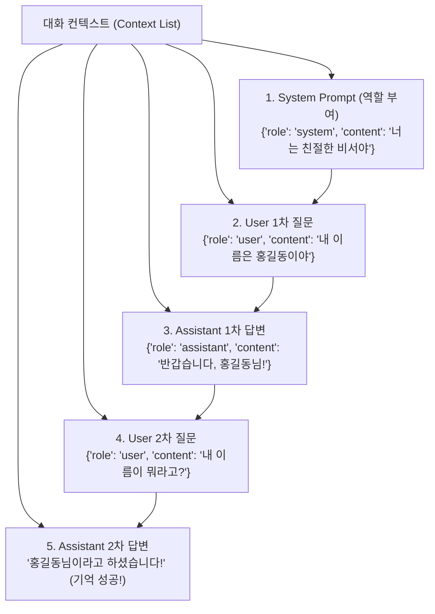
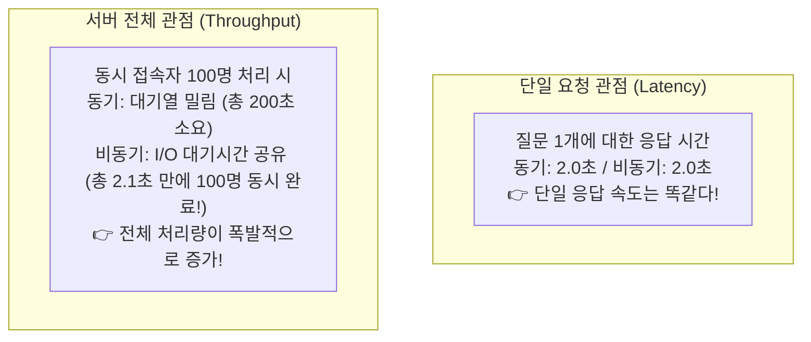
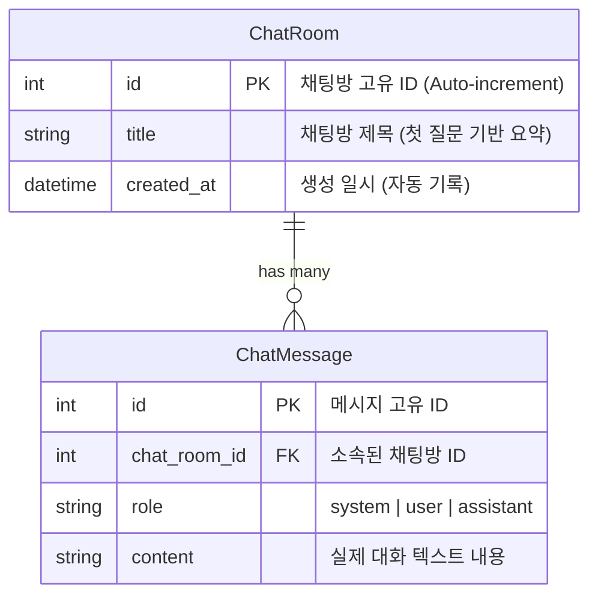

# 🤖 FastAPI 고급 AI 서빙: 멀티턴 챗봇, 스트리밍 & OpenAI API 완벽 정리 노트

> LLM 대화 **컨텍스트(Context) 관리 3대 전략**부터 **메모리를 절약하는 제너레이터(Generator)와 실시간 타자기 효과 `StreamingResponse`**, **CPU Bound vs I/O Bound 작업의 본질**, **OpenAI API 연동(동기/비동기, 구조화 응답, .env 보안 관리)**, 그리고 **SQLite 비동기 ORM을 결합한 멀티턴(Multi-turn) 챗봇과 원자적 트랜잭션(`session.flush()` vs `session.commit()`)**까지 총정리한 실무 AI 엔지니어링 가이드

---

## 📑 목차
1. [LLM 대화 컨텍스트(Context) 관리 전략](#1-llm-대화-컨텍스트context-관리-전략)
   - [1-1. 프롬프트와 3대 Role (System, User, Assistant)의 누적 구조](#1-1-프롬프트와-3대-role-system-user-assistant의-누적-구조)
   - [1-2. 컨텍스트 윈도우 관리 3대 기법 (계속 쌓기 vs 슬라이딩 윈도우 vs 대화 요약)](#1-2-컨텍스트-윈도우-관리-3대-기법-계속-쌓기-vs-슬라이딩-윈도우-vs-대화-요약)
   - [1-3. 단일 입력값 전달: `Body(..., embed=True)` vs Pydantic 모델](#1-3-단일-입력값-전달-body-embedtrue-vs-pydantic-모델)
   - [1-4. 소프트웨어 설계 원칙: "응집도는 높게, 결합도는 낮게" & `Depends(get_llm)`](#1-4-소프트웨어-설계-원칙-응집도는-높게-결합도는-낮게--dependsget_llm)
2. [제너레이터(Generator)와 지연 평가(Lazy Evaluation)](#2-제너레이터generator와-지연-평가lazy-evaluation)
   - [2-1. Generator란? (값을 한 번에 하나씩 생성하는 이터레이터)](#2-1-generator란-값을-한-번에-하나씩-생성하는-이터레이터)
   - [2-2. `yield` 키워드의 마법 (함수 상태 유지와 일시정지)](#2-2-yield-키워드의-마법-함수-상태-유지와-일시정지)
   - [2-3. 왜 쓰는가? (메모리 절약 & 지연시간 개선)](#2-3-왜-쓰는가-메모리-절약--지연시간-개선)
   - [2-4. 리스트 vs 제너레이터 메모리 사용량 실측 (`sys.getsizeof`)](#2-4-리스트-vs-제너레이터-메모리-사용량-실측-sysgetsizeof)
3. [Streaming(스트리밍)과 FastAPI StreamingResponse](#3-streaming스트리밍과-fastapi-streamingresponse)
   - [3-1. 배치 방식(Batch) vs 스트리밍 방식(Streaming)](#3-1-배치-방식batch-vs-스트리밍-방식streaming)
   - [3-2. `StreamingResponse`와 SSE 표준 (`text/event-stream`)](#3-2-streamingresponse와-sse-표준-textevent-stream)
   - [3-3. 로컬 LLaMA 모델 토큰 제너레이터 구현 (`stream=True`)](#3-3-로컬-llama-모델-토큰-제너레이터-구현-streamtrue)
   - [3-4. cURL을 이용한 실시간 스트리밍 테스트 (`curl -N`)](#3-4-curl을-이용한-실시간-스트리밍-테스트-curl--n)
4. [OpenAI API 연동 & 컴퓨터 작업 분류 (CPU Bound vs I/O Bound)](#4-openai-api-연동--컴퓨터-작업-분류-cpu-bound-vs-io-bound)
   - [4-1. 로컬 LLaMA 서빙 vs OpenAI API 연동 아키텍처 비교](#4-1-로컬-llama-서빙-vs-openai-api-연동-아키텍처-비교)
   - [4-2. CPU Bound(로컬 추론) vs I/O Bound(외부 API 호출)](#4-2-cpu-bound로컬-추론-vs-io-bound외부-api-호출)
   - [4-3. OpenAI 기본 호출과 구조화 응답 (`responses.parse`, Pydantic 스키마 고정)](#4-3-openai-기본-호출과-구조화-응답-responsesparse-pydantic-스키마-고정)
5. [안전한 API Key 관리: pydantic-settings & .env](#5-안전한-api-key-관리-pydantic-settings--env)
   - [5-1. 왜 API Key를 코드에 하드코딩하면 안 되는가?](#5-1-왜-api-key를-코드에-하드코딩하면-안-되는가)
   - [5-2. `BaseSettings`를 활용한 환경 변수 자동 로드](#5-2-basesettings를-활용한-환경-변수-자동-로드)
   - [5-3. `.env` 파일과 `.gitignore` 필수 보안 수칙](#5-3-env-파일과-gitignore-필수-보안-수칙)
6. [비동기 OpenAI 스트리밍 & 비동기 프로그래밍의 진실](#6-비동기-openai-스트리밍--비동기-프로그래밍의-진실)
   - [6-1. `AsyncOpenAI`와 비동기 제너레이터 (`async for event in stream`)](#6-1-asyncopenai와-비동기-제너레이터-async-for-event-in-stream)
   - [6-2. 델타(`delta`) 텍스트 추출과 `response.completed` 종료 처리](#6-2-델타delta-텍스트-추출과-responsecompleted-종료-처리)
   - [6-3. ⚠️ 비동기 프로그래밍 사용 시 유의사항 (단일 요청 속도 vs 전체 동시 처리량)](#6-3-️-비동기-프로그래밍-사용-시-유의사항-단일-요청-속도-vs-전체-동시-처리량)
7. [데이터베이스 연동 멀티턴(Multi-turn) 챗봇 시스템 풀 구현](#7-데이터베이스-연동-멀티턴multi-turn-챗봇-시스템-풀-구현)
   - [7-1. 데이터 모델링: `ChatRoom` & `ChatMessage` 1:N 관계 설계](#7-1-데이터-모델링-chatroom--chatmessage-1n-관계-설계)
   - [7-2. 비동기 테이블 자동 생성 유틸리티 (`init_db`)](#7-2-비동기-테이블-자동-생성-유틸리티-init_db)
   - [7-3. 트랜잭션(Transaction)과 원자성(Atomicity: All or Nothing)](#7-3-트랜잭션transaction과-원자성atomicity-all-or-nothing)
   - [7-4. 💡 핵심 테크닉: `await session.flush()` vs `await session.commit()`](#7-4--핵심-테크닉-await-sessionflush-vs-await-sessioncommit)
   - [7-5. [API 1] 채팅방 생성 & 시스템 프롬프트 원자적 등록 (`POST /chat-rooms`)](#7-5-api-1-채팅방-생성--시스템-프롬프트-원자적-등록-post-chat-rooms)
   - [7-6. [API 2] 대화 이력 조회 ➔ LLM 추론 ➔ 답변 저장 (`POST /chat-rooms/{id}/messages`)](#7-6-api-2-대화-이력-조회--llm-추론--답변-저장-post-chat-roomsidmessages)
8. [💡 실전 핵심 요약 치트시트](#8--실전-핵심-요약-치트시트)

---

## 1. LLM 대화 컨텍스트(Context) 관리 전략

### 1-1. 프롬프트와 3대 Role (System, User, Assistant)의 누적 구조

LLM은 본질적으로 이전 대화를 스스로 기억하지 못하는 **무상태(Stateless)** 엔진입니다.  
따라서 사용자와 연속적인 대화(Multi-turn Chat)를 이어가려면, **지금까지 나눈 모든 대화 기록을 `messages` 리스트에 담아 매 요청마다 모델에게 통째로 건네주어야 합니다.**



---

### 1-2. 컨텍스트 윈도우 관리 3대 기법 (계속 쌓기 vs 슬라이딩 윈도우 vs 대화 요약)

대화가 20턴, 50턴 길어지면 모델의 최대 컨텍스트 토큰 한도(Context Window)를 초과하게 됩니다. 실무에서는 다음 3가지 전략 중 하나를 선택합니다:

| 전략 | 작동 방식 | 장점 | 단점 / 한계 |
| :--- | :--- | :--- | :--- |
| **1. 계속 쌓기 (Accumulate All)** | 대화 내용을 영구히 뒤에 이어 붙임 (`context.append()`) | 대화의 모든 세부 사항을 완벽 보존 | 대화가 길어질수록 **토큰 비용 급증, 응답 속도 저하, 한도 초과 에러** 발생 |
| **2. 최근 n개만 사용 (Sliding Window)** | 최근 5개~10개의 대화만 잘라서 유지 (`context[-10:]`) | 토큰 수 일정하게 유지, 최근 화제에 집중 | **대화 극초반에 언급한 중요한 정보(이름, 핵심 요구사항)를 망각**함 |
| **3. 대화 요약하기 (Summarization)** | 대화가 길어지면 LLM을 이용해 **이전 대화를 핵심 위주로 요약·압축**하여 시스템 프롬프트에 주입 | 메모리 효율 극대화 + 과거 중요 맥락 보존 (2번 단점 극복) | 주기적인 요약 생성을 위한 추가 LLM 호출 비용 발생 |

> [!NOTE]
> 💡 **ChatGPT의 내부 동작**:  
> ChatGPT 화면에 간혹 *"세션을 위해 요약 중..."*, *"대화 압축 중..."*이라는 안내가 뜨는 이유가 바로 **3번 요약 전략**을 통해 과거 대화를 컴팩트하게 압축하고 있기 때문입니다.

---

### 1-3. 단일 입력값 전달: `Body(..., embed=True)` vs Pydantic 모델

클라이언트로부터 단 하나의 문자열(`user_input`)만 전달받을 때, 매번 Pydantic `BaseModel` 클래스를 선언하는 것은 번거로울 수 있습니다.  
FastAPI의 **`Body(..., embed=True)`**를 사용하면 클래스 없이도 깔끔한 JSON 객체 포맷을 강제할 수 있습니다.

```python
from fastapi import FastAPI, Body

app = FastAPI()

# embed 옵션 비교:
# embed=False (기본값): 클라이언트가 순수 텍스트 "Python이 뭐야?" 를 Body에 보냄
# embed=True: 클라이언트가 JSON 객체 {"user_input": "Python이 뭐야?"} 형태로 보냄
@app.post("/generate")
def generate_answer(user_input: str = Body(..., embed=True)):
    return {"received": user_input}
```

---

### 1-4. 소프트웨어 설계 원칙: "응집도는 높게, 결합도는 낮게" & `Depends(get_llm)`

- **응집도(Cohesion)**: 관련된 코드끼리 끈끈하게 모여있는 정도 (높을수록 좋음).
- **결합도(Coupling)**: 서로 다른 모듈 간에 너무 얽혀있는 정도 (낮을수록 좋음).

라우터 함수마다 `request: Request`를 받고 `request.app.state.llm`을 수동으로 꺼내는 코드를 반복하면 결합도가 높아집니다.  
**의존성 주입(`Depends`)**을 사용하여 이를 깔끔하게 분리합니다:

```python
from fastapi import FastAPI, Request, Depends
from llama_cpp import Llama

# 1. LLM 모델 객체를 꺼내주는 작은 의존성 함수 정의
def get_llm(request: Request) -> Llama:
    return request.app.state.llm

# 2. 라우터 함수에서는 Depends로 주입받아 바로 사용
@app.post("/generate")
def generate_answer(
    user_input: str = Body(..., embed=True),
    llm: Llama = Depends(get_llm)  # ✅ FastAPI가 알아서 get_llm 실행 후 주입!
):
    ...
```

---

## 2. 제너레이터(Generator)와 지연 평가(Lazy Evaluation)

### 2-1. Generator란? (값을 한 번에 하나씩 생성하는 이터레이터)
- 일반 함수는 계산 결과를 리스트 등에 몽땅 담아서 한 번에 `return`합니다.
- **제너레이터(Generator)**는 모든 값을 미리 메모리에 올리지 않고, **요청이 올 때마다 그때그때 하나씩 계산해서 던져주는 특별한 함수(Iterator)**입니다.

---

### 2-2. `yield` 키워드의 마법 (함수 상태 유지와 일시정지)
- `return`: 값을 반환하고 함수의 실행 컨텍스트(메모리)를 완전히 파괴하고 종료.
- **`yield`**: 값을 반환하지만, **함수의 현재 상태(로컬 변수, 실행 라인)를 그대로 유지한 채 '일시정지'**. 다음번에 `next()`나 `for`문이 호출하면 멈췄던 바로 그 자리부터 다음 코드를 재개!

```python
def count_up_to(n):
    i = 1
    while i <= n:
        yield i   # 값을 반환하고 여기서 일시정지!
        i += 1    # 다음 호출 시 여기서부터 실행 재개

gen = count_up_to(3)
print(next(gen))  # 1
print(next(gen))  # 2
print(next(gen))  # 3
# print(next(gen)) -> StopIteration 예외 발생 (생성 완료)
```

---

### 2-3. 왜 쓰는가? (메모리 절약 & 지연시간 개선)
1. **메모리 절약 (Memory Efficiency)**:  
   - "전부 만들지 말고, 필요할 때만!"  
   - 리스트는 백만 개의 데이터를 RAM에 몽땅 적재하지만, 제너레이터는 한 번에 1개씩만 생성하고 소비하므로 **메모리 점유율이 0에 수렴**합니다.
2. **지연시간 개선 (Latency Improvement)**:  
   - "먼저 나온 것부터 즉시 처리!"  
   - 10만 건 중 5건만 필요한 경우, 리스트는 10만 건을 다 만들 때까지 기다려야 하지만, 제너레이터는 **1건이 계산되는 즉시 화면에 보내고 5건이 채워지면 즉시 종료(`break`)**할 수 있습니다.

---

### 2-4. 리스트 vs 제너레이터 메모리 사용량 실측 (`sys.getsizeof`)

```python
import sys

# 1. 백만 개 원소를 담은 리스트 (모든 값을 미리 생성하여 RAM 적재)
lst = [i for i in range(1_000_000)]
print(f"List 메모리: {sys.getsizeof(lst):,} bytes")
# 출력: List 메모리: 8,448,728 bytes (약 8.4 MB!)

# 2. 백만 개 원소를 다루는 제너레이터 (요청 시 1개씩 계산하는 규칙만 보관)
gen = (i for i in range(1_000_000))
print(f"Generator 메모리: {sys.getsizeof(gen):,} bytes")
# 출력: Generator 메모리: 112 bytes (단 112 바이트!)
```

---

## 3. Streaming(스트리밍)과 FastAPI StreamingResponse

### 3-1. 배치 방식(Batch) vs 스트리밍 방식(Streaming)


---

### 3-2. `StreamingResponse`와 SSE 표준 (`text/event-stream`)

FastAPI는 HTTP 연결을 끊지 않고 데이터를 지속적으로 흘려보내기 위해 **`StreamingResponse`** 클래스를 제공합니다.

- **`media_type="text/event-stream"`**:  
  Server-Sent Events(SSE) 웹 표준 규격으로, 브라우저가 연결을 유지한 채 서버가 푸시하는 텍스트 조각(Chunk)을 실시간으로 수신하도록 지정합니다.

---

### 3-3. 로컬 LLaMA 모델 토큰 제너레이터 구현 (`stream=True`)

`llama.cpp`의 `create_chat_completion` 함수에 **`stream=True`** 옵션을 주면, 전체 문자열이 아닌 **토큰 청크(Chunk)를 뱉어내는 제너레이터 객체**가 반환됩니다.

```python
from fastapi import FastAPI, Body, Request, Depends
from fastapi.responses import StreamingResponse
from llama_cpp import Llama

app = FastAPI()

def get_llm(request: Request) -> Llama:
    return request.app.state.llm

# 1. 토큰을 1개씩 생성하여 yield하는 제너레이터 함수
def token_generator(llm: Llama, user_input: str):
    # stream=True 활성화
    resp_iterator = llm.create_chat_completion(
        messages=[
            {"role": "system", "content": "You are a helpful assistant."},
            {"role": "user", "content": user_input}
        ],
        max_tokens=512,
        temperature=0.7,
        stream=True  # 🌟 핵심!
    )
    
    # 모델이 단어 조각(delta)을 뱉을 때마다 즉시 yield
    for chunk in resp_iterator:
        delta = chunk["choices"][0]["delta"]
        token = delta.get("content")
        if token:
            yield token  # 클라이언트에게 1글자씩 실시간 방출!

# 2. FastAPI 엔드포인트에서 StreamingResponse로 감싸서 반환
@app.post("/chats")
def chat_stream(
    user_input: str = Body(..., embed=True),
    llm: Llama = Depends(get_llm)
):
    return StreamingResponse(
        token_generator(llm, user_input),
        media_type="text/event-stream"
    )
```

---

### 3-4. cURL을 이용한 실시간 스트리밍 테스트 (`curl -N`)

```bash
# -N (--no-buffer): 버퍼링 없이 서버에서 날아오는 패킷을 터미널에 즉시 출력!
curl -N -X POST http://127.0.0.1:8000/chats \
  -H "Content-Type: application/json" \
  -d '{"user_input": "Python에 대해서 설명해줘"}'
```

---

## 4. OpenAI API 연동 & 컴퓨터 작업 분류 (CPU Bound vs I/O Bound)

### 4-1. 로컬 LLaMA 서빙 vs OpenAI API 연동 아키텍처 비교

```mermaid
graph TD
    subgraph Local_LLM["방식 A: 로컬 LLaMA 서빙 (내 서버 안에서 실행)"]
        C1["클라이언트"] --> S1["FastAPI 서버"]
        S1 --> CPU1["내 서버의 CPU/RAM<br/>(Llama 3.2 모델 가동)"]
        Note over CPU1: ⚠️ CPU 연산량 폭증 (CPU Bound)<br/>서버 사양이 좋아야 함
    end

    subgraph OpenAI_API["방식 B: OpenAI API 연동 (클라우드 서비스 활용)"]
        C2["클라이언트"] --> S2["FastAPI 서버"]
        S2 -->|인터넷 HTTP 요청| OPENAI["OpenAI 클라우드 서버<br/>(ChatGPT gpt-4.1-mini)"]
        Note over S2: ⚡ 내 서버는 통신만 중계 (I/O Bound)<br/>서버 자원 소모 거의 없음!
    end
```

---

### 4-2. CPU Bound(로컬 추론) vs I/O Bound(외부 API 호출)

| 작업 분류 | 작업의 본질 | 컴퓨터 자원 소모 | 최적의 비동기 전략 |
| :--- | :--- | :--- | :--- |
| **CPU Bound**<br/>(로컬 AI 모델 직접 추론) | 대규모 행렬 곱셈, 딥러닝 연산, 이미지 렌더링 | CPU 100% 풀가동, 고열 발생 | 이벤트 루프를 막지 않기 위해 **별도 스레드 풀(`run_in_threadpool`)이나 프로세스 풀로 격리** |
| **I/O Bound**<br/>(OpenAI API, DB 통신) | 외부 서버에 패킷을 쏘고 응답이 오길 멍하니 기다림 | CPU 사용량 0%, 단순 네트워크 대기 | **순수 비동기(`async/await`)**를 사용해 대기 시간 동안 다른 유저 요청 처리 |

---

### 4-3. OpenAI 기본 호출과 구조화 응답 (`responses.parse`, Pydantic 스키마 고정)

최신 OpenAI 파이썬 SDK(1.x+)를 활용하여 챗봇 응답을 호출하는 기본 문법입니다.

#### 1. 일반 텍스트 응답 호출:
```python
from openai import OpenAI

client = OpenAI(api_key="sk-...")

resp = client.responses.create(
    model="gpt-4.1-mini",
    input="Python에 대해 한 줄로 설명해줘"
)
print(resp.output_text)
```

#### 2. Pydantic 스키마 고정 (Structured Outputs):
모델이 제멋대로 답하지 않고, **개발자가 정의한 Pydantic 클래스 형식의 정형 데이터(JSON)로만 정확하게 답변하도록 강제**합니다.

```python
from pydantic import BaseModel, Field

# 응답받을 데이터 스키마 정의
class OpenAIResponse(BaseModel):
    result: str = Field(description="질문에 대한 최종 답변")
    confidence: float = Field(description="0~1 사이의 답변 신뢰도 점수")

# client.responses.parse를 사용해 Pydantic 모델로 자동 파싱!
response = client.responses.parse(
    model="gpt-4.1-mini",
    input="Python의 특징은?",
    text_format=OpenAIResponse  # 🌟 스키마 고정!
)

parsed_data: OpenAIResponse = response.output_parsed
print(parsed_data.result)
print(parsed_data.confidence)
```

---

## 5. 안전한 API Key 관리: pydantic-settings & .env

### 5-1. 왜 API Key를 코드에 하드코딩하면 안 되는가?
- `api_key="sk-proj-12345..."` 처럼 파이썬 파일에 키를 직접 적고 GitHub에 커밋하면, 봇 크롤러들이 3초 만에 키를 탈취하여 **수백만 원의 과금 폭탄**을 맞게 됩니다.
- 따라서 민감한 비밀키는 반드시 **환경 변수(`.env` 파일)**로 분리 보관해야 합니다.

---

### 5-2. `BaseSettings`를 활용한 환경 변수 자동 로드

`pydantic-settings` 라이브러리를 사용하면 환경 변수를 타입 안전(Type-safe)하게 관리할 수 있습니다.

```bash
pip install pydantic-settings
```

```python
# config.py
from pydantic_settings import BaseSettings

class Settings(BaseSettings):
    # 환경 변수 이름과 매핑 (대소문자 무관)
    openai_api_key: str

    class Config:
        env_file = ".env"  # .env 파일에서 자동으로 읽어옴

settings = Settings()
```

---

### 5-3. `.env` 파일과 `.gitignore` 필수 보안 수칙

```ini
# .env 파일 생성
OPENAI_API_KEY=sk-xxxxYourSecretKeyHerexxxx
```

```gitignore
# .gitignore 파일에 반드시 추가!
.env
.venv/
__pycache__/
*.db
```

```python
# main.py 에서 사용
from config import settings
from openai import AsyncOpenAI

# 안전하게 환경 변수에서 주입받아 클라이언트 초기화!
client = AsyncOpenAI(api_key=settings.openai_api_key)
```

---

## 6. 비동기 OpenAI 스트리밍 & 비동기 프로그래밍의 진실

### 6-1. `AsyncOpenAI`와 비동기 제너레이터 (`async for event in stream`)

OpenAI 서버와의 통신은 I/O Bound 작업이므로 `AsyncOpenAI` 클라이언트를 사용하여 비동기 스트리밍을 구현합니다.

```python
from fastapi import FastAPI, Body
from fastapi.responses import StreamingResponse
from openai import AsyncOpenAI
from config import settings

app = FastAPI()
client = AsyncOpenAI(api_key=settings.openai_api_key)

# 비동기 제너레이터 함수 정의 (async def + yield)
async def event_generator(user_input: str):
    # 1. async with 로 비동기 스트림 연결
    async with client.responses.stream(
        model="gpt-4.1-mini",
        input=user_input
    ) as stream:
        # 2. 토큰 조각이 날아올 때마다 비동기 반복문(async for)으로 수신
        async for event in stream:
            # 3. 텍스트 조각(delta) 이벤트인 경우 브라우저로 즉시 yield
            if event.type == "response.output_text.delta":
                yield event.delta
            # 4. 생성이 완료되었다는 신호가 오면 스트림 종료
            elif event.type == "response.completed":
                break

@app.post("/chat-gpt")
async def call_chat_gpt(user_input: str = Body(..., embed=True)):
    return StreamingResponse(
        event_generator(user_input),
        media_type="text/event-stream"
    )
```

---

### 6-2. 델타(`delta`) 텍스트 추출과 `response.completed` 종료 처리
- `response.output_text.delta`: 전체 텍스트가 아니라 **"방금 막 생성된 단어 한 조각"**입니다. 이를 받는 족족 `yield`하여 클라이언트에게 실시간 타자기 효과를 전달합니다.
- `response.completed`: OpenAI 서버가 답변 생성을 모두 마쳤음을 알리는 신호입니다. `break`로 반복문을 빠져나와 스트리밍 HTTP 연결을 깔끔하게 마무리합니다.

---

### 6-3. ⚠️ 비동기 프로그래밍 사용 시 유의사항 (단일 요청 속도 vs 전체 동시 처리량)

> **입문자들의 흔한 오해**:  
> *"비동기(`async/await`)로 코드를 짜면 내 질문 하나에 대한 답변 속도가 1초에서 0.1초로 빨라지겠지?"*



- **진실**:
  - 비동기 프로그래밍은 **단일 작업의 물리적 실행 시간을 줄여주는 기술이 아닙니다.** (네트워크 지연이나 외부 서버 속도 자체는 동일함)
  - 대신 **I/O 대기 시간(Idle Time) 동안 다른 요청들을 교대로 처리**할 수 있게 해주므로, **서버 전체의 동시 처리량(Throughput / Concurrency)을 수십 배 이상 끌어올리는 기술**입니다!

---

## 7. 데이터베이스 연동 멀티턴(Multi-turn) 챗봇 시스템 풀 구현

슬라이드 26~30페이지에 등장하는 **SQLite 비동기 ORM + 트랜잭션 원자성(`flush()`) + 멀티턴 대화 이력 보존 챗봇 API**의 완성 아키텍처입니다.

### 7-1. 데이터 모델링: `ChatRoom` & `ChatMessage` 1:N 관계 설계



```python
# model.py
from datetime import datetime
from sqlalchemy.orm import DeclarativeBase, Mapped, mapped_column
from sqlalchemy import Integer, String, DateTime, func

class Base(DeclarativeBase):
    pass

# 1. 채팅방 테이블
class ChatRoom(Base):
    __tablename__ = "chat_room"

    id: Mapped[int] = mapped_column(Integer, primary_key=True, autoincrement=True)
    title: Mapped[str] = mapped_column(String(50))  # 첫 질문 기반 제목
    created_at: Mapped[datetime] = mapped_column(
        DateTime, server_default=func.now()  # DB 서버 현재 시간 자동 기록
    )

# 2. 채팅 메시지 테이블 (대화 이력 보관)
class ChatMessage(Base):
    __tablename__ = "chat_message"

    id: Mapped[int] = mapped_column(Integer, primary_key=True, autoincrement=True)
    chat_room_id: Mapped[int] = mapped_column(Integer)
    role: Mapped[str] = mapped_column(String(20))     # system / user / assistant
    content: Mapped[str] = mapped_column(String(4000))
```

---

### 7-2. 비동기 테이블 자동 생성 유틸리티 (`init_db`)

비동기 엔진에서는 `conn.run_sync()`를 통해 DDL 스키마를 동기화하여 테이블을 생성합니다.

```python
# connection.py
from sqlalchemy.ext.asyncio import create_async_engine, AsyncSession, async_sessionmaker
from model import Base

DATABASE_URL = "sqlite+aiosqlite:///./llm.db"
engine = create_async_engine(DATABASE_URL, echo=True)
AsyncSessionFactory = async_sessionmaker(bind=engine, expire_on_commit=False)

async def init_db():
    async with engine.begin() as conn:
        # 비동기 연결 상에서 Base.metadata.create_all 동기 함수를 안전하게 실행
        await conn.run_sync(Base.metadata.create_all)
```

---

### 7-3. 트랜잭션(Transaction)과 원자성(Atomicity: All or Nothing)

> **계좌이체 비유**:  
> A가 B에게 100만 원 중 10만 원을 송금할 때:  
> 1. A 계좌 -10만 원  
> 2. B 계좌 +10만 원  
> 만약 1번은 성공했는데 전산 장애로 2번이 실패했다면? 1번 작업도 즉시 취소(Rollback)되어야 합니다.  
> **"둘 다 성공하거나, 둘 다 실패해야 한다 (All or Nothing)"**는 성질이 바로 **원자성(Atomicity)**입니다.

---

### 7-4. 💡 핵심 테크닉: `await session.flush()` vs `await session.commit()`

채팅방을 만들면서 그 방의 ID를 외래키로 갖는 초기 시스템 메시지를 동시에 저장해야 합니다.

```python
new_chat_room = ChatRoom(title="파이썬 질문방")
session.add(new_chat_room)

# ❓ 질문: 아직 commit()을 안 했는데 new_chat_room.id 번호가 존재할까요?
# 답: 존재하지 않습니다 (None 상태)! commit을 해야 DB가 PK 번호를 발급해 주기 때문입니다.
```

- 그렇다고 여기서 `commit()`을 해버리면 트랜잭션이 2개로 쪼개져서, 뒤쪽 메시지 생성이 실패했을 때 빈 껍데기 채팅방만 DB에 덩그러니 남는 버그가 생깁니다!
- **해결책: `await session.flush()`**
  - **`flush()`**: DB에 임시로 INSERT SQL을 밀어 넣어 **기본키 ID(`new_chat_room.id`)를 미리 발급받되, 트랜잭션은 커밋하지 않고 그대로 열어둡니다!**
  - 발급받은 ID로 `ChatMessage`를 생성한 뒤, 마지막에 **단 한 번의 `await session.commit()`**을 호출하여 두 작업을 하나의 완벽한 원자적 트랜잭션으로 묶어 저장합니다!

---

### 7-5. [API 1] 채팅방 생성 & 시스템 프롬프트 원자적 등록 (`POST /chat-rooms`)

```python
SYSTEM_PROMPT = "당신은 친절한 AI 어시스턴트입니다. 항상 한국어로 답변하세요."

@app.post("/chat-rooms", summary="새로운 채팅방 생성 API")
async def create_chat_room_handler(
    title: str = Body(..., embed=True),
    session: AsyncSession = Depends(get_session)
):
    # 1. 채팅방 객체 생성 및 세션 등록
    new_chat_room = ChatRoom(title=title)
    session.add(new_chat_room)
    
    # 🌟 2. flush() 호출로 트랜잭션을 유지한 채 new_chat_room.id 번호만 즉시 발급받음!
    await session.flush()

    # 3. 발급받은 방 ID를 부여하여 시스템 프롬프트 메시지 생성
    system_prompt_msg = ChatMessage(
        chat_room_id=new_chat_room.id,
        role="system",
        content=SYSTEM_PROMPT
    )
    session.add(system_prompt_msg)
    
    # 4. 방 생성과 시스템 메시지 등록을 단 한 번의 커밋으로 원자적 확정!
    await session.commit()
    
    return new_chat_room
```

---

### 7-6. [API 2] 대화 이력 조회 ➔ LLM 추론 ➔ 답변 저장 (`POST /chat-rooms/{id}/messages`)

사용자가 새 질문을 던지면 **1) 유저 질문 임시 저장(flush) ➔ 2) 과거 대화 이력 누적 조회 ➔ 3) LLM 추론 ➔ 4) AI 답변 영구 저장(commit)**이 하나의 유기적 파이프라인으로 동작합니다.

```python
from fastapi import Path
from sqlalchemy import select

@app.post("/chat-rooms/{chat_room_id}/messages", summary="대화 진행 및 답변 생성 API")
async def send_chat_message(
    chat_room_id: int = Path(..., ge=1),
    user_input: str = Body(..., embed=True),
    llm: Llama = Depends(get_llm),
    session: AsyncSession = Depends(get_session)
):
    # 1. 사용자 질문을 세션에 추가하고 flush()로 임시 저장
    user_msg = ChatMessage(
        chat_room_id=chat_room_id,
        role="user",
        content=user_input
    )
    session.add(user_msg)
    await session.flush()

    # 2. 현재 채팅방의 과거 모든 대화 이력을 ID 오름차순(시간순)으로 조회
    stmt = (
        select(ChatMessage.role, ChatMessage.content)
        .where(ChatMessage.chat_room_id == chat_room_id)
        .order_by(ChatMessage.id.asc())
    )
    result = await session.execute(stmt)
    
    # 🌟 result.mappings().all()을 호출하면 LLM이 요구하는 포맷과 100% 일치!
    # [{'role': 'system', 'content': '...'}, {'role': 'user', 'content': '...'}]
    conversation_context = result.mappings().all()

    # 3. 누적된 전체 대화 맥락을 넘겨서 문맥을 이해한 맞춤 답변 생성
    response = llm.create_chat_completion(
        messages=conversation_context,
        max_tokens=512,
        temperature=0.7
    )
    ai_answer_text = response["choices"][0]["message"]["content"].strip()

    # 4. 생성된 AI 어시스턴트 답변을 DB에 등록하고 최종 커밋!
    assistant_msg = ChatMessage(
        chat_room_id=chat_room_id,
        role="assistant",
        content=ai_answer_text
    )
    session.add(assistant_msg)
    await session.commit()

    return {"answer": ai_answer_text}
```

---

## 8. 💡 실전 핵심 요약 치트시트

```markdown
┌────────────────────────────────────────────────────────────────────────┐
│      FastAPI 스트리밍 & OpenAI 연동 & 멀티턴 챗봇 핵심 치트시트         │
├──────────────────────────────┬─────────────────────────────────────────┤
│ 문법 / 개념                  │ 핵심 요약 및 사용 공식                  │
├──────────────────────────────┼─────────────────────────────────────────┤
│ Body(..., embed=True)        │ Pydantic 클래스 없이 {"key": "val"} 수신 │
├──────────────────────────────┼─────────────────────────────────────────┤
│ yield (제너레이터)           │ 지연 평가로 메모리 절약 & 1개씩 지연 방출│
├──────────────────────────────┼─────────────────────────────────────────┤
│ StreamingResponse            │ media_type="text/event-stream" (SSE)    │
│                              │ 토큰 생성 즉시 타자기 효과 스트리밍     │
├──────────────────────────────┼─────────────────────────────────────────┤
│ curl -N                      │ 버퍼링 끄고 스트리밍 패킷 실시간 수신    │
├──────────────────────────────┼─────────────────────────────────────────┤
│ CPU Bound vs I/O Bound       │ 로컬 모델 추론(CPU집약) vs API통신(I/O) │
├──────────────────────────────┼─────────────────────────────────────────┤
│ pydantic-settings            │ BaseSettings + .env로 API 키 보안 분리  │
├──────────────────────────────┼─────────────────────────────────────────┤
│ responses.parse              │ text_format=Pydantic 으로 구조화 응답   │
├──────────────────────────────┼─────────────────────────────────────────┤
│ 비동기의 진실                │ 단일 응답속도 단축 X, 서버 동시처리량 O │
├──────────────────────────────┼─────────────────────────────────────────┤
│ await session.flush()        │ 커밋 전 DB 자동증가 ID를 미리 발급받아   │
│                              │ 원자적 트랜잭션을 유지하는 핵심 테크닉  │
├──────────────────────────────┼─────────────────────────────────────────┤
│ result.mappings().all()      │ DB 조회를 [{'role': ..., 'content':...}]│
│                              │ 딕셔너리로 즉시 뽑아 LLM messages 주입 │
└──────────────────────────────┴─────────────────────────────────────────┘
```
