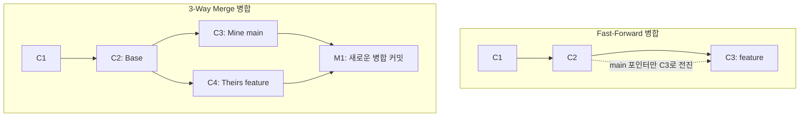

# 🌐 Git & GitHub 심화: 원격 저장소와 협업 완벽 정리 노트

> 로컬 버전 관리를 넘어 **원격 저장소(Remote Repository)**를 활용한 다중 기기 동기화, **Clone vs Fork**, 그리고 **Pull Request & 코드 리뷰** 협업 프로세스 정리 가이드

---

## 📑 목차
1. [핵심 복습: Branch & Merge](#1-핵심-복습-branch--merge)
   - [1-1. Branch와 Merge의 본질](#1-1-branch와-merge의-본질)
   - [1-2. 두 가지 병합 방식: Fast-Forward vs 3-Way Merge](#1-2-두-가지-병합-방식-fast-forward-vs-3-way-merge)
   - [1-3. 충돌(Conflict)과 해결 원칙](#1-3-충돌conflict과-해결-원칙)
2. [원격 저장소(Remote Repository)를 사용하는 이유](#2-원격-저장소remote-repository를-사용하는-이유)
   - [2-1. 왜 로컬에만 두지 않고 원격 저장소를 쓸까?](#2-1-왜-로컬에만-두지-않고-원격-저장소를-쓸까)
   - [2-2. 원격 저장소의 4대 핵심 역할](#2-2-원격-저장소의-4대-핵심-역할)
3. [GitHub와 레포지토리 초기 설정 3대 옵션](#3-github와-레포지토리-초기-설정-3대-옵션)
   - [3-1. GitHub란?](#3-1-github란)
   - [3-2. 새 저장소 생성 시 마주치는 3대 옵션](#3-2-새-저장소-생성-시-마주치는-3대-옵션)
4. [원격 저장소 연결과 동기화 명령어](#4-원격-저장소-연결과-동기화-명령어)
   - [4-1. git remote add origin (주소 등록)](#4-1-git-remote-add-origin-주소-등록)
   - [4-2. git push & git pull (동기화 2대 축)](#4-2-git-push--git-pull-동기화-2대-축)
5. [협업의 핵심: Clone vs Fork 완벽 비교](#5-협업의-핵심-clone-vs-fork-완벽-비교)
   - [5-1. Clone (복제)](#5-1-clone-복제)
   - [5-2. Fork (포크)](#5-2-fork-포크)
   - [5-3. 한눈에 보는 Clone vs Fork 비교표](#5-3-한눈에-보는-clone-vs-fork-비교표)
6. [팀 협업의 꽃: Pull Request (PR) & Code Review](#6-팀-협업의-꽃-pull-request-pr--code-review)
   - [6-1. Pull Request (PR)란?](#6-1-pull-request-pr란)
   - [6-2. Code Review (코드 리뷰)의 목적과 중요성](#6-2-code-review-코드-리뷰의-목적과-중요성)
   - [6-3. 표준 GitHub 협업 사이클 (Lifecycle)](#6-3-표준-github-협업-사이클-lifecycle)
7. [💡 실전 명령어 치트시트](#7--실전-명령어-치트시트)

---

## 1. 핵심 복습: Branch & Merge

### 1-1. Branch와 Merge의 본질
- **Branch (브랜치)**: 기존 코드에서 **독립적인 작업 공간**을 만드는 것.
  - 실험적이거나 단위 기능(Feature)을 개발할 때 안전한 격리 공간 제공.
  - 작업한 내용이 마음에 들지 않거나 실패하면 **그냥 브랜치를 삭제(`git branch -d <이름>`)하면 끝!** 원본 코드에는 아무런 피해가 없습니다.
- **Merge (병합)**: 한 브랜치에서 완료된 작업 내용을 다른 브랜치(주로 `main` 또는 `develop`)로 합치는 것.
  - 명령어: `git merge <합쳐올_브랜치이름>` (합침을 받을 기준 브랜치로 이동한 후 실행)

---

### 1-2. 두 가지 병합 방식: Fast-Forward vs 3-Way Merge



| 구분 | Fast-Forward (빨리 감기) | 3-Way Merge (3자 병합) |
| :--- | :--- | :--- |
| **발생 조건** | 분기 이후 기준 브랜치에 변경이 없어 **커밋 그래프가 단순한 일직선**일 때 | 브랜치가 갈라진 후 **양쪽 브랜치 모두에 새로운 커밋이 발생**했을 때 |
| **동작 방식** | 별도의 커밋 없이 **포인터만 앞으로 이동** | Base, Mine, Theirs를 비교하여 **새로운 병합 커밋(Merge Commit) 생성** |

---

### 1-3. 충돌(Conflict)과 해결 원칙
- **충돌 원인**: 서로 다른 두 브랜치에서 **같은 파일의 같은 부분을 서로 다르게 수정**한 경우 발생.
- **해결 원칙**: Git이 자동으로 판단할 수 없으므로, **개발자가 직접 파일을 열어 충돌 코드를 선택·수정(마커 기호 삭제)한 뒤 `git add` & `git commit`**을 실행해야 합니다.

---

## 2. 원격 저장소(Remote Repository)를 사용하는 이유

### 2-1. 왜 로컬에만 두지 않고 원격 저장소를 쓸까?
1. **코드 및 작업 이력의 자유로운 공유**:
   - **다중 기기 동기화**: 회사 컴퓨터, 집 노트북 등 2개 이상의 장치에서 동일한 코드를 이어서 작업하고 싶을 때.
   - **동료와의 협업**: 전 세계 어디에 있는 개발자든 동일한 프로젝트 코드를 실시간으로 확인하고 기여 가능.
2. **오픈소스(Open Source) 개발**:
   - 코드를 공개하여 전 세계 수천 명의 기여자와 함께 버그를 고치고 발전시킴 (예: React, Linux, Vue 등).

---

### 2-2. 원격 저장소의 4대 핵심 역할

```
           ┌─────────────────────────────────────────┐
           │      🌐 원격 저장소 (GitHub Repo)        │
           │   - 단일 진실 공급원 (Single Source)     │
           │   - 자동 안전 클라우드 백업             │
           └──────────────────┬──────────────────────┘
                              │
            ┌─────────────────┼─────────────────┐
            ▼                                   ▼
┌───────────────────────┐           ┌───────────────────────┐
│  💻 개발자 A (로컬 PC) │           │  💻 개발자 B (로컬 PC) │
│  git push / git pull  │           │  git push / git pull  │
└───────────────────────┘           └───────────────────────┘
```

1. **인터넷에 존재하는 중앙 저장소**: 시간과 장소에 구애받지 않고 언제 어디서나 접근 가능.
2. **코드 공유의 중심**: 여러 사람이 같은 코드를 기반으로 동시에 작업할 수 있는 통로.
3. **완벽한 클라우드 백업**: 로컬 컴퓨터가 고장 나거나 분실되어도 전체 커밋 히스토리가 안전하게 보존됨.
4. **협업의 기준점 (Single Source of Truth)**: 어떤 코드가 공식 배포용 최신 버전인지 명확한 기준 제공.

---

## 3. GitHub와 레포지토리 초기 설정 3대 옵션

### 3-1. GitHub란?
- **Git 저장소를 호스팅해 주는 웹 서비스**.
- 계정을 만든 후 새 Repository를 생성하면 고유한 **원격 저장소 주소(URL)**가 발급됩니다.
  - 예: `https://github.com/사용자아이디/저장소이름.git`

---

### 3-2. 새 저장소 생성 시 마주치는 3대 옵션

GitHub에서 **[New repository]**를 누르면 나오는 체크박스 3대 옵션의 정체:

```
[ ] Add a README file      ──▶ 프로젝트 안내서/설명서 문서 생성
[ ] Add .gitignore         ──▶ Git 추적 제외 목록 템플릿 설정
[ ] Choose a license       ──▶ 오픈소스 라이선스 및 저작권 규정
```

| 옵션명 | 설명 및 역할 | 실무 팁 |
| :--- | :--- | :--- |
| **Add README** | 프로젝트의 **소개서, 사용법, 설치 안내서(Documentation)**를 담는 `README.md` 파일을 자동 생성 | 로컬에 이미 작성한 코드를 처음 push할 때는 충돌 방지를 위해 **체크 해제 권장**! |
| **Add .gitignore** | 빌드 산출물(`dist/`), 패키지(`node_modules/`), 개인 비밀키(`.env`) 등 **Git이 추적하지 않고 무시해야 할 목록**을 정의하는 설정 파일 | 언어/프레임워크(Node, Python, Java 등) 템플릿을 선택하면 편리함 |
| **Choose a license** | 해당 코드의 **저작권 및 사용 허가 범위**를 규정 (MIT, Apache 2.0, GPL 등) | 누구나 자유롭게 사용/수정 가능한 **MIT License**가 가장 대중적 |

---

## 4. 원격 저장소 연결과 동기화 명령어

### 4-1. git remote add origin (주소 등록)
로컬 Git 저장소에게 원격 저장소의 위치(URL)를 알려주고 별칭을 붙여주는 명령어입니다.

```bash
# 원격 저장소 주소를 'origin'이라는 기본 별칭으로 등록
git remote add origin https://github.com/username/my-project.git

# 현재 연결된 원격 저장소 목록 및 주소 확인
git remote -v
```

> [!NOTE]
> `origin`은 Git에서 관례적으로 사용하는 **기본 원격 저장소의 별명(Alias)**입니다.

---

### 4-2. git push & git pull (동기화 2대 축)

```
[내 컴퓨터 (로컬 저장소)] ──( git push )──▶ [GitHub (원격 저장소)]
[내 컴퓨터 (로컬 저장소)] ◀──( git pull )─── [GitHub (원격 저장소)]
```

#### 1) `git push` (올리기)
- 내 로컬 저장소에 쌓인 커밋 이력을 원격 저장소로 업로드합니다.
```bash
# 로컬의 main 브랜치 이력을 원격(origin)의 main 브랜치로 업로드
git push origin main

# -u (upstream) 옵션을 주면 다음부터는 단순히 'git push'만 입력 가능
git push -u origin main
```

#### 2) `git pull` (내려받아 합치기)
- 원격 저장소의 최신 변경사항을 다운로드한 후, 현재 작업 중인 내 로컬 브랜치에 자동으로 병합합니다.
```bash
git pull origin main
```

---

## 5. 협업의 핵심: Clone vs Fork 완벽 비교

원격 저장소의 코드를 내 쪽으로 가져오는 두 가지 방식의 차이점을 명확히 정리합니다:

```mermaid
graph TD
    subgraph [1. Clone 방식 - 팀 내부 협업]
        R1[팀 원격 저장소] -->|git clone| L1[내 로컬 PC]
        L1 -->|직접 push 권한 있음| R1
    end

    subgraph [2. Fork 방식 - 오픈소스 기여]
        O1[남의 원본 저장소] -->|Fork 웹 버튼 클릭| F1[내 GitHub 계정 저장소]
        F1 -->|git clone| L2[내 로컬 PC]
        L2 -->|내 저장소로 push| F1
        F1 -->|Pull Request 요청| O1
    end
```

### 5-1. Clone (복제)
- **개념**: 원격 저장소를 **그대로 내 로컬 컴퓨터로 복제**하여 다운로드.
- **특징**:
  - 해당 저장소의 팀원/멤버로서 **직접 `push`할 수 있는 쓰기 권한이 있을 때** 사용.
  - 회사나 팀 프로젝트 같은 **내부 협업**에 주로 사용.
```bash
git clone https://github.com/team/project.git
```

### 5-2. Fork (포크)
- **개념**: 다른 사람의 GitHub 원격 저장소를 **내 GitHub 계정으로 통째로 복사본을 떠오는 것**.
- **특징**:
  - 원본 저장소에 **직접 `push`할 권한이 없을 때** 사용.
  - 내 GitHub 계정으로 복사해 왔으므로 마음껏 수정 후, 원본 저장소에 **Pull Request(PR)**를 보내어 기여함.
  - **오픈소스 기여(Contribution)**의 표준 방식!

---

### 5-3. 한눈에 보는 Clone vs Fork 비교표

| 비교 항목 | Clone (클론) | Fork (포크) |
| :--- | :--- | :--- |
| **복사 대상 위치** | 원격 저장소 ➔ **내 로컬 컴퓨터(PC)** | 남의 원격 저장소 ➔ **내 GitHub 계정(웹)** |
| **실행 방식** | 터미널 명령어 (`git clone <url>`) | GitHub 웹사이트 상단의 **[Fork] 버튼** 클릭 |
| **원본 쓰기 권한** | 직접 push 권한이 **있을 때** 사용 | 직접 push 권한이 **없을 때** 사용 |
| **주 사용처** | 회사 업무, 팀 내부 프로젝트 협업 | 오픈소스 프로젝트 기여, 남의 코드 개인 학습 |

---

## 6. 팀 협업의 꽃: Pull Request (PR) & Code Review

### 6-1. Pull Request (PR)란?
- **정의**: 내가 브랜치에서 작업한 변경 사항을 **"원본(또는 기준) 저장소에 반영(Merge)해 주세요!"라고 정중하게 요청(Request)**하는 협업 기능.
- **핵심 역할**:
  1. **변경 내용 상세 설명**: 어떤 문제를 해결했고 어떤 코드를 바꿨는지 문서화.
  2. **리뷰 요청**: 동료 개발자에게 코드 검토(Reviewers) 지정.
  3. **병합 전 최종 안전 검증**: 테스트 통과 여부 및 충돌 여부를 병합 전에 자동 검사.

---

### 6-2. Code Review (코드 리뷰)의 목적과 중요성
> *"코드를 실제 서비스(`main`)에 병합하기 전에 팀원들이 함께 눈으로 확인하고 토론하는 과정"*

1. **버그 조기 예방**: 작성자가 미처 발견하지 못한 엣지 케이스나 잠재적 오류를 동료가 사전에 발견.
2. **코드 품질 및 가독성 유지**: 중복 코드 제거, 성능 개선, 클린 코드 원칙 준수 유도.
3. **팀 지식 및 규칙 공유**: 팀의 컨벤션(코딩 스타일)을 일치시키고 프로젝트 노하우를 팀 전체로 전파.

---

### 6-3. 표준 GitHub 협업 사이클 (Lifecycle)

```
[1. 브랜치 생성] ──▶ [2. 작업 & commit] ──▶ [3. 내 브랜치 push]
       │
       ▼
[4. Pull Request 생성] ──▶ [5. 동료의 Code Review] ──▶ [6. 승인 & 최종 Merge]
```

1. `main`에서 새 기능 브랜치 생성 (`git switch -c feature/login`)
2. 기능 개발 후 로컬에 커밋 (`git commit -m "feat: 카카오 로그인 추가"`)
3. 원격 저장소로 브랜치 푸시 (`git push origin feature/login`)
4. GitHub 웹에서 **Compare & Pull Request** 버튼 클릭하여 PR 작성
5. 팀원들의 **Code Review** 진행 (댓글 토론 및 수정 커밋 반영)
6. 리뷰 승인(Approve) 후 `main` 브랜치로 최종 병합(**Merge Pull Request**) 완료! 🎉

---

## 7. 💡 실전 명령어 치트시트

```bash
# 1. 원격 저장소 연동
git remote add origin <URL>              # 원격 저장소 주소 등록
git remote -v                             # 연결된 원격 주소 확인

# 2. 업로드 & 다운로드
git push origin <브랜치명>                 # 로컬 커밋을 원격에 올리기
git push -u origin main                   # 최초 업로드 시 기본 업스트림 지정
git pull origin <브랜치명>                 # 원격의 최신 변경사항 내려받기

# 3. 프로젝트 복제
git clone <URL>                           # 원격 저장소 전체를 내 PC로 복사

# 4. 브랜치 병합
git merge <가져올브랜치명>                 # 현재 브랜치로 대상 브랜치 병합
git branch -d <삭제할브랜치명>             # 병합 완료된 불필요 브랜치 삭제
```
