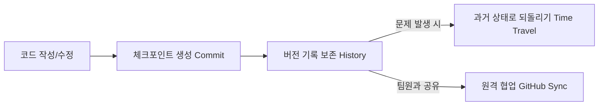
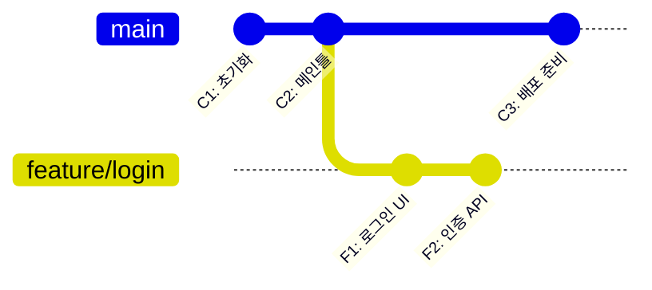
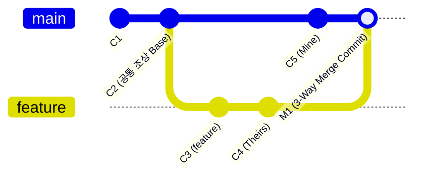

# 📚 Git & GitHub 핵심 이론 정리 노트

> 파일이나 코드의 변경 이력을 체계적으로 기록하고 관리하는 **버전 관리(Version Control)** 완벽 정리 가이드

---

## 📑 목차
1. [Git / GitHub 핵심 개념](#1-git--github-핵심-개념)
   - [1-1. Git & GitHub를 사용해야 하는 이유](#1-1-git--github를-사용해야-하는-이유)
   - [1-2. Git과 GitHub의 차이](#1-2-git과-github의-차이)
   - [1-3. Repository (저장소)](#1-3-repository-저장소)
   - [1-4. Commit (커밋)](#1-4-commit-커밋)
   - [1-5. Branch (브랜치)](#1-5-branch-브랜치)
2. [Git 기본 7대 명령어 & 4단계 워크플로우](#2-git-기본-7대-명령어--4단계-워크플로우)
   - [2-1. git config (환경 설정)](#2-1-git-config-환경-설정)
   - [2-2. git init (저장소 초기화)](#2-2-git-init-저장소-초기화)
   - [2-3. git status (상태 확인)](#2-3-git-status-상태-확인)
   - [2-4. git add (스테이징)](#2-4-git-add-스테이징)
   - [2-5. git commit (버전 기록)](#2-5-git-commit-버전-기록)
   - [2-6. git push (원격 업로드)](#2-6-git-push-원격-업로드)
   - [2-7. git pull (원격 다운로드 & 병합)](#2-7-git-pull-원격-다운로드--병합)
3. [Branch 심화 & Merge 전략](#3-branch-심화--merge-전략)
   - [3-1. git branch 명령어 (확인, 생성, 전환)](#3-1-git-branch-명령어-확인-생성-전환)
   - [3-2. 브랜치 관리 전략 (Git Flow 5대 브랜치)](#3-2-브랜치-관리-전략-git-flow-5대-브랜치)
   - [3-3. Fast-forward 병합](#3-3-fast-forward-병합)
   - [3-4. 3-Way Merge 병합](#3-4-3-way-merge-병합)
   - [3-5. Merge Conflict (충돌) 및 해결법](#3-5-merge-conflict-충돌-및-해결법)

---

## 1. Git / GitHub 핵심 개념

### 1-1. Git & GitHub를 사용해야 하는 이유
- **핵심 이유**: *"체크포인트를 만들고 기록을 남기는 **버전 관리(Version Control)**"*
- **버전 관리란?**
  - 파일이나 코드의 변경 이력을 체계적으로 기록하고 관리하는 것을 뜻함.
  - **언제, 누가, 무엇을 바꿨는지** 명확히 알 수 있고, 필요하면 과거 상태로 되돌릴 수 있음.
- **버전 관리가 필요한 3대 이유**:
  1. **변경 이력 추적**: 어떤 파일의 몇 번째 줄이 왜 바뀌었는지 투명하게 추적.
  2. **실수 복구**: 코드 작성 중 치명적인 버그가 발생해도 안전했던 과거 세이브포인트로 즉각 복구.
  3. **충돌 없는 협업**: 여러 작업자가 같은 프로젝트를 작업할 때 서로의 코드를 덮어쓰지 않고 독립적으로 개발 후 병합.



---

### 1-2. Git과 GitHub의 차이

| 구분 | Git (깃) | GitHub (깃허브) |
| :--- | :--- | :--- |
| **정의** | 버전 관리를 위한 **핵심 도구(프로그램)** | Git 저장소를 올려두는 **클라우드 웹 서비스** |
| **동작 위치** | **내 로컬 컴퓨터**에서 직접 동작 | **인터넷 클라우드 서버**에 호스팅 |
| **오프라인 지원**| 인터넷 연결 없이도 커밋, 브랜치 가능 | 인터넷 연결 필수 |
| **주요 역할** | 변경 이력 기록, 브랜치 생성, 병합 | 코드 공유, 팀 협업, Pull Request, Issue, 코드 리뷰 |
| **비유** | 사진을 찍어 메모리에 저장하는 **카메라** | 사진을 공유하고 피드백을 나누는 **SNS(인스타그램)** |

---

### 1-3. Repository (저장소)
- 파일과 그 변경 이력을 함께 관리하는 저장소로, **프로젝트 전체와 모든 버전 기록**이 보관되는 공간.

```
📁 내 컴퓨터 (로컬)                     🌐 GitHub (원격)
┌───────────────────────┐            ┌────────────────────────┐
│  my-project/          │  git push  │  github.com/user/repo  │
│  ├── src/             │ ─────────> │                        │
│  └── .git/ (로컬 저장소)│ <───────── │  (클라우드 원격 저장소) │
└───────────────────────┘  git pull  └────────────────────────┘
```

1. **로컬 저장소 (Local Repository)**:
   - 내 컴퓨터 하드디스크에 위치하는 저장소.
   - 프로젝트 폴더 내 숨김 폴더인 `.git` 디렉토리에 모든 버전 기록이 저장됨.
2. **원격 저장소 (Remote Repository)**:
   - GitHub, GitLab 등 인터넷 서버에 위치한 저장소.
   - 팀원 누구나 접근하여 코드를 공유하고 동기화할 수 있음.

---

### 1-4. Commit (커밋)
- 변경 사항을 하나의 기록으로 저장하는 단위 (**= 하나의 완성된 버전**).
- 게임의 **세이브포인트(Save Point)** 또는 마일스톤 같은 개념.
- **커밋 단위**: 정해진 규격은 없으며, **개발자가 의미 있는 논리적 작업 단위(예: 로그인 기능 구현, 버튼 버그 수정 등)로 직접 설정**.

```
(과거)                                                      (현재)
[Commit 1: 초기 설정] ──▶ [Commit 2: 메인 UI] ──▶ [Commit 3: 로그인 구현]
  hash: a1b2c3d             hash: e4f5g6h             hash: 7i8j9k0 (HEAD)
```

---

### 1-5. Branch (브랜치)
- **독립적으로 작업할 수 있는 작업 공간** (기능 개발 등 큰 단위로 작업할 때 유용함).
- **기존 코드를 통째로 복사한 독립된 작업 공간** (복사본/평행 우주 같은 개념).
- 브랜치 안에서 아무리 코드를 수정하고 실험해도, 병합(Merge)하기 전까지는 원본 코드(`main`)에 아무런 영향을 주지 않음.



---

## 2. Git 기본 7대 명령어 & 4단계 워크플로우

### 🔄 Git의 4단계 라이프사이클 흐름도

```
[1. Working Directory] ──( git add )──▶ [2. Staging Area]
  (작업 디렉토리 / 수정 중)                 (인덱스 / 커밋 대기)
                                                │
                                            ( git commit )
                                                │
                                                ▼
[4. Remote Repository] ◀──( git push )── [3. Local Repository]
  (GitHub 원격 저장소)   ──( git pull )──▶ (로컬 .git 저장소)
```

---

### 2-1. git config
- **용도**: Git의 기본 동작 환경 및 사용자 정보 설정.
```bash
# 전역(Global) 사용자 이름 설정
git config --global user.name "홍길동"

# 전역 사용자 이메일 설정
git config --global user.email "hong@example.com"

# 현재 설정된 전체 목록 확인
git config --list
```

### 2-2. git init
- **용도**: 현재 폴더를 Git 저장소로 초기화.
```bash
git init
# 실행 시 현재 폴더에 숨김 폴더인 .git 디렉토리가 생성되며 버전 관리가 시작됨
```

### 2-3. git status
- **용도**: 현재 작업 디렉토리와 스테이징 영역의 상태 확인.
```bash
git status
```

### 2-4. git add
- **용도**: 변경된 파일을 **Staging Area(스테이징 영역)**로 올리는 명령어.
```bash
# 특정 파일 하나만 스테이징
git add index.html

# 변경 및 추가된 모든 파일을 한 번에 스테이징
git add .
```

### 2-5. git commit
- **용도**: Staging Area에 대기 중인 파일들을 하나의 영구 버전(체크포인트)으로 로컬 저장소에 기록.
```bash
# 커밋 메시지와 함께 바로 기록
git commit -m "feat: 로그인 입력 폼 마크업 추가"
```

### 2-6. git push
- **용도**: 로컬 저장소에 쌓인 커밋 이력들을 GitHub 원격 저장소로 업로드.
```bash
# 원격 저장소(origin)의 main 브랜치로 업로드
git push origin main

# 처음 업로드 시 -u 옵션을 주면 이후에는 'git push'만 입력해도 자동 연동
git push -u origin main
```

### 2-7. git pull
- **용도**: 원격 저장소의 최신 변경사항을 다운로드한 후, 현재 작업 중인 로컬 브랜치에 자동으로 병합(Merge).
```bash
git pull origin main
```

---

## 3. Branch 심화 & Merge 전략

### 3-1. git branch 명령어 (확인, 생성, 전환)

```bash
# 1. 로컬 브랜치 목록 확인 (* 표시된 것이 현재 내가 위치한 브랜치)
git branch

# 2. 새로운 브랜치 생성 (main 코드를 복사하여 생성)
git branch feature/ui

# 3. 브랜치 이동/전환 (작업 공간 변경)
git switch feature/ui

# 4. 브랜치 생성과 전환을 한 번에 실행
git switch -c feature/login
```

---

### 3-2. 브랜치 관리 전략 (Git Flow 5대 브랜치)

| 브랜치명 | 역할 및 특징 |
| :--- | :--- |
| **`main`** | **배포 가능한 안정 버전** (실서비스 운영 코드, 직접 푸시 금지, 무결점 유지) |
| **`develop`** | **개발 중인 기능을 테스트하는 버전** (모든 feature가 합쳐지는 중심 개발선) |
| **`feature`** | **단위 기능 개발** (`feature/cart`, `feature/login` 등 기능 완료 후 develop에 병합 후 삭제) |
| **`release`** | **서비스 배포(출시) 준비** (develop에서 분기하여 출시 직전 버그 수정 및 최종 QA) |
| **`hotfix`** | **긴급 수정** (운영 중인 main에서 치명적 버그 발생 시 즉시 main에서 따서 패치 후 배포) |

---

### 3-3. Fast-forward 병합
- **개념**: 브랜치가 분기된 이후 기준 브랜치(`main`)에 아무런 추가 커밋이 없어 **일직선으로 이어질 때** 병합되는 방식.
- **특징**: 별도의 새로운 병합 커밋(Merge Commit)을 만들지 않고, **단순히 `main`의 포인터만 앞으로 이동(빨리 감기)**시킵니다.

```
[병합 전]
main    : C1 ──▶ C2 (HEAD)
                   ╰──▶ C3 ──▶ C4 (feature)

[Fast-forward 병합 후: git merge feature]
main    : C1 ──▶ C2 ──▶ C3 ──▶ C4 (HEAD, main, feature)
(포인터만 C4로 쑥 전진!)
```

---

### 3-4. 3-Way Merge 병합
- **개념**: 브랜치가 갈라진 후, **양쪽 브랜치 모두에 새로운 커밋이 발생**하여 두 갈래가 되었을 때 병합되는 방식.
- **특징**: 공통 조상(Base), 현재 브랜치(Mine), 대상 브랜치(Theirs) 3곳을 비교하여 결합하고, **새로운 병합 커밋(Merge Commit)**을 생성합니다.



---

### 3-5. Merge Conflict (충돌) 및 해결법
- **발생 원인**: **같은 파일의 같은 부분을 서로 다르게 수정**한 상태에서 병합을 시도하면, Git이 둘 중 어느 코드를 채택해야 할지 스스로 결정할 수 없어 충돌이 발생합니다.

#### 🔍 충돌 코드 마커 구조
```javascript
function getGreeting() {
<<<<<<< HEAD
  // 현재 내가 있는 브랜치(main)의 코드
  return "안녕하세요! 메인 서비스입니다.";
=======
  // 가져와서 합치려는 브랜치(feature)의 코드
  return "반갑습니다! 신규 기능 페이지입니다.";
>>>>>>> feature/ui
}
```

#### 🛠️ 충돌 해결 3단계 프로세스
1. **충돌 파일 열기 & 코드 정리**: 마커 기호 제거 및 올바른 코드로 직접 수정
2. **해결 완료 파일 스테이징**: `git add <파일명>`
3. **병합 커밋 확정**: `git commit -m "fix: resolve merge conflict"`
