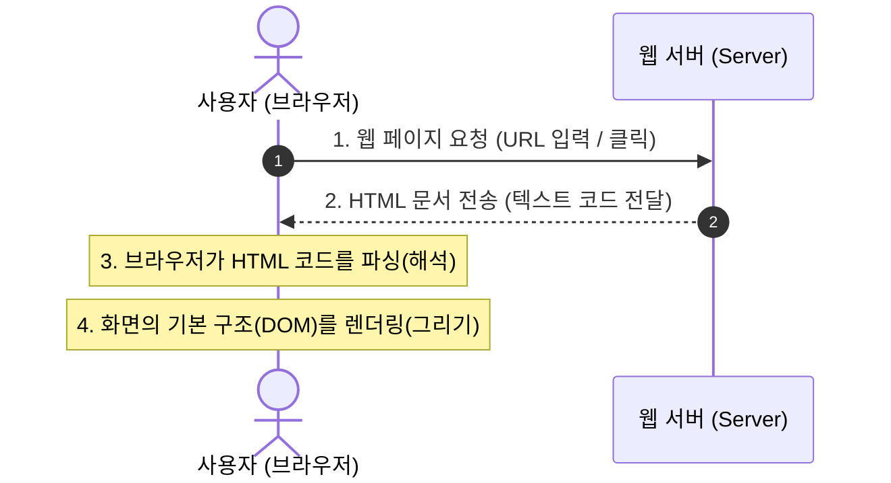
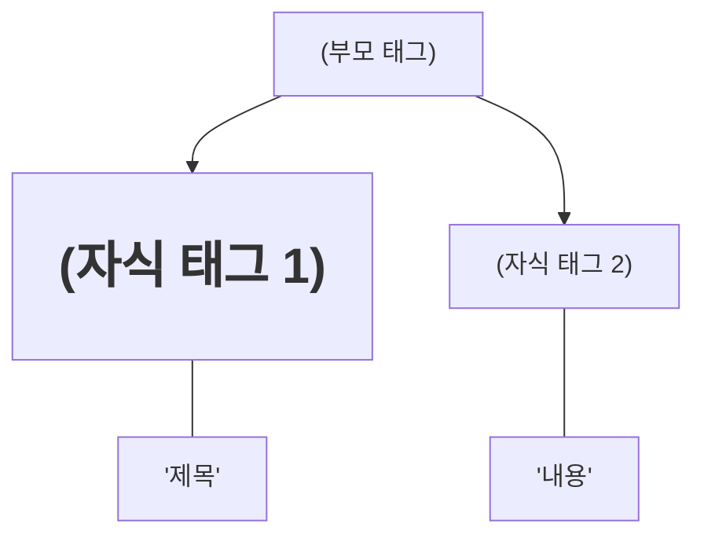

# 🌐 HTML 기초: 웹의 뼈대와 기본 구조 완벽 정리 노트

> 웹 페이지의 구조와 뼈대를 정의하는 **HTML(HyperText Markup Language)**의 기본 원리, 브라우저 렌더링 흐름, 그리고 필수 골격 태그 완벽 가이드

---

## 📑 목차
1. [HTML(HyperText Markup Language)이란?](#1-htmlhypertext-markup-language이란)
   - [1-1. HTML의 정의와 핵심 역할](#1-1-html의-정의와-핵심-역할)
   - [1-2. 웹(Web)과 HTML: 브라우저가 화면을 그리는 과정](#1-2-웹web과-html-브라우저가-화면을-그리는-과정)
2. [태그(Tag)와 요소(Element)의 원리](#2-태그tag와-요소element의-원리)
   - [2-1. 태그의 기본 문법과 구조](#2-1-태그의-기본-문법과-구조)
   - [2-2. 대표적인 기본 태그 예시: h1과 p](#2-2-대표적인-기본-태그-예시-h1과-p)
3. [중첩(Nesting)과 부모-자식 계층 구조](#3-중첩nesting과-부모-자식-계층-구조)
   - [3-1. 태그의 중첩과 문서 계층](#3-1-태그의-중첩과-문서-계층)
   - [3-2. 부모 태그(Parent) vs 자식 태그(Child) 트리](#3-2-부모-태그parent-vs-자식-태그child-트리)
4. [HTML 문서의 필수 5대 골격 구조](#4-html-문서의-필수-5대-골격-구조)
   - [4-1. <!DOCTYPE html> (문서 형식 선언)](#4-1-doctype-html-문서-형식-선언)
   - [4-2. <html> (루트 태그)](#4-2-html-루트-태그)
   - [4-3. <head> (설정과 메타 정보 영역)](#4-3-head-설정과-메타-정보-영역)
   - [4-4. <title> (탭 제목과 SEO)](#4-4-title-탭-제목과-seo)
   - [4-5. <body> (실제 화면 출력 영역)](#4-5-body-실제-화면-출력-영역)
5. [💡 표준 HTML5 기본 골격 템플릿 & 요약](#5--표준-html5-기본-골격-템플릿--요약)

---

## 1. HTML(HyperText Markup Language)이란?

### 1-1. HTML의 정의와 핵심 역할
- **HTML** = **H**yper**T**ext **M**arkup **L**anguage
  - **HyperText**: 단순 텍스트를 넘어 클릭을 통해 다른 페이지나 문서로 자유롭게 이동(링크)할 수 있는 텍스트.
  - **Markup Language**: 태그(`tag`)를 사용해 문서의 각 부분이 **제목인지, 본문인지, 이미지인지** 표시(마크)하는 언어.
- **핵심 역할**: **웹 페이지의 뼈대(구조)를 만드는 역할**.
  - 글의 제목, 문단, 이미지, 링크, 버튼, 표 등의 위치와 골격을 정의합니다.

> [!TIP]
> **웹 개발의 3대 요소 비유**:
> - 🦴 **HTML**: 건물의 **철근과 골조** (구조와 뼈대)
> - 🎨 **CSS**: 건물의 **페인트와 인테리어** (시각적 스타일링)
> - ⚡ **JavaScript**: 건물의 **엘리베이터와 전등 스위치** (동작과 상호작용)

---

### 1-2. 웹(Web)과 HTML: 브라우저가 화면을 그리는 과정
서버가 만든 HTML 문서를 웹 브라우저(Chrome, Safari, Edge 등)가 해석하여 우리가 보는 화면으로 그려냅니다.



1. **요청 및 생성**: 사용자가 주소를 입력하면, 서버가 HTML 문서를 만들어 브라우저에 전달합니다.
2. **해석(Parsing)**: 브라우저는 전달받은 HTML 태그들을 위에서부터 순서대로 읽고 해석합니다.
3. **화면 구성(Rendering)**: 브라우저가 태그의 의미에 맞춰 글자 크기, 줄바꿈, 이미지 영역 등의 **화면 기본 구조를 시각적으로 완성**합니다.

---

## 2. 태그(Tag)와 요소(Element)의 원리

### 2-1. 태그의 기본 문법과 구조
- HTML 문서는 **태그(tag)**들의 조합으로 구성됩니다.
- 태그는 `<태그이름>` 형태로 꺾쇠괄호 안에 작성합니다.
- 각 태그마다 고유한 **의미(Semantic)와 역할**을 지닙니다.
- 대부분의 태그는 **여는 태그(Opening tag)**와 **닫는 태그(Closing tag)**가 쌍을 이룹니다.

```
<p> 안녕하세요, 반갑습니다! </p>
───  ───────────────────────  ────
 ▲              ▲               ▲
 │              │               └── 3. 닫는 태그 (Closing Tag: '/' 슬래시 포함)
 │              └────────────────── 2. 내용 (Content: 실제 표현될 데이터)
 └───────────────────────────────── 1. 여는 태그 (Opening Tag: 요소의 시작 알림)
└─────────────────────────────────┘
                ▲
                └── 전체를 합쳐 **요소 (Element)**라고 부름
```

---

### 2-2. 대표적인 기본 태그 예시: h1과 p

| 태그 | 정식 명칭 | 의미 및 역할 | 예시 코드 |
| :--- | :--- | :--- | :--- |
| **`<h1>`** | **Heading Tag** | 문서나 섹션의 **가장 중요한 대제목**을 표시 (h1 ~ h6까지 존재) | `<h1>오늘의 뉴스</h1>` |
| **`<p>`** | **Paragraph Tag** | 텍스트의 하나의 완성된 **문단(단락)**을 표시 | `<p>오늘 날씨는 맑고 쾌청합니다.</p>` |

---

## 3. 중첩(Nesting)과 부모-자식 계층 구조

### 3-1. 태그의 중첩과 문서 계층
- 태그 안에 또 다른 태그가 들어갈 수 있으며, 이를 **태그의 중첩(Nesting)**이라고 합니다.
- 중첩 구조를 통해 문서가 트리(Tree) 형태의 체계적인 **계층 구조**를 갖추게 됩니다.
- 닫는 태그는 **가장 안쪽에 열린 태그부터 순서대로** 닫아주어야 문법 오류가 나지 않습니다.

```html
<!-- 올바른 중첩: 안쪽 p를 먼저 닫고, 바깥 body를 닫음 -->
<body>
    <h1>문서의 제목</h1>
    <p>여기는 본문 내용입니다.</p>
</body>
```

---

### 3-2. 부모 태그(Parent) vs 자식 태그(Child) 트리

다른 태그를 감싸고 있는 바깥쪽 태그를 **부모 태그**, 그 안에 포함된 안쪽 태그를 **자식 태그**라고 부릅니다.



```
📂 계층 구조 관계도:
└─ <body>           ── [부모 태그 (Parent)]
    ├─ <h1>         ── [자식 태그 (Child 1)] ── sibling (형제 관계)
    └─ <p>          ── [자식 태그 (Child 2)] ── sibling (형제 관계)
```

---

## 4. HTML 문서의 필수 5대 골격 구조

모든 정상적인 HTML 문서는 항상 다음과 같은 일정한 기본 틀을 가집니다:

```html
<!DOCTYPE html>
<html>
    <head>
        <title>My Page</title>
    </head>
    <body>
        <h1>제목</h1>
        <p>내용</p>
    </body>
</html>
```

---

### 4-1. `<!DOCTYPE html>` (문서 형식 선언)
- **역할**: 현재 문서가 **최신 표준 웹 기술인 HTML5 규격**으로 작성되었음을 브라우저에 알리는 선언문.
- **특징**: 태그가 아닌 **선언문(Document Type Definition)**이므로 닫는 태그가 없으며, 문서의 **맨 첫 줄(1행)**에 반드시 위치해야 합니다.
- 브라우저가 과거 호환 모드가 아닌 표준 모드(Standards Mode)로 올바르게 렌더링하도록 강제합니다.

---

### 4-2. `<html>` (최상위 루트 태그)
- **역할**: HTML 문서의 **시작과 끝을 알리는 가장 바깥쪽의 최상위 태그(Root Element)**.
- **특징**: `<!DOCTYPE html>` 선언을 제외한 **모든 HTML 태그는 반드시 `<html>`과 `</html>` 안**에 포함되어야 합니다.
- 주로 어떤 언어로 작성되었는지 속성을 함께 표기합니다: `<html lang="ko">`

---

### 4-3. `<head>` (설정과 메타 정보 영역)
- **역할**: 브라우저 화면(본문)에는 **직접 보이지 않는 문서의 설정 및 정보**를 담는 구역.
- **주요 포함 요소**:
  - 문자 인코딩 설정 (예: `<meta charset="UTF-8">` - 한글 깨짐 방지)
  - 웹 페이지 탭 제목 (`<title>`)
  - 검색 엔진을 위한 설명글 및 키워드 (메타 태그)
  - 외부 CSS 스타일시트 및 자바스크립트 파일 연결

---

### 4-4. `<title>` (탭 제목과 SEO)
- **역할**: `<head>` 영역 안에 위치하며, **브라우저 상단 탭에 표시되는 페이지 제목**.
- **중요성**:
  1. 사용자가 웹 서핑 중 탭을 구분하는 이름표 역할.
  2. 즐겨찾기(북마크) 등록 시 기본 이름으로 지정됨.
  3. 구글, 네이버 등 **검색 포털 결과의 파란색 클릭 링크 제목(SEO)**으로 가장 중요하게 노출됨.

---

### 4-5. `<body>` (실제 화면 출력 영역)
- **역할**: 사용자가 웹 브라우저 화면에서 **실제로 눈으로 보게 되는 모든 시각적 콘텐츠**가 위치하는 공간.
- **주요 포함 요소**:
  - 제목 태그 (`<h1>` ~ `<h6>`)
  - 본문 텍스트 문단 (`<p>`)
  - 이미지 (``), 링크 (`<a>`), 버튼 (`<button>`)
  - 목록 (`<ul>`, `<ol>`), 테이블 (`<table>`), 입력 폼 (`<input>`) 등

---

## 5. 💡 표준 HTML5 기본 골격 템플릿 & 요약

```html
<!DOCTYPE html>
<html lang="ko">
  <head>
    <!-- 화면에는 보이지 않는 문서의 설정 구역 -->
    <meta charset="UTF-8" />
    <meta name="viewport" content="width=device-width, initial-scale=1.0" />
    <title>My Page - 첫 번째 웹 페이지</title>
  </head>
  <body>
    <!-- 사용자의 눈에 실제로 보이는 본문 화면 구역 -->
    <h1>환영합니다! HTML 기본 구조 학습</h1>
    <p>서버가 보낸 HTML을 브라우저가 읽고 화면을 그립니다.</p>
  </body>
</html>
```

### 📌 핵심 한 줄 요약
1. **HTML**은 웹 페이지의 **뼈대와 구조**를 만드는 마크업 언어다.
2. **서버 ➔ HTML 전달 ➔ 브라우저 파싱 ➔ 화면 렌더링**의 흐름으로 웹 페이지가 동작한다.
3. 태그는 `<태그>내용</태그>`의 형태를 가지며, 부모-자식 간 **중첩 계층 구조**를 이룬다.
4. **`<!DOCTYPE html>`**(선언) ➔ **`<html>`**(전체) ➔ **`<head>`**(설정/안 보이는 정보) ➔ **`<body>`**(실제 보이는 본문)의 뼈대를 반드시 기억하자!
