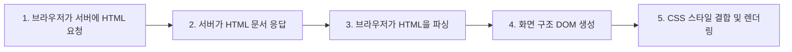
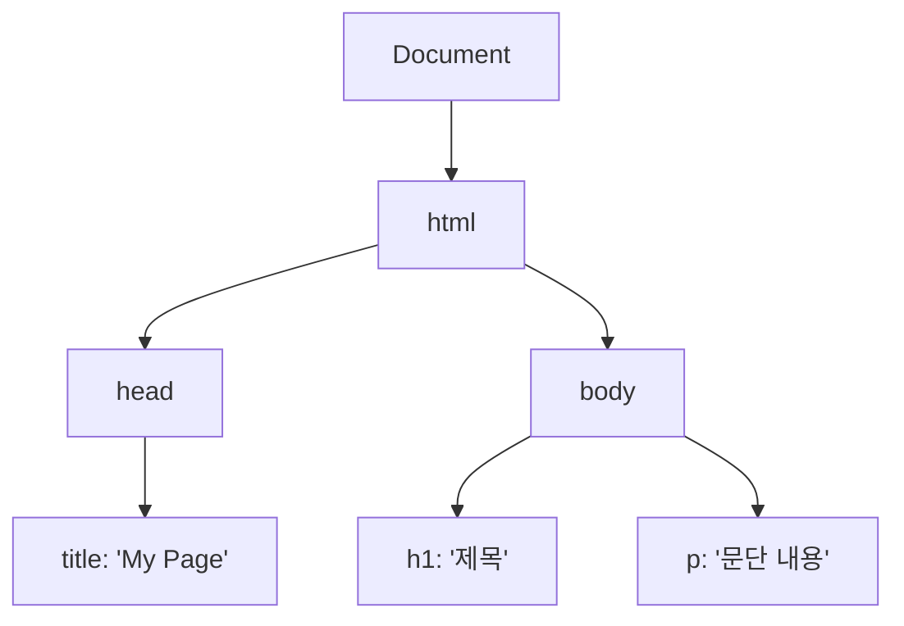

# 🎨 HTML & CSS 기초 심화: DOM, 속성, 폼과 스타일링 완벽 정리 노트

> HTML의 문서 골격과 브라우저의 **DOM 생성 원리**, **id vs class 속성**, **주요 태그(List, Table, Img, Form)**, 그리고 **CSS의 Cascading과 스타일링 기초**까지 한 번에 정리하는 실전 가이드

---

## 📑 목차
1. [HTML 문서 골격 & 브라우저 렌더링 과정](#1-html-문서-골격--브라우저-렌더링-과정)
   - [1-1. HTML 기본 구조 복습](#1-1-html-기본-구조-복습)
   - [1-2. 브라우저가 화면을 그리는 5단계 흐름](#1-2-브라우저가-화면을-그리는-5단계-흐름)
   - [1-3. DOM (Document Object Model)이란?](#1-3-dom-document-object-model이란)
2. [HTML 속성(Attribute)과 식별자: id vs class](#2-html-속성attribute과-식별자-id-vs-class)
   - [2-1. HTML 속성의 기본 규칙](#2-1-html-속성의-기본-규칙)
   - [2-2. id 속성: 단 하나뿐인 고유 식별자](#2-2-id-속성-단-하나뿐인-고유-식별자)
   - [2-3. class 속성: 공통 그룹 묶기](#2-3-class-속성-공통-그룹-묶기)
   - [2-4. [보너스] 정규표현식(Regex) 기초 문법표](#2-4-보너스-정규표현식regex-기초-문법표)
3. [시맨틱 태그(Semantic HTML) & HTTP 메시지 구조 비유](#3-시맨틱-태그semantic-html--http-메시지-구조-비유)
   - [3-1. 시맨틱(Semantic)이란?](#3-1-시맨틱semantic이란)
   - [3-2. HTTP 메시지와 HTML 문서 구조의 닮은 점](#3-2-http-메시지와-html-문서-구조의-닮은-점)
   - [3-3. 닫는 태그가 없는 빈 태그 (Void Tag)](#3-3-닫는-태그가-없는-빈-태그-void-tag)
4. [핵심 HTML 태그 상세 정복](#4-핵심-html-태그-상세-정복)
   - [4-1. 목록 태그: ul, ol, li](#4-1-목록-태그-ul-ol-li)
   - [4-2. 테이블 태그: table, tr, th, td](#4-2-테이블-태그-table-tr-th-td)
   - [4-3. 미디어 태그: img와 경로, 쿼리 파라미터의 진실](#4-3-미디어-태그-img와-경로-쿼리-파라미터의-진실)
   - [4-4. 링크 & 사용자 입력 폼: a, form, label, input](#4-4-링크--사용자-입력-폼-a-form-label-input)
5. [CSS 기초: 문법과 Cascading(상속) 원리](#5-css-기초-문법과-cascading상속-원리)
   - [5-1. CSS(Cascading Style Sheets)란?](#5-1-csscascading-style-sheets란)
   - [5-2. Cascading의 핵심: 부모 스타일 상속](#5-2-cascading의-핵심-부모-스타일-상속)
   - [5-3. 인라인 스타일 실전 예제 (font-size, font-weight, text-align)](#5-3-인라인-스타일-실전-예제-font-size-font-weight-text-align)
   - [5-4. 시맨틱 태그와 인라인 스타일 결합 예제](#5-4-시맨틱-태그와-인라인-스타일-결합-예제)
6. [💡 핵심 한눈에 보기 치트시트](#6--핵심-한눈에-보기-치트시트)

---

## 1. HTML 문서 골격 & 브라우저 렌더링 과정

### 1-1. HTML 기본 구조 복습
VS Code 등 에디터에서 `!` 입력 후 `Enter`를 누르면 자동 세팅되는 기본 틀입니다:

```html
<!DOCTYPE html>
<html lang="ko">
  <head>
    <meta charset="UTF-8" />
    <title>My Page</title>
  </head>
  <body>
    Hello, HTML
  </body>
</html>
```

| 태그 | 역할 및 상세 설명 |
| :--- | :--- |
| `<!DOCTYPE html>` | 현재 문서가 **HTML5 표준 문서**임을 브라우저에 알리는 DTD 선언 |
| `<html>` | 문서의 **최상위 루트(Root) 태그** (모든 HTML 요소가 내부에 위치) |
| `<head>` | **화면에 직접 보이지 않는 설정 구역** (문자 인코딩 UTF-8, CSS 연결, 메타 정보) |
| `<title>` | **브라우저 탭에 표시되는 제목**이자 검색 엔진(SEO) 결과 제목 |
| `<body>` | **브라우저 화면에 실제로 표시되는 본문 영역** (텍스트, 이미지, 버튼 등) |

---

### 1-2. 브라우저가 화면을 그리는 5단계 흐름



1. **Request**: 브라우저가 서버에 특정 URL의 웹 문서를 요청합니다.
2. **Response**: 서버가 HTML 텍스트 문서를 응답으로 돌려줍니다.
3. **Parsing**: 브라우저 엔진이 HTML 코드를 위에서부터 토큰 단위로 읽고 해석합니다.
4. **DOM 생성**: 파싱한 태그들을 바탕으로 메모리상에 **DOM(Document Object Model) 트리**를 구축합니다.
5. **Styling & Rendering**: CSS 스타일을 매핑(Render Tree)하여 픽셀 단위로 실제 화면을 그려냅니다.

---

### 1-3. DOM (Document Object Model)이란?
- **정의**: 브라우저가 HTML 문서를 읽고 해석하여 메모리에 생성한 **객체(Object) 기반의 트리(Tree) 구조**.
- **특징**:
  - HTML 코드의 모든 태그와 텍스트가 하나의 **노드(Node)**가 되어 부모-자식 관계로 연결됩니다.
  - **JavaScript가 화면을 동적으로 조작(추가, 삭제, 수정)할 때 조작하는 실체**가 바로 DOM입니다.



> [!TIP]
> **핵심 한 줄 비유**:  
> **HTML 코드**는 건축물의 **"설계도면"**이고,  
> **DOM**은 브라우저 메모리 안에 세워진 **"실제 건물 구조"**입니다!

---

## 2. HTML 속성(Attribute)과 식별자: id vs class

### 2-1. HTML 속성의 기본 규칙
- **목적**: 태그에 추가적인 정보, 설정, 또는 특정 동작을 지정하기 위해 부여합니다.
- **기본 문법**: `<태그이름 속성명="속성값">`
- **핵심 특징**:
  1. 반드시 **여는 태그(Opening tag)에만 작성**합니다.
  2. 태그 종류에 따라 사용 가능한 고유 속성이 다릅니다 (예: `a`의 `href`, `img`의 `src`).
  3. 하나의 태그 안에 공백으로 구분하여 **여러 속성을 동시 사용 가능**합니다.

```html
<a href="https://example.com" target="_blank" class="btn">링크 이동</a>

```

---

### 2-2. `id` 속성: 단 하나뿐인 고유 식별자
- **목적**: 한 HTML 페이지 안에서 **특정 요소 딱 하나를 고유하게 지정(식별)**할 때 사용합니다.
- **규칙**: **페이지 내에서 중복 사용 불가 (유일성 보장)**.

```html
<!-- 올바른 예시: id는 고유해야 함 -->
<div id="header">상단 헤더</div>
<div id="main-content">본문 영역</div>

<!-- 잘못된 예시: 동일한 id를 여러 태그에 중복 사용 금지! -->
<div id="header"></div>
<p id="header"></p> <!-- ❌ 문법 오류 및 JS 충돌 원인 -->
```

---

### 2-3. `class` 속성: 공통 그룹 묶기
- **목적**: **공통된 특징이나 스타일을 가진 여러 요소들을 하나의 그룹으로 묶기 위해** 사용합니다.
- **규칙**: 여러 요소에 **동일한 이름을 얼마든지 중복하여 반복 사용 가능**합니다.
- **중요성**: CSS에서 디자인을 일괄 적용하거나 JS로 일괄 선택할 때 가장 핵심적인 기준점이 됩니다.

```html
<!-- 여러 문단에 같은 class를 지정하여 공통 스타일 적용 -->
<p class="text-highlight">첫 번째 중요한 문장입니다.</p>
<p class="text-highlight">두 번째 중요한 문장입니다.</p>
```

| 구분 | `id` 속성 | `class` 속성 |
| :--- | :--- | :--- |
| **목적** | 단 하나의 요소를 고유 식별 | 공통된 특징을 가진 요소들을 그룹화 |
| **중복 허용 여부** | **페이지 내 유일 (중복 불가)** | **여러 요소에 중복 사용 가능** |
| **CSS 선택자** | `#id-name` (샵) | `.class-name` (점) |
| **비유** | 사람의 **주민등록번호** | 사람들의 **취미 소모임 (동호회)** |

---

### 2-4. [보너스] 정규표현식(Regex) 기초 문법표
문자열의 형식(이메일, 비밀번호 등)을 검사·검색·치환할 때 사용하는 패턴 규칙입니다:

| 기호 | 의미 및 설명 | 예시 |
| :---: | :--- | :--- |
| `.` | 임의의 **아무 문자 1개** | `a.c` ➔ "abc", "a1c" 일치 |
| `*` | 앞의 문자가 **0번 이상 반복** | `ab*` ➔ "a", "ab", "abbb" 일치 |
| `+` | 앞의 문자가 **1번 이상 반복** | `ab+` ➔ "ab", "abb" ("a"는 불일치) |
| `?` | 앞의 문자가 **0번 또는 1번** 존재 | `apple?` ➔ "appl", "apple" |
| `{n}` | 앞의 문자가 **정확히 n번 반복** | `\d{3}` ➔ 숫자 연속 3자리 |
| `[ ]` | 괄호 안의 **문자 집합 중 1개** | `[abc]` ➔ a, b, c 중 하나 |
| `0-9` | **0부터 9까지의 모든 숫자** | `[0-9]` |
| `\d` | **숫자(Digit)**를 의미 (`[0-9]`와 동일) | `\d+` ➔ 1개 이상의 숫자 |
| `^` | 문자열의 **시작 지점** | `^Hello` ➔ "Hello"로 시작해야 함 |
| `$` | 문자열의 **끝 지점** | `world$` ➔ "world"로 끝나야 함 |

---

## 3. 시맨틱 태그(Semantic HTML) & HTTP 메시지 구조 비유

### 3-1. 시맨틱(Semantic)이란?
- **정의**: 태그 자체에 **명확한 '의미와 역할'을 부여**하여 문서를 작성하는 방식입니다.
- **효과**:
  1. 개발자가 코드를 읽을 때 가독성이 극대화됩니다.
  2. 검색 엔진(SEO)이 웹페이지의 핵심 콘텐츠를 정확히 이해합니다.
  3. 스크린 리더(시각장애인 보조기기)의 웹 접근성이 향상됩니다.

```
[비시맨틱 (Non-Semantic)]               [시맨틱 (Semantic)]
<div class="header"> ───────────▶   <header>  (상단 로고/메뉴)
<div class="main-content"> ─────▶   <main>    (핵심 본문 콘텐츠)
<div class="footer"> ───────────▶   <footer>  (하단 저작권/정보)
<div class="nav"> ──────────────▶   <nav>     (내비게이션 링크 모음)
<div class="article"> ──────────▶   <article> (독립적인 글/기사)
```

---

### 3-2. HTTP 메시지와 HTML 문서 구조의 닮은 점
HTTP 프로토콜 메시지와 HTML 문서는 둘 다 **"메타 정보를 담는 Head"**와 **"실제 데이터를 담는 Body"**로 분리되어 있습니다:

```
┌───────────────────────────────────────┐   ┌───────────────────────────────────────┐
│          HTTP 메시지 구조             │   │            HTML 문서 구조             │
├───────────────────────────────────────┤   ├───────────────────────────────────────┤
│ 1. StartLine : 요청/응답 종류 표시    │   │ 1. <!DOCTYPE html> : 문서 형식 선언   │
│ 2. Header    : Body를 설명하는 메타정보│   │ 2. <head> : 인코딩, 타이틀 등 메타정보 │
│ 3. Body      : 실제 전송할 데이터 내용 │   │ 3. <body> : 실제 화면에 그려질 본문    │
└───────────────────────────────────────┘   └───────────────────────────────────────┘
```

---

### 3-3. 닫는 태그가 없는 빈 태그 (Void Tag)
대부분의 태그는 여는 태그와 닫는 태그가 쌍을 이루지만, 내부에 감쌀 텍스트 내용(Content)이 필요 없는 태그는 **닫는 태그가 없습니다**:

- `<br>`: 강제 줄바꿈(Break) 태그
- ``: 외부 이미지를 삽입하는 이미지 태그
- `<input>`: 사용자 입력 필드 태그
- `<hr>`: 수평 가로선 태그

---

## 4. 핵심 HTML 태그 상세 정복

### 4-1. 목록 태그: ul, ol, li
여러 개의 나열된 데이터를 화면에 출력할 때 사용합니다:

```html
<!-- 1. 순서가 없는 목록 (Unordered List: 점으로 표시) -->
<ul>
  <li>사과</li>
  <li>바나나</li>
</ul>

<!-- 2. 순서가 있는 목록 (Ordered List: 숫자로 표시) -->
<ol type="i" start="0">
  <li>영 번째 항목 (i)</li>
  <li>첫 번째 항목 (ii)</li>
</ol>
```
- `<ol type="i">`: 넘버링 스타일 변경 (`1`, `a`, `A`, `i`, `I` 등)
- `<ol start="0">`: 시작 번호를 0 또는 원하는 숫자로 지정

---

### 4-2. 테이블 태그: table, tr, th, td
행(Row, 가로)과 열(Column, 세로)로 이루어진 표를 만듭니다:

```html
<table border="2">
  <thead>
    <tr>
      <th>ID</th>
      <th>Name</th>
      <th>Email</th>
    </tr>
  </thead>
  <tbody>
    <tr>
      <td>1</td>
      <td>Alex</td>
      <td>alex@example.com</td>
    </tr>
  </tbody>
</table>
```
- `<tr>`: 행(Row) 생성
- `<th>`: 표의 머리글 셀(Header Cell: 굵은 글씨, 중앙 정렬)
- `<td>`: 데이터가 들어가는 일반 셀(Data Cell)

---

### 4-3. 미디어 태그: img와 경로, 쿼리 파라미터의 진실
외부 웹서버의 사진이나 내 컴퓨터의 사진을 화면에 띄웁니다:

```html
<!-- 1. 외부 서버 이미지 -->


<!-- 2. 내 컴퓨터 로컬 폴더 이미지 -->

```

- `src` (**Source**): 원본 이미지의 파일 경로 또는 웹 URL 주소.
- `alt` (**Alternative text**): 네트워크 오류 등으로 **사진이 깨졌을 때 대신 출력되는 설명 텍스트** (웹 접근성 필수!).

> [!WARNING]
> **💡 로컬 이미지 파일에는 쿼리 파라미터(`?w=500`)가 동작할까?**  
> **정답은 NO!**  
> Unsplash 같은 웹 서버는 URL 뒤의 쿼리 파라미터를 읽어서 이미지 크기를 동적으로 줄여주는 백엔드 서버 로직이 동작하지만, 내 로컬 컴퓨터의 파일 시스템(`image.png`)은 요청을 해석해 줄 서버가 없으므로 쿼리 파라미터가 전혀 반영되지 않습니다.
> 또한 브라우저가 이미지를 받아올 때 응답받는 것은 HTML 문서가 아니라 **이미지 바이너리 파일(`Content-Type: image/png`)**입니다!

---

### 4-4. 링크 & 사용자 입력 폼: a, form, label, input

#### 1) 하이퍼링크: `<a>` (Anchor)
```html
<a href="https://google.com" target="_blank">구글 새 탭으로 이동</a>
```

#### 2) 사용자 입력과 폼: `<form>`, `<label>`, `<input>`
사용자로부터 데이터를 입력받아 서버로 전송하는 가장 핵심적인 태그입니다:

```html
<form action="/search" method="GET">
  <!-- label의 for와 input의 id를 반드시 동일하게 연결! -->
  <label for="user-keyword">검색어:</label>
  <input type="text" id="user-keyword" name="q" placeholder="검색어 입력..." />
  
  <button type="submit">검색</button>
</form>
```

#### 🔍 `id`, `name`, `for` 속성의 역할 비교:
1. `id="user-keyword"`: **태그 자체의 고유 식별자** (JS 조작 및 label 연결용).
2. `<label for="user-keyword">`: **라벨 텍스트를 클릭했을 때 해당 input에 포커스**가 가도록 연결하는 웹 접근성 속성.
3. `name="q"`: **서버로 전송될 때 데이터의 키(Key) 이름** (예: `GET /search?q=python`).

> [!NOTE]
> **HTML 기본 `<form>` 태그의 한계**:  
> 순수 HTML 폼은 전송 메서드로 **`GET`과 `POST`만 지원**하며, `PUT`, `PATCH`, `DELETE`는 자바스크립트(`fetch`/`axios`)를 통해서만 호출할 수 있습니다.

---

## 5. CSS 기초: 문법과 Cascading(상속) 원리

### 5-1. CSS(Cascading Style Sheets)란?
- **정의**: HTML 요소의 **시각적 모양, 색상, 크기, 정렬, 레이아웃을 정의하는 스타일링 언어**.
- **원칙**: HTML 골격이 존재해야만 적용할 수 있으며, **CSS 단독으로는 웹 화면을 구성할 수 없습니다**.
- 주요 역할:
  - 글자 크기(`font-size`), 색상(`color`), 굵기(`font-weight`)
  - 여백(`margin`, `padding`), 정렬(`text-align`)
  - 화면 크기에 따라 변하는 **반응형 디자인(Responsive Design)**

---

### 5-2. Cascading의 핵심: 부모 스타일 상속
- **Cascading(폭포수처럼 흐르는 성질)**:
  - 자식 요소는 **자신이 별도로 스타일을 정의하지 않는 이상, 부모 요소가 가진 글꼴/정렬 등의 성질을 그대로 물려받습니다(상속)**.

```html
<!-- 부모인 div에 text-align: center를 주면, 자식 p 태그들도 모두 중앙 정렬됨! -->
<div style="text-align: center;">
  <p>자동으로 중앙 정렬됩니다.</p>
  <p>나도 중앙 정렬됩니다.</p>
</div>
```

---

### 5-3. 인라인 스타일 실전 예제 (font-size, font-weight, text-align)

태그 안에 `style="..."` 속성을 직접 작성하는 방식입니다:

```html
<body>
  <!-- 글자 크기 x-large + 볼드체 + 중앙 정렬 -->
  <p style="font-size: x-large; font-weight: bold; text-align: center;">
    Dong-hyeon Shin
  </p>

  <!-- 기본 크기 medium + 중앙 정렬 -->
  <p style="font-size: medium; text-align: center;">
    Backend Engineer in Seoul
  </p>

  <!-- 작은 크기 xx-small + 중앙 정렬 -->
  <p style="font-size: xx-small; text-align: center;">
    Copyright &#169; Dong-hyeon Shin
  </p>
</body>
```

---

### 5-4. 시맨틱 태그와 인라인 스타일 결합 예제
단순 `<p>` 태그 대신, 문서의 역할이 명확한 시맨틱 태그를 적용한 완성 코드입니다:

```html
<header style="font-size: x-large; font-weight: bold; text-align: center;">
  Dong-hyeon Shin
</header>

<main style="font-size: medium; text-align: center;">
  Backend Engineer in Seoul
</main>

<footer style="font-size: xx-small; text-align: center;">
  Copyright &#169; Dong-hyeon Shin
</footer>
```

---

## 6. 💡 핵심 한눈에 보기 치트시트

```html
1. DOM 개념 공식
   HTML 코드(설계도) ➔ 브라우저 파싱 ➔ DOM 트리(객체 메모리 구조) ➔ JS가 조작

2. 속성(Attribute) 3대 구분
   - id   : 한 페이지에 오직 1개 (#header)
   - class: 여러 태그에 반복 그룹 (.card)
   - name : 폼 전송 시 서버로 넘어가는 데이터 Key 이름 (name="keyword")

3. 폼(Form)과 접근성 연결 공식
   <label for="my-id">아이디</label>
   <input id="my-id" name="userId" type="text" />
   (for 값과 id 값이 반드시 같아야 클릭 연결됨!)

4. 이미지 태그 공식
     (닫는 태그 없음!)

5. CSS Cascading(상속)
   부모에 스타일을 주면 자식 태그들도 물려받음 (자식이 덮어쓰지 않는 한 유지)
```
