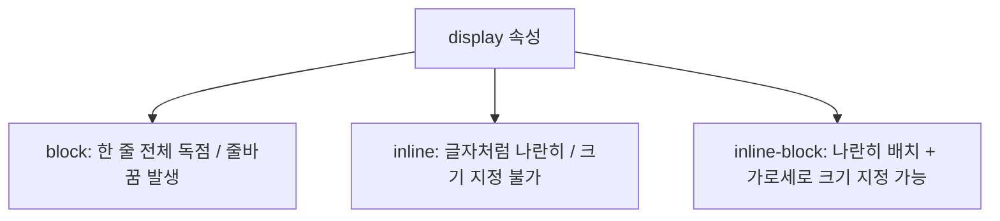

# 🎨 CSS 핵심 마스터: 선택자(Selector), 우선순위, 박스 모델 & 디스플레이 완벽 정리 노트

> CSS 적용 방식(Internal vs External)부터 **모든 종류의 선택자(기본·결합·속성·가상 클래스)**, **선택자 우선순위 점수표**, **박스 모델(Box Model)과 box-sizing 계산 공식**, 그리고 **Inline vs Block vs Inline-Block** 디스플레이 성질까지 완벽 가이드

---

## 📑 목차
1. [CSS 적용 3가지 방식 (적용 위치에 따른 분류)](#1-css-적용-3가지-방식-적용-위치에-따른-분류)
   - [1-1. Inline Style (인라인 스타일)](#1-1-inline-style-인라인-스타일)
   - [1-2. Internal CSS (내부 스타일 시트)](#1-2-internal-css-내부-스타일-시트)
   - [1-3. External CSS (외부 스타일 시트)](#1-3-external-css-외부-스타일-시트)
2. [CSS 선택자 (Selectors) 완전 정복](#2-css-선택자-selectors-완전-정복)
   - [2-1. 기본 선택자 4종 (전체, 태그, 클래스, ID)](#2-1-기본-선택자-4종-전체-태그-클래스-id)
   - [2-2. 결합자 (관계) 선택자 4종 (자손, 자식, 인접 형제, 일반 형제)](#2-2-결합자-관계-선택자-4종-자손-자식-인접-형제-일반-형제)
   - [2-3. 속성 선택자 (Attribute Selectors)](#2-3-속성-선택자-attribute-selectors)
   - [2-4. 가상 클래스 선택자 (Pseudo-class Selectors)](#2-4-가상-클래스-선택자-pseudo-class-selectors)
   - [2-5. [추천] 선택자 실전 연습 사이트: CSS Diner](#2-5-추천-선택자-실전-연습-사이트-css-diner)
3. [선택자 우선순위 (Specificity / 캐스케이딩 규칙)](#3-선택자-우선순위-specificity--캐스케이딩-규칙)
   - [3-1. 우선순위 계급 체계](#3-1-우선순위-계급-체계)
   - [3-2. 황금 규칙: id > class > tag](#3-2-황금-규칙-id--class--tag)
4. [CSS 박스 모델 (Box Model - 꼭 암기하자!)](#4-css-박스-모델-box-model---꼭-암기하자)
   - [4-1. 박스 모델의 4대 구성 요소](#4-1-박스-모델의-4대-구성-요소)
   - [4-2. 실제 화면 크기 계산과 content-box의 함정](#4-2-실제-화면-크기-계산과-content-box의-함정)
   - [4-3. 해결책: box-sizing: border-box 필수 초기화](#4-3-해결책-box-sizing-border-box-필수-초기화)
5. [주요 CSS 스타일링 프로퍼티](#5-주요-css-스타일링-프로퍼티)
   - [5-1. background-color & margin/border/padding](#5-1-background-color--marginborderpadding)
   - [5-2. font-family & font 단축 속성(Shorthand)](#5-2-font-family--font-단축-속성shorthand)
   - [5-3. 링크 스타일링 (text-decoration & hover)](#5-3-링크-스타일링-text-decoration--hover)
   - [5-4. 웹 폰트 아이콘 라이브러리: Font Awesome 활용](#5-4-웹-폰트-아이콘-라이브러리-font-awesome-활용)
6. [공간 배치와 성질: Inline vs Block vs Inline-block](#6-공간-배치와-성질-inline-vs-block-vs-inline-block)
   - [6-1. Inline 요소 vs Block-level 요소 비교](#6-1-inline-요소-vs-block-level-요소-비교)
   - [6-2. display 속성으로 성질 전환하기](#6-2-display-속성으로-성질-전환하기)
7. [💡 실전 핵심 요약 치트시트](#7--실전-핵심-요약-치트시트)

---

## 1. CSS 적용 3가지 방식 (적용 위치에 따른 분류)

| 방식 | 작성 위치 | 문법 예시 | 장단점 및 특징 |
| :--- | :--- | :--- | :--- |
| **1. Inline Style** | HTML 태그 안 `style=""` | `<p style="color: red;">` | 특정 태그 하나에만 즉시 적용되나 유지보수가 어렵고 우선순위가 너무 높아 실무 지양 |
| **2. Internal CSS** | HTML `<head>` 안 `<style>` 태그 | `<style> div { text-align: center; } </style>` | 한 HTML 파일 안에서 일괄 관리 가능, 단 여러 페이지에 걸쳐 재사용 불가 |
| **3. External CSS** | 별도 분리된 `.css` 파일 | `<link rel="stylesheet" href="style.css">` | **실무 표준!** HTML과 스타일을 완벽히 분리하고 여러 페이지에서 공통 재사용 가능 |

### 📌 Internal CSS 예시 코드
```html
<head>
  <style>
    div { text-align: center; }
    header { font-size: x-large; font-weight: bold; }
    main { font-size: medium; }
    footer { font-size: xx-small; }
  </style>
</head>
```

### 📌 External CSS 예시 코드
```html
<head>
  <!-- 별도의 style.css 파일을 불러와 연결 -->
  <link rel="stylesheet" href="style.css">
</head>
```

---

## 2. CSS 선택자 (Selectors) 완전 정복

> **선택자(Selector)란?** 어떤 HTML 요소에 CSS 스타일을 적용할지 대상을 지정하는 규칙

### 2-1. 기본 선택자 4종
```css
/* 1. 전체 셀렉터 (*): 페이지 내의 모든 HTML 요소를 일괄 선택 */
* {
  margin: 0;
  padding: 0;
}

/* 2. 태그 셀렉터: 지정한 태그 이름을 가진 모든 요소 선택 */
div {
  color: blue;
}

/* 3. 클래스 셀렉터 (.class): 특정 클래스명을 가진 요소 그룹 선택 */
.class {
  font-size: 16px;
}

/* 4. ID 셀렉터 (#id): 페이지에 단 하나뿐인 고유 ID를 가진 요소 선택 */
#id {
  font-weight: bold;
}
```

---

### 2-2. 결합자 (관계) 선택자 4종

부모, 자식, 형제 관계를 기반으로 대상을 정밀하게 조준합니다:

```
┌──────────────────────────────────────────────┐
│ <div class="parent">                         │
│     <p>1번 문단 (div의 직계 자식이자 자손)</p>   │
│     <section>                                │
│         <p>2번 문단 (div의 자손)</p>          │
│     </section>                               │
│ </div>                                       │
│ <p>3번 문단 (div 바로 다음 인접 형제)</p>        │
│ <p>4번 문단 (div 뒤에 오는 일반 형제)</p>        │
└──────────────────────────────────────────────┘
```

| 선택자 종류 | 문법 | 공백/기호 | 설명 및 선택 범위 |
| :--- | :---: | :---: | :--- |
| **자손 선택자** | `div p` | 공백 (` `) | `div` 안에 들어있는 **모든 `p` 요소** (자식이든 손자든 깊이 상관없이 전부) |
| **자식 선택자** | `div > p` | 꺾쇠 (`>`) | `div`의 **바로 아래 직계 자식 `p`만** 선택 (손자/증손자는 제외) |
| **인접 형제 선택자** | `div + p` | 더하기 (`+`) | `div` 바로 **뒤에 딱 붙어서 뒤따라오는 첫 번째 `p` 하나만** 선택 |
| **일반 형제 선택자** | `div ~ p` | 물결 (`~`) | `div` 뒤에 오는 **모든 형제 `p` 요소들**을 전부 선택 |

---

### 2-3. 속성 선택자 (Attribute Selectors)
태그가 가진 **속성(Attribute)과 그 값**을 조건으로 요소를 선택합니다:

```css
/* 1. href 속성을 가지고 있는 모든 a 태그 선택 */
a[href] {
  color: green;
}

/* 2. type 속성값이 정확히 "text"인 input 태그만 선택 */
input[type="text"] {
  border: 1px solid #ccc;
}

/* 3. target 속성이 "_blank"인 링크만 선택 */
a[target="_blank"] {
  font-weight: bold;
}
```

---

### 2-4. 가상 클래스 선택자 (Pseudo-class Selectors)
요소의 **특정한 상태(마우스 오버, 포커스 등)**나 **위치 순서**를 기준으로 선택합니다:

```css
/* 1. :hover ➔ 마우스 커서를 요소 위에 올렸을 때 */
a:hover {
  text-decoration: underline;
  color: red;
}

/* 2. :focus ➔ 입력창(input) 등을 클릭하여 포커스를 가졌을 때 */
input:focus {
  outline: 2px solid skyblue;
}

/* 3. :active ➔ 마우스 버튼을 꾹 누르고(클릭 중) 있는 그 순간 */
button:active {
  background-color: darkgray;
}

/* 4. :nth-child(n) ➔ 부모 기준으로 n번째 자식 요소 선택 */
li:nth-child(1) { color: red; }       /* 1번째 항목 */
li:nth-child(even) { background: #eee; } /* 짝수 번째 항목 */
li:nth-child(2n+1) { background: #fff; } /* 홀수 번째 항목 */
```

---

### 2-5. [추천] 선택자 실전 연습 사이트: CSS Diner
- CSS 선택자의 원리를 직관적인 식탁 접시 게임으로 실습할 수 있는 최고의 연습 사이트:
- 🔗 **링크**: [https://flukeout.github.io/](https://flukeout.github.io/)

---

## 3. 선택자 우선순위 (Specificity / 캐스케이딩 규칙)

여러 스타일이 동일한 요소에 충돌할 때, 브라우저가 **어떤 스타일을 최종 채택할지 결정하는 계급 체계**입니다:

```
[최강] !important (무조건 1순위 강제 적용)
  ▲
  │   inline style (HTML 태그 안 style="")  ── [1000점]
  │   id 선택자 (#id)                       ── [100점]
  │   class / 속성 / 가상 클래스 (.c, [t], :h)── [10점]
  │   태그 선택자 (div, p)                   ── [1점]
  │   * (전체 선택자)                        ── [0점]
[최약] 상속된 부모 스타일
```

### 🏆 황금 요약 규칙
```
✅ !important > inline style > id (#) > class (.) > tag > *
```
- 점수가 같으면 **"가장 나중에(아래쪽에) 작성된 코드"**가 최종 승리합니다!

---

## 4. CSS 박스 모델 (Box Model - 꼭 암기하자!)

> **박스 모델이란?** 브라우저가 **모든 HTML 요소를 네모난 사각형 박스**로 취급하고, 그 크기와 여백을 계산하는 규칙입니다.

```
┌────────────────────────────────────────────────────────┐
│                        MARGIN                          │  ◀── 바깥쪽 여백
│   ┌────────────────────────────────────────────────┐   │
│   │                    BORDER                      │   │  ◀── 테두리 선
│   │   ┌────────────────────────────────────────┐   │   │
│   │   │                PADDING                 │   │   │  ◀── 안쪽 여백
│   │   │   ┌────────────────────────────────┐   │   │   │
│   │   │   │                                │   │   │   │
│   │   │   │            CONTENT             │   │   │   │  ◀── 실제 콘텐츠 내용
│   │   │   │         (글자, 이미지 등)        │   │   │   │      (width x height)
│   │   │   │                                │   │   │   │
│   │   │   └────────────────────────────────┘   │   │   │
│   │   └────────────────────────────────────────┘   │   │
│   └────────────────────────────────────────────────┘   │
└────────────────────────────────────────────────────────┘
```

### 4-1. 박스 모델의 4대 구성 요소
1. **Content (콘텐츠)**: 텍스트나 이미지가 들어있는 실제 알맹이 영역.
2. **Padding (패딩)**: 콘텐츠와 테두리(Border) 사이의 **안쪽 여백**.
3. **Border (테두리)**: 패딩 바깥을 감싸는 **시각적 테두리 경계선**.
4. **Margin (마진)**: 테두리 바깥에 생기는 **다른 요소와의 간격(바깥쪽 여백)**.

---

### 4-2. 실제 화면 크기 계산과 content-box의 함정

```html
<div class="box">BOX</div>
```
```css
.box {
  width: 100px;
  padding: 50px;
  border: 5px solid black;
  margin: 20px;
}
```

기본값(`box-sizing: content-box`) 상태에서는 `width: 100px`이 오직 **Content 영역만의 크기**를 의미합니다:

$$\text{실제 차지하는 가로 폭} = \text{width}(100) + \text{padding 양쪽}(50 \times 2) + \text{border 양쪽}(5 \times 2) = \mathbf{210px}$$

> [!WARNING]
> 개발자는 박스 크기를 **100px**로 만들려고 했으나, 패딩과 테두리가 더해져 **실제 크기가 210px로 2배 이상 뚱뚱해지는 대참사**가 발생합니다!

---

### 4-3. 해결책: box-sizing: border-box 필수 초기화
`box-sizing: border-box`로 설정하면, 지정한 `width` 안에 **Padding과 Border의 두께가 자동으로 포함**되어 계산됩니다:

$$\text{전체 가로 폭} = 100\text{px 안에 Padding과 Border가 모두 들어감! (크기 유지)}$$

```css
/* 실무 필수 표준 리셋 코드: 모든 요소에 border-box 일괄 적용 */
*, *::before, *::after {
  box-sizing: border-box;
}
```

---

## 5. 주요 CSS 스타일링 프로퍼티

### 5-1. background-color & margin/border/padding
```css
header {
  font-size: x-large;
  font-weight: bold;
  background-color: red;
  margin-top: 20px;       /* 위쪽 바깥 여백 20px */
  border: 2px solid blue; /* 2px 두께 실선 파란 테두리 */
}

main {
  font-size: medium;
  background-color: green;
  padding: 50px;          /* 사방 안쪽 여백 50px */
}

footer {
  font-size: xx-small;
  background-color: yellow;
}
```

---

### 5-2. font-family & font 단축 속성(Shorthand)

#### 1) `font-family`: 글꼴과 대체 폰트(Fallback)
```css
header {
  /* 1순위: Times New Roman, 없으면 2순위 Times, 둘 다 없으면 기본 명조(serif) */
  font-family: 'Times New Roman', Times, serif;
}
```

#### 2) `font` 단축 속성 (순서 주의!)
- **작성 순서**: `font-weight` ➔ `font-size` ➔ `font-family`
- **필수 포함 규칙**: **`font-size`와 `font-family`는 반드시 생략 없이 포함**되어야 단축 문법이 유효합니다.

```css
header {
  /* font-weight(bold) + font-size(x-large) + font-family */
  font: bold x-large 'Times New Roman', Times, serif;
}
```

---

### 5-3. 링크 스타일링 (text-decoration & hover)
기본 밑줄을 지우고, 마우스를 올렸을 때만 밑줄이 나타나게 하는 깔끔한 링크 스타일:

```css
.github-link {
  font-size: small;
  color: gray;
  text-decoration: none; /* 파란 기본 밑줄 제거 */
}

.github-link:hover {
  text-decoration: underline; /* 마우스 올렸을 때만 밑줄 표시 */
}
```

---

### 5-4. 웹 폰트 아이콘 라이브러리: Font Awesome 활용
웹에서 사용하는 다양한 브랜드/시스템 아이콘을 글자(Font)처럼 제공하는 대표 라이브러리:

1. `<head>`에 CDN 링크 연결:
```html
<link
  rel="stylesheet"
  href="https://cdnjs.cloudflare.com/ajax/libs/font-awesome/7.0.1/css/all.min.css"
/>
```

2. 태그로 아이콘 출력 (예: GitHub 고양이 로고):
```html
<a class="github-link" href="https://github.com/qu3vipon">
  <i class="fa-brands fa-github"></i> GitHub
</a>
```

---

## 6. 공간 배치와 성질: Inline vs Block vs Inline-block

화면에서 공간을 차지하고 줄바꿈되는 방식에 따라 요소는 크게 나뉩니다:



### 6-1. Inline 요소 vs Block-level 요소 비교

| 구분 | Block-level (블록 요소) | Inline (인라인 요소) |
| :--- | :--- | :--- |
| **줄바꿈** | **항상 새로운 줄에서 시작** | 줄바꿈 없이 **같은 줄에 나란히 배치** |
| **너비(Width)**| 기본값으로 **부모 가로 폭 100% 전부 차지** | 텍스트/콘텐츠의 **내용물 크기만큼만 차지** |
| **크기 지정** | `width`, `height` 지정 **가능** | `width`, `height` 지정 **불가 (무시됨)** |
| **상하 여백** | `margin-top/bottom` 완벽 적용 | `margin-top/bottom` 제대로 적용 안 됨 |
| **대표 태그** | `<div>`, `<p>`, `<h1>`~`<h6>`, `<section>`, `<article>`, `<header>`, `<footer>` | `<span>`, `<a>`, `<strong>`, `<em>`, `` |

---

### 6-2. `display` 속성으로 성질 전환하기
CSS의 `display` 속성을 사용하면 요소의 본래 태생적 성질을 마음대로 변경할 수 있습니다:

```html
<!-- 1. 기본 블록 요소: 한 줄 전체를 차지함 -->
<div style="background-color: skyblue;">Block 1</div>

<!-- 2. display: inline ➔ 글자 취급되므로 width: 100px이 무시됨! -->
<div style="display: inline; width: 100px; background-color: orange;">Inline 1</div>

<!-- 3. display: inline-block ➔ 옆으로 나란히 붙으면서도 width: 100px 크기가 온전히 적용됨! -->
<div style="display: inline-block; width: 100px; background-color: orange;">Inline 2</div>

<!-- 4. 다시 블록 요소: 새 줄에서 시작 -->
<div style="background-color: skyblue;">Block 2</div>
```

---

## 7. 💡 실전 핵심 요약 치트시트

```css
1. 선택자 우선순위 점수
   !important > inline style(1000점) > #id(100점) > .class/[attr]/:hover(10점) > tag(1점) > *(0점)

2. 결합자(관계) 기호 구분
   - div p   : 모든 자손
   - div > p : 바로 아래 자식
   - div + p : 바로 뒤에 붙은 인접 형제 1개
   - div ~ p : 뒤따라오는 모든 형제

3. 박스 크기 계산 표준 공식
   *, *::before, *::after { box-sizing: border-box; }
   (지정한 width 안에 padding과 border를 자동 포함시켜 레이아웃 깨짐 방지)

4. font 단축 속성 필수 순서
   font: [font-weight] [font-size] [font-family];
   (font-size와 font-family는 필수!)

5. display 3대장 핵심
   - block        : 한 줄 독점 (width/height 가능)
   - inline       : 나란히 배치 (width/height 불가)
   - inline-block : 나란히 배치 + width/height 크기 지정 가능
```
