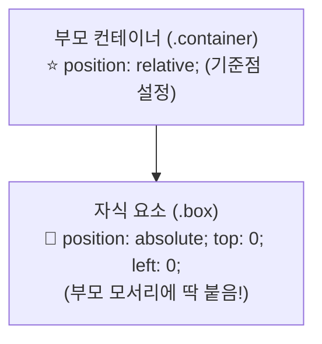

# 📐 CSS 레이아웃 & 반응형 웹 마스터: Position, Flexbox & Media Query 완벽 정리 노트

> Normal Flow의 한계 극복부터 **Position 4대 속성(static/relative/absolute/fixed)**, **Flexbox 1차원 레이아웃(주축·교차축·flex: 1)**, **Media Query 반응형 디자인**, 그리고 **실전 반응형 네비게이션 바(Navbar) 구현**까지 총정리한 실전 가이드

---

## 📑 목차
1. [Normal Flow (기본 문서 흐름)와 레이아웃의 필요성](#1-normal-flow-기본-문서-흐름와-레이아웃의-필요성)
   - [1-1. Normal Flow란?](#1-1-normal-flow란)
   - [1-2. Normal Flow의 배치 규칙과 한계점](#1-2-normal-flow의-배치-규칙과-한계점)
2. [CSS position 속성: 자유로운 위치 제어](#2-css-position-속성-자유로운-위치-제어)
   - [2-1. position 속성의 개념과 오프셋 4대장](#2-1-position-속성의-개념과-오프셋-4대장)
   - [2-2. static (기본값)](#2-2-static-기본값)
   - [2-3. relative (원래 자기 자리 기준)](#2-3-relative-원래-자기-자리-기준)
   - [2-4. absolute (기준 조상 기준) & 실무 공식](#2-4-absolute-기준-조상-기준--실무-공식)
   - [2-5. fixed (화면 뷰포트 기준 영구 고정)](#2-5-fixed-화면-뷰포트-기준-영구-고정)
   - [2-6. position 4대 속성 한눈에 비교하기](#2-6-position-4대-속성-한눈에-비교하기)
3. [Flexbox (Flexible Box Layout): 1차원 정렬 시스템](#3-flexbox-flexible-box-layout-1차원-정렬-시스템)
   - [3-1. Flexbox의 탄생 배경과 핵심 특징](#3-1-flexbox의-탄생-배경과-핵심-특징)
   - [3-2. Flex Container (부모) vs Flex Item (자식)](#3-2-flex-container-부모-vs-flex-item-자식)
   - [3-3. 주축(Main Axis) vs 교차축(Cross Axis)](#3-3-주축main-axis-vs-교차축cross-axis)
   - [3-4. Flexbox 정렬 3단계 핵심 프로퍼티](#3-4-flexbox-정렬-3단계-핵심-프로퍼티)
   - [3-5. 실무 마법의 코드: 정가운데 정렬 & flex: 1 스티키 푸터](#3-5-실무-마법의-코드-정가운데-정렬--flex-1-스티키-푸터)
   - [3-6. [추천] Flexbox 실전 연습 게임: Flexbox Froggy](#3-6-추천-flexbox-실전-연습-게임-flexbox-froggy)
4. [반응형 웹 디자인 (Responsive Design) & Media Query](#4-반응형-웹-디자인-responsive-design--media-query)
   - [4-1. 반응형 디자인의 필요성](#4-1-반응형-디자인의-필요성)
   - [4-2. 반응형의 3대 핵심 요소 & rem 크기 단위](#4-2-반응형의-3대-핵심-요소--rem-크기-단위)
   - [4-3. Media Query (미디어 쿼리) 문법과 분기점](#4-3-media-query-미디어-쿼리-문법과-분기점)
5. [실전 종합 프로젝트: 반응형 네비게이션 바 (Responsive Navbar)](#5-실전-종합-프로젝트-반응형-네비게이션-바-responsive-navbar)
   - [5-1. 시맨틱 HTML 구조 설계 (`navbar.html`)](#5-1-시맨틱-html-구조-설계-navbarhtml)
   - [5-2. 데스크톱 레이아웃 CSS 스타일링 (`navbar_style.css`)](#5-2-데스크톱-레이아웃-css-스타일링-navbar_stylecss)
   - [5-3. 모바일 반응형 미디어 쿼리 적용 (@media max-width: 400px)](#5-3-모바일-반응형-미디어-쿼리-적용-media-max-width-400px)
6. [💡 실전 핵심 요약 치트시트](#6--실전-핵심-요약-치트시트)

---

## 1. Normal Flow (기본 문서 흐름)와 레이아웃의 필요성

### 1-1. Normal Flow란?
- **CSS에서 아무런 위치/레이아웃 속성도 적용하지 않았을 때 브라우저가 요소를 자동으로 배치하는 기본 규칙**입니다.
- 웹 문서의 가장 자연스러운 원시적 흐름(Normal Flow)입니다.

### 1-2. Normal Flow의 배치 규칙과 한계점
1. **Inline 요소**: 텍스트를 쓸 때처럼 **왼쪽에서 오른쪽으로** 나열되며, 공간이 꽉 차면 자동으로 다음 줄로 넘어갑니다 (`span`, `a`, `strong`).
2. **Block-level 요소**: 블록처럼 **위에서 아래로 한 줄 전체를 독점**하며 벽돌을 쌓듯 차례로 배치됩니다 (`div`, `p`, `h1`).

> [!WARNING]
> **🚨 Normal Flow의 치명적 한계**:  
> 기본 흐름만으로는 현대 웹의 필수 요소인 **좌우 가로 정렬, 상하좌우 완전한 정가운데 정렬, 유연한 간격(gap) 조절, 특정 위치 고정(헤더/배지)** 등을 구현하기가 극도로 어렵습니다.  
> ➔ 따라서 우리는 **`position`**과 **`flexbox`**를 통해 Normal Flow를 의도적으로 벗어나거나 제어합니다!

---

## 2. CSS position 속성: 자유로운 위치 제어

### 2-1. position 속성의 개념과 오프셋 4대장
- **역할**: 요소를 **어디에(Where), 무엇을 기준(Reference)으로** 배치할지 결정하는 핵심 속성.
- **오프셋 프로퍼티**: 기준점으로부터 얼마나 떨어질지 거리를 지정합니다.
  - `top`, `bottom`, `left`, `right` (px, rem, % 등)

---

### 2-2. `position: static` (기본값)
- 모든 HTML 요소의 태생적 기본값.
- **Normal Flow를 그대로 유지**하며 일반적인 문서 흐름에 따라 배치됩니다.
- ⚠️ `top`, `left`, `right`, `bottom` 오프셋 좌표를 적어도 **완전히 무시**되어 적용되지 않습니다!

---

### 2-3. `position: relative` (원래 자기 자리 기준)
- **기준점**: **"내가 원래 있었어야 할 본래 위치"**가 기준점(0, 0)이 됩니다.
- **특징**:
  1. **Normal Flow 유지**: 요소가 시각적으로 이동하더라도, **원래 자리는 빈 공간(유령 자리)으로 그대로 보존**됩니다.
  2. 다른 인접 요소들의 레이아웃 배치에 전혀 영향을 주지 않습니다 (`margin`과 다른 점!).
  3. 🌟 **자식의 `absolute`를 가두는 기준 조상 역할**로 가장 많이 사용됩니다.

```css
.box {
  position: relative;
  top: 30px;  /* 원래 위치에서 아래로 30px 이동 */
  left: 30px; /* 원래 위치에서 오른쪽으로 30px 이동 */
}
```

---

### 2-4. `position: absolute` (기준 조상 기준) & 실무 공식
- **기준점**: **"가장 가까운 `position`이 지정된 조상 요소"** (즉, static이 아닌 relative, absolute, fixed를 가진 부모).
- **특징**:
  1. **Normal Flow에서 완전 제거**: 붕 떠오르면서(부유) 원래 차지하던 자리가 사라집니다. 주변 요소들이 빈자리를 메우기 위해 당겨집니다.
  2. 기준이 될 포지셔닝 부모가 없으면 **브라우저 화면(Viewport / 초기 컨테이닝 블록)**을 기준으로 배치됩니다.



#### 🏆 실무 100% 필수 공식: "부모 relative + 자식 absolute"
```html
<div class="container">
  <div class="box">BOX</div>
</div>
```
```css
/* 1. 부모에게 기준점 부여 */
.container {
  width: 200px;
  height: 200px;
  border: 3px solid #333;
  position: relative; /* 자식의 absolute 좌표 기준점이 됨! */
}

/* 2. 자식은 부모 안에서 자유자재로 이동 */
.box {
  width: 100px;
  height: 100px;
  background: #4caf50;
  position: absolute;
  top: 0px;
  left: 0px; /* 부모 컨테이너의 좌상단(0, 0)에 정확히 밀착 */
}
```

#### 📌 실전 활용 예제: 우상단 링크/배지 고정
```css
.korean-link {
  position: absolute;
  top: 10px;
  right: 10px; /* 부모의 오른쪽 위 모서리에 고정 */
  color: darkcyan;
  font-size: small;
}
```

---

### 2-5. `position: fixed` (화면 뷰포트 기준 영구 고정)
- **기준점**: 부모가 누구든 상관없이 무조건 **브라우저 화면 전체(Viewport)**가 기준점.
- **특징**:
  1. Normal Flow에서 완전히 제거됨.
  2. **페이지를 아무리 길게 스크롤해도 화면의 지정된 그 위치에 못 박힌 듯 영구 고정**됩니다.
  3. 주요 사용처: **상단 고정 헤더(Navigation Bar)**, 화면 우하단 **맨 위로 가기 플로팅 버튼**, 챗봇 상담 아이콘.

```css
.fixed-header {
  position: fixed;
  top: 0;
  left: 0;
  width: 100%; /* 화면 상단 전체를 덮는 고정 바 */
}
```

---

### 2-6. position 4대 속성 한눈에 비교하기

| 속성값 | 기준점 (Reference) | Normal Flow 이탈 여부 | 원래 자리 보존 여부 | 스크롤 시 동작 |
| :--- | :--- | :---: | :---: | :--- |
| **`static`** | 일반적인 문서 흐름 | ❌ (유지) | ⭕ (보존) | 함께 스크롤됨 (위치 이동 불가) |
| **`relative`** | **자신의 본래 위치** | ❌ (유지) | ⭕ (원래 자리 비어있음) | 함께 스크롤됨 |
| **`absolute`** | **포지셔닝된 가장 가까운 조상** | ⭕ (완전 제거) | ❌ (자리 사라짐) | 함께 스크롤됨 |
| **`fixed`** | **브라우저 화면 (Viewport)** | ⭕ (완전 제거) | ❌ (자리 사라짐) | **화면에 영구 고정 (스크롤 무시)** |

---

## 3. Flexbox (Flexible Box Layout): 1차원 정렬 시스템

### 3-1. Flexbox의 탄생 배경과 핵심 특징
- **목적**: 복잡한 계산 없이 **여러 박스를 한 방향(가로 or 세로)으로 유연하게 배치하고 정렬**하기 위한 최신 CSS 레이아웃 시스템.
- **핵심 특징**:
  1. **1차원 레이아웃**: 가로(Row) 또는 세로(Column) 중 한 방향 축을 기준으로 정렬.
  2. **부모 중심 제어**: 부모(Container)에게 속성을 주면 자식(Items)들의 배치가 일괄 통제됨.
  3. **직관적인 간격과 정렬**: `gap`, `justify-content`, `align-items`로 손쉬운 여백 제어.

---

### 3-2. Flex Container (부모) vs Flex Item (자식)
부모 요소에 `display: flex;`를 선언하는 순간, 즉시 Flex 환경이 가동됩니다:

```html
<div class="container"> <!-- Flex Container (부모) -->
  <div class="item">A</div> <!-- Flex Item (자식) -->
  <div class="item">B</div> <!-- Flex Item (자식) -->
  <div class="item">C</div> <!-- Flex Item (자식) -->
</div>
```
```css
.container {
  display: flex; /* 자식들이 기본적으로 가로(row) 방향으로 나란히 정렬됨 */
  gap: 10px;     /* 자식 아이템 사이의 간격을 10px로 균등 배치 */
}
```

---

### 3-3. 주축(Main Axis) vs 교차축(Cross Axis)

Flexbox는 항상 **두 개의 직교하는 축**을 기준으로 요소를 정렬합니다:

```
[기본값: flex-direction: row 인 경우]

  주축 (Main Axis: 가로) ➔ justify-content 로 정렬
  ────────────────────────────────────────────────────────►
 │ [Item A]   [Item B]   [Item C]
 │
 │ 교차축 (Cross Axis: 세로) ➔ align-items 로 정렬
 ▼
```

- **주축 (Main Axis)**: 아이템들이 배치되는 기본 진행 방향 (기본값: **가로 방향 `row`**).
- **교차축 (Cross Axis)**: 주축과 90도로 교차하는 수직 방향 (기본값: **세로 방향 `column`**).

---

### 3-4. Flexbox 정렬 3단계 핵심 프로퍼티

#### 1) 1단계: 주축의 방향 결정 (`flex-direction`)
- `flex-direction: row;` (기본값) ➔ 왼쪽에서 오른쪽으로 가로 배치
- `flex-direction: column;` ➔ 위에서 아래로 세로 배치 (모바일 반응형에서 필수!)

#### 2) 2단계: 주축 방향의 정렬 결정 (`justify-content`)
- `flex-start` (기본값): 시작 지점으로 정렬
- `center`: **주축 기준 가운데 정렬**
- `flex-end`: 끝 지점으로 정렬
- `space-between`: **양 끝을 벽에 붙이고, 아이템 사이 간격을 균등하게 배분 (네비게이션 바 필수!)**
- `space-around` / `space-evenly`: 아이템 둘레/사이를 균등 분배

#### 3) 3단계: 교차축 방향의 정렬 결정 (`align-items`)
- `stretch` (기본값): 부모의 높이만큼 아이템을 늘림
- `center`: **교차축 기준 수직 가운데 정렬**
- `flex-start` / `flex-end`: 상단 또는 하단 정렬

---

### 3-5. 실무 마법의 코드: 정가운데 정렬 & flex: 1 스티키 푸터

#### 🪄 마법 1: 박스 안의 글자/요소를 상하좌우 완전 정가운데 놓기
```css
.item {
  display: flex;
  justify-content: center; /* 가로(주축) 가운데 */
  align-items: center;     /* 세로(교차축) 가운데 */
}
```

#### 🪄 마법 2: `flex: 1` ➔ 남은 공간 혼자 다 차지하기 (Sticky Footer 패턴)
콘텐츠가 적은 페이지에서도 푸터(Footer)가 화면 중간에 뜨지 않고 **항상 브라우저 맨 바닥에 달라붙게 만드는 실무 표준 기법**:

```css
body {
  min-height: 100vh;       /* 화면 전체 높이 보장 */
  display: flex;
  flex-direction: column;  /* 세로 방향으로 쌓기 */
}

main {
  flex: 1;                 /* ⭐ 메인 콘텐츠가 화면의 남은 여백을 전부 차지하여 푸터를 맨 밑으로 밀어냄! */
}

footer {
  margin-bottom: 2rem;
}
```

---

### 3-6. [추천] Flexbox 실전 연습 게임: Flexbox Froggy
- 개구리를 연잎 위에 올려놓으며 Flexbox 정렬 속성을 직관적으로 마스터하는 세계적인 학습 게임:
- 🔗 **링크**: [https://flexboxfroggy.com/#ko](https://flexboxfroggy.com/#ko)

---

## 4. 반응형 웹 디자인 (Responsive Design) & Media Query

### 4-1. 반응형 디자인의 필요성
- 스마트폰, 태블릿, 데스크톱 모니터 등 **사용자의 화면 크기(Viewport)와 디바이스 환경이 다양화**됨에 따라, 화면에 맞춰 레이아웃과 폰트 크기가 자연스럽게 재배치되는 웹을 구축해야 합니다.

---

### 4-2. 반응형의 3대 핵심 요소 & rem 크기 단위
1. **유연한 레이아웃**: `Flexbox`, `Grid`
2. **유연한 상대 크기 단위**: `%`, `vw`, `vh`, **`rem`**
3. **조건부 스타일**: **`Media Query (@media)`**

> [!NOTE]
> **`rem` 단위란?**  
> `rem`(Root em)은 최상위 `<html>` 태그의 기본 폰트 크기(보통 16px)를 기준으로 비례하는 상대 단위입니다.  
> - `1rem` = 16px  
> - `2.4rem` = 약 38.4px (대제목)  
> - `0.9rem` = 약 14.4px (작은 본문/라벨)  
> 모바일이나 사용자 설정에 따라 기본 글꼴이 커지면 모든 요소가 아름답게 함께 확대/축소됩니다.

---

### 4-3. Media Query (미디어 쿼리) 문법과 분기점
- **정의**: **"화면이 이 조건(크기)에 부합하면, 아래 스타일을 덮어써서 적용하라!"**는 조건부 CSS 규칙.

```css
/* 화면 너비가 400px 이하인 작은 스마트폰 화면일 때만 실행 */
@media (max-width: 400px) {
  .container {
    flex-direction: column; /* 가로 나열을 세로 쌓기로 변경 */
  }
  .box {
    background: orange;     /* 배경색 변경 */
  }
}
```

---

## 5. 실전 종합 프로젝트: 반응형 네비게이션 바 (Responsive Navbar)

강의 슬라이드에서 완성한 **PC에서는 가로 1줄, 모바일(400px 이하)에서는 세로로 깔끔하게 떨어지는 반응형 상단 메뉴바**의 완성 코드입니다:

### 5-1. 시맨틱 HTML 구조 설계 (`navbar.html`)
```html
<!DOCTYPE html>
<html lang="ko">
<head>
  <meta charset="UTF-8" />
  <title>반응형 Navigation Bar</title>
  <!-- Font Awesome CDN 및 외부 스타일시트 연결 -->
  <link rel="stylesheet" href="https://cdnjs.cloudflare.com/ajax/libs/font-awesome/7.0.1/css/all.min.css" />
  <link rel="stylesheet" href="navbar_style.css" />
</head>
<body>
  <nav class="navbar">
    <!-- 1. 좌측 로고 -->
    <div class="navbar__logo">
      <i class="fa-brands fa-dev"></i>
      <a href="#">qu3vipon</a>
    </div>

    <!-- 2. 중앙 메뉴 링크 -->
    <ul class="navbar__menu">
      <li><a href="#">About</a></li>
      <li><a href="resume.html">Resume</a></li>
      <li><a href="#">Gallery</a></li>
    </ul>

    <!-- 3. 우측 SNS 아이콘 -->
    <ul class="navbar__icons">
      <li><i class="fa-brands fa-github"></i></li>
      <li><i class="fa-brands fa-x-twitter"></i></li>
    </ul>
  </nav>
</body>
</html>
```

---

### 5-2. 데스크톱 기본 스타일 (`navbar_style.css`)
```css
/* 기본 리셋 및 폰트 */
body {
  margin: 0;
  font-family: "BBH Bogle", sans-serif;
}

a {
  text-decoration: none;
  color: black;
}

/* 네비게이션 컨테이너: flex 3등분 좌우 분배 */
.navbar {
  display: flex;
  justify-content: space-between; /* 로고 - 메뉴 - 아이콘을 양 끝과 중앙에 고루 배치 */
  align-items: center;            /* 수직 가운데 정렬 */
  background-color: beige;
  padding-left: 0.5rem;
  padding-right: 0.5rem;
}

.navbar__logo {
  font-size: 1.4rem;
}

/* 메뉴 리스트: 가로 flex 배치 */
.navbar__menu {
  display: flex;
  list-style: none;
  padding: 0;
}

.navbar__menu li {
  padding: 8px 12px;
}

.navbar__menu li:hover {
  background-color: white;
  border-radius: 8px;
}

/* SNS 아이콘 리스트: 가로 flex 배치 */
.navbar__icons {
  display: flex;
  list-style: none;
  padding: 0;
}

.navbar__icons li {
  padding: 8px 4px;
}
```

---

### 5-3. 모바일 반응형 미디어 쿼리 (`@media (max-width: 400px)`)
화면 너비가 좁아지면 가로 정렬을 **세로 1열(`column`)**로 전환하여 화면 찌그러짐을 방지합니다:

```css
@media (max-width: 400px) {
  /* 1. 전체 바를 세로로 쌓고 왼쪽 정렬 */
  .navbar {
    flex-direction: column;
    align-items: flex-start;
    padding: 16px;
  }

  /* 2. 메뉴 항목을 가로폭 100% 차지하게 늘리고 텍스트 중앙 정렬 */
  .navbar__menu {
    flex-direction: column;
    width: 100%;
    text-align: center;
  }

  /* 3. 아이콘 모음도 중앙 정렬 */
  .navbar__icons {
    justify-content: center;
    width: 100%;
  }
}
```

---

## 6. 💡 실전 핵심 요약 치트시트

```css
1. position 핵심 공식
   - static   : 기본 흐름 (top/left 무시)
   - relative : 원래 내 자리 기준 (부모 기준점 잡기용)
   - absolute : 가장 가까운 포지셔닝 부모 기준 (자식 부유 배치)
   - fixed    : 화면 창(viewport) 기준 (스크롤해도 영구 고정)
   🌟 공식: 부모에 position: relative 주고 자식에 position: absolute 주기!

2. Flexbox 정렬 공식
   - display: flex;                     (가로 정렬 가동)
   - justify-content: center;           (주축 가로 가운데)
   - align-items: center;               (교차축 세로 가운데)
   - justify-content: space-between;    (양 끝 벌리기)
   - flex: 1;                           (남은 빈 공간 다 차지하기)

3. 반응형 Media Query 공식
   @media (max-width: 768px) {
     /* 모바일/태블릿용 스타일 작성 (flex-direction: column 등) */
   }
```
