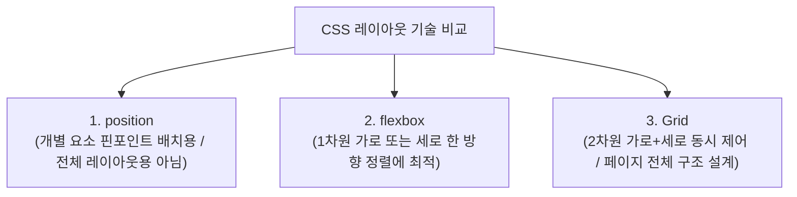

# 🍱 CSS Grid & 부트스트랩(Bootstrap) UI 프레임워크 완벽 정리 노트

> 2차원 바둑판 레이아웃 **CSS Grid(fr 단위·grid-template-areas·호버 효과)**부터 트위터의 오픈소스 UI 프레임워크 **부트스트랩 5(12칸 그리드·반응형 Navbar·모달 팝업)**, 그리고 실무 한계점과 VS Code 팁까지 총정리한 실전 가이드

---

## 📑 목차
1. [CSS Grid 레이아웃: 2차원 구조 설계](#1-css-grid-레이아웃-2차원-구조-설계)
   - [1-1. Grid의 정의와 레이아웃 기술별 비교](#1-1-grid의-정의와-레이아웃-기술별-비교)
   - [1-2. Grid Container (부모)와 Grid Item (자식)](#1-2-grid-container-부모와-grid-item-자식)
2. [Grid 핵심 문법 & 단위 정복](#2-grid-핵심-문법--단위-정복)
   - [2-1. 열(Column) 만들기: repeat()과 fr 단위](#2-1-열column-만들기-repeat과-fr-단위)
   - [2-2. 행(Row) 만들기 & gap 간격 설정](#2-2-행row-만들기--gap-간격-설정)
   - [2-3. [추천] Grid 실전 연습 게임: Grid Garden](#2-3-추천-grid-실전-연습-게임-grid-garden)
3. [실전 프로젝트 1: grid-template-areas 반응형 갤러리](#3-실전-프로젝트-1-grid-template-areas-반응형-갤러리)
   - [3-1. 직관적인 영역 배치 (grid-template-areas)](#3-1-직관적인-영역-배치-grid-template-areas)
   - [3-2. object-fit: cover와 감성 흑백 호버 인터랙션](#3-2-object-fit-cover와-감성-흑백-호버-인터랙션)
   - [3-3. 갤러리 완성 전체 코드 분석](#3-3-갤러리-완성-전체-코드-분석)
4. [부트스트랩 (Bootstrap 5) UI 프레임워크](#4-부트스트랩-bootstrap-5-ui-프레임워크)
   - [4-1. 부트스트랩이란?](#4-1-부트스트랩이란)
   - [4-2. CDN 설치 및 환경 설정 (CSS & JS 번들)](#4-2-cdn-설치-및-환경-설정-css--js-번들)
   - [4-3. 핵심 유틸리티: Flex, Badge, Button](#4-3-핵심-유틸리티-flex-badge-button)
   - [4-4. 부트스트랩의 12칸 Grid 시스템 (`container ➔ row ➔ col`)](#4-4-부트스트랩의-12칸-grid-시스템-container--row--col)
5. [실전 프로젝트 2: 부트스트랩 핵심 컴포넌트 3선](#5-실전-프로젝트-2-부트스트랩-핵심-컴포넌트-3선)
   - [5-1. 실습 1: 3단 카드(Card) 레이아웃 (`col-md-4`)](#5-1-실습-1-3단-카드card-레이아웃-col-md-4)
   - [5-2. 실습 2: 반응형 햄버거 메뉴 Navigation Bar](#5-2-실습-2-반응형-햄버거-메뉴-navigation-bar)
   - [5-3. 실습 3: 인터랙티브 Modal (모달 팝업창)](#5-3-실습-3-인터랙티브-modal-모달-팝업창)
6. [부트스트랩의 실무적 한계 & 개발 환경 꿀팁](#6-부트스트랩의-실무적-한계--개발-환경-꿀팁)
   - [6-1. 부트스트랩의 단점과 Tailwind CSS 전환 트렌드](#6-1-부트스트랩의-단점과-tailwind-css-전환-트렌드)
   - [6-2. VS Code 필수 설정: Format On Save (자동 들여쓰기 정렬)](#6-2-vs-code-필수-설정-format-on-save-자동-들여쓰기-정렬)
7. [💡 실전 핵심 요약 치트시트](#7--실전-핵심-요약-치트시트)

---

## 1. CSS Grid 레이아웃: 2차원 구조 설계

### 1-1. Grid의 정의와 레이아웃 기술별 비교
- **CSS Grid**: **행(Row, 가로 줄)**과 **열(Column, 세로 줄)**을 동시에 제어하는 **2차원 바둑판식 레이아웃 시스템**.
- 페이지 전체의 거대한 골격 구조(뼈대) 자체를 설계할 때 가장 강력합니다.



| 기술 | 차원 | 주요 목적 | 한계 및 적합한 상황 |
| :--- | :---: | :--- | :--- |
| **`position`** | - | 배지, 고정 헤더, 모달 팝업 등 특정 좌표 배치 | 요소 간의 관계가 끊어지므로 전체 페이지 틀을 잡기엔 부적합 |
| **`flexbox`** | **1차원** | 네비게이션 바 메뉴, 카드 내부 아이템 등 한 줄 정렬 | 가로와 세로 줄을 동시에 맞추는 격자 바둑판 구조에는 비효율적 |
| **`Grid`** | **2차원** | 대시보드, 매거진 갤러리, 쇼핑몰 상품 목록 격자 | **화면 전체 구조를 행과 열로 구획화할 때 최적** |

---

### 1-2. Grid Container (부모)와 Grid Item (자식)
- **`Grid Container`**: `display: grid;`가 선언된 부모 요소 (바둑판 틀).
- **`Grid Item`**: 컨테이너 바로 아래의 **직계 자식 요소들** (바둑알).
- **원칙**: 모든 배치와 칸 나누기는 **부모(Container)의 CSS 속성**을 기준으로 결정됩니다.

```html
<div class="container"> <!-- Grid Container -->
  <div class="item">A</div> <!-- Grid Item -->
  <div class="item">B</div> <!-- Grid Item -->
  <div class="item">C</div> <!-- Grid Item -->
  <div class="item">D</div> <!-- Grid Item -->
  <div class="item">E</div> <!-- Grid Item -->
  <div class="item">F</div> <!-- Grid Item -->
</div>
```

---

## 2. Grid 핵심 문법 & 단위 정복

### 2-1. 열(Column) 만들기: repeat()과 fr 단위
- `grid-template-columns`: 세로 열의 개수와 너비를 지정합니다.

```css
.container {
  display: grid;

  /* 방법 1: 백분율로 4칸 분할 (25%씩 4개) */
  grid-template-columns: 25% 25% 25% 25%;

  /* 방법 2: repeat(반복횟수, 크기) 함수 사용 (위와 완벽히 동일) */
  grid-template-columns: repeat(4, 25%);

  /* 방법 3: fr(Fraction, 비율) 단위 사용 (1 : 2 : 1 비율로 유연 분할) */
  grid-template-columns: 1fr 2fr 1fr;
}
```

> [!NOTE]
> **`fr`(Fraction) 단위란?**  
> 그리드 컨테이너의 남은 여백 공간을 **비율(분수)**대로 나누어 갖는 그리드 전용 유연 단위입니다.  
> `1fr 2fr 1fr`은 전체 가로폭을 `1 + 2 + 1 = 4등분`하여 `25% : 50% : 25%`로 유연하게 배분합니다.

---

### 2-2. 행(Row) 만들기 & gap 간격 설정
- `grid-template-rows`: 가로 행의 높이를 지정.
- `grid-auto-rows`: 명시되지 않고 자동으로 늘어나는 행들의 기본 높이 지정.
- `gap`: 그리드 아이템 사이의 여백 간격.

```css
.container {
  display: grid;
  grid-template-columns: repeat(3, 1fr);
  
  /* 1행과 2행의 높이를 각각 80px로 고정 */
  grid-template-rows: 80px 80px;

  /* 아이템이 많아져 3행, 4행이 생길 때의 자동 높이 설정 */
  grid-auto-rows: 80px;

  /* 가로세로 아이템 사이 간격 10px */
  gap: 10px;
}
```

---

### 2-3. [추천] Grid 실전 연습 게임: Grid Garden
- 당근에 물을 주고 잡초를 뽑으며 Grid 속성을 단계별로 마스터하는 유명 학습 게임:
- 🔗 **링크**: [https://cssgridgarden.com/#ko](https://cssgridgarden.com/#ko)

---

## 3. 실전 프로젝트 1: grid-template-areas 반응형 갤러리

### 3-1. 직관적인 영역 배치 (`grid-template-areas`)
숫자 선 번호 대신, **눈에 보이는 문자열 지도(ASCII Art 형태)**로 각 영역의 이름을 배치하는 가장 직관적인 그리드 기법입니다:

```css
.container {
  display: grid;
  gap: 0.8rem;
  grid-template-columns: 1fr 1fr 1fr;         /* 3열 구조 */
  grid-template-rows: repeat(4, 200px);       /* 4행 (각 200px 높이) */

  /* 직관적인 바둑판 영역 지도 정의 */
  grid-template-areas:
    "img1 img3 img3"
    "img1 img4 img6"
    "img2 img2 img6"
    "img5 img5 img5";
}

/* 각 아이템에 해당 영역 이름 부여 */
.img1 { grid-area: img1; }
.img2 { grid-area: img2; }
.img3 { grid-area: img3; }
.img4 { grid-area: img4; }
.img5 { grid-area: img5; }
.img6 { grid-area: img6; }
```

```
┌───────────┬───────────────────────┐
│   img1    │         img3          │  (img3은 2칸 차지)
├───────────┼───────────┬───────────┤
│   img1    │   img4    │   img6    │  (img1은 세로로 2칸)
├───────────┴───────────┼───────────┤
│         img2          │   img6    │  (img2는 가로 2칸, img6 세로 2칸)
├───────────────────────┴───────────┤
│               img5                │  (img5는 가로 전체 3칸 차지)
└───────────────────────────────────┘
```

---

### 3-2. `object-fit: cover`와 감성 흑백 호버 인터랙션

#### 1) `object-fit: cover;`
- 이미지의 가로세로 비율이 제각각이어도, **원본 비율을 왜곡(찌그러짐) 없이 유지하며 지정된 박스에 꽉 채워주는 마법의 속성** (넘치는 영역은 자연스럽게 잘림).

#### 2) `container:hover img:not(:hover)` (포커스 호버 기법)
- 컨테이너에 마우스를 올렸을 때, **"마우스가 올라가지 않은 나머지 모든 이미지들(`:not(:hover)`)"**에게만 흑백 필터와 투명도를 적용하여, 마우스가 닿은 사진 하나만 화려하게 돋보이게 만듭니다!

```css
/* 기본 이미지 세팅 */
img {
  width: 100%;
  height: 100%;
  object-fit: cover;
  border-radius: 0.6rem;
  transition: 0.5s ease; /* 부드러운 전환 효과 */
}

/* 갤러리에 호버 시, 호버되지 않은 다른 이미지들은 흑백 + 반투명 처리 */
.container:hover img:not(:hover) {
  filter: grayscale(1); /* 100% 흑백 처리 */
  opacity: 0.5;         /* 반투명 처리 */
}
```

---

### 3-3. 갤러리 완성 전체 코드 분석

```html
<!DOCTYPE html>
<html lang="ko">
<head>
  <meta charset="UTF-8">
  <meta name="viewport" content="width=device-width, initial-scale=1.0">
  <title>CSS Grid Gallery</title>
  <style>
    .container {
      padding: 5% 10%;
      display: grid;
      gap: 0.8rem;
      grid-template-columns: 1fr 1fr 1fr;
      grid-template-rows: repeat(4, 200px);
      grid-template-areas:
        "img1 img4 img4"
        "img1 img6 img3"
        "img2 img2 img3"
        "img5 img5 img5";
    }

    img {
      width: 100%;
      height: 100%;
      object-fit: cover;
      border-radius: 0.6rem;
      transition: 0.5s;
    }

    .container:hover img:not(:hover) {
      filter: grayscale(1);
      opacity: 0.5;
    }

    .img1 { grid-area: img1; }
    .img2 { grid-area: img2; }
    .img3 { grid-area: img3; }
    .img4 { grid-area: img4; }
    .img5 { grid-area: img5; }
    .img6 { grid-area: img6; }
  </style>
</head>
<body>
  <div class="container">
    <div class="item img1"></div>
    <div class="item img2"></div>
    <div class="item img3"></div>
    <div class="item img4"></div>
    <div class="item img5"></div>
    <div class="item img6"></div>
  </div>
</body>
</html>
```

---

## 4. 부트스트랩 (Bootstrap 5) UI 프레임워크

### 4-1. 부트스트랩이란?
- **트위터(Twitter)에서 개발한 오픈소스 CSS & JavaScript UI 라이브러리 프레임워크**.
- 버튼, 카드, 팝업, 반응형 네비게이션 바 등 자주 쓰이는 UI 컴포넌트가 미리 다 만들어져 있어 **"클래스 이름만 붙이면 완성도 높은 디자인이 완성"**됩니다.
- ➔ **"개발자가 복잡한 CSS를 직접 처음부터 작성하지 않아도 된다!"**

---

### 4-2. CDN 설치 및 환경 설정 (CSS & JS 번들)

별도의 npm 설치 없이 `<head>`와 `<body>` 끝에 링크 한 줄씩만 추가하면 즉시 가동됩니다:

```html
<!DOCTYPE html>
<html lang="ko">
<head>
  <meta charset="UTF-8">
  <title>Bootstrap 실습</title>
  <!-- 1. 부트스트랩 CSS CDN (스타일 적용) -->
  <link href="https://cdn.jsdelivr.net/npm/bootstrap@5.3.8/dist/css/bootstrap.min.css" rel="stylesheet">
</head>
<body>

  <!-- 본문 내용 -->

  <!-- 2. 부트스트랩 JS 번들 CDN (모달 팝업, 햄버거 토글 등 동적 기능 필수) -->
  <script src="https://cdn.jsdelivr.net/npm/bootstrap@5.3.8/dist/js/bootstrap.bundle.min.js"></script>
</body>
</html>
```

---

### 4-3. 핵심 유틸리티: Flex, Badge, Button

```html
<!-- 1. Flex & 배지 (알림 뱃지) -->
<div class="d-flex justify-content-center align-items-center gap-2">
  <div>알림 목록</div>
  <span class="badge bg-danger">5</span>
</div>

<!-- 2. 사전 정의된 컬러풀 버튼들 -->
<button class="btn btn-primary">확인 (파란색)</button>
<button class="btn btn-danger">취소 (빨간색)</button>
<button class="btn btn-info">보류 (하늘색)</button>
<button class="btn btn-secondary">닫기 (회색)</button>
```

---

### 4-4. 부트스트랩의 12칸 Grid 시스템 (`container ➔ row ➔ col`)

부트스트랩 그리드는 **화면 가로를 무조건 12개의 균등한 칸(Column)**으로 분할하여 계산합니다:

```
┌────────────────────────────────────────────────────────────────────────┐
│                   container (중앙 정렬 컨테이너)                         │
│  ┌──────────────────────────────────────────────────────────────────┐  │
│  │                        row (행)                                  │  │
│  │  ┌───────────────────────────┬────────────────────────────────┐  │  │
│  │  │      col-6 (6칸 = 50%)    │       col-6 (6칸 = 50%)        │  │  │
│  │  └───────────────────────────┴────────────────────────────────┘  │  │
│  └──────────────────────────────────────────────────────────────────┘  │
└────────────────────────────────────────────────────────────────────────┘
```

- 공식: **한 줄의 `col` 숫자 합이 `12`가 되도록 조합**합니다. (예: `col-6 + col-6`, `col-4 + col-4 + col-4`)
- 반응형 접두사: `col-md-4` ➔ 중간 화면(태블릿/PC) 이상에서는 4칸(3개씩), 작은 모바일에서는 12칸(1개씩 100%) 자동 전환!

---

## 5. 실전 프로젝트 2: 부트스트랩 핵심 컴포넌트 3선

### 5-1. 실습 1: 3단 카드(Card) 레이아웃 (`col-md-4`)
한 줄에 카드가 3개씩 나란히 놓이는 반응형 대시보드 카드 레이아웃:

```html
<div class="container mt-5">
  <div class="row">
    <!-- 카드 1 (12칸 중 4칸 차지 = 1/3 크기) -->
    <div class="col-md-4 mb-3">
      <div class="card p-3 shadow-sm">
        <div class="card-body">
          <h5 class="card-title">기본 카드 1</h5>
          <p class="card-text">설명 텍스트가 들어가는 본문 영역입니다.</p>
          <a href="#" class="btn btn-primary">상세보기</a>
        </div>
      </div>
    </div>

    <!-- 카드 2 -->
    <div class="col-md-4 mb-3">
      <div class="card p-3 shadow-sm">
        <div class="card-body">
          <h5 class="card-title">기본 카드 2</h5>
          <p class="card-text">설명 텍스트가 들어가는 본문 영역입니다.</p>
          <a href="#" class="btn btn-primary">상세보기</a>
        </div>
      </div>
    </div>

    <!-- 카드 3 -->
    <div class="col-md-4 mb-3">
      <div class="card p-3 shadow-sm">
        <div class="card-body">
          <h5 class="card-title">기본 카드 3</h5>
          <p class="card-text">설명 텍스트가 들어가는 본문 영역입니다.</p>
          <a href="#" class="btn btn-primary">상세보기</a>
        </div>
      </div>
    </div>
  </div>
</div>
```

---

### 5-2. 실습 2: 반응형 햄버거 메뉴 Navigation Bar
자바스크립트 코드를 직접 한 줄도 작성하지 않고, 오직 `data-bs-*` 속성만으로 모바일 햄버거 메뉴 열림/닫힘을 구현합니다:

```html
<nav class="navbar navbar-expand-lg navbar-dark bg-dark">
  <div class="container">
    <!-- 브랜드 로고 -->
    <a class="navbar-brand text-white" href="#">MySite</a>

    <!-- 모바일용 햄버거 토글 버튼 -->
    <button
      class="navbar-toggler"
      type="button"
      data-bs-toggle="collapse"
      data-bs-target="#navMenu"
    >
      <span class="navbar-toggler-icon"></span>
    </button>

    <!-- 메뉴 리스트 (화면 작을 땐 접히고, PC에선 펼쳐짐) -->
    <div class="collapse navbar-collapse" id="navMenu">
      <ul class="navbar-nav ms-auto">
        <li class="nav-item"><a class="nav-link active" href="#">Home</a></li>
        <li class="nav-item"><a class="nav-link" href="#">About</a></li>
        <li class="nav-item"><a class="nav-link" href="#">Contact</a></li>
      </ul>
    </div>
  </div>
</nav>
```

---

### 5-3. 실습 3: 인터랙티브 Modal (모달 팝업창)
버튼을 누르면 화면 중앙에 뜨는 다이얼로그 팝업의 3단계 구조입니다:

```html
<!-- 1. 모달을 띄우는 트리거 버튼 -->
<div class="container mt-5 text-center">
  <button
    class="btn btn-primary"
    data-bs-toggle="modal"
    data-bs-target="#exampleModal"
  >
    삭제 확인 모달 열기
  </button>
</div>

<!-- 2. 모달 팝업 본체 -->
<div class="modal fade" id="exampleModal" tabindex="-1">
  <div class="modal-dialog modal-dialog-centered">
    <div class="modal-content">
      
      <!-- 헤더 (제목 + 닫기 X 버튼) -->
      <div class="modal-header">
        <h5 class="modal-title">경고 알림</h5>
        <button type="button" class="btn-close" data-bs-dismiss="modal"></button>
      </div>

      <!-- 바디 (본문 메시지) -->
      <div class="modal-body">
        정말로 영구 삭제하시겠습니까?
      </div>

      <!-- 푸터 (취소/확인 버튼) -->
      <div class="modal-footer">
        <button type="button" class="btn btn-secondary" data-bs-dismiss="modal">취소</button>
        <button type="button" class="btn btn-danger">삭제 확정</button>
      </div>

    </div>
  </div>
</div>
```

---

## 6. 부트스트랩의 실무적 한계 & 개발 환경 꿀팁

### 6-1. 부트스트랩의 단점과 Tailwind CSS 전환 트렌드
1. **클래스 남용과 HTML 가독성 저하**: 수많은 클래스가 태그에 덕지덕지 붙어 HTML 구조 파악이 어려워질 수 있습니다.
2. **디자인 커스텀의 한계**: 이미 만들어진 스타일이 확고하여, 기업만의 개성 넘치는 독창적인 UI를 만들려면 부트스트랩의 기본 CSS를 강제로 덮어써야 하는 번거로움이 있습니다.
3. **최신 트렌드**: 최근 실무 웹 서비스에서는 부트스트랩 대신 훨씬 자유도가 높고 최적화된 **Tailwind CSS**를 채택하는 경우가 매우 많습니다.

---

### 6-2. VS Code 필수 설정: Format On Save (자동 들여쓰기 정렬)
코드를 작성하고 저장(`Ctrl + S` / `Cmd + S`)할 때마다 삐뚤빼뚤한 들여쓰기와 태그 닫기를 에디터가 자동으로 칼같이 정렬해 주는 필수 설정입니다:

1. VS Code에서 **`Ctrl + ,`** (Mac은 **`Cmd + ,`**) 단축키를 눌러 **설정(Settings)** 창을 엽니다.
2. 검색창에 **`format on save`**를 입력합니다.
3. **`Editor: Format On Save`** 항목의 체크박스를 **체크(✅)**합니다!

---

## 7. 💡 실전 핵심 요약 치트시트

```css
1. CSS Grid 핵심
   - 2차원(가로/세로 동시) 레이아웃 시스템
   - repeat(3, 1fr) ➔ 3등분 자동 배분
   - gap: 10px ➔ 칸 사이 간격
   - grid-template-areas ➔ 시각적 바둑판 지도 배치
   - object-fit: cover ➔ 이미지 비율 찌그러짐 방지

2. Bootstrap 5 핵심
   - 12칸 그리드: container ➔ row ➔ col-md-4 (3칸씩)
   - data-bs-toggle="collapse/modal" ➔ JS 없이 팝업/토글 제어
   - 모달 구조: modal ➔ modal-dialog ➔ modal-content (header/body/footer)

3. 개발 꿀팁
   - Grid 연습 게임: https://cssgridgarden.com/#ko
   - VS Code 저장 시 자동 정렬: Settings ➔ 'Format On Save' 체크
```
