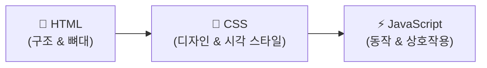
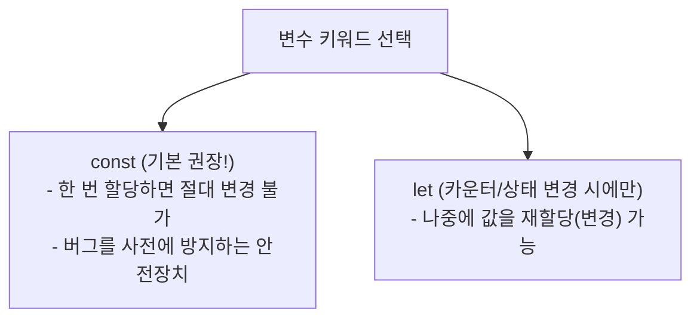

# ⚡ JavaScript 핵심 기초 문법 완벽 정리 노트

> 웹의 심장 **JavaScript의 정의와 4가지 실행 방법(Node.js 포함)**부터 **변수(let vs const)**, **5대 기본 자료형과 Falsy 6대장**, **엄격한 비교(===)**, **조건문 & 논리 연산 실전 과제**, 그리고 **반복문과 배열 순회(for...of)**까지 총정리한 실전 가이드

---

## 📑 목차
1. [JavaScript란 무엇인가?](#1-javascript란-무엇인가)
   - [1-1. 웹의 3대 요소 (HTML, CSS, JS의 역할)](#1-1-웹의-3대-요소-html-css-js의-역할)
   - [1-2. JavaScript 실행 방법 4가지](#1-2-javascript-실행-방법-4가지)
   - [1-3. Node.js란? & 터미널 환경의 4대 장점](#1-3-nodejs란--터미널-환경의-4대-장점)
2. [변수 (Variable)와 메모리: let vs const](#2-변수-variable와-메모리-let-vs-const)
   - [2-1. 변수의 본질과 값 저장](#2-1-변수의-본질과-값-저장)
   - [2-2. let vs const 핵심 비교](#2-2-let-vs-const-핵심-비교)
   - [2-3. 변수 선언 방식 비교 (JavaScript vs Python)](#2-3-변수-선언-방식-비교-javascript-vs-python)
3. [기본 자료형 (Data Types) & null vs undefined](#3-기본-자료형-data-types--null-vs-undefined)
   - [3-1. 5대 핵심 기본 자료형](#3-1-5대-핵심-기본-자료형)
   - [3-2. null vs undefined의 명확한 차이](#3-2-null-vs-undefined의-명확한-차이)
4. [연산자 (Operators) & 타입 변환의 함정](#4-연산자-operators--타입-변환의-함정)
   - [4-1. 산술 & 비교 & 논리 연산자](#4-1-산술--비교--논리-연산자)
   - [4-2. 동등(==) vs 일치(===) 연산자 (왜 ===를 써야 할까?)](#4-2-동등-vs-일치-연산자-왜-를-써야-할까)
   - [4-3. 암묵적 타입 변환 (JavaScript vs Python)](#4-3-암묵적-타입-변환-javascript-vs-python)
5. [조건문 (if / else) & Truthy vs Falsy](#5-조건문-if--else--truthy-vs-falsy)
   - [5-1. if / else 기본 문법](#5-1-if--else-기본-문법)
   - [5-2. Falsy 6대장 (무조건 암기!) & Truthy 값](#5-2-falsy-6대장-무조건-암기--truthy-값)
   - [5-3. 실전 실습 1: 콘솔 사칙연산 계산기](#5-3-실전-실습-1-콘솔-사칙연산-계산기)
   - [5-4. 실전 실습 2: 복합 조건 합격 판정 프로그램](#5-4-실전-실습-2-복합-조건-합격-판정-프로그램)
6. [반복문 (Loop: for vs while) & 배열 (Array)](#6-반복문-loop-for-vs-while--배열-array)
   - [6-1. for 반복문과 while 반복문 비교](#6-1-for-반복문과-while-반복문-비교)
   - [6-2. 배열(Array)의 구조와 at(-1) 최신 인덱싱](#6-2-배열array의-구조와-at-1-최신-인덱싱)
   - [6-3. 현대적 배열 순회: for...of](#6-3-현대적-배열-순회-forof)
7. [기출 개념 점검 퀴즈 4선 풀이](#7-기출-개념-점검-퀴즈-4선-풀이)
8. [💡 실전 핵심 요약 치트시트](#8--실전-핵심-요약-치트시트)

---

## 1. JavaScript란 무엇인가?

### 1-1. 웹의 3대 요소 (HTML, CSS, JS의 역할)
- **JavaScript**: 웹 브라우저에서 동적으로 살아 숨 쉬는 기능을 구현하는 **인터프리터 프로그래밍 언어**.
- 사용자의 버튼 클릭 감지, 폼 입력값 검증, 서버와의 실시간 데이터 교환, 애니메이션 등 **"동적 상호작용(Behavior)"**을 전담합니다.



---

### 1-2. JavaScript 실행 방법 4가지

| 방법 | 실행 위치 및 방식 | 코드 예시 | 주요 용도 |
| :--- | :--- | :--- | :--- |
| **1. 브라우저 콘솔 (Console)** | 크롬 개발자 도구(`F12`) ➔ `Console` 탭 | `console.log(1 + 2);` | 즉시 실행, 빠른 문법 연습, 에러 확인 |
| **2. 인라인 `<script>` 태그** | HTML 문서 내부 `<head>` 또는 `<body>` | `<script> console.log("Hello"); </script>` | HTML과 한 파일에서 간단한 스크립트 실행 |
| **3. 외부 JS 파일 분리** | 별도의 `.js` 파일을 생성해 HTML에 링크 | `<script src="app.js"></script>` | **실무 표준!** 코드의 모듈화와 유지보수성 극대화 |
| **4. Node.js 터미널 실행** | 터미널 CLI 환경에서 직접 실행 | `$ node app.js` | **브라우저 없이** 백엔드/컴퓨터 환경에서 JS 단독 실행 |

---

### 1-3. Node.js란? & 터미널 환경의 4대 장점
- **Node.js**: 웹 브라우저 안에서만 갇혀 살던 JavaScript를 **컴퓨터 OS(운영체제) 환경에서 독립적으로 실행할 수 있게 꺼내준 런타임 엔진(V8 기반)**입니다.
- **Node.js의 4대 장점**:
  1. **환경이 단순**: HTML, CSS 파일 없이 순수 JavaScript 문법만 집중 실행 가능.
  2. **실행이 초간단**: 터미널에서 `node app.js` 한 줄로 즉시 실행.
  3. **에러 추적 명확**: 터미널에 스택 트레이스(Stack Trace)가 출력되어 몇 번째 줄에서 왜 에러가 났는지 원인 파악이 쉬움.
  4. **초보자에게 친절**: 문법적 오류를 브라우저 새로고침 없이 즉각 확인 가능.

> [!NOTE]
> **프로그램을 설치(Install)한다는 것의 본질**:  
> 웹에서 다운로드 ➔ 내 하드디스크에 저장 ➔ 실행 파일(바이너리)을 OS에 등록(이식) ➔ 터미널에서 명령어로 실행 시 컴퓨터 CPU가 코드를 한 줄씩 해석하여 동작!  
> 설치 확인 명령어: `node -v`, `npm -v`, `git --version`

---

## 2. 변수 (Variable)와 메모리: let vs const

### 2-1. 변수의 본질과 값 저장
- **변수(Variable)**: 데이터를 컴퓨터 메모리 공간에 저장하고, 그 공간에 **이름(식별자)**을 붙여 나중에 언제든 **재사용**할 수 있도록 하는 상자.

```javascript
let age = 20;            // age라는 이름의 상자에 숫자 20을 저장
const username = "Alex"; // username이라는 상자에 문자열 "Alex"를 고정 저장

console.log(age);        // 20 출력
console.log(username);   // Alex 출력
```

---

### 2-2. let vs const 핵심 비교



```javascript
// 1. let: 값 변경(재할당) 가능
let count = 1;
count = 2; // ✅ 정상 작동

// 2. const: 값 변경(재할당) 절대 불가 (상수 / Constant)
const pi = 3.14;
pi = 3.15; // ❌ TypeError: Assignment to constant variable!
```

> [!TIP]
> **실무 꿀팁**:  
> 기본적으로 모든 변수는 **`const`를 기본값으로 사용**하고, 오직 반복문의 카운터(`i`)나 상태가 명확히 바뀌어야 하는 변수만 **`let`**을 사용하세요. (과거의 `var`는 스코프 오염 문제로 절대 사용하지 않습니다!)

---

### 2-3. 변수 선언 방식 비교 (JavaScript vs Python)

| 언어 | 값 없이 변수 선언만 하는 문법 | 값 생략 시 초기 상태 |
| :--- | :--- | :--- |
| **Python** | `email` ❌ (에러 발생! 무조건 `email = None`처럼 값을 줘야 함) | 초기값 필수 요구 |
| **JavaScript** | `let email;` ⭕ (선언만 가능!) | 자동으로 **`undefined`**가 할당됨 |

---

## 3. 기본 자료형 (Data Types) & null vs undefined

### 3-1. 5대 핵심 기본 자료형

```javascript
// 1. number: 정수와 실수 구분 없이 모두 number 타입
let a = 10;
let b = 3.14;
console.log(typeof a); // "number"

// 2. string: 큰따옴표(" ")나 작은따옴표(' ')로 감싼 문자열
let username = "Alex";
console.log(typeof username); // "string"

// 3. boolean: 참(true) 또는 거짓(false)
let isStudent = true;
console.log(typeof isStudent); // "boolean"

// 4. null: 값이 의도적으로 비어 있음을 개발자가 명시한 상태
let selectedUser = null;
console.log(typeof selectedUser); // ⚠️ "object" (자바스크립트 초기 설계의 역사적 버그)

// 5. undefined: 변수 선언 후 아직 값이 할당되지 않아 비어있는 상태
let score;
console.log(typeof score); // "undefined"
```

---

### 3-2. null vs undefined의 명확한 차이

```
┌────────────────────────────────────────────────────────┐
│  let a = null;        ──▶ "개발자가 의도적으로 비워둠"    │
│  let b;               ──▶ "아직 값을 안 정해서 자동으로 빔" │
└────────────────────────────────────────────────────────┘
```

| 비교 항목 | `null` | `undefined` |
| :--- | :--- | :--- |
| **의미** | **의도적인 빈 값** (휴지가 다 써서 빈 휴지걸이) | **아직 정의되지 않음** (휴지걸이 자체가 없음) |
| **할당 주체** | **개발자**가 직접 코드에 대입 | **자바스크립트 엔진**이 자동으로 부여 |
| **typeof 결과** | `"object"` | `"undefined"` |

```javascript
let a = null;
let b; // undefined

console.log(a == b);  // true  (느슨한 비교: 둘 다 빈 값이므로 같다고 인정)
console.log(a === b); // false (엄격한 비교: 타입이 object vs undefined로 다름!)
```

---

## 4. 연산자 (Operators) & 타입 변환의 함정

### 4-1. 산술 & 비교 & 논리 연산자

```javascript
// 1. 산술 연산자 (+, -, *, /)
let x = 10, y = 3;
console.log(x + y); // 13 (더하기)
console.log(x - y); // 7  (빼기)
console.log(x * y); // 30 (곱하기)
console.log(x / y); // 3.3333... (나누기)

// 2. 비교 연산자 (>, <, >=, <=) ➔ 결과는 무조건 boolean
console.log(10 > 5);   // true
console.log(10 <= 9);  // false

// 3. 논리 연산자 (&&, ||, !)
let age = 20, hasId = true;
console.log(age >= 19 && hasId); // true (AND: 둘 다 참이어야 함)
console.log(age < 19 || hasId);  // true (OR: 둘 중 하나만 참이면 됨)
console.log(!hasId);             // false (NOT: 참/거짓 반전)

// 4. 문자열 연산자 (+)
let firstName = "Alex", lastName = "Kim";
console.log(firstName + " " + lastName); // "Alex Kim"
```

---

### 4-2. 동등(==) vs 일치(===) 연산자 (왜 ===를 써야 할까?)
- **`==` (동등 연산자)**: 비교할 때 자바스크립트가 스스로 **타입을 강제로 일치시킨 후 값만 비교**합니다 (위험!).
- **`===` (일치 연산자 - 권장)**: **값과 데이터 타입이 모두 같아야만 `true`**로 판정합니다.

```javascript
console.log(10 == "10");  // true  ⚠️ (숫자 10과 문자열 "10"을 같다고 판정!)
console.log(10 === "10"); // false ✅ (타입이 number vs string으로 다르므로 다름!)
```

---

### 4-3. 암묵적 타입 변환 (JavaScript vs Python)
- **문자열 + 숫자 덧셈 시**:
  - **JavaScript**: 숫자를 자동으로 문자열로 바꿔서 연결해 버립니다! (`"10" + 1 ➔ "101"`)
  - **Python**: 서로 다른 타입 덧셈을 허용하지 않고 `TypeError`를 발생시킵니다!

---

## 5. 조건문 (if / else) & Truthy vs Falsy

### 5-1. if / else 기본 문법
```javascript
let age = 20;

if (age >= 19) {
  console.log("성인입니다.");
} else {
  console.log("미성년자입니다.");
}
```

---

### 5-2. Falsy 6대장 (무조건 암기!) & Truthy 값
자바스크립트 조건문(`if`) 괄호 안에 boolean이 아닌 일반 값을 넣었을 때, **자동으로 `false`로 취급되는 값은 전 우주에서 딱 6개뿐**입니다:

#### ❌ Falsy 값 (거짓으로 평가되는 6가지):
1. `false`
2. `0` (숫자 영)
3. `""` (빈 문자열)
4. `null`
5. `undefined`
6. `NaN` (Not a Number)

#### ⭕ Truthy 값 (Falsy 6개를 제외한 세상의 모든 값!):
- ⚠️ **빈 배열 `[]`은 Truthy!** (배열 객체는 존재하므로 참!)
- ⚠️ **빈 객체 `{}`도 Truthy!**
- ⚠️ **문자열 `"0"`도 Truthy!** (글자가 1개 들어있는 문자열이므로 참!)

---

### 5-3. 실전 실습 1: 콘솔 사칙연산 계산기
- **요구사항**: 숫자 두 개와 연산자 기호(`+`, `-`, `*`, `/`)를 변수로 받아 결과 출력하기

```javascript
let a = 10;
let b = 5;
let operator = "+"; // "+", "-", "*", "/" 중 선택

if (operator === "+") {
  console.log(a + b);
} else if (operator === "-") {
  console.log(a - b);
} else if (operator === "*") {
  console.log(a * b);
} else if (operator === "/") {
  console.log(a / b);
} else {
  console.log("지원하지 않는 연산자입니다.");
}
```

---

### 5-4. 실전 실습 2: 복합 조건 합격 판정 프로그램
- **합격 조건**:
  - 점수(`score`) 70 이상
  - 출석률(`attendance`) 80 이상
  - 과제 제출 여부(`submitted`) `true`
  - **[단서 조항]**: 단, 점수가 90점 이상이면 출석률은 미달이어도 합격!

```javascript
let score = 88;
let attendance = 75;
let submitted = true;

// 과제는 필수 제출 + (기본 기준 통과 또는 90점 이상 슈퍼패스)
if (submitted && ((score >= 70 && attendance >= 80) || score >= 90)) {
  console.log("최종 합격");
} else {
  console.log("불합격");
}
```

---

## 6. 반복문 (Loop: for vs while) & 배열 (Array)

### 6-1. for 반복문과 while 반복문 비교

```javascript
// 1. for 반복문 (반복 횟수가 정해져 있을 때 표준 사용)
// for (초기값; 조건식; 증감식)
for (let i = 1; i <= 3; i++) {
  console.log(i); // 1, 2, 3 출력
}

// 2. while 반복문 (특정 조건이 true인 동안 계속 반복 / 무한루프 주의!)
let i = 0;
while (i < 3) {
  console.log(i); // 0, 1, 2 출력
  i++;
}
```

---

### 6-2. 배열(Array)의 구조와 at(-1) 최신 인덱싱
- 여러 개의 값을 하나의 변수에 순서(0부터 시작하는 Index)대로 묶어 보관하는 자료형.
- 요소마다 서로 다른 타입을 담을 수도 있습니다.

```javascript
let numbers = [10, 20, 30];

console.log(numbers[0]);      // 10 (첫 번째 요소)
console.log(numbers.at(-1));   // 30 (⭐ 맨 마지막 요소를 가리키는 모던 JS 문법!)
console.log(numbers[3]);       // undefined (존재하지 않는 4번째 인덱스 접근 시)
```

---

### 6-3. 현대적 배열 순회: `for...of`
배열 안의 알맹이 데이터를 하나씩 꺼내어 순서대로 처리할 때 가장 간결하고 직관적인 반복문:

```javascript
let scores = [80, 90, 70];

for (const score of scores) {
  console.log(score); // 80 -> 90 -> 70 순차 출력
}
```

---

## 7. 기출 개념 점검 퀴즈 4선 풀이

### Q1. 다음 중 Node.js의 역할로 가장 적절한 것은?
- ① HTML을 꾸민다
- ② JavaScript를 브라우저에서만 실행한다
- **③ 브라우저 없이 JavaScript를 실행한다 (정답 ✅)**
- ④ CSS를 컴파일한다  
> **해설**: Node.js는 브라우저 외부 환경(컴퓨터 콘솔/서버)에서 JS를 독자적으로 실행할 수 있게 해주는 런타임 환경입니다.

---

### Q2. 다음 코드의 출력 결과는? `console.log(10 + "5");`
- ① `15`
- ② `"15"`
- **③ `"105"` (정답 ✅)**
- ④ 에러 발생  
> **해설**: 숫자와 문자열을 `+` 연산하면 자바스크립트는 숫자를 문자열로 변환하여 두 문자열을 결합("10" + "5" = "105")합니다.

---

### Q3. 다음 중 Falsy(거짓 같은 값)가 아닌 것은?
- ① `0`
- ② `""`
- **③ `[]` (정답 ✅)**
- ④ `null`  
> **해설**: Falsy 6가지는 `false, 0, "", null, undefined, NaN`입니다. 빈 배열 `[]`과 빈 객체 `{}`는 메모리에 객체 상자가 생성된 상태이므로 **Truthy**로 평가됩니다!

---

### Q4. `==` 와 `===` 의 차이로 옳은 설명은?
- ① 차이가 없다
- ② `==` 는 타입까지 비교한다
- ③ `===` 는 값만 비교한다
- **④ `===` 는 값과 타입을 모두 비교한다 (정답 ✅)**  
> **해설**: `==`는 자동 형변환이 일어나 값만 비교하지만, `===`는 데이터 타입까지 일치해야만 참으로 처리하는 엄격한 일치 연산자입니다.

---

## 8. 💡 실전 핵심 요약 치트시트

```javascript
1. 변수 선언 공식
   - 기본은 무조건 const 사용!
   - 값이 나중에 바뀌는 경우(카운터 등)에만 let 사용

2. 엄격 비교 원칙
   - (X) if (a == b)   --> 암묵적 형변환 버그 위험
   - (O) if (a === b)  --> 값 + 타입 완벽 일치 검사

3. Falsy 6대장 외우기
   false, 0, "", null, undefined, NaN
   (⚠️ [], {} 은 Falsy가 아니라 Truthy다!)

4. 배열 마지막 원소 접근
   arr.at(-1)  // arr[arr.length - 1]의 세련된 현대식 표현

5. 배열 순회 표준
   for (const item of items) { ... }
```
