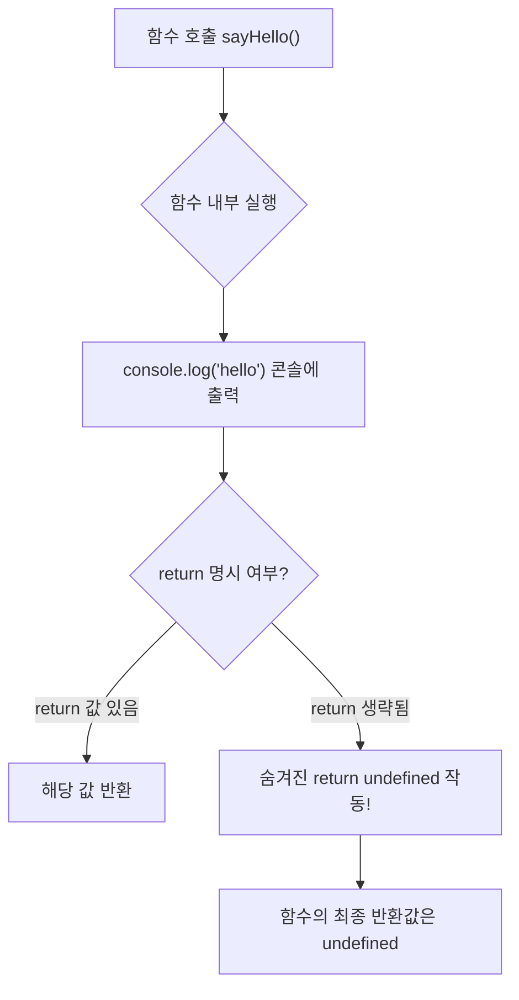
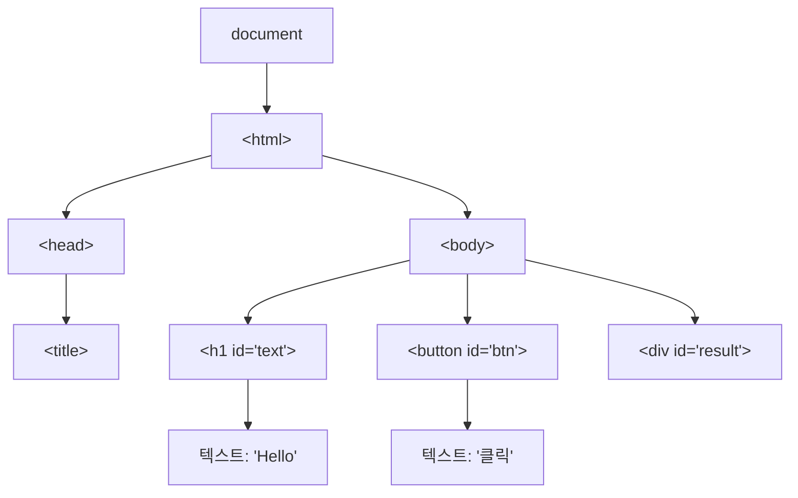
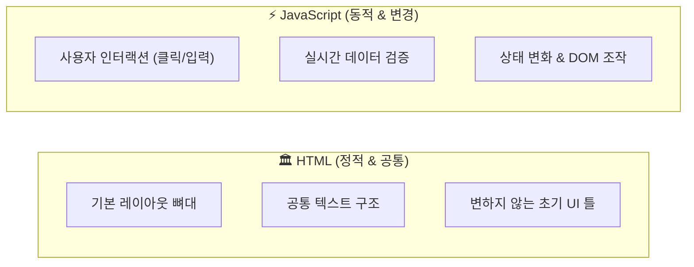
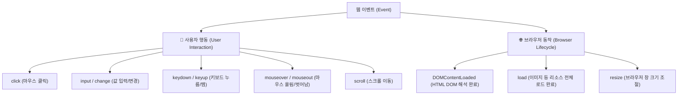
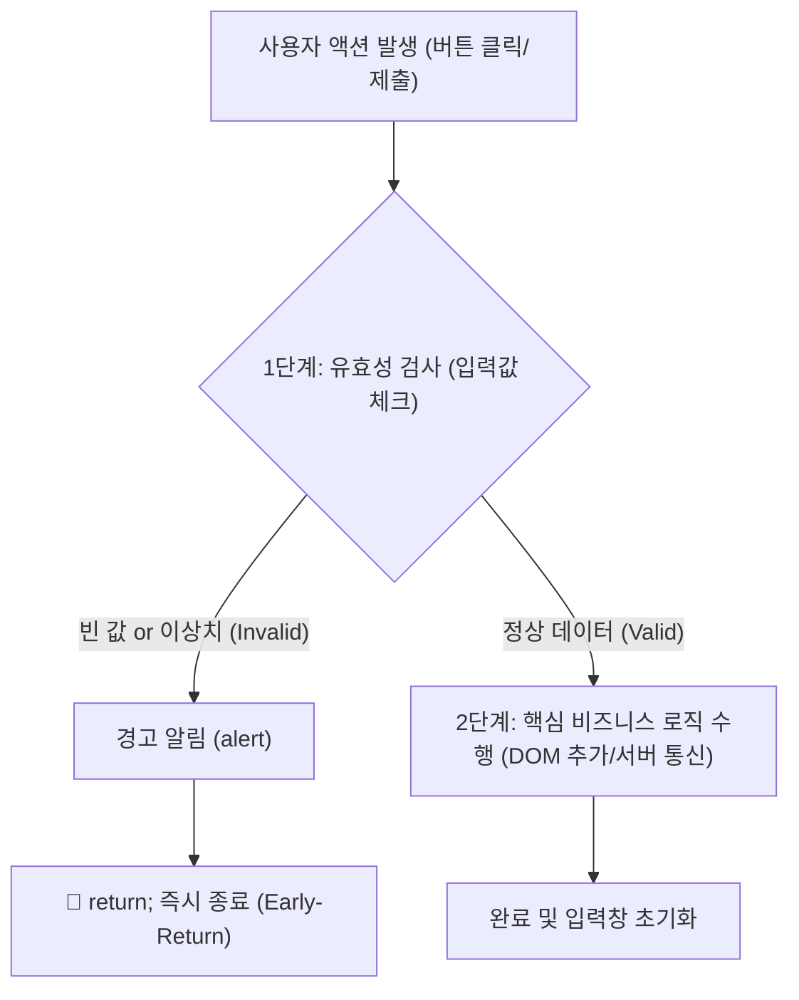
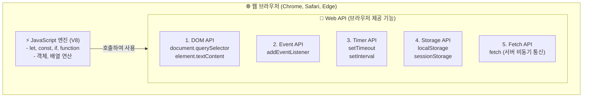

# 🌐 JavaScript DOM 조작, 이벤트 & Web API 완벽 정리 노트

> 브라우저 화면을 동적으로 제어하는 **함수의 반환값 규칙(return 생략 시 undefined)**부터 **DOM의 본질과 트리 구조**, **HTML vs JS의 명확한 역할 분담**, **DOM 선택 & 스타일·속성 조작**, **이벤트 리스너 & 화살표 함수**, **얼리 리턴(Early-Return) 패턴**, 그리고 브라우저가 제공하는 **Web API 5대 분류와 Timer API(카운트다운 실습)**까지 총정리한 실전 가이드

---

## 📑 목차
1. [함수의 반환 규칙: return을 생략하면 무슨 일이 일어날까?](#1-함수의-반환-규칙-return을-생략하면-무슨-일이-일어날까)
   - [1-1. 모든 함수는 "반드시" 값을 반환한다](#1-1-모든-함수는-반드시-값을-반환한다)
   - [1-2. return 생략과 undefined (JavaScript vs Python 비교)](#1-2-return-생략과-undefined-javascript-vs-python-비교)
2. [JavaScript는 어떻게 화면을 바꾸는가? (DOM의 탄생)](#2-javascript는-어떻게-화면을-바꾸는가-dom의-탄생)
   - [2-1. HTML을 직접 수정하는 것이 아니다!](#2-1-html을-직접-수정하는-것이-아니다)
   - [2-2. DOM(Document Object Model)의 정의와 트리 구조](#2-2-domdocument-object-model의-정의와-트리-구조)
   - [2-3. 웹 페이지의 '상태'와 새로고침(Reload)의 의미](#2-3-웹-페이지의-상태와-새로고침reload의-의미)
3. [역할 분담의 대원칙: HTML vs JavaScript](#3-역할-분담의-대원칙-html-vs-javascript)
   - [3-1. 🏛 HTML: 정적 & 공통적인 뼈대](#3-1--html-정적--공통적인-뼈대)
   - [3-2. ⚡ JavaScript: 동적 & 변경되는 상태·로직](#3-2--javascript-동적--변경되는-상태로직)
   - [3-3. 역할 분담 한 줄 요약 법칙](#3-3-역할-분담-한-줄-요약-법칙)
4. [DOM 요소 선택하기 (Selector Methods)](#4-dom-요소-선택하기-selector-methods)
   - [4-1. 3대 핵심 선택자 메서드 비교](#4-1-3대-핵심-선택자-메서드-비교)
   - [4-2. `querySelector` vs `querySelectorAll` 실전 문법](#4-2-queryselector-vs-queryselectorall-실전-문법)
5. [DOM 조작 (내용, 스타일, 속성, 동적 요소 생성)](#5-dom-조작-내용-스타일-속성-동적-요소-생성)
   - [5-1. 텍스트와 HTML 내용 변경 (`textContent` vs `innerHTML`)](#5-1-텍스트와-html-내용-변경-textcontent-vs-innerhtml)
   - [5-2. 인라인 스타일 변경 (`style.color`, `style.fontSize` 등)](#5-2-인라인-스타일-변경-stylecolor-stylefontsize-등)
   - [5-3. 태그 속성(Attribute) 변경 (`link.href`, `img.src` 등)](#5-3-태그-속성attribute-변경-linkhref-imgsrc-등)
   - [5-4. 동적 요소 생성과 문서 추가 (`createElement` & `appendChild`)](#5-4-동적-요소-생성과-문서-추가-createelement--appendchild)
6. [이벤트(Event)와 이벤트 리스너(Event Listener)](#6-이벤트event와-이벤트-리스너event-listener)
   - [6-1. 이벤트(Event)란? (사용자 행동 vs 브라우저 동작)](#6-1-이벤트event란-사용자-행동-vs-브라우저-동작)
   - [6-2. 이벤트 리스너를 사용하는 이유와 동작 메커니즘](#6-2-이벤트-리스너를-사용하는-이유와-동작-메커니즘)
   - [6-3. 초보자가 가장 많이 하는 치명적 실수: `func` vs `func()`](#6-3-초보자가-가장-많이-하는-치명적-실수-func-vs-func)
   - [6-4. 이벤트 핸들러 작성법의 진화 (기명함수 ➔ 익명함수 ➔ 화살표 함수)](#6-4-이벤트-핸들러-작성법의-진화-기명함수--익명함수--화살표-함수)
7. [모던 자바스크립트: 화살표 함수 (Arrow Function)](#7-모던-자바스크립트-화살표-함수-arrow-function)
   - [7-1. 화살표 함수의 탄생 배경과 기본 문법](#7-1-화살표-함수의-탄생-배경과-기본-문법)
   - [7-2. 화살표 함수 문법 축약 3단계](#7-2-화살표-함수-문법-축약-3단계)
8. [🛡 얼리 리턴 (Early-Return, 조기 반환) 디자인 패턴](#8--얼리-리턴-early-return-조기-반환-디자인-패턴)
   - [8-1. 얼리 리턴의 정의와 머신러닝 데이터 전처리 비유](#8-1-얼리-리턴의-정의와-머신러닝-데이터-전처리-비유)
   - [8-2. 왜 얼리 리턴을 써야 하는가? (안정성 & Deep Nesting 탈출)](#8-2-왜-얼리-리턴을-써야-하는가-안정성--deep-nesting-탈출)
   - [8-3. 실전 Before vs After 코드 비교](#8-3-실전-before-vs-after-코드-비교)
9. [Web API란 무엇인가?](#9-web-api란-무엇인가)
   - [9-1. JavaScript 언어와 Web API의 차이점](#9-1-javascript-언어와-web-api의-차이점)
   - [9-2. 브라우저 제공 Web API 5대 핵심 분류](#9-2-브라우저-제공-web-api-5대-핵심-분류)
10. [Timer API 완벽 이해 (`setTimeout`, `setInterval`, `timerId`)](#10-timer-api-완벽-이해-settimeout-setinterval-timerid)
    - [10-1. 1회성 타이머: `setTimeout`](#10-1-1회성-타이머-settimeout)
    - [10-2. 반복 타이머: `setInterval`과 중단 `clearInterval`](#10-2-반복-타이머-setinterval과-중단-clearinterval)
    - [10-3. `timerId`의 역할과 중복 실행 버그 방지 가드 클로즈](#10-3-timerid의-역할과-중복-실행-버그-방지-가드-클로즈)
11. [💻 강의 슬라이드 실전 실습 과제 풀이 모음](#11--강의-슬라이드-실전-실습-과제-풀이-모음)
    - [실습 1: 버튼 클릭 이벤트 콘솔 출력](#실습-1-버튼-클릭-이벤트-콘솔-출력)
    - [실습 2: 버튼 클릭 시 텍스트 및 색상 변경](#실습-2-버튼-클릭-시-텍스트-및-색상-변경)
    - [실습 3: 비밀번호 실시간 길이 감지 및 유효성 피드백](#실습-3-비밀번호-실시간-길이-감지-및-유효성-피드백)
    - [실습 4: 마우스 감지 이벤트 (호버 시 색상 전환)](#실습-4-마우스-감지-이벤트-호버-시-색상-전환)
    - [실습 5: 동적 입력값 처리 및 화면 렌더링 (DOM 추가)](#실습-5-동적-입력값-처리-및-화면-렌더링-dom-추가)
    - [실습 6: Timer API 5초 카운트다운 타이머 완성](#실습-6-timer-api-5초-카운트다운-타이머-완성)
12. [💡 실전 핵심 요약 치트시트](#12--실전-핵심-요약-치트시트)

---

## 1. 함수의 반환 규칙: return을 생략하면 무슨 일이 일어날까?

### 1-1. 모든 함수는 "반드시" 값을 반환한다
- 자바스크립트의 함수는 호출되면 **어떤 상황에서든 반드시 결과값 하나를 반환(Return)**하도록 언어 차원에서 설계되어 있습니다.
- 개발자가 코드 내에서 `return` 키워드를 명시하지 않더라도, 자바스크립트 엔진은 내부적으로 **`return undefined;`**를 자동으로 붙여서 실행을 마칩니다.



---

### 1-2. return 생략과 undefined (JavaScript vs Python 비교)

```javascript
// 'Hello' 를 출력하는 함수
function sayHello() {
  console.log("hello");
  // ⚠️ return을 명시하지 않았지만, 내부적으로 아래 코드가 숨겨져 있음!
  // return undefined;
}

// sayHello()의 반환값을 변수 hello에 할당
let hello = sayHello(); // 1) 콘솔에 "hello"가 출력됨

// hello 변수에 무엇이 담겼는지 확인
console.log(hello);     // 2) undefined 가 출력됨!
```

#### 🌐 언어별 return 생략 시 반환값 비교

| 언어 | return 생략 시 자동 반환값 | 설명 |
| :--- | :--- | :--- |
| **JavaScript** | `undefined` | "값이 아직 정의되지 않음"을 나타내는 JS 기본 원시 타입 |
| **Python** | `None` | 파이썬의 `NoneType` 객체를 기본 반환 (`def foo(): pass` 호출 시 `None` 리턴) |

> [!IMPORTANT]
> **콘솔 출력(`console.log`)과 반환(`return`)의 차이**:  
> - `console.log()`는 단순히 개발자 모니터(화면)에 글자를 띄워주는 **"출력 행위"**일 뿐입니다.
> - `return`은 함수를 호출한 자리에 데이터를 쥐어주는 **"값의 전달"**입니다.  
> `return`이 없는 함수는 외부 변수에 담았을 때 언제나 `undefined`가 할당됩니다.

---

## 2. JavaScript는 어떻게 화면을 바꾸는가? (DOM의 탄생)

### 2-1. HTML을 직접 수정하는 것이 아니다!
많은 입문자들이 *"자바스크립트가 `.html` 텍스트 파일을 직접 열어서 코드를 수정하나?"*라고 오해합니다.  
하지만 **자바스크립트는 하드디스크나 서버에 있는 HTML 파일을 직접 수정하는 것이 아닙니다.**

```mermaid
graph LR
    A["📄 index.html<br/>(정적 파일)"] -->|브라우저가 읽고 파싱| B["🌳 DOM (객체 트리)<br/>(메모리 상의 객체 구조)"]
    C["⚡ JavaScript"] -->|조작 (Modify)| B
    B -->|화면 렌더링| D["🖥 사용자 모니터 화면"]
```

1. 브라우저가 원본 HTML 파일을 읽어서 컴퓨터 메모리 안에 **DOM(Document Object Model) 객체 트리**를 생성합니다.
2. JavaScript는 이 **메모리 상에 존재하는 DOM 객체를 조작**합니다.
3. 브라우저는 변경된 DOM 객체를 감지하고 화면을 즉시 다시 그려냅니다(Re-rendering).

---

### 2-2. DOM(Document Object Model)의 정의와 트리 구조

- **DOM이란?**: 브라우저가 HTML 문서를 해석하여, **JavaScript와 같은 프로그래밍 언어가 제어하고 다룰 수 있도록 만든 객체(Object) 구조**입니다.
- **웹 페이지 = 거대한 트리(Tree) 구조**:
  - 가장 꼭대기(뿌리): `document`
  - 부모 노드: `<html>`
  - 자식 노드: `<head>`, `<body>`
  - 잎사귀(Leaf) 노드: `<h1>`, `<p>`, `<button>`, 텍스트, 속성 등



---

### 2-3. 웹 페이지의 '상태'와 새로고침(Reload)의 의미
- **DOM은 '웹 페이지의 현재 상태'**입니다.  
  JavaScript로 글자 색을 빨간색으로 바꾸고 글씨를 바꿨더라도, 그것은 **오직 브라우저 메모리 안의 DOM에만 반영된 상태**입니다.
- 사용자가 웹 브라우저에서 **새로고침(F5 / reload)**을 누르면:
  1. 메모리에 있던 기존 DOM이 완전히 소멸합니다.
  2. 원본 `index.html` 파일을 서버나 로컬에서 다시 읽어옵니다.
  3. **새로운 DOM을 처음부터 다시 생성**하므로 모든 화면 조작 상태가 초기화됩니다.

---

## 3. 역할 분담의 대원칙: HTML vs JavaScript

*"어떤 코드를 HTML에 넣고, 어떤 코드를 JavaScript에 넣어야 할까?"*



### 3-1. 🏛 HTML: 정적 & 공통적인 뼈대
- **역할**: 웹 페이지의 뼈대와 공통적인 구조를 담당.
- **특징**:
  - 사용자가 누구든, 버튼을 어떻게 누르든 **변하지 않고 항상 그 자리에 그대로 있는 공통적이고 정적인 부분**은 HTML 파일에 작성합니다.
  - 예시: 헤더, 사이드바 틀, 기본 입력 양식 태그(`<input>`, `<button>`), 푸터 레이아웃.

### 3-2. ⚡ JavaScript: 동적 & 변경되는 상태·로직
- **역할**: 사용자의 행동(클릭, 키 입력, 마우스 이동 등)에 따라 변화를 가하는 동적 제어와 비즈니스 로직을 담당.
- **특징**:
  - 사용자의 인터랙션에 따라 **실시간으로 바뀌거나(상태 변화)**, 개발자가 조건문/반복문/연산 로직으로 제어해야 하는 부분은 JavaScript(DOM 조작 및 이벤트)에 작성합니다.
  - 예시: 로그인 버튼 클릭 시 글자 색상 변경, 비밀번호 입력값 실시간 자릿수 검사, 5초 카운트다운 타이머 등.

### 3-3. 역할 분담 한 줄 요약 법칙

> [!NOTE]
> 💡 **골든 룰 (Golden Rule)**:  
> **"화면의 기본 틀과 공통 속성은 HTML에! 사용자의 행동이나 상황에 따라 동적으로 변하는 상태와 로직은 JS(DOM)에!"**  
> 이 기준을 잡으면 컴포넌트나 웹 코드를 작성할 때 역할이 명쾌해집니다.

---

## 4. DOM 요소 선택하기 (Selector Methods)

JavaScript가 화면 요소를 바꾸려면, 가장 먼저 **"어떤 요소를 바꿀 것인가?"**를 지정(선택)해야 합니다.

### 4-1. 3대 핵심 선택자 메서드 비교

| 메서드명 | 인자 형식 | 반환값 | 매칭 대상이 없을 때 | 주요 특징 및 권장 용도 |
| :--- | :--- | :--- | :--- | :--- |
| **`document.getElementById()`** | `"아이디명"` (ex: `"text"`) | 단일 Element | `null` | 고유 ID로 1개 요소를 빠르게 찾을 때 사용 |
| **`document.querySelector()`** | `CSS 선택자` (ex: `"#text"`, `".item"`, `"p"`) | 단일 Element | `null` | **실무 최다 사용!** 가장 첫 번째로 일치하는 요소 1개 반환 |
| **`document.querySelectorAll()`** | `CSS 선택자` (ex: `".item"`, `"ul > li"`) | `NodeList` (유사 배열) | 빈 NodeList (`[]`) | 조건에 맞는 **모든 요소를 그룹으로 선택** (`forEach` 순회 가능) |

---

### 4-2. `querySelector` vs `querySelectorAll` 실전 문법

```html
<!-- HTML 구조 예시 -->
<h1 id="text">Hello</h1>
<div class="item">사과</div>
<div class="item">바나나</div>
<div class="item">포도</div>
```

```javascript
// 1. querySelector: 단 1개의 요소만 선택
const singleHeading = document.querySelector("#text");  // id가 text인 요소
const firstItem     = document.querySelector(".item");  // 클래스가 item인 것 중 '첫 번째' (사과)

console.log(singleHeading.textContent); // "Hello"
console.log(firstItem.textContent);     // "사과"

// 2. querySelectorAll: 일치하는 모든 요소를 NodeList로 선택
const allItems = document.querySelectorAll(".item");

console.log(allItems.length); // 3 (사과, 바나나, 포도)

// NodeList는 forEach 메서드로 간편하게 순회 가능!
allItems.forEach((el, index) => {
  console.log(`${index + 1}번째 과일:`, el.textContent);
});
// 1번째 과일: 사과
// 2번째 과일: 바나나
// 3번째 과일: 포도
```

---

## 5. DOM 조작 (내용, 스타일, 속성, 동적 요소 생성)

요소를 선택했다면, 그 요소의 텍스트, HTML 구조, CSS 디자인 스타일, 속성을 마음대로 변경할 수 있습니다.

### 5-1. 텍스트와 HTML 내용 변경 (`textContent` vs `innerHTML`)

```javascript
const el = document.getElementById("text");

// 1. textContent: 순수한 텍스트만 읽거나 변경 (보안상 안전, XSS 방지)
el.textContent = "Hello, JavaScript"; 
console.log(el.textContent.trim()); // 공백 제거 후 텍스트 출력

// 2. innerHTML: HTML 태그까지 포함하여 파싱하고 화면을 변경
// 기존 내부 요소를 비우거나 새 태그를 통째로 주입할 때 사용
el.innerHTML = "<span style='color: blue;'>Hello, Blue JS!</span>";

// 요소 내부를 깨끗이 비울 때도 자주 활용:
// el.innerHTML = "";
```

---

### 5-2. 인라인 스타일 변경 (`style.color`, `style.fontSize` 등)
- 선택한 요소의 `.style` 객체 속성에 접근하여 CSS 스타일을 직접 변경합니다.
- CSS 속성명에 하이픈(`-`)이 있는 속성은 JavaScript에서 **카멜 표기법(camelCase)**으로 작성합니다.
  - `font-size` ➔ `fontSize`
  - `background-color` ➔ `backgroundColor`
  - `border-radius` ➔ `borderRadius`

```javascript
const el = document.querySelector("#text");

el.textContent = "Hello, DOM";
el.style.color = "red";             // 글자색 변경
el.style.fontSize = "20px";          // 폰트 크기 변경
el.style.backgroundColor = "yellow"; // 배경색 변경
el.style.border = "1px solid red";   // 테두리 추가
```

---

### 5-3. 태그 속성(Attribute) 변경 (`link.href`, `img.src` 등)
- HTML 태그가 가진 고유 속성(`href`, `src`, `placeholder`, `disabled`, `type` 등)을 직접 변경할 수 있습니다.

```javascript
// <a> 태그의 링크 목적지 변경
const link = document.querySelector("a");
link.href = "https://google.com";
link.target = "_blank"; // 새 탭에서 열기

// <input> 태그의 속성 변경
const input = document.querySelector("#name-input");
input.placeholder = "새로운 이름을 입력해주세요";
```

---

### 5-4. 동적 요소 생성과 문서 추가 (`createElement` & `appendChild`)
새로운 태그 요소를 자바스크립트로 메모리상에 생성하고, 원하는 부모 태그 아래에 자식으로 이어 붙입니다.

```javascript
// 1. 메모리 상에 새로운 <p> 태그 노드 생성
const p = document.createElement("p"); // <p></p>

// 2. 생성한 요소에 내용 채우기
p.textContent = "새롭게 생성된 문단입니다."; // <p>새롭게 생성된 문단입니다.</p>

// 3. 실제 DOM 트리(화면)에 붙이기
// document.body 또는 특정 부모 컨테이너(result 등)에 appendChild 실행
const resultBox = document.querySelector("#result");
resultBox.appendChild(p);
```

---

## 6. 이벤트(Event)와 이벤트 리스너(Event Listener)

### 6-1. 이벤트(Event)란? (사용자 행동 vs 브라우저 동작)
- **이벤트(Event)**: 웹 페이지 안에서 일어나는 모든 상태 변화나 사건.
- 주로 **사용자의 상호작용 행동**에 의해 발생하지만, **브라우저 자체의 라이프사이클 동작**도 포함됩니다.



---

### 6-2. 이벤트 리스너를 사용하는 이유와 동작 메커니즘
- **이벤트 리스너(Event Listener)**: 특정 요소에서 지정한 이벤트가 언제 발생하는지 귀 기울여 감시하다가, **해당 사건이 발생하면 지정해 둔 함수(콜백 함수)를 자동으로 호출해 주는 시스템**입니다.
- **사용하는 3대 이유**:
  1. 사용자의 행동을 감지하여 실시간 상호작용(Interaction) 구현.
  2. 죽어있는 정적인 HTML 문서를 살아 숨 쉬는 동적 웹 애플리케이션으로 변환.
  3. 화면(UI)과 비즈니스 로직을 상황에 맞춰 동적으로 제어.

```javascript
// 기본 문법: 타겟요소.addEventListener("이벤트종류", 실행할함수);
const btn = document.querySelector("button");

btn.addEventListener("click", function () {
  console.log("버튼이 클릭됨!");
});
```

---

### 6-3. 초보자가 가장 많이 하는 치명적 실수: `func` vs `func()`

```javascript
function buttonAlert() {
  alert("버튼이 클릭됨");
}

const btn = document.querySelector("button");

// ✅ 올바른 코드: 함수 '이름(참조)'만 전달!
btn.addEventListener("click", buttonAlert);
// 설명: "클릭이라는 사건이 발생했을 때, 그때 buttonAlert 함수를 실행해줘!"

// ❌ 치명적인 실수 코드: 함수 뒤에 괄호 ()를 붙여 호출해버림!
btn.addEventListener("click", buttonAlert());
```

> [!WARNING]
> 🚨 **왜 `buttonAlert()`로 작성하면 안 되는가?**  
> `buttonAlert()`처럼 괄호를 붙이면, 이벤트 리스너가 등록되는 시점(코드 로딩 즉시)에 함수가 바로 1회 실행되어 버립니다!  
> 게다가 `buttonAlert` 함수는 return 값이 없으므로 반환값인 `undefined`가 `addEventListener`의 두 번째 인자로 전달됩니다.  
> 즉, 브라우저는 내부적으로 `btn.addEventListener("click", undefined)`로 인식하여, **실제 버튼을 클릭했을 때 아무런 동작도 하지 않게 됩니다.**

---

### 6-4. 이벤트 핸들러 작성법의 진화 (기명함수 ➔ 익명함수 ➔ 화살표 함수)

```javascript
const btn = document.querySelector("button");

// 1단계: 외부 기명 함수 전달 (재사용할 때 적합)
function handleClick() {
  alert("클릭됨");
}
btn.addEventListener("click", handleClick);

// 2단계: 단독 사용 시 안에서 익명 함수 정의
btn.addEventListener("click", function () {
  alert("클릭됨");
});

// 3단계: 화살표 함수 (Arrow Function)로 전환
btn.addEventListener("click", () => {
  alert("클릭됨");
});

// 4단계: 실행할 코드가 한 줄이면 중괄호 { } 생략 (최종 모던 스타일)
btn.addEventListener("click", () => alert("클릭됨"));
```

---

## 7. 모던 자바스크립트: 화살표 함수 (Arrow Function)

### 7-1. 화살표 함수의 탄생 배경과 기본 문법
- ES6(2015)에서 도입된 문법으로, 길고 번거로운 `function` 키워드 대신 `=>` 기호를 사용하여 함수를 **더 짧고 간결하게 정의**할 수 있습니다.
- 특히 이벤트 리스너나 배열 순회 메서드(`forEach`, `map`, `filter`)의 **콜백 함수**로 압도적으로 많이 사용됩니다.

---

### 7-2. 화살표 함수 문법 축약 3단계

```javascript
// [기존 전통적 함수 선언]
function add(a, b) {
  return a + b;
}

// 1단계: function 대신 화살표(=>) 기본 표기
const add1 = (a, b) => {
  return a + b;
};

// 2단계: 본문이 '단일 return 문'인 경우 중괄호 { }와 return 키워드 동시 생략!
const add2 = (a, b) => a + b;

// 3단계: 매개변수가 1개뿐인 경우 소괄호 ( )도 생략 가능!
const double = x => x * 2;
```

#### 이벤트 리스너에서의 화살표 함수 활용 비교:
```javascript
// 기본 익명 함수
btn.addEventListener("click", function () {
  console.log("클릭됨");
});

// 화살표 함수
btn.addEventListener("click", () => {
  console.log("클릭됨");
});

// 한 줄 축약 화살표 함수
btn.addEventListener("click", () => console.log("클릭됨"));
```

---

## 8. 🛡 얼리 리턴 (Early-Return, 조기 반환) 디자인 패턴

### 8-1. 얼리 리턴의 정의와 머신러닝 데이터 전처리 비유

- **정의**: 함수나 이벤트 핸들러가 본격적인 핵심 로직을 실행하기 전, **가장 앞단에서 데이터 유효성 검사(Data Validation)를 수행하여 조건에 맞지 않는 잘못된 입력값을 사전에 차단하고 함수를 즉시 종료(`return;`)하는 패턴**입니다.



> [!NOTE]
> 🤖 **머신러닝(AI) 관점에서의 비유**:  
> 머신러닝 모델에 학습 데이터를 주입하기 전, **데이터 전처리(Data Preprocessing)**를 거쳐 결측치(Null)나 이상치(Outlier)를 먼저 걸러내는 것과 완벽히 동일합니다.  
> 쓰레기 데이터(비정상 값)가 핵심 모델에 들어가서 계산 에러나 오작동을 일으키는 것을 입구에서 원천 봉쇄하는 것입니다.

---

### 8-2. 왜 얼리 리턴을 써야 하는가? (안정성 & Deep Nesting 탈출)

1. **안정성 확보 (Bug Prevention)**:
   - 빈 문자열(`""`), `null`, 음수, 비정상 포맷 값이 메인 로직으로 흘러 들어가 화면이 깨지거나 런타임 오류가 터지는 현상을 사전에 방지합니다.
2. **가독성 향상 (Deep Nesting 방지)**:
   - 조건마다 안쪽으로 깊숙이 들여쓰기(`if { if { if { ... } } }`)하는 '피라미드 지옥(Pyramid of Doom)' 대신, 예외 상황을 초반에 잘라내어 **코드의 깊이(Indent Level)를 1단계로 평탄하게 유지**합니다.

---

### 8-3. 실전 Before vs After 코드 비교

#### ❌ Before: if-else 중첩 방식 (코드가 오른쪽으로 계속 밀려남)
```javascript
function handleSubmit() {
  if (input.value !== "") {
    if (input.value.length >= 4) {
      // 핵심 로직 실행...
      console.log("저장 성공!");
    } else {
      alert("4자리 이상 입력해주세요.");
    }
  } else {
    alert("값을 입력해주세요.");
  }
}
```

#### ✅ After: 얼리 리턴(Early-Return) 패턴 (평탄하고 읽기 쉬움)
```javascript
function handleSubmit() {
  // 1. 빈 값 예외 처리 ➔ 즉시 종료
  if (input.value.trim() === "") {
    alert("이름을 입력하세요.");
    return; // 함수 강제 종료! 아래 코드는 거들떠보지도 않음
  }

  // 2. 글자수 예외 처리 ➔ 즉시 종료
  if (input.value.length < 4) {
    alert("4자리 이상 입력하세요.");
    return;
  }

  // 3. 모든 검문을 통과한 안전한 데이터만 핵심 로직 수행!
  console.log("저장 성공:", input.value);
}
```

---

## 9. Web API란 무엇인가?

### 9-1. JavaScript 언어와 Web API의 차이점
- **순수 JavaScript 언어 스펙(ECMAScript)**: 변수, 조건문, 함수, 객체, 배열 등 순수한 문법과 계산 엔진 기능만 가지고 있습니다.
- **Web API**: **웹 브라우저 환경이 자바스크립트 엔진에게 선물로 제공하는 도구 상자(기능 모음)**입니다.
  - 브라우저가 제공하므로 웹 페이지가 브라우저 기능(화면 그리기, 타이머, 로컬 저장소, 서버 네트워크 통신 등)과 상호작용할 수 있습니다.



---

### 9-2. 브라우저 제공 Web API 5대 핵심 분류

| API 분류 | 대표 메서드 / 객체 | 주요 역할 및 사용 목적 |
| :--- | :--- | :--- |
| **1. DOM API** | `document.querySelector`, `element.textContent`, `createElement` | HTML 요소를 선택하고, 내용을 바꾸고, 새 요소를 화면에 조작 |
| **2. Event API** | `element.addEventListener` | 클릭, 입력, 키보드, 마우스 등 사용자의 모든 인터랙션 감지 |
| **3. Timer API** | `setTimeout`, `setInterval`, `clearTimeout`, `clearInterval` | 시간 지연 후 실행, 주기적 반복 실행 등 시간 제어 |
| **4. Storage API** | `localStorage`, `sessionStorage` | 브라우저에 데이터를 반영구적 또는 세션 동안 보관 |
| **5. Fetch API** | `fetch("https://api.example.com/data")` | 새로고침 없이 백엔드 서버와 비동기로 데이터(JSON)를 송수신 |

---

## 10. Timer API 완벽 이해 (`setTimeout`, `setInterval`, `timerId`)

### 10-1. 1회성 타이머: `setTimeout`
- **역할**: 지정한 시간(밀리초, 1000ms = 1초)이 지난 뒤에, 지정한 콜백 함수를 **딱 한 번만 실행**합니다.

```javascript
// 3초(3000ms) 뒤에 콘솔 출력
setTimeout(function () {
  console.log("3초 후 실행");
}, 3000);

// 화살표 함수 한 줄 축약형
setTimeout(() => console.log("3초 후 실행"), 3000);
```

---

## 11. 💻 강의 슬라이드 실전 실습 과제 풀이 모음

강의 슬라이드에 등장한 모든 실습 과제의 **문제, HTML 뼈대, JavaScript 완성 코드, 핵심 해설**을 완벽하게 정리했습니다.

---

### 실습 1: 버튼 클릭 이벤트 콘솔 출력

- **과제**: 버튼을 클릭하면 브라우저 콘솔에 `"버튼 클릭됨"`을 출력하세요.

#### HTML
```html
<button id="btn">클릭</button>
```

#### JavaScript
```javascript
const btn = document.querySelector("#btn");

btn.addEventListener("click", function () {
  console.log("버튼 클릭됨");
});

// 💡 모던 화살표 함수 버전:
// btn.addEventListener("click", () => console.log("버튼 클릭됨"));
```

---

### 실습 2: 버튼 클릭 시 텍스트 및 색상 변경

- **과제**: 버튼을 클릭하면 `h1` 태그의 텍스트를 `"Hello JavaScript"`로 바꾸고, 글자 색상은 **빨간색**으로 변경하세요.

#### HTML
```html
<h1 class="text">Hello</h1>
<button id="change">변경</button>
```

#### JavaScript
```javascript
const h1 = document.querySelector(".text");
const button = document.querySelector("#change");

button.addEventListener("click", function () {
  // 1. 텍스트 내용 변경
  h1.textContent = "Hello JavaScript";
  // 2. 인라인 글자 색상 스타일 변경
  h1.style.color = "red";
});
```

---

### 실습 3: 비밀번호 실시간 길이 감지 및 유효성 피드백

- **과제**: 사용자가 비밀번호를 입력할 때마다 실시간으로 길이를 체크하여, 4자리 미만이면 빨간색으로 `"4자리 이상 입력하세요."`, 4자리 이상이면 파란색으로 `"사용 가능한 비밀번호입니다."`를 출력하세요.

#### HTML
```html
<input type="password" id="pw-input" placeholder="비밀번호 입력">
<p id="result"></p>
```

#### JavaScript
```javascript
const input = document.querySelector("#pw-input");
const result = document.querySelector("#result");

function validatePassword() {
  if (input.value.length < 4) {
    result.textContent = "4자리 이상 입력하세요.";
    result.style.color = "red";
  } else {
    result.textContent = "사용 가능한 비밀번호입니다.";
    result.style.color = "blue";
  }
}

// input 이벤트: 키를 누르거나 입력값이 변할 때마다 실시간 호출
input.addEventListener("input", validatePassword);
```

---

### 실습 4: 마우스 감지 이벤트 (호버 시 색상 전환)

- **과제**: 박스 위에 마우스를 올리면 텍스트가 오렌지색(또는 배경이 skyblue), 마우스를 밖으로 내리면 원래대로 복구되게 만드세요.

#### HTML
```html
<p id="box">마우스를 올려보세요</p>
```

#### JavaScript (버전 A: 텍스트 및 테두리 변경)
```javascript
const box = document.querySelector("#box");

function highlightText() {
  box.style.color = "orange";
  box.style.border = "1px solid orange";
}

function resetText() {
  box.style.color = "black";
  box.style.border = "none";
}

box.addEventListener("mouseover", highlightText);
box.addEventListener("mouseout", resetText);
```

#### JavaScript (버전 B: 화살표 함수를 활용한 배경색 변경)
```javascript
const box = document.querySelector("#box");

function changeBackgroundColor(color) {
  box.style.backgroundColor = color;
}

box.addEventListener("mouseover", () => changeBackgroundColor("skyblue"));
box.addEventListener("mouseout", () => changeBackgroundColor("orange"));
```

---

### 실습 5: 동적 입력값 처리 및 화면 렌더링 (DOM 추가)

- **과제**: 사용자가 텍스트를 입력하고 확인 버튼을 누르면 환영 문구를 담은 `<p>` 태그를 동적으로 생성하여 결과 영역에 추가하세요. (빈 값 입력 시 얼리 리턴 처리)

#### HTML
```html
<input type="text" id="name-input" placeholder="이름을 입력하세요">
<button id="submit-btn">확인</button>
<div id="result"></div>
```

#### JavaScript (얼리 리턴 & createElement 결합)
```javascript
const input = document.querySelector("#name-input");
const button = document.querySelector("#submit-btn");
const result = document.querySelector("#result");

function printName() {
  // 1. [얼리 리턴] 빈 값 검증: 공백 제거 후 빈 문자열이면 즉시 차단
  if (input.value.trim() === "") {
    alert("이름을 입력하세요");
    return;
  }

  // 2. 기존 결과 영역 초기화
  result.innerHTML = "";

  // 3. 동적으로 새 <p> 태그 생성 및 내용 주입
  const welcomeText = "환영합니다, " + input.value + " 님";
  const p = document.createElement("p");
  p.textContent = welcomeText;

  // 4. 화면(DOM)에 자식 요소로 추가
  result.appendChild(p);

  // 5. 사용 편의를 위해 입력창 비우기
  input.value = "";
}

button.addEventListener("click", printName);
```

---

### 실습 6: Timer API 5초 카운트다운 타이머 완성

- **과제**: "카운트다운 시작" 버튼을 누르면 5부터 1초마다 1씩 감소하고, 0이 되는 순간 카운트를 멈추고 화면에 `"끝"`을 출력하는 타이머를 만드세요. (중복 클릭 방지 포함)

#### HTML
```html
<button id="start">카운트다운 시작</button>
<p id="result"></p>
```

#### JavaScript (중복 방지 가드 & 타이머 클리어)
```javascript
const startBtn = document.querySelector("#start");
const timeEl = document.querySelector("#result");

let time = 5;
let timerId = null; // 실행 중인 타이머 번호를 보관하는 변수

startBtn.addEventListener("click", function () {
  // 🛡 1. 중복 실행 방지 가드 클로즈:
  // 이미 타이머가 실행 중(timerId !== null)이면 추가 클릭을 완벽히 무시!
  if (timerId !== null) return;

  // 초기 시작 숫자 화면에 즉시 표시
  timeEl.textContent = time;

  // 2. 1초(1000ms)마다 동작하는 인터벌 등록
  timerId = setInterval(function () {
    time--; // 1초마다 1씩 감소

    if (time === 0) {
      // 0초 도달 시 종료 처리
      timeEl.textContent = "끝";
      clearInterval(timerId); // 타이머 반복 중단!
      timerId = null;         // 상태를 초기화하여 다시 시작할 수 있게 함
      time = 5;               // 다음 실행을 위해 시간 리셋
    } else {
      // 아직 시간이 남아있으면 남은 초 표시
      timeEl.textContent = time;
    }
  }, 1000);
});
```

---

## 12. 💡 실전 핵심 요약 치트시트

```markdown
┌────────────────────────────────────────────────────────────────────────┐
│                      DOM & Event & Web API 치트시트                    │
├────────────────────────────────┬───────────────────────────────────────┤
│ 개념 / 메서드                  │ 핵심 기능 및 설명                     │
├────────────────────────────────┼───────────────────────────────────────┤
│ return 생략                    │ 모든 JS 함수는 return 없으면          │
│                                │ 자동으로 undefined 를 반환한다!       │
├────────────────────────────────┼───────────────────────────────────────┤
│ DOM (Document Object Model)    │ 브라우저가 HTML을 파싱해 JS가 다룰 수 │
│                                │ 있게 만든 메모리 상의 '객체 트리'     │
├────────────────────────────────┼───────────────────────────────────────┤
│ HTML vs JS 역할 분담           │ 뼈대/공통 틀 = HTML                  │
│                                │ 동적 상태/인터랙션/로직 = JS(DOM)     │
├────────────────────────────────┼───────────────────────────────────────┤
│ document.querySelector(selector)│ CSS 선택자로 일치하는 첫 번째 요소 반환│
├────────────────────────────────┼───────────────────────────────────────┤
│ document.querySelectorAll(...) │ 일치하는 모든 요소를 NodeList로 반환  │
├────────────────────────────────┼───────────────────────────────────────┤
│ el.textContent = "내용"        │ 태그 내부 순수 텍스트 안전하게 변경   │
├────────────────────────────────┼───────────────────────────────────────┤
│ el.style.camelCase = "값"      │ 인라인 CSS 스타일 실시간 조작         │
├────────────────────────────────┼───────────────────────────────────────┤
│ document.createElement("태그") │ 메모리 상에 새로운 DOM 태그 객체 생성 │
├────────────────────────────────┼───────────────────────────────────────┤
│ parent.appendChild(child)      │ 생성한 태그를 화면(부모 노드)에 부착  │
├────────────────────────────────┼───────────────────────────────────────┤
│ addEventListener("click", fn)  │ 이벤트 발생 시 실행할 콜백 함수 등록   │
│                                │ ⚠️ 절대 fn() 처럼 괄호 붙이지 말 것! │
├────────────────────────────────┼───────────────────────────────────────┤
│ () => { ... } (화살표 함수)   │ function 키워드를 줄인 모던 간결 문법 │
├────────────────────────────────┼───────────────────────────────────────┤
│ Early-Return (조기 반환)       │ 입구에서 유효성 검사 후 즉시 return;  │
│                                │ (Deep Nesting 방지 및 안정성 극대화)  │
├────────────────────────────────┼───────────────────────────────────────┤
│ Web API 5대장                  │ DOM, Event, Timer, Storage, Fetch     │
├────────────────────────────────┼───────────────────────────────────────┤
│ setTimeout(fn, ms)             │ ms(밀리초) 뒤에 fn 함수 딱 1회 실행   │
├────────────────────────────────┼───────────────────────────────────────┤
│ setInterval(fn, ms)            │ ms(밀리초) 간격으로 fn 함수 무한 반복 │
├────────────────────────────────┼───────────────────────────────────────┤
│ clearInterval(timerId)         │ 실행 중인 setInterval 반복 즉시 중단  │
├────────────────────────────────┼───────────────────────────────────────┤
│ if (timerId !== null) return;  │ 버튼 연타 시 타이머 중복 생성 방지    │
└────────────────────────────────┴───────────────────────────────────────┘
```
