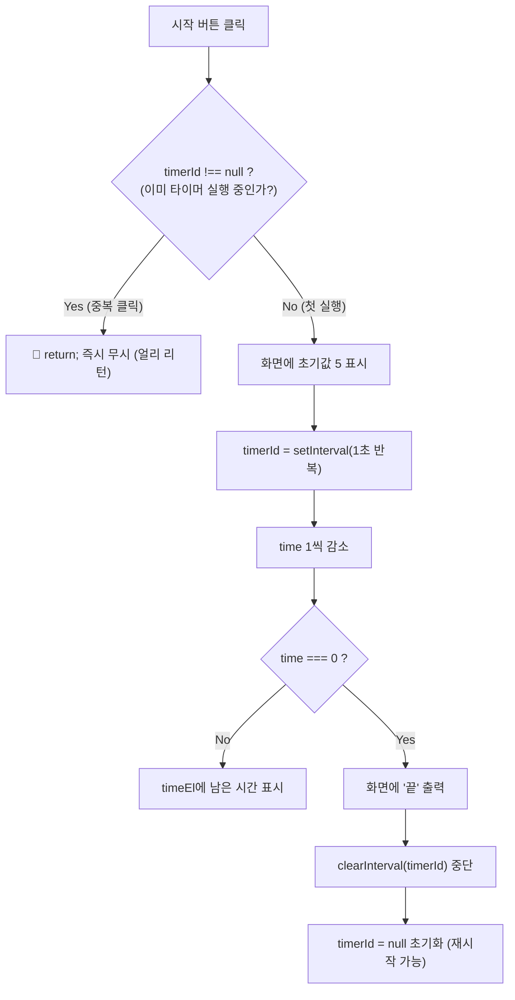
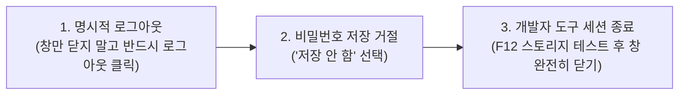
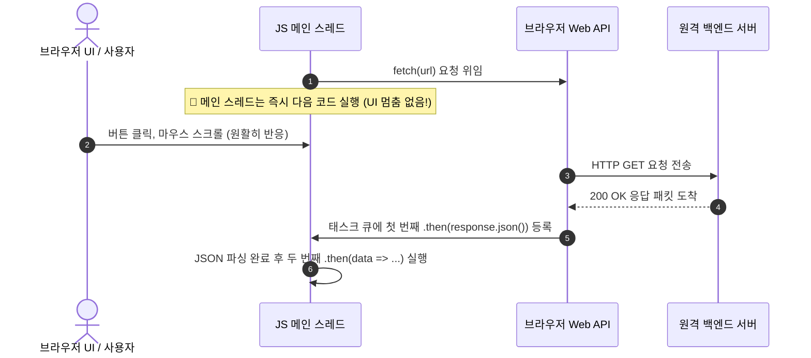
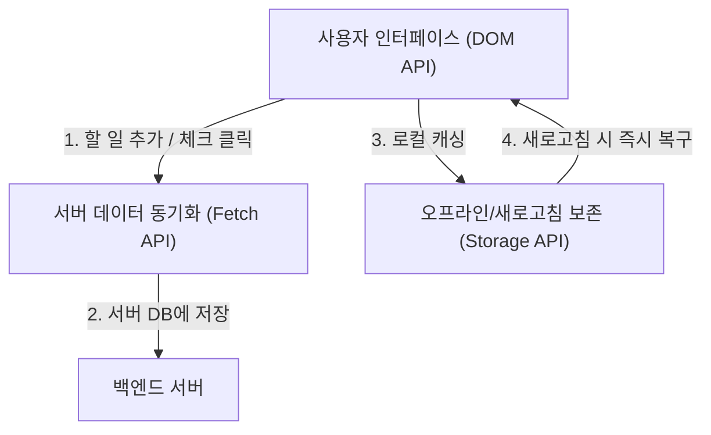

# 🌐 JavaScript Web API 완벽 정리 노트: Timer, Storage & Fetch API

> 브라우저가 제공하는 강력한 도구 상자 **Web API의 핵심 3대장(Timer API, Web Storage API, Fetch API)**을 총정리한 실전 가이드입니다.  
> **`setInterval`과 `timerId`를 활용한 카운트다운 타이머**, **LocalStorage vs SessionStorage의 수명·보안·객체 직렬화**, **비동기(Asynchronous) 통신의 원리와 `.then()` 체이닝의 진실**, **GET/POST 통신과 얼리 리턴(Early Return) 최적화**, 그리고 **클라이언트 캐싱과 모던 프레임워크 상태 관리**까지 한 번에 정리합니다.

---

## 📑 목차
1. [Timer API: 주기적 실행과 제어 (setInterval & timerId)](#1-timer-api-주기적-실행과-제어-setinterval--timerid)
   - [1-1. setInterval의 기본 개념과 1초 주기 실행](#1-1-setinterval의-기본-개념과-1초-주기-실행)
   - [1-2. timerId의 본질과 clearInterval](#1-2-timerid의-본질과-clearinterval)
   - [1-3. [실습 1] 5초 카운트다운 타이머와 버튼 연타 방지 가드](#1-3-실습-1-5초-카운트다운-타이머와-버튼-연타-방지-가드)
2. [Web Storage API: 브라우저 저장소 (LocalStorage vs SessionStorage)](#2-web-storage-api-브라우저-저장소-localstorage-vs-sessionstorage)
   - [2-1. Web Storage의 특징 (Key-Value & 문자열 저장)](#2-1-web-storage의-특징-key-value--문자열-저장)
   - [2-2. LocalStorage vs SessionStorage 완벽 비교](#2-2-localstorage-vs-sessionstorage-완벽-비교)
   - [2-3. 핵심 메서드 4총사 (setItem, getItem, removeItem, clear)](#2-3-핵심-메서드-4총사-setitem-getitem-removeitem-clear)
   - [2-4. 객체(Object) 저장의 필수 공식: JSON 직렬화 & 역직렬화](#2-4-객체object-저장의-필수-공식-json-직렬화--역직렬화)
   - [2-5. [실습 2] 새로고침해도 유지되는 입력값 저장 프로그램](#2-5-실습-2-새로고침해도-유지되는-입력값-저장-프로그램)
3. [브라우저 스토리지 보안 & 공용 PC 필수 보안 수칙](#3-브라우저-스토리지-보안--공용-pc-필수-보안-수칙)
   - [3-1. 시크릿 모드 (Incognito Mode)의 장점과 원리](#3-1-시크릿-모드-incognito-mode의-장점과-원리)
   - [3-2. 공용 PC 사용 시 개발자가 꼭 지켜야 할 3대 보안 습관](#3-2-공용-pc-사용-시-개발자가-꼭-지켜야-할-3대-보안-습관)
4. [Fetch API와 비동기(Asynchronous) 통신의 본질](#4-fetch-api와-비동기asynchronous-통신의-본질)
   - [4-1. Fetch API란 무엇인가?](#4-1-fetch-api란-무엇인가)
   - [4-2. 비동기(Asynchronous)의 핵심: 왜 let response = fetch()는 안 될까?](#4-2-비동기asynchronous의-핵심-왜-let-response--fetch는-안-될까)
   - [4-3. .then() 체이닝의 진실: "순서대로 실행되는데 왜 100% 비동기인가?"](#4-3-then-체이닝의-진실-순서대로-실행되는데-왜-100-비동기인가)
   - [4-4. 만약 통신이 '동기(Synchronous)'였다면 벌어지는 끔찍한 일](#4-4-만약-통신이-동기synchronous였다면-벌어지는-끔찍한-일)
5. [Fetch API 기본 사용법 (GET 요청 & DOM 렌더링)](#5-fetch-api-기본-사용법-get-요청--dom-렌더링)
   - [5-1. GET 요청 4단계 라이프사이클](#5-1-get-요청-4단계-라이프사이클)
   - [5-2. [실습 3] 버튼 클릭 시 게시글 5개 조회하여 리스트 렌더링](#5-2-실습-3-버튼-클릭-시-게시글-5개-조회하여-리스트-렌더링)
6. [데이터 렌더링 최적화 & 얼리 리턴 (Early Return)](#6-데이터-렌더링-최적화--얼리-리턴-early-return)
   - [6-1. 중복 출력 문제 발생과 4가지 해결 방법](#6-1-중복-출력-문제-발생과-4가지-해결-방법)
   - [6-2. 왜 1번(innerHTML="")보다 2번(Early Return)이 훨씬 뛰어난가?](#6-2-왜-1번innerhtml보다-2번early-return이-훨씬-뛰어난가)
   - [6-3. 한 걸음 더: 클라이언트 메모리 캐싱 (Client Caching) 고도화](#6-3-한-걸음-더-클라이언트-메모리-캐싱-client-caching-고도화)
7. [Fetch API: POST 요청으로 서버에 데이터 전송](#7-fetch-api-post-요청으로-서버에-데이터-전송)
   - [7-1. POST 요청의 3대 필수 요소 (method, headers, body)](#7-1-post-요청의-3대-필수-요소-method-headers-body)
   - [7-2. [실습 4] 이메일 전송 및 JSON 응답 가독성 출력 (null, 2)](#7-2-실습-4-이메일-전송-및-json-응답-가독성-출력-null-2)
8. [종합 최종 실습: To-do 앱 & 모던 프레임워크 상태 관리](#8-종합-최종-실습-to-do-앱--모던-프레임워크-상태-관리)
   - [8-1. Web API 삼총사(DOM + Storage + Fetch)의 융합](#8-1-web-api-삼총사dom--storage--fetch의-융합)
   - [8-2. 바닐라 JS의 한계와 프레임워크(React, Next.js, Vue.js)로의 확장](#8-2-바닐라-js의-한계와-프레임워크react-nextjs-vuejs로의-확장)
9. [💡 실전 핵심 요약 치트시트](#9--실전-핵심-요약-치트시트)

---

## 1. Timer API: 주기적 실행과 제어 (setInterval & timerId)

### 1-1. setInterval의 기본 개념과 1초 주기 실행
- **`setInterval(callback, delay)`**: 브라우저 Web API로, 지정한 시간(밀리초, ms) 간격마다 등록된 콜백 함수를 **무한히 반복 실행**합니다. (1000ms = 1초)

```javascript
// 1초(1000ms)마다 주기적으로 콘솔에 메시지 출력
setInterval(function () {
  console.log("1초마다 실행");
}, 1000);
```

---

### 1-2. timerId의 본질과 clearInterval
- **`timerId`**: 브라우저 엔진이 활성화된 타이머들을 고유하게 식별하기 위해 발급해 주는 **식별 번호(ID)**입니다.
- **필요성**:
  1. 반복 실행 중인 타이머를 원하는 시점에 종료(`clearInterval`)하기 위해.
  2. 사용자가 시작 버튼을 여러 번 연속으로 눌렀을 때, **타이머가 중복 생성되어 카운트 속도가 비정상적으로 빨라지는 버그를 사전에 방지**하기 위해.

```javascript
// 타이머를 실행하고 고유 식별 번호를 timerId 변수에 저장
const timerId = setInterval(function () {
  console.log("실행");
}, 1000);

// 특정 조건 도달 시 타이머 중단
clearInterval(timerId);
```

---

### 1-3. [실습 1] 5초 카운트다운 타이머와 버튼 연타 방지 가드

- **과제**: "카운트다운 시작" 버튼을 클릭하면 5초부터 1초마다 숫자가 감소하고, 0초가 되면 타이머가 멈추며 `"끝"`을 출력하는 타이머를 작성하세요.



#### HTML
```html
<button id="start">카운트다운 시작</button>
<p id="result"></p>
```

#### JavaScript
```javascript
const startBtn = document.querySelector("#start");
const timeEl = document.querySelector("#result");

let time = 5;
let timerId = null; // 현재 타이머가 돌고 있는지 체크하는 상태값

startBtn.addEventListener("click", function () {
  // 🛡 [버튼 연타 방지 가드 / Early Return]
  // 이미 실행 중이면 추가 타이머를 만들지 않고 즉시 함수 종료!
  if (timerId !== null) return;

  // 시작 즉시 현재 시간 표시
  timeEl.textContent = time;

  // 1초마다 실행되는 타이머 등록
  timerId = setInterval(function () {
    time--; // 1초 감소

    if (time === 0) {
      // 0초가 되면 카운트다운 종료
      timeEl.textContent = "끝";
      clearInterval(timerId); // 타이머 반복 중단!
      timerId = null;         // 상태를 null로 리셋하여 다시 시작 가능하게 함
      time = 5;               // 다음 실행을 위해 시간 복구
    } else {
      timeEl.textContent = time; // 4, 3, 2, 1 화면 갱신
    }
  }, 1000);
});
```

---

## 2. Web Storage API: 브라우저 저장소 (LocalStorage vs SessionStorage)

### 2-1. Web Storage의 특징 (Key-Value & 문자열 저장)
- 브라우저가 클라이언트(사용자 컴퓨터) 환경에 제공하는 내장 데이터 저장소입니다.
- **3대 핵심 특징**:
  1. **서버 없는 로컬 데이터 보관**: 데이터베이스(DB)나 백엔드 서버 없이도 브라우저 자체에 데이터를 저장하고 조회할 수 있습니다.
  2. **Key - Value 구조**: 데이터는 언제나 고유한 이름(Key)과 실제 값(Value)의 쌍으로 저장됩니다.
  3. **값은 항상 문자열(String)**: 숫자, 불리언, 객체, 배열 등 어떤 데이터를 넣어도 내부적으로는 **문자열 형태**로만 저장됩니다.

---

### 2-2. LocalStorage vs SessionStorage 완벽 비교

브라우저 스토리지의 두 축인 **로컬 스토리지**와 **세션 스토리지**의 결정적 차이는 **데이터의 수명(지속성)**과 **공유 범위(Scope)**입니다.

| 구분 | 📦 로컬 스토리지 (Local Storage) | ⏳ 세션 스토리지 (Session Storage) |
| :--- | :--- | :--- |
| **데이터 수명 (지속성)** | **영구적 (Permanent)**<br/>사용자가 직접 삭제하거나 코드로 지우지 않는 한 브라우저를 닫거나 컴퓨터를 재부팅해도 보존됨 | **임시적 (Temporary)**<br/>해당 탭(Tab) 또는 브라우저 창을 닫는 즉시 메모리에서 영구 삭제됨 |
| **공유 범위 (Scope)** | **동일 도메인(Origin) 전체 공유**<br/>새 탭, 새 창을 여러 개 열어도 동일한 도메인이면 데이터가 실시간 공유됨 | **해당 탭(Tab) 단독 독립 공간**<br/>같은 사이트라도 탭마다 별개의 세션이 생성되며 서로 데이터를 공유하지 않음 |
| **만료 시간** | 없음 (수동 삭제 전까지 영구 유지) | 탭 종료 시 자동 소멸 |
| **대표 활용 예시** | • 자동 로그인 토큰/아이디 기억<br/>• 다크 모드 / 라이트 모드 테마 설정<br/>• 비회원 장바구니 목록 보관 | • 일회성 설문조사 / 회원가입 폼 임시 데이터<br/>• 은행 / 금융 웹사이트 일회성 로그인 세션<br/>• 이전 페이지 뒤로가기 시 복구할 임시 UI 상태 |

---

### 2-3. 핵심 메서드 4총사 (setItem, getItem, removeItem, clear)

`localStorage`와 `sessionStorage`는 사용하는 메서드 이름과 문법이 100% 동일합니다.

```javascript
// 1. 데이터 저장 (Key, Value)
localStorage.setItem("name", "Alex");
localStorage.setItem("theme", "dark");

// 2. 데이터 조회 (Key)
const username = localStorage.getItem("name");
console.log(username); // "Alex"
// ⚠️ 존재하지 않는 Key를 조회하면 null을 반환합니다.

// 3. 특정 데이터 1개 삭제 (Key)
localStorage.removeItem("name");

// 4. 스토리지 전체 데이터 비우기 (초기화)
localStorage.clear();
```

---

### 2-4. 객체(Object) 저장의 필수 공식: JSON 직렬화 & 역직렬화

> [!WARNING]
> 🚨 **스토리지에 객체를 그냥 넣으면 발생하는 대참사!**  
> `localStorage.setItem("user", { name: "Alex" });`  
> 위 코드를 실행하면 자바스크립트는 객체를 문자열로 강제 변환하여 `"[object Object]"`라는 쓸모없는 문자열로 저장해버립니다!

- **해결책**:
  - 저장할 때: `JSON.stringify(객체)`를 사용해 객체를 **JSON 문자열로 직렬화(Serialization)**하여 저장.
  - 꺼낼 때: `JSON.parse(문자열)`를 사용해 JSON 문자열을 **다시 자바스크립트 객체로 역직렬화(Deserialization)**하여 사용.

```javascript
const user = { name: "Alex", age: 20 };

// 1. 객체를 JSON 문자열로 변환하여 저장: '{"name":"Alex","age":20}'
localStorage.setItem("user", JSON.stringify(user));

// 2. 스토리지에서 문자열을 꺼내와서 다시 실제 JS 객체로 복원!
const savedUser = JSON.parse(localStorage.getItem("user"));

console.log(savedUser.name); // "Alex"
console.log(savedUser.age);  // 20
```

---

### 2-5. [실습 2] 새로고침해도 유지되는 입력값 저장 프로그램

- **과제**: 이름을 입력하고 "저장" 버튼을 누르면 화면에 출력되고, 브라우저를 새로고침(F5)해도 이전 입력값이 그대로 남아있도록 구현하세요.

#### HTML
```html
<input id="name" placeholder="이름 입력" />
<button id="save">저장</button>
<p id="result"></p>
```

#### JavaScript
```javascript
const input = document.querySelector("#name");
const button = document.querySelector("#save");
const result = document.querySelector("#result");

// 1. [페이지 초기 로드 시점] 스토리지에 기존 저장된 이름이 있는지 확인
const savedName = localStorage.getItem("name");
if (savedName) {
  // 저장된 값이 존재하면 결과 문단에 즉시 복원 표시!
  result.textContent = savedName;
}

// 2. [저장 버튼 클릭 시점] 새 입력값을 스토리지에 저장하고 화면 갱신
button.addEventListener("click", function () {
  localStorage.setItem("name", input.value);
  result.textContent = input.value;
});
```

---

## 3. 브라우저 스토리지 보안 & 공용 PC 필수 보안 수칙

브라우저 스토리지는 접근이 매우 간편하지만, **보안 측면(XSS 공격, 공용 PC 개인정보 유출 등)에서 각별한 주의**가 필요합니다.

### 3-1. 시크릿 모드 (Incognito Mode)의 장점과 원리
1. **모든 흔적 완전 차단**:
   - 시크릿 모드에서는 방문 기록, 검색 기록, 쿠키, 그리고 **로컬/세션 스토리지 데이터가 창을 닫는 순간 브라우저 메모리에서 깨끗하게 소멸**됩니다.
2. **자동 로그인 방지**:
   - 기존 일반 모드의 쿠키나 저장된 세션이 적용되지 않으며, 아이디/비밀번호 자동 완성이 비활성화되어 다음 사용자가 내 계정에 접근하는 위험을 원천 차단합니다.

---

### 3-2. 공용 PC 사용 시 개발자가 꼭 지켜야 할 3대 보안 습관



1. **로그인 계정 직접 로그아웃**:  
   구글 드라이브, 깃허브 등 민감한 서비스는 단순히 탭이나 창만 닫지 말고, 반드시 **[로그아웃] 버튼을 직접 눌러 서버 세션을 무효화**해야 합니다.
2. **브라우저 비밀번호 저장 팝업 주의**:  
   "비밀번호를 저장하시겠습니까?" 팝업이 뜰 때 실수로 '저장'을 누르면 공용 PC의 브라우저 프로필에 평문으로 남을 수 있으므로 반드시 '저장 안 함'을 선택합니다.
3. **개발자 도구(F12) 테스트 후 완전 종료**:  
   테스트나 학습 목적으로 공용 PC의 F12 Application 탭에서 스토리지를 조작했다면, 작업 직후 **브라우저 창 전체를 완전히 닫아** 임시 데이터와 세션을 깔끔히 초기화해야 합니다.

---

## 4. Fetch API와 비동기(Asynchronous) 통신의 본질

### 4-1. Fetch API란 무엇인가?
- 브라우저가 자바스크립트에게 제공하는 **최신 표준 서버 통신용 Web API**입니다.
- 웹 페이지가 화면 전체를 새로고침하지 않고도 백엔드 서버에 **HTTP 요청(Request)을 보내고 응답(Response)을 수신**할 수 있게 해줍니다.
- 내부적으로 **비동기(Asynchronous)** 방식으로 작동합니다.

---

### 4-2. 비동기(Asynchronous)의 핵심: 왜 `let response = fetch()`는 안 될까?

```javascript
// ❌ 초보자들이 흔히 생각하는 잘못된 동기식 코드 발상
let response = fetch("https://api.example.com/posts");
console.log(response); // 서버 데이터가 아니라 Promise 객체가 출력됨!
```

#### 왜 바로 변수에 담을 수 없을까?
1. **서버 통신은 물리적으로 시간이 걸리는 작업**:  
   인터넷 네트워크를 타고 저 멀리 있는 서버까지 요청이 갔다가, 서버가 DB를 조회하고 데이터를 돌려주는 데는 수백 밀리초에서 수 초의 시간이 걸립니다.
2. **자바스크립트의 싱글 스레드(Single Thread) 특성**:  
   자바스크립트는 한 번에 한 줄씩 코드를 실행합니다. 만약 `fetch()`가 완료될 때까지 그 자리에서 멈춰서 기다린다면(**블로킹 / 동기 방식**), 서버 응답이 올 때까지 웹페이지의 모든 화면 렌더링, 마우스 클릭, 스크롤이 **꽁꽁 얼어붙는 현상(렉/프리즈)**이 발생합니다.
3. **비동기 처리의 철학**:  
   자바스크립트는 *"서버에 요청을 일단 던져놓고, 기다리는 동안 아래에 있는 다른 코드와 UI 상호작용을 계속하고 있을게! 서버 응답이 도착하면 그때 등록해 둔 `.then()` 콜백을 깨워서 처리해 줘!"*라는 방식으로 동작합니다.

---

### 4-3. `.then()` 체이닝의 진실: "순서대로 실행되는데 왜 100% 비동기인가?"

> **Q. `.then()` 체이닝 코드를 보면 1번이 끝나야 2번이 실행되는 순서 구조인데, 이건 동기 아닌가요?**  
> **A. 결론부터 말하면 코드 외형만 순서대로 적혀있을 뿐, 실제 내부 메커니즘은 100% 비동기(Asynchronous)입니다!**



1. **외형 (코드 모양새)**:  
   개발자의 가독성과 로직 흐름을 위해 `.then()`으로 순서대로 체이닝(Chaining)하여 작성하므로 마치 동기처럼 읽힙니다.
2. **실제 내부 동작**:  
   `fetch()`를 실행하자마자 자바스크립트는 자리를 비켜주고 다른 일을 하다가, **서버 응답이 도착하는 그 특정 타이밍에 맞춰서만 큐에 들어가 차례대로 실행**되므로 명백한 **비동기 흐름 제어(Asynchronous Control Flow)**입니다.

---

### 4-4. 만약 통신이 '동기(Synchronous)'였다면 벌어지는 끔찍한 일
- 만약 자바스크립트 통신이 동기 방식이었다면:
  - 서버 응답에 3초가 걸릴 경우, **그 3초 동안 웹 브라우저 전체가 멈춥니다.**
  - 사용자가 버튼을 클릭해도 눌리지 않고, 스크롤도 안 되며, 브라우저는 "페이지가 응답하지 않습니다" 경고창을 띄우게 됩니다.
- 비동기 통신 덕분에 데이터를 백그라운드에서 가져오는 동안에도 사용자는 로딩 스피너를 보거나 다른 페이지 요소를 자유롭게 조작할 수 있습니다.

---

## 5. Fetch API 기본 사용법 (GET 요청 & DOM 렌더링)

### 5-1. GET 요청 4단계 라이프사이클

```javascript
fetch("https://jsonplaceholder.typicode.com/posts")
  // 1단계: 서버에 HTTP GET 요청을 보내고 응답 객체(response) 수신
  .then(response => {
    // 2단계: 응답 객체에서 본문 데이터만 JSON 형태로 추출(파싱)
    return response.json(); 
  })
  // 3단계: JSON 변환이 완료된 순수 자바스크립트 데이터(data) 수령
  .then(data => {
    // 4단계: 받아온 실제 데이터를 콘솔에 출력하거나 화면(DOM)에 렌더링!
    console.log(data);
  });
```

---

### 5-2. [실습 3] 버튼 클릭 시 게시글 5개 조회하여 리스트 렌더링

- **과제**: "불러오기" 버튼을 누르면 JSONPlaceholder API에서 게시글 데이터를 받아와, 상위 5개의 `title`을 `<ul>` 목록 안에 `<li>` 태그로 동적 출력하세요.

#### HTML
```html
<button id="load">불러오기</button>
<ul id="list"></ul>
```

#### JavaScript
```javascript
const button = document.querySelector("#load");
const list = document.querySelector("#list");

button.addEventListener("click", function () {
  fetch("https://jsonplaceholder.typicode.com/posts")
    .then(res => res.json())
    .then(posts => {
      // 1. 기존 목록 초기화
      list.innerHTML = "";

      // 2. 전체 데이터 중 0~4번째(5개)만 잘라서 반복문 순회
      for (const post of posts.slice(0, 5)) {
        const li = document.createElement("li"); // <li></li> 생성
        li.textContent = post.title;             // <li>게시글 제목</li>
        list.appendChild(li);                    // <ul> 안에 추가
      }
    });
});
```

---

## 6. 데이터 렌더링 최적화 & 얼리 리턴 (Early Return)

### 6-1. 중복 출력 문제 발생과 4가지 해결 방법

> **🚨 문제 발생**:  
> 위 코드에서 '불러오기' 버튼을 계속 누르면, `posts.slice(0, 5)`로 똑같은 0~4번 데이터가 리스트 밑으로 끝없이 중복 추가되는 문제가 발생합니다.

#### 4가지 해결 전략 비교:

| 해결 방법 | 코드 예시 | 장점 및 평가 |
| :--- | :--- | :--- |
| **1. 이전 출력 내용 초기화** | `list.innerHTML = "";` | 구현은 단순하나, 버튼을 누를 때마다 **매번 불필요한 서버 통신을 반복**함 (낭비 발생) |
| **2. 🛡 Early Return (조기 반환)** | `if (list.innerHTML !== "") return;` | **가장 우수한 방법!** 이미 데이터가 있으면 함수를 즉시 종료하여 **네트워크 요청 자체를 차단** |
| **3. 버튼 비활성화 (Disable)** | `button.disabled = true;` | 클릭 1회 완료 후 버튼을 비활성화하여 추가 클릭을 물리적으로 방지 |
| **4. 페이지네이션 (Sliding Window)** | `start += 5; end += 5;`<br/>`posts.slice(start, end)` | 누를 때마다 중복이 아닌 **다음 5개(5~9, 10~14...)**를 순차적으로 이어서 보여줌 |

---

### 6-2. 왜 1번(`innerHTML=""`)보다 2번(Early Return)이 훨씬 뛰어난가?

```javascript
button.addEventListener("click", () => {
  // 🛡 [2번 방법: 얼리 리턴 적용]
  // 리스트 안에 이미 글이 채워져 있다면? ➔ 즉시 함수 종료!
  if (list.innerHTML !== "") {
    return;
  }

  // 데이터가 비어있을 때만 단 1번 서버 통신 실행!
  fetch("https://jsonplaceholder.typicode.com/posts")
    .then(response => response.json())
    .then(posts => {
      for (const post of posts.slice(0, 5)) {
        const li = document.createElement("li");
        li.textContent = post.title;
        list.appendChild(li);
      }
    });
});
```

> [!TIP]
> 💡 **얼리 리턴(Early Return)이 압도적으로 좋은 이유**:  
> 1번 방식(`list.innerHTML = ""`)은 화면상으로는 깔끔해 보이지만, 버튼을 누를 때마다 100개의 데이터를 서버에서 새로 다운로드하는 **극심한 네트워크 대역폭 낭비와 서버 부하**가 발생합니다.  
> 반면 2번 방식은 **조건 검사 후 즉시 return하여 불필요한 fetch 자체를 원천 차단**하므로 성능, 비용, 안정성 모든 면에서 탁월합니다.

---

### 6-3. 한 걸음 더: 클라이언트 메모리 캐싱 (Client Caching) 고도화

- **기존 방식의 비효율**: 버튼을 누를 때마다 매번 서버에 새로 요청. (100개를 다 받아와서 5개만 쓰고 버리는 낭비)
- **고도화된 새로운 방식 (Client Caching)**:  
  최초 1회만 서버에서 데이터를 통째로 받아와 자바스크립트 변수(브라우저 메모리)에 저장(Cache)해 두고, 이후 버튼을 누를 때는 **서버 통신 없이 메모리에 저장된 배열에서 슬라이스(`6~10`, `11~15`)하여 렌더링**합니다!

```javascript
let cachedPosts = null; // 서버에서 받아온 데이터를 보관할 캐시 변수
let startIndex = 0;
const PAGE_SIZE = 5;

button.addEventListener("click", async () => {
  // 1. 최초 1회만 서버에서 fetch로 가져와 캐시에 저장
  if (!cachedPosts) {
    const res = await fetch("https://jsonplaceholder.typicode.com/posts");
    cachedPosts = await res.json();
  }

  // 2. 이미 캐시된 데이터가 있으므로 서버 요청 없이 메모리에서 잘라서 출력!
  const currentSlice = cachedPosts.slice(startIndex, startIndex + PAGE_SIZE);
  
  currentSlice.forEach(post => {
    const li = document.createElement("li");
    li.textContent = `${post.id}. ${post.title}`;
    list.appendChild(li);
  });

  startIndex += PAGE_SIZE; // 다음 5개를 위해 인덱스 전진 (Sliding Window)
});
```

---

## 7. Fetch API: POST 요청으로 서버에 데이터 전송

### 7-1. POST 요청의 3대 필수 요소 (method, headers, body)
GET 요청과 달리, 서버에 새로운 리소스를 생성하거나 데이터를 보낼 때는 두 번째 인자로 설정 객체를 전달합니다.

1. **`method`**: `"POST"` 지정
2. **`headers`**: 전송하는 데이터 포맷이 JSON임을 서버에 알림 (`{ "Content-Type": "application/json" }`)
3. **`body`**: 자바스크립트 객체를 전송 가능한 JSON 문자열로 직렬화 (`JSON.stringify({ ... })`)

---

### 7-2. [실습 4] 이메일 전송 및 JSON 응답 가독성 출력 (`null, 2`)

- **과제**: 이메일 입력창의 값을 서버에 POST 방식으로 전송하고, 서버가 반환한 응답 데이터를 `<pre>` 태그 안에 들여쓰기가 적용된 JSON 형태로 출력하세요.

#### HTML
```html
<input type="email" id="email" placeholder="이메일 입력">
<button id="send">전송</button>
<pre id="result"></pre>
```

#### JavaScript
```javascript
const input = document.querySelector("#email");
const button = document.querySelector("#send");
const result = document.querySelector("#result");

button.addEventListener("click", function () {
  fetch("https://jsonplaceholder.typicode.com/posts", {
    method: "POST",
    headers: {
      "Content-Type": "application/json" // 내가 보내는 데이터는 JSON입니다!
    },
    body: JSON.stringify({
      email: input.value // 객체를 JSON 문자열로 변환하여 전송
    })
  })
    .then(res => res.json())
    .then(data => {
      // JSON.stringify의 3번째 인자 2는 들여쓰기 공백 수 (가독성 향상)
      result.textContent = JSON.stringify(data, null, 2);
    });
});
```

---

## 8. 종합 최종 실습: To-do 앱 & 모던 프레임워크 상태 관리

### 8-1. Web API 삼총사(DOM + Storage + Fetch)의 융합
현대 웹 애플리케이션의 핵심인 To-do 앱은 지금까지 배운 Web API들이 유기적으로 결합되어 동작합니다.



---

### 8-2. 바닐라 JS의 한계와 프레임워크(React, Next.js, Vue.js)로의 확장
- **순수 바닐라 자바스크립트의 한계**:
  - 데이터가 변경될 때마다 개발자가 직접 `document.querySelector`로 요소를 찾고, `createElement`와 `appendChild`를 일일이 명령형(Imperative)으로 호출해야 합니다.
  - 규모가 커지면 **"어떤 코드가 화면의 어떤 부분을 바꾸고 있는지"** 추적하기가 매우 어려워집니다 (스파게티 코드).
- **모던 프레임워크(React, Vue, Next.js)의 상태 관리(State Management)**:
  - *"데이터(상태)가 바뀌면 화면은 알아서 자동으로 다시 그려져라!"* 하는 **선언형(Declarative) UI** 패러다임 도입.
  - 복잡한 DOM 수동 조작에서 벗어나 비즈니스 로직과 데이터 상태 관리에만 집중할 수 있게 됩니다.

---

## 9. 💡 실전 핵심 요약 치트시트

```markdown
┌────────────────────────────────────────────────────────────────────────┐
│              Web API 심화 (Timer & Storage & Fetch) 치트시트           │
├──────────────────────────────┬─────────────────────────────────────────┤
│ API / 문법                   │ 핵심 요약 및 사용 공식                  │
├──────────────────────────────┼─────────────────────────────────────────┤
│ setInterval(fn, ms)          │ ms 간격으로 fn 함수 무한 반복 실행       │
├──────────────────────────────┼─────────────────────────────────────────┤
│ clearInterval(timerId)       │ 실행 중인 setInterval 반복 즉시 중단    │
├──────────────────────────────┼─────────────────────────────────────────┤
│ if (timerId !== null) return;│ 타이머 중복 실행 방지 가드 클로즈       │
├──────────────────────────────┼─────────────────────────────────────────┤
│ localStorage                 │ 브라우저 닫아도 영구 유지 (동일 도메인) │
├──────────────────────────────┼─────────────────────────────────────────┤
│ sessionStorage               │ 현재 탭 닫으면 즉시 삭제 (탭 간 격리)   │
├──────────────────────────────┼─────────────────────────────────────────┤
│ Storage.setItem("k", "v")    │ Key - Value 데이터 저장 (문자열만 가능) │
├──────────────────────────────┼─────────────────────────────────────────┤
│ JSON.stringify(obj)          │ JS 객체를 스토리지 저장용 JSON 문자열로 │
├──────────────────────────────┼─────────────────────────────────────────┤
│ JSON.parse(str)              │ 스토리지의 JSON 문자열을 JS 객체로 복원 │
├──────────────────────────────┼─────────────────────────────────────────┤
│ fetch(url)                   │ 서버와 비동기 HTTP 통신 수행            │
├──────────────────────────────┼─────────────────────────────────────────┤
│ 왜 비동기인가?               │ 서버 응답 대기 중 화면 멈춤(렉) 방지    │
├──────────────────────────────┼─────────────────────────────────────────┤
│ .then(res => res.json())     │ 서버 응답 바디를 JSON 파싱하여 전달     │
├──────────────────────────────┼─────────────────────────────────────────┤
│ if (list.innerHTML !== "")   │ 렌더링 중복 방지 & 불필요한 fetch 차단  │
│ return;                      │ (얼리 리턴 최적화)                      │
├──────────────────────────────┼─────────────────────────────────────────┤
│ Client Caching               │ 최초 1회만 fetch 후 메모리에 저장       │
│                              │ 이후 slice()로 서버 요청 횟수 절약      │
├──────────────────────────────┼─────────────────────────────────────────┤
│ fetch POST 필수 3속성        │ method: 'POST',                         │
│                              │ headers: {'Content-Type': 'app/json'},  │
│                              │ body: JSON.stringify({...})             │
├──────────────────────────────┼─────────────────────────────────────────┤
│ JSON.stringify(d, null, 2)   │ 2칸 들여쓰기로 보기 좋게 JSON 출력      │
└──────────────────────────────┴─────────────────────────────────────────┘
```
